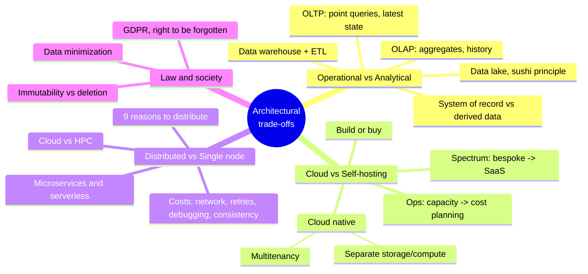
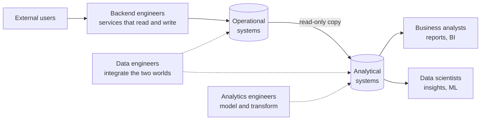
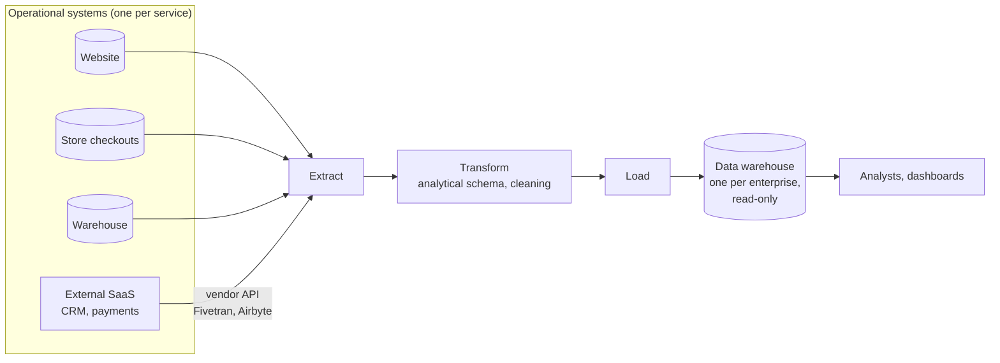
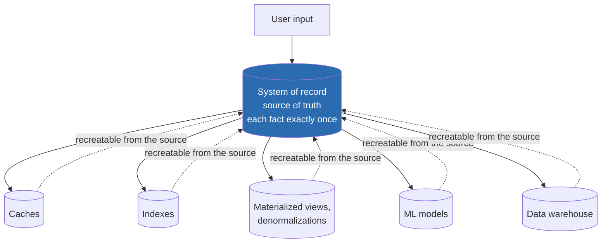
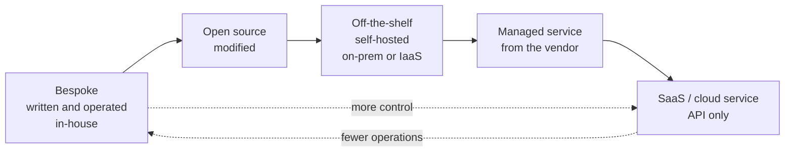
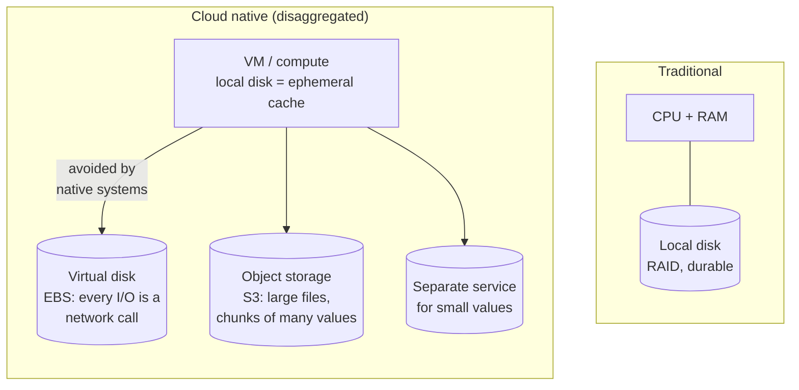
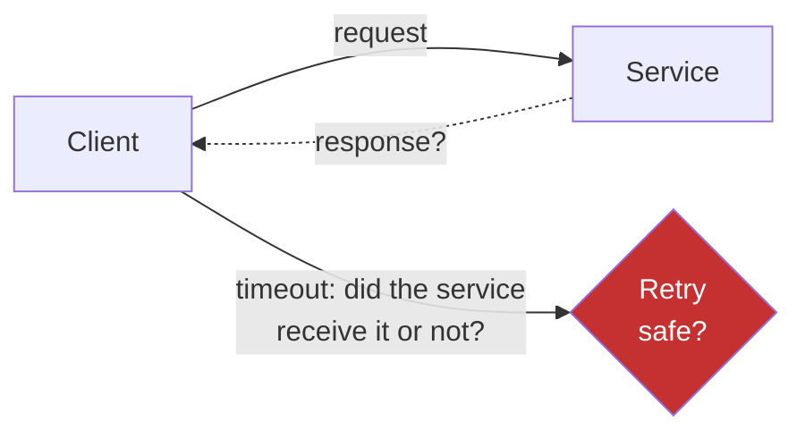

# Chapter 1 · Trade-Offs in Data Systems Architecture

> *There are no solutions; there are only trade-offs. […] But you try to get the best trade-off you can get, and that's all you can hope for.* — Thomas Sowell, interview with Fred Barnes (2005)

**In one sentence:** no architectural choice is "right" in absolute terms. The chapter
introduces four axes of trade-offs (operational/analytical, cloud/self-hosted,
distributed/single-node, business/people's rights) and the vocabulary that the
rest of the book takes for granted.

**PDF pages:** 25-56 · **Density:** introductory, but it defines terms used everywhere.

---

## Chapter map

---

## 0. Basic terminology
<!-- pdf: 25 -->

- **Data-intensive**: the primary challenge is managing the data (volume, changes,
  consistency, availability), not parallelizing a computation (*compute-intensive*).
- **Recurring building blocks**: databases, caches, search indexes, stream processing,
  batch processing. The book is a guide to choosing and combining them.
- **Frontend / backend**: the frontend handles the data of *one* user, the backend the data
  of *all* of them. The backend is typically stateless: anything that must survive a
  request lives in the *data infrastructure* (DB, caches, queues).

---

## 1. Operational vs analytical systems
<!-- pdf: 27 -->

### Who uses the data
<!-- pdf: 28 -->

### OLTP vs OLAP
<!-- pdf: 29 -->

| Property | Operational (OLTP) | Analytical (OLAP) |
|---|---|---|
| Read pattern | Point queries by key | Aggregates over many records |
| Write pattern | Individual inserts/updates/deletes | Bulk import (ETL) or event stream |
| Human user | End user of the app | Internal analyst |
| Machine use | "Is this action authorized?" | Detecting fraud patterns |
| Queries | Fixed, hard-coded in the application | Arbitrary, exploratory |
| Query volume | Many and small | Few and heavy |
| Data represents | The current state | The history of events |
| Size | GB - TB | TB - PB |

Why OLTP users are not given free-form SQL: permissions and query cost. Analysts
are, either directly or via Tableau / Looker / Power BI.

Intermediate category: **product analytics / real-time analytics** (Pinot, Druid,
ClickHouse). An analytical workload but inside a user-facing product: real-time ingest,
low-latency queries. Classic OLAP instead ingests in batches and optimizes for throughput.

### Why separate: the data warehouse
<!-- pdf: 31 -->

An enterprise has dozens or hundreds of independent OLTP systems. Querying them
directly for analytics is a problem for four reasons:

1. **Data silos**: the interesting data is scattered across several systems.
2. **Wrong schema**: a layout that is good for OLTP is terrible for analytics (ch. 3, star schema).
3. **Cost**: an analytical query slows down the users of the operational system.
4. **Network and compliance**: often the OLTP systems are not even reachable.

Variants: **ELT** (transformation after loading, inside the warehouse);
**HTAP** (a single system for both workloads, but internally it is almost always
OLTP + analytical coupled together). HTAP does not replace the warehouse: it is useful when
*the same app* needs to do massive scans and low-latency point reads (e.g. fraud).

General trend: the larger the scale, the more systems **specialize**.

### From data warehouse to data lake
<!-- pdf: 33 -->

The warehouse is relational and SQL: perfect for analysts, awkward for data
scientists (feature engineering, NLP, computer vision, Pandas, Spark).

| | Data warehouse | Data lake |
|---|---|---|
| Content | Relational tables with a schema | Files of any format (Parquet, Avro, images, vectors) |
| Schema | Enforced on write | None enforced |
| Cost | Relational storage | Commodity object storage, cheaper |
| Typical user | Business analyst | Data scientist |

**Sushi principle**: "raw data is better". The lake keeps the raw data and every
consumer transforms it as they need. Often the lake is an intermediate stop between
OLTP and warehouse: ETL generalized into **data pipelines**.

Beyond the lake: DataOps and governance (GDPR, CCPA), data as **streams of events**
(reacting in seconds instead of days), **reverse ETL** (analytical outputs, e.g. ML
models, fed back into operational systems via TFX, Kubeflow, MLflow).

### System of record vs derived data
<!-- pdf: 34 -->

This is the most reused concept of the chapter.

- **System of record**: the canonical version. In case of a discrepancy it wins by definition.
- **Derived data**: redundant, reconstructible. It exists for *read performance*
  and to look at the same data from different points of view.
- It is not a property of the tool but of its **use**: the same PostgreSQL can be
  either one. Explicitly stating what is derived from what clarifies confusing architectures.
- Open problem: how to **propagate updates** from the record to the derived data. DBs
  don't help, they assume they are the only system. Answer in ch. 11-12 (data pipelines, streams).

---

## 2. Cloud vs self-hosting
<!-- pdf: 36 -->

### Build or buy
<!-- pdf: 36 -->

Rule of thumb: in-house for what is a **core competency or competitive advantage**;
outsourced for what is routine. Two distinct decisions: *who writes* the software and *who operates* it.

### Pros and cons of the cloud
<!-- pdf: 37 -->

| The cloud wins when | Self-hosting wins when |
|---|---|
| You don't yet know how to operate that system | You already have the skills |
| The load is highly **variable** (e.g. interactive analytical queries) | The load is **predictable** |
| You want to free the team from basic administration | You need to tune for your specific workload |
| | Extreme latency (high-frequency trading) |

The main downside of the cloud is a single concept: **no control**.
Missing features, outages you can only wait out, bugs you cannot diagnose (no system logs),
vendor lock-in without standard APIs, geopolitical risk (sanctions), trust in the
security of your data for compliance.

### Cloud native
<!-- pdf: 38 -->

It is not "self-hosted software moved onto a VM". It is software that **builds on other
cloud services** (S3 underneath Snowflake, Snowflake underneath others). Measured advantages: better
performance on the same hardware, faster recovery, fast scaling, larger datasets.

| | Self-hosted | Cloud native |
|---|---|---|
| OLTP | MySQL, PostgreSQL, MongoDB | Aurora, Azure SQL Hyperscale, Spanner |
| OLAP | Teradata, ClickHouse, Spark | Snowflake, BigQuery, Synapse |

Rule about abstractions: the higher the level, the more specific it is to one use case.
If your case matches, use the high level; otherwise build from the bottom up.

### Separation of storage and compute
<!-- pdf: 40 -->

- A VM's local disk disappears if the instance dies or is resized:
  it is a **cache**, not storage.
- Virtual disks emulate a block device over the network: overhead and sensitivity to
  network glitches.
- Native systems write small values to a dedicated service and large chunks
  to object storage (details in ch. 4).
- Consequence: analyzing data means **moving it over the network** to the compute.
- **Multitenancy**: several customers on the same hardware. Efficiency for the provider,
  delicate engineering to isolate performance and security.

### Operations in the cloud era
<!-- pdf: 41 -->

From DBA/sysadmin to DevOps/SRE. The work does not disappear, its object changes:

| Before (machines) | After (services) |
|---|---|
| Capacity planning: disks, provisioning | **Financial planning**: metered billing, what you use and why |
| Performance optimization | **Cost optimization** |
| OS patches, migrations between machines | Choosing the service, integrating services, migrating between vendors |
| | Provider quotas and limits to know about in advance |

Always stays in-house: security of the app and its libraries, interactions between your own
services, monitoring, root cause of degradations and outages. Integration between cloud
services has no standards: it is manual work.

---

## 3. Distributed vs single node
<!-- pdf: 43 -->

**Distributed system**: several machines communicating via a network; each process is a *node*.

### Nine reasons to distribute
<!-- pdf: 43 -->

1. **Inherent distribution**: several users on several devices.
2. **Requests between cloud services**: data in one service, processing in another.
3. **Fault tolerance / high availability**: redundancy.
4. **Scalability**: data or computation beyond one machine.
5. **Latency**: servers close to users around the world.
6. **Elasticity**: scale up and down with the load, paying only for what you use.
7. **Specialized hardware**: many disks here, many CPUs there, GPUs elsewhere.
8. **Legal compliance**: data residency per jurisdiction.
9. **Sustainability**: run jobs where and when renewable energy is available.

### The price
<!-- pdf: 44 -->

- **Partial failure**: every call can time out without knowing whether it was
  executed. Retrying is not always safe (ch. 9).
- **Slow network** compared to an in-process call. Better to bring the computation to the data
  than the data to the computation. A single-threaded program can beat a 100-core cluster.
- **Hard to debug**: you need *observability* (OpenTelemetry, Zipkin, Jaeger).
- **Consistency across services** becomes the application's problem: one DB per service,
  distributed transactions rarely used (ch. 8).

The author's conclusion: **don't rush to distribute**. CPUs, RAM and disks have
grown; DuckDB, SQLite, KùzuDB handle many workloads on a single node.

### Microservices and serverless
<!-- pdf: 45 -->

- **Microservices**: one service, one purpose, one API, one team, **its own database**
  (sharing the DB makes the schema part of the API and impossible to change).
- Advantages: independent deployments, dedicated resources, hidden implementation.
- Costs: tests that require all the dependencies, infrastructure for every service
  (deployment, scaling, logs, monitoring, on-call), **API evolution** (added or removed
  fields break clients; OpenAPI and gRPC help, ch. 5).
- Key sentence: *microservices are a technical solution to a people problem*.
  Few teams, no microservices.
- **Serverless / FaaS**: metered billing applied to code execution. Limits:
  maximum time per function, constrained runtimes, cold starts. The term is also used
  by BigQuery and Kafka to mean "autoscaling and pay-per-use billing".

### Cloud vs supercomputing (HPC)
<!-- pdf: 47 -->

| HPC | Cloud |
|---|---|
| Batch scientific computing | Always-available online services |
| Checkpoints to disk; if a node fails everything stops and restarts | You cannot stop: serve users with minimal interruptions |
| Shared memory, RDMA, mutual trust | IP/Ethernet networks, mutually untrusting tenants: VMs, encryption, authentication |
| Mesh/torus topologies | Clos topologies, bisection bandwidth |
| Nodes close together | Nodes across multiple regions |

---

## 4. Law and society
<!-- pdf: 48 -->

- GDPR (2018), CCPA, EU AI Act: rights over personal data, limits on its use in AI.
- **Right to be forgotten** versus **immutable append-only logs**: how do you delete a
  piece of data in the middle of an immutable file? And in derived datasets (trained ML models)?
  An open engineering problem that recurs throughout the book.
- The cost of keeping data is not just the S3 bill: leaks, reputation, fines,
  requests from authorities, **physical risks for users** (location data in countries
  where certain behaviors are criminalized).
- **Data minimization** (*Datensparsamkeit*): collect only for an explicit purpose,
  don't reuse, don't retain beyond what is necessary. The opposite of the "big data" philosophy.
- Industry standards: PCI for payments, SOC 2 for vendors.

---

## The trade-offs in one table

| Axis | Choice A | Choice B | The decision criterion |
|---|---|---|---|
| Workload | OLTP | OLAP | Access pattern and audience; scale pushes toward specialization |
| Hosting | Self-hosted | Cloud | In-house skills, load variability, need for control |
| Topology | Single node | Distributed | One of the nine reasons, otherwise stay on one node |
| Organization | Monolith | Microservices | Number of teams, not the technology |
| Data | Keep everything | Minimize | Value vs legal, reputational, security risk |

---

## Self-check questions

1. Why is a data warehouse a *derived data system* and not a *system of record*?
2. What makes a database "cloud native", beyond the fact that it runs in the cloud?
3. Why do cloud native systems avoid virtual disks such as EBS?
4. A timeout on a remote call: what are the two possible states of the server and
   why is a retry not automatically safe?
5. In what sense do microservices solve a people problem?
6. What changes in the operations work between on-prem and cloud? What does not change?
7. Why is *data minimization* in tension with the immutable-log architecture?

Flashcards in [`flashcards/ch01.yaml`](../data/flashcards/ch01.yaml).

## Cross-references

- Transactions in the strict sense: ch. 8
- Star schema and analytical layouts: ch. 3 and 4
- Avro/Parquet formats, API evolution: ch. 5
- Replication and fault tolerance: ch. 6
- Problems of distributed systems (timeouts, retries): ch. 9
- Data pipelines and propagation to derived data: ch. 11 and 12
- Ethics, bias, compliance: ch. 14
