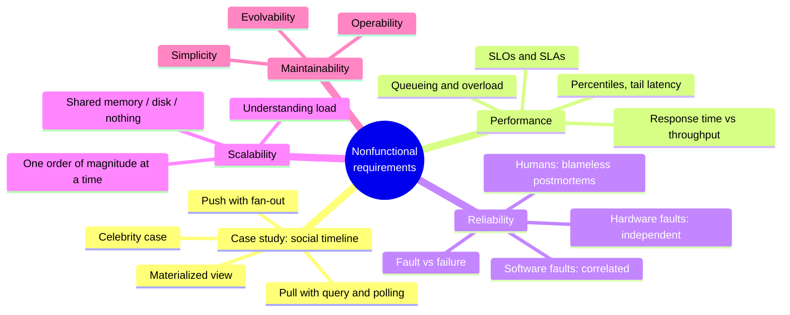
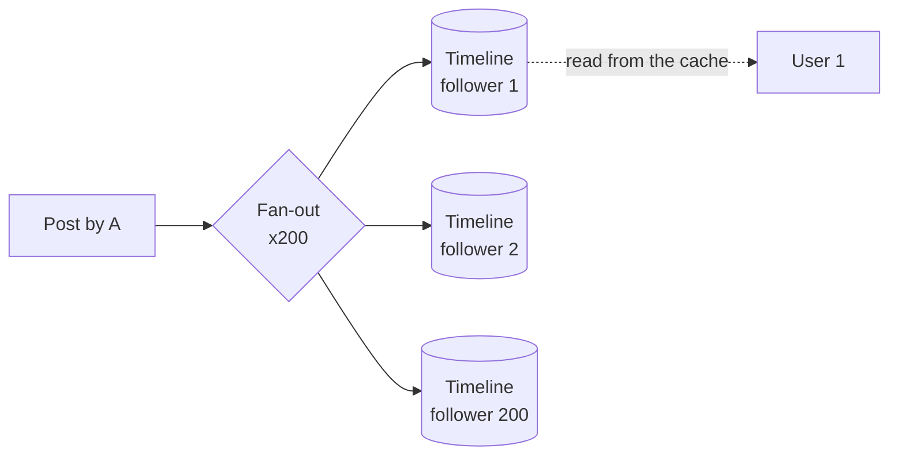
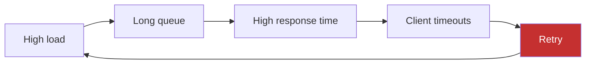
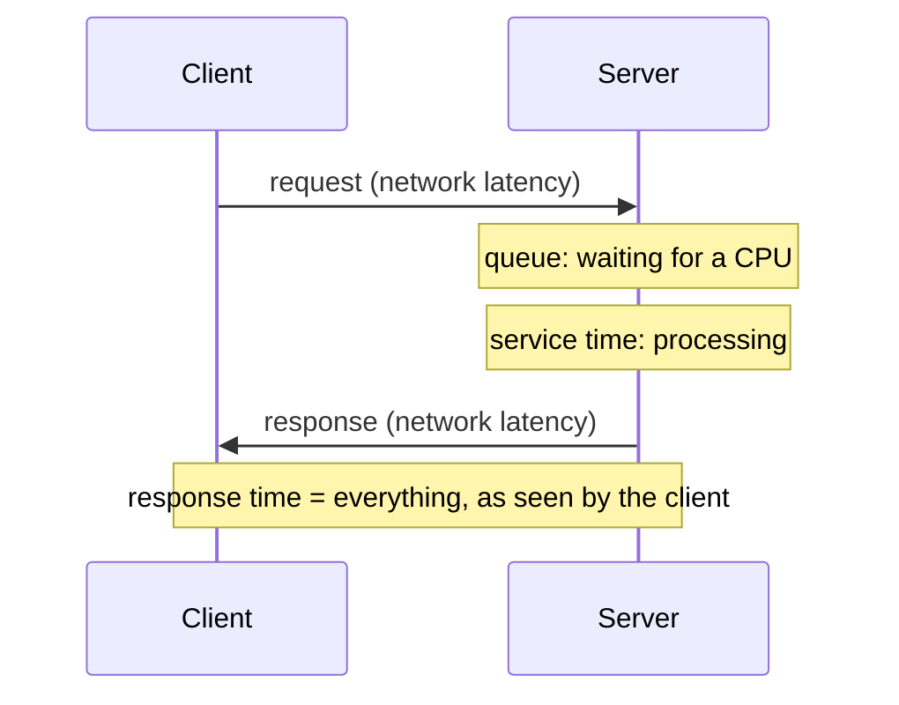
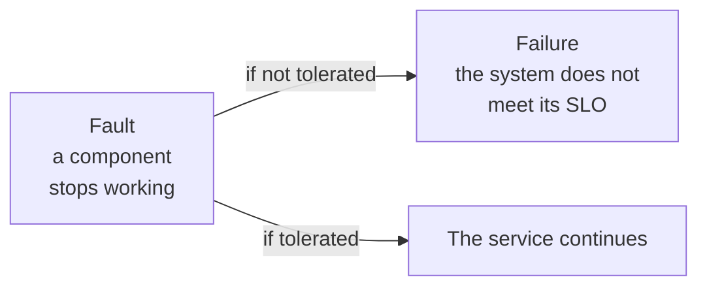
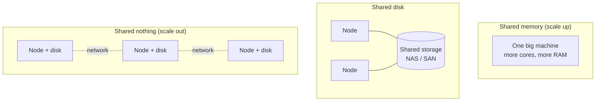

# Chapter 2 · Defining Nonfunctional Requirements

**In one sentence:** "fast, reliable, scalable, maintainable" are requirements
just as much as features are, but they stay vague until you define them in a
measurable way. The chapter gives you the vocabulary to do so: percentiles, faults
and failures, load and scalability, three properties of maintainability.

**PDF pages:** 57-88 · **Density:** medium. The opening case study alone is worth
half the chapter.

---

## Chapter map

---

## 1. Case study: the home timeline of a social network
<!-- pdf: 58 -->

Starting numbers: 500 million posts per day (5,800 per second, with spikes of
150,000), every user follows 200 people on average and has 200 followers, 10 million
users online at the same time.

**Pull approach.** Three tables (`users`, `posts`, `follows`) and a query with two
joins that reconstructs the timeline. To see posts within 5 seconds the client must
repeat the query every 5 seconds (*polling*): 2 million queries per second, each
with 200 lookups. 400 million lookups per second, in the average case.

**Push approach.** Each user's timeline is precomputed and kept in a cache.
When someone posts, the post is delivered to the "mailbox" of each follower.
The client subscribes to the stream of its own timeline instead of querying.

Cost: about 1 million timeline writes per second. A lot, but 400 times fewer
than the lookups of the pull approach. At peak times the deliveries queue up: the
timeline arrives a few seconds late, but reading it is always fast.

This is an example of **materialization**: the cached timeline is a *materialized
view*. You pay on write to gain on read. It is the same idea of *derived data*
from Chapter 1.

**The two extreme cases**, which come back in every system design interview:

| Case | Problem | Solution |
|---|---|---|
| User who follows tens of thousands of accounts | Too many writes to their timeline | Some deliveries are dropped: they won't read them all anyway |
| Celebrity with millions of followers | Millions of writes for a single post, which cannot be dropped | Celebrity posts are stored separately and merged into the timeline **at read time** (hybrid push + pull) |

---

## 2. Describing performance
<!-- pdf: 61 -->

Two metrics, two units:

- **Response time**: seconds from the click to the response. It is what the user perceives.
- **Throughput**: requests (or bytes) per second. It determines how many servers you need,
  hence the cost.

They are linked: at low load the response time is stable, but as you approach the
maximum capacity of the hardware it rises sharply because requests get
**queued** behind the ones in progress.

### When an overloaded system won't recover
<!-- pdf: 62 -->

Long queue, high response time, clients time out and **retry**, the load
increases even more: a *retry storm*. The system can remain overloaded even when
the external load returns to normal, until it is restarted. This is called a **metastable
failure**.

Countermeasures, on the client side and on the server side:

| Client side | Server side |
|---|---|
| **Exponential backoff**: increasing, randomized waits between retries | **Load shedding**: rejecting requests before collapse |
| **Circuit breaker**: stop calling a service that is failing | **Backpressure**: asking clients to slow down |
| **Token bucket**: limiting the rate | Choice of queueing and load balancing |

### The four words for "time"
<!-- pdf: 62 -->

- **Response time**: the total, from the client's point of view.
- **Service time**: the time during which the server is actually working.
- **Queueing delay**: waiting in a queue, at several points along the path.
- **Latency**: "latent" time, during which the request is not being processed; *network
  latency* is the trip over the network.

Response time varies even for the same request: context switches, lost packets,
garbage collection, page faults. The queue is the main source of variance:
a few slow requests are enough to hold up the ones behind them (**head-of-line blocking**).
That is why you measure **on the client side**: the service time alone hides the queue.

### Average, median, percentiles
<!-- pdf: 64 -->

Response time is a **distribution**, not a single number. The average is useful for estimating
throughput, but it doesn't tell you how many users waited how long. Percentiles do:

- **p50 (median)**: half of the requests are faster than this value.
- **p95, p99, p999**: how bad the outliers are. They are called *tail latencies*.

Amazon defines its internal requirements on the p999 because the customers with the
slowest requests are the ones with the most data, i.e. the most valuable. The p9999 was judged
too expensive: beyond a certain point the gains diminish and the causes are outside your control.

**Tail latency amplification**: if a user request calls 10 backends in
parallel, it waits for the slowest of the 10. Even with 1% of slow calls, the share
of slow user requests grows. The more fan-out, the more the p99 of the backends matters.

**SLOs and SLAs**: an SLO is a measurable target ("p50 under 200 ms, p99 under 1 s,
99.9% of responses without errors"). An SLA is the contract that specifies what happens if
the SLO is not met.

**Computing percentiles**: rolling window and sorting, or approximation
algorithms (HdrHistogram, t-digest, DDSketch). **You do not average
percentiles** from several machines or several minutes: it is mathematically meaningless. You
add the histograms.

### How much it matters to users
<!-- pdf: 65 -->

The frequently cited statistics (Google, Bing, Akamai) are unreliable or
contradictory. The only controlled study, by Yahoo, measures 20-30% more clicks
on fast searches when the difference exceeds 1.25 seconds. The lesson is about
method: distrust numbers that are not controlled for the quality of the content.

---

## 3. Reliability and fault tolerance
<!-- pdf: 67 -->

**Reliable** = keeps working correctly even when something goes wrong.
To be precise you need two words:

They are the same thing at different levels: a failed disk is a *failure* of the disk and a
*fault* of the system that contains it. A component whose fault becomes a failure is a
**single point of failure**.

Tolerance is always **limited** to certain types and numbers of faults ("two disks out of
ten", "one node out of three"). Counterintuitive but right: in a fault-tolerant system
it pays to **trigger** faults deliberately and at random (*fault injection*, *chaos engineering*), because
many critical bugs sit precisely in the error-handling code, which would otherwise
never be exercised.

Exception: where there is no cure (security, stolen data) prevention beats
tolerance.

### Hardware faults: frequent but independent
<!-- pdf: 68 -->

| Component | Typical rate |
|---|---|
| Magnetic hard drives | 2-5% per year: in a cluster of 10,000 disks, one per day |
| SSDs | 0.5-1% per year, but uncorrectable errors about once a year per drive |
| CPUs | 1 machine in 1,000 has a core that sometimes computes wrong results |
| RAM with ECC | Over 1% of machines have an uncorrectable error per year |
| Entire datacenter | Rare, but catastrophic: power outage, fire, solar storm |

First answer: **redundancy** within the single component (RAID, dual power supplies,
generators). It works if faults are independent, but whole racks and datacenters go down
more often than expected. That is why cloud systems tolerate faults **at the
software level**, across machines in different *availability zones*. Operational advantage:
**rolling upgrades**, one node at a time without stopping the service.

### Software faults: rare but correlated
<!-- pdf: 70 -->

All nodes run the same code, so they have the same bugs and go down together.
Examples: the 2012 leap second that hung JVMs, SSDs that all die at 32,768
hours, a process that exhausts a shared resource, a dependent service that
returns corrupted data, **cascading failures** between components.

The dormant bug wakes up when an **assumption about the environment** stops being
true. There is no quick solution: make the assumptions explicit, test, isolate
processes, let them crash and restart, avoid feedback loops, measure in production.

### Humans
<!-- pdf: 71 -->

In large services the leading cause of outages is **configuration changes**
made by operators; hardware accounts for only 10-25%. But "human error" is a
symptom of the sociotechnical system, not the cause. Technical measures: testing even with random
inputs, quick rollbacks, gradual rollouts, monitoring, interfaces that make the
right thing easy. Cultural measure: **blameless postmortems**, telling everything without
fear of punishment, so the organization learns. Distrust simple answers,
both "Bob should have been more careful" and "let's rewrite everything in Haskell".

Why it matters: permanent data loss is catastrophic even for trivial apps (the
photos of your children). Extreme case: the British Post Office Horizon scandal, hundreds
of convictions for theft caused by accounting bugs, because the law presumed that
computers worked correctly.

---

## 4. Scalability
<!-- pdf: 73 -->

It is not a label ("X is scalable, Y isn't") but a series of questions: *if the load grows
in this particular way, what options do we have? when do we hit the limits of the current
architecture?*

For a startup with few users, worrying about scale is counterproductive:
simplicity and flexibility first, because the product will change. You scale once you
discover **where** the bottleneck is.

### Understanding load
<!-- pdf: 74 -->

First measure the current load: requests per second, GB per day, online users at
peak. Then the characteristics that change the access patterns: ratio of
reads to writes, cache hit rate, items per user. Finally two questions:

1. Load up, resources unchanged: how does performance change?
2. Load up, performance unchanged: how many more resources are needed?

**Linear scalability**: double the resources, double the load. Rare. Usually the cost
grows faster than linearly.

### Three architectures
<!-- pdf: 75 -->

| | Shared memory | Shared disk | Shared nothing |
|---|---|---|---|
| How | Bigger machine | Independent CPUs, shared disks | Independent nodes, coordination via software |
| Pros | Simple | Traditional for on-prem data warehouses | Potentially linear, best-priced hardware, elastic, multi-datacenter |
| Cons | Cost grows faster than linearly, internal bottlenecks | Contention and locking limit scale | Explicit sharding (ch. 7) and all the distributed complexity (ch. 9) |

Cloud-native databases with separate storage and compute resemble shared
disk, but the storage exposes an API designed for the database instead of a filesystem,
and avoids the historical limits.

### Principles
<!-- pdf: 76 -->

- There is no "magic scaling sauce": 100,000 requests of 1 kB and 3 requests of 2 GB
  per minute have the same throughput and completely different architectures.
- An architecture holds up for about **one order of magnitude**; beyond that you rethink it. It is not
  worth planning further ahead.
- Break the system into components that operate **independently**: it is the principle underneath
  microservices, sharding, stream processing, shared nothing.
- Don't overcomplicate: a DB on a single machine beats a cluster if it is enough; manual scaling
  beats autoscaling if the load is predictable; 5 services are better than 50.

---

## 5. Maintainability
<!-- pdf: 76 -->

Most of the cost of software is maintenance, not development. Every system
of value will become legacy. Three properties to design for from the start:

| Property | Means | How |
|---|---|---|
| **Operability** | Easy to keep running | Metrics and observability, no dependency on a single machine, documentation "if I do X then Y happens", good defaults but overrides possible, self-healing with manual control, predictable behavior |
| **Simplicity** | Easy to understand for newcomers | Consistent patterns, no unnecessary complexity, good **abstractions** (SQL hides on-disk structures, concurrency and crashes) |
| **Evolvability** | Easy to change | Loose coupling, simplicity, and above all **minimizing irreversibility** |

Two notes worth remembering:

- Automation is double-edged: the cases it cannot handle are the most complex ones,
  so more automation requires more skilled operators. More automation is not always
  more operability.
- The distinction between essential and accidental complexity is useful but unstable: the
  boundary shifts as the tooling evolves.

---

## Self-check questions

1. Why does the materialized timeline trade write cost for read speed,
   and why do you go back to a hybrid model for celebrities?
2. Explain a retry storm and name one client-side and one server-side countermeasure.
3. Why is measuring response time on the server side misleading?
4. A service has a p99 of 100 ms. A page calls 20 of these services in
   parallel: why will the page's p99 be much worse?
5. Why can't you average the percentiles of ten machines?
6. Fault and failure: define them and explain why they depend on the level of observation.
7. Why are software faults more dangerous than hardware faults even though they are rarer?
8. What is the difference between traditional shared disk and the cloud's storage/compute separation?
9. Why doesn't "more automation" equal "more operability"?

Flashcards in [`flashcards/ch02.yaml`](../data/flashcards/ch02.yaml).

## Cross-references

- Exactly-once in fan-out: ch. 12
- Rolling upgrades and compatibility: ch. 5
- Sharding in shared nothing: ch. 7
- Timeouts and unbounded delays: ch. 9
- Fault tolerance across datacenters: ch. 6 and 10
