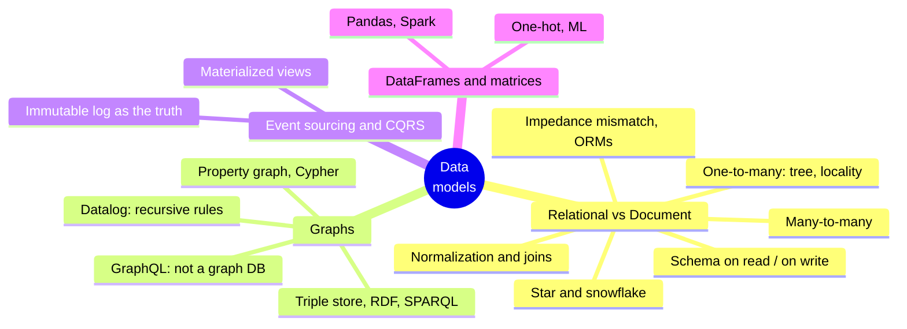
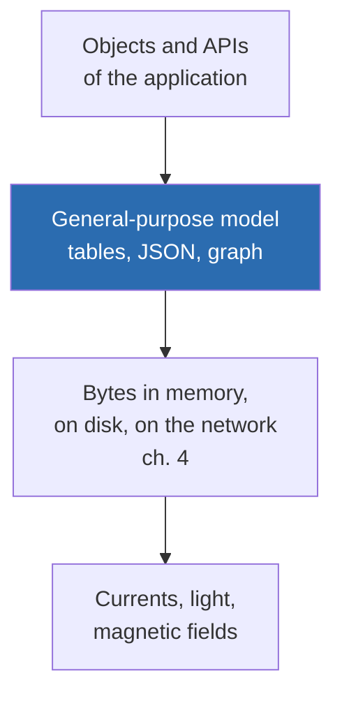
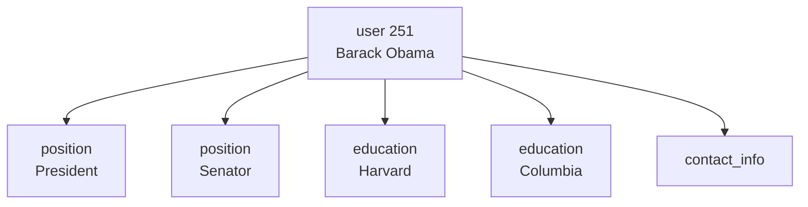
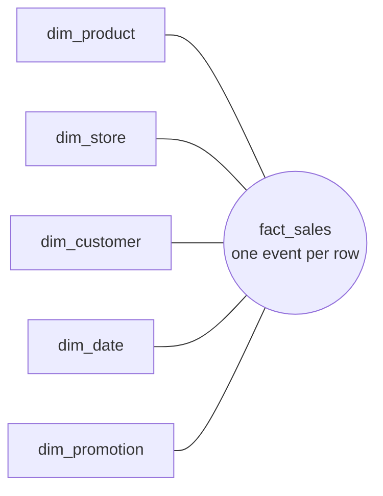
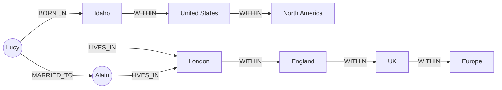
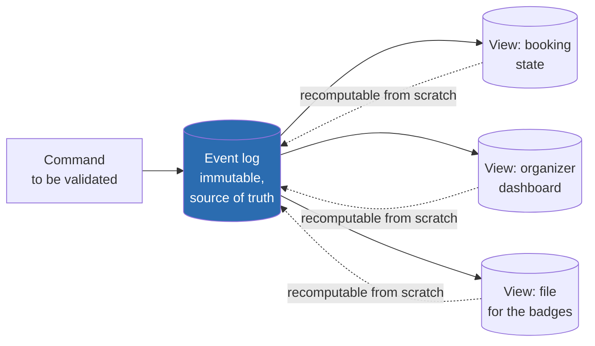
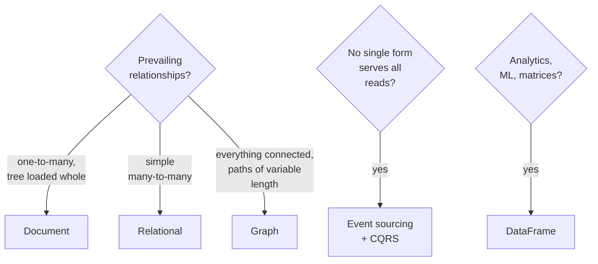

# Chapter 3 · Data Models and Query Languages

> *The limits of my language mean the limits of my world.* — Ludwig Wittgenstein, Tractatus Logico-Philosophicus (1922)

**In one sentence:** the data model decides not only how you write the code but how
you think about the problem. Relational, document, graph, event sourcing and DataFrames
are good for different **types of relationship**: the right question is "what relationships
are there in my data and how do I query them?".

**PDF pages:** 89-138 · **Density:** high in the first half (relational vs
document), more discursive in the part on graphs.

---

## Chapter map



---

## 0. The layers
<!-- pdf: 89 -->

Every application stacks data models, and each layer hides the one below it:



This chapter is the blue layer. Almost all the languages you meet here (SQL,
Cypher, SPARQL, Datalog) are **declarative**: you say *what* you want, not *how*
to get it. The advantage is not just conciseness: the engine can change algorithms,
indexes and parallelism without you touching a query.

---

## 1. Relational vs document
<!-- pdf: 91 -->

Brief history: the relational model (Codd, 1970) defeated the network model, the
hierarchical model, object databases and XML databases. NoSQL in the 2010s was not a
technology but a set of ideas (new models, flexible schemas, scalability, open
source). The ideas were absorbed and the term has faded. The lasting legacy is
the **document model** (JSON), born with MongoDB and Couchbase and by now supported by
almost all relational databases.

### Impedance mismatch and ORMs
<!-- pdf: 92 -->

The code is object-oriented, the DB is tables: a translation layer is needed. ORMs
reduce it, but with known costs:

- They don't hide the differences entirely: you still think about both models.
- They are useful only for OLTP; whoever does analytics works on the underlying tables, so the
  relational schema matters anyway.
- They make it easy to write inefficient queries. The classic case is **N+1**: one query
  for N comments, then N queries for the authors' names instead of a join.

In their favor: less boilerplate in repetitive cases, caching, migration management.

### One-to-many: where the document wins
<!-- pdf: 93 -->

A LinkedIn profile has a name (once) but several positions, several degrees,
several contacts. In relational you need separate tables with foreign keys (*shredding*).
In JSON it is a tree, and the tree is explicit:



Concrete advantage: **locality**. The document is a contiguous string, you read it with
one access instead of several queries or a multi-way join. It pays off if you need the whole
document together; if you use one piece of it or update it often, reloading and rewriting
everything is a waste. Hence the rule: **small** documents, few updates.

"One-to-many" is often "one-to-few". If the children are thousands (comments on a
viral post) the relational approach becomes preferable again.

### Normalization: ID or text?
<!-- pdf: 96 -->

Why `region_id: "us:91"` and not `"Washington, DC"`? Because an **ID means
nothing to humans and therefore never changes**. Everything that is meaningful to humans
sooner or later changes, and if it is duplicated all the copies have to be updated.

| | Normalized (ID) | Denormalized (copied text) |
|---|---|---|
| Write | Fast: a single copy | Expensive: many copies, more space, risk of inconsistency |
| Read | Needs a join or a lookup | Fast: everything in the record |
| Suited to | OLTP, small and medium scale | Analytics, where historical data doesn't change |

It is useful to think of denormalization as **derived data**: you need a process that
updates the copies and, if the process crashes halfway, an atomic transaction or a
stream that puts things right (ch. 8 and 12).

**The example that dismantles a myth.** X's materialized timeline does not contain the
text of the posts: only the post ID and the author ID. On read, the service does two joins
in application code (*hydrating*) to fetch text, likes and profile pictures, because
that data changes too often to be denormalized. Joins on read **are not** an obstacle
to scalability: hydrating parallelizes well and its cost does not depend on how many
followers you have. The scalable answer denormalizes some things and
leaves others normalized.

### Many-to-one and many-to-many
<!-- pdf: 99 -->

Many people in the same region: many-to-one. People and organizations: many-to-
many, in relational a **join table**. These cases don't fit well in a self-contained
document. If you query them in both directions, you either duplicate the references
on both sides (denormalized, can diverge) or keep them in one place only
and use **secondary indexes**, even on fields inside JSON arrays (ch. 4).

### Star and snowflake: the schemas for analytics
<!-- pdf: 101 -->



- **Fact table**: one event per row (a sale, a click), plus numeric attributes
  (price, cost) and foreign keys to the dimensions. It becomes huge, petabytes.
- **Dimension table**: who, what, where, when, how, why. Even the date is a
  dimension, so you can distinguish holidays.
- **Wide** tables, hundreds of columns. Almost all many-to-one relationships.
- **Snowflake**: dimensions broken into subdimensions, more normalized. The star is
  preferred because it is simpler for analysts.
- **One big table**: drop the dimensions too, everything in the fact table. More space,
  queries sometimes faster. Here denormalization does no harm: the data is historical
  and doesn't change.

### Schema-on-read vs schema-on-write
<!-- pdf: 104 -->

"Schemaless" is misleading: the code that reads **assumes** a structure. The schema
is there, it is just implicit. So:

| Schema-on-write (relational) | Schema-on-read (document) |
|---|---|
| Explicit, enforced on write | Implicit, interpreted on read |
| Like static type checking | Like dynamic type checking |
| Format change: `ALTER TABLE` + `UPDATE` migration | Format change: write the new documents, the code handles the old ones on read |

Adding a column with a default is fast everywhere; the `UPDATE` on a large table
is slow because it rewrites every row. Practical trick: column with default `NULL` and
fill it in on read, as a document DB would do.

Schema-on-read pays off when the data is **heterogeneous** (many object types, or
a structure decided by external systems that change). When all records have the
same shape, the schema documents and protects.

### Convergence
<!-- pdf: 107 -->

Relational databases have added JSON, operators and indexes inside documents; document
databases have added joins, secondary indexes, declarative languages. The combination
in the same DB is the most powerful solution. Historical note: Codd in 1970 already foresaw
*nonsimple domains*, values nested inside a row. JSON in SQL arrived 30 years later.

---

## 2. Graph models
<!-- pdf: 108 -->

If many-to-many relationships are the norm and "anything can be related to anything",
the graph is natural. Vertices and edges; social graphs, the web, road networks, but also
**a single graph with different types** of objects (Facebook: people, places, events,
comments) or the knowledge graphs of search engines.

Running example of the chapter: Lucy born in Idaho, Alain born in Saint-Lô, married,
living in London. Things that are hard in relational and easy in a graph: different
regional structures per country, variable granularity (residence at city level,
birth at state level).



### Property graphs and Cypher
<!-- pdf: 110 -->

Each vertex has an id, a label, properties, incoming and outgoing edges. Each edge has an id,
a tail vertex and a head vertex, a label, properties. In PostgreSQL two tables are enough,
`vertices` and `edges` with `jsonb` for the properties and **indexes on both
ends** to traverse the graph in both directions. The `edges` table is
the join table generalized to several types of relationship.

The query "who emigrated from the US to Europe" in Cypher:

```cypher
MATCH
  (person) -[:BORN_IN]->  () -[:WITHIN*0..]-> (:Location {name:'United States'}),
  (person) -[:LIVES_IN]-> () -[:WITHIN*0..]-> (:Location {name:'Europe'})
RETURN person.name
```

`WITHIN*0..` means "follow WITHIN zero or more times", like `*` in a regex. The
point is that **you don't know in advance how many edges** separate the residence from the country.

In SQL the same query requires `WITH RECURSIVE` and 31 lines versus 4. It can be done,
but it shows how much the choice of model matters. The ISO GQL standard (2024) is based on
Cypher.

Limit of the graph: an edge connects exactly two vertices. A three-way relationship
requires an intermediate vertex or a hypergraph.

### Triple stores, RDF and SPARQL
<!-- pdf: 116 -->

Same expressiveness, different words: everything is a triple **(subject, predicate,
object)**. If the object is a primitive value, the triple is a property; if it is
another vertex, the predicate is an edge. Turtle format:

```turtle
_:lucy  a :Person;   :name "Lucy";  :bornIn _:idaho.
_:idaho a :Location; :name "Idaho"; :within _:usa.
```

It comes from the **Semantic Web**, which failed as a project but lives on in its legacies: JSON-LD,
biomedical ontologies, Facebook's Open Graph, Wikidata, Schema.org. In RDF the predicates
are URIs to avoid conflicts when you combine other people's data. SPARQL is the language;
Cypher copied its pattern matching, which is why they look alike.

### Datalog: recursive rules
<!-- pdf: 120 -->

1980s, a subset of Prolog, a relational rather than graph data model, but very powerful
for recursive queries. The data are **facts** (`born_in(100, 3)`), the queries are
**rules** that derive virtual tables, like composable and recursive SQL views:

```prolog
within_recursive(LocID, Name) :- location(LocID, Name, _).
within_recursive(LocID, Name) :- within(LocID, Via), within_recursive(Via, Name).
```

You build the query one piece at a time, like functions calling each other. Used by
Datomic, LogicBlox, CozoDB, LinkedIn's LIquid.

### GraphQL: not a graph database
<!-- pdf: 122 -->

Despite the name, it is a **deliberately limited** language for OLTP: the client
(mobile, browser) asks for a JSON with exactly the shape it needs to
render the UI, and changes the query without touching the server. No recursion,
no arbitrary conditions, because the queries come from untrusted sources and
could cause a denial of service. It accepts larger, duplicated responses (the author's name and
picture repeated in every message) to simplify rendering. It is
implemented on top of **any** database.

---

## 3. Event sourcing and CQRS
<!-- pdf: 125 -->

So far data is read in the same form in which it is written. In complex domains
no single form satisfies all reads. So: write in **one** form optimized
for writing and derive **several** forms optimized for reads.

The simplest form to write is a **log of immutable events**, append-only.



- **Event sourcing**: the events are the truth, every state change is an event.
- **CQRS**: separate read representations, derived from the write representation.
- A **command** is validated; if valid it becomes an **event**. The log contains only
  valid events, and whoever builds a view cannot reject one.
- Events in the **past tense** ("the seats were booked"): a fact that happened stays true
  even if it is later cancelled by another event.
- Difference from a fact table: different event types with different properties, and
  **order matters**.

| Pros | Cons |
|---|---|
| Events say *why*, not "column active set to false on row 4001" | External data (exchange rates) makes the replay non-deterministic: put the rate in the event |
| Views can be deleted and recomputed with new code: bugs are fixed by rebuilding | Immutability versus GDPR: crypto-shredding or personal data kept outside the event |
| Multiple views, any model, even just in memory | External side effects (emails) must not be repeated on replay |
| New features = new events, old ones untouched; fewer irreversible actions | All views must see the events **in the same order**: hard in a distributed system (ch. 10) |
| Audit log for free; high write throughput, bursts absorbed | |

Tools: EventStoreDB, MartenDB, Axon, or Kafka as the log and a stream processor
for the views (ch. 12).

---

## 4. DataFrames, matrices and arrays
<!-- pdf: 129 -->

Models from analytics and science, almost never OLTP. A DataFrame (Pandas, R, Spark, Dask)
looks like a table and has similar operators (filter, group by, join called *merge*),
but it is manipulated with a **sequence of commands** on your own copy of the data, not with
a declarative query. It is the workflow of someone who "digs through" the data.

Typical use: transform a table (user, movie, rating) into a **matrix** of users
by movies, sparse, with thousands of columns that a relational database couldn't handle. Non-
numbers become numbers: scaled dates, categories in **one-hot encoding** (one column
per genre, 1 or 0). From there linear algebra, i.e. the foundation of ML.

Array databases (TileDB) for scientific data on a grid: geospatial, medical imaging,
telescopes. DataFrames also for time series in finance.

---

## Which model: the decision
<!-- pdf: 131 -->



Two cross-cutting rules:

- **The relationships decide**, not fashion. Few links between documents: document. Many
  many-to-many: relational. Paths of unknown length: graph.
- Every model **emulates** the others (graph in SQL, JSON in Postgres), but the emulation is
  awkward. Databases are converging though, and hybrids are often the best answer.

Models not covered: genome sequence search, double-entry ledgers
(TigerBeetle, blockchain), full-text search (ch. 4).

---

## Self-check questions

1. What is the N+1 problem and why does an ORM encourage it?
2. Why is an ID better than a human-readable string as a reference? What is the cost?
3. X's timeline contains only IDs: why does this choice contradict the idea that
   "joins don't scale"?
4. What distinguishes a star schema from a snowflake, and why is denormalization
   not a problem in analytics?
5. "Schemaless" is a wrong term: why? What is the correct term?
6. In which situation is schema-on-read really preferable?
7. Why is a query with variable-length paths awkward in SQL and natural in Cypher?
8. GraphQL has "graph" in its name: what is it not, and why is it deliberately limited?
9. In event sourcing, why is an event with a price in a foreign currency a problem?
10. What is the only non-negotiable requirement of event storage?

Flashcards in [`flashcards/ch03.yaml`](../data/flashcards/ch03.yaml).

## Cross-references

- Secondary indexes, storage engines, full-text search: ch. 4
- Schemas and evolution, JSON encoding: ch. 5
- Atomicity of multi-document transactions: ch. 8
- Ordering of events in a distributed system: ch. 10
- DataFrames in batch processing frameworks: ch. 11
- Kafka as event log, views via stream processing: ch. 12
