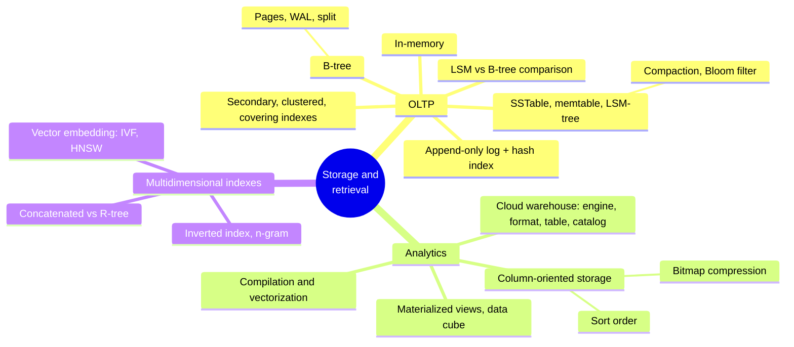
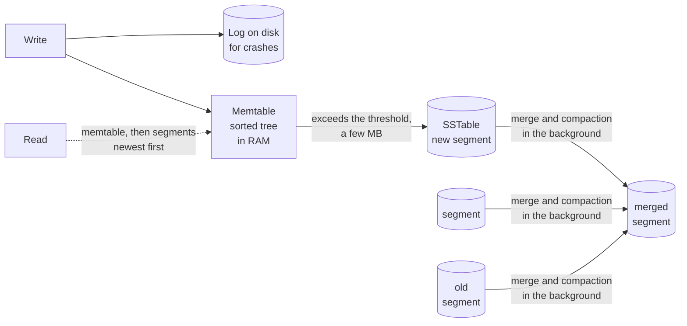
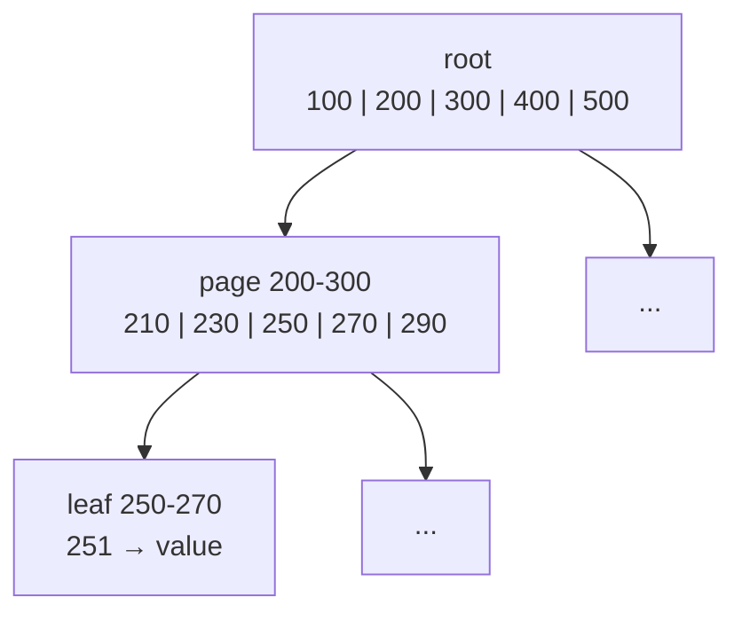
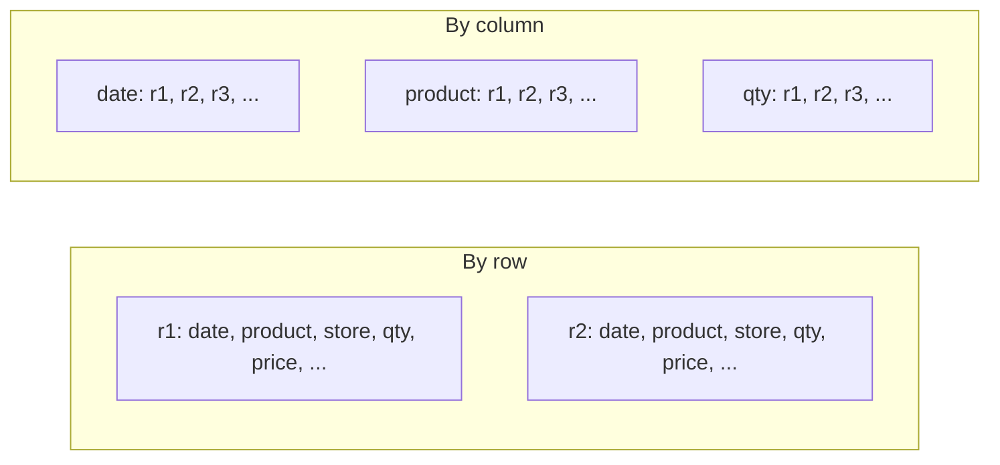

# Chapter 4 · Storage and Retrieval

> *One of the miseries of life is that everybody names things a little bit wrong. And so it makes everything a little harder to understand in the world than it would be if it were named differently. A computer does not primarily compute in the sense of doing arithmetic. […] They primarily are filing systems.* — Richard Feynman, Idiosyncratic Thinking seminar (1985)

**In one sentence:** a database needs to do two things, store the data and give it
back. The chapter opens the hood: two families of storage engines for OLTP
(log-structured with immutable files, B-trees that overwrite pages), column-oriented
storage for analytics, and the indexes that answer several conditions at once
(spatial, full-text, vector).

**PDF pages:** 139-184 · **Density:** high. It is the most "mechanical" chapter of the
first half of the book and the most useful for understanding the tuning parameters of
any DB.

---

## Chapter map

---

## 1. The world's simplest database
<!-- pdf: 140 -->

Two bash functions: `db_set` does `echo "$key,$value" >> database`, `db_get` does a
`grep` and takes the last line. It works, and writes are great because **appending to
a file is the cheapest operation there is**. Reads, however, are O(n): they scan
everything.

From here comes the trade-off that governs the whole chapter:

> An **index** is an additional structure derived from the data that speeds up reads.
> Every index costs space and **slows down writes**, because it has to be updated on
> every write. That is why DBs don't index everything: you choose, based on the queries.

A note on the term: in this book a *log* is not the application log but an
append-only sequence of records on disk, possibly binary.

---

## 2. Log-structured storage
<!-- pdf: 142 -->

### First step: an in-memory hash index
<!-- pdf: 142 -->

Keep the append-only file and add a hash map from key to the byte offset where its
latest value lives. Fast reads, but four problems: space is never reclaimed, the hash
map must be rebuilt on every restart, it must fit in RAM, and **range queries** are
impossible (you'd have to look up every key one by one).

### SSTable: sorting by key
<!-- pdf: 143 -->

A **Sorted String Table** is a file of key-value pairs **sorted by key, each key
appearing only once**. Sorting changes everything:

- A **sparse index** is enough: the first key of every block of a few KB. To find
  `handiwork` you know it lies between `handbag` and `handsome`, so you jump to the
  offset of `handbag` and scan one block.
- Blocks can be **compressed**.
- Range queries come naturally.

But you can no longer append at the end: you would break the ordering. The solution is
the hybrid between a log and a sorted file:

1. Writes go into a **memtable**, a sorted in-memory tree (red-black, skip list,
   trie), and in parallel into a log on disk whose only purpose is to rebuild the
   memtable after a crash.
2. When the memtable exceeds a few MB it is written to disk as an SSTable, the most
   recent **segment**. A new memtable is started.
3. A read looks in the memtable, then in the segments from newest to oldest.
4. In the background, **merging and compaction** fuse segments and throw away
   overwritten values. It's a mergesort: read the files side by side, copy the lowest
   key, and if it appears in several files keep the most recent one. Minimal memory.

A deletion is a special record, the **tombstone**: during the merge it tells the
process to discard the previous values for that key.

This is the **LSM-tree** (Log-Structured Merge-tree, 1996): RocksDB, Cassandra,
ScyllaDB, HBase, all descended from the Bigtable paper. Segments are **immutable**,
written in one pass: crash recovery is trivial (delete the incomplete file), segments
can even live on object storage (SlateDB, Delta Lake), and the merge can run while
reads still use the input segments.

### Bloom filter
<!-- pdf: 146 -->

Reading an old or nonexistent key is expensive: you must check many segments. A
**Bloom filter** per segment answers "definitely not" or "probably yes" with few bits
and bitwise operations. Each key is hashed to a few positions in a bit array, which are
set to 1. On a query: if at least one bit is 0 the key is **not there**, so you skip the
segment. If they are all 1 the key may be there, or it may be a **false positive** and
you've done a bit of wasted work. Rule of thumb: 10 bits per key give a 1% false
positive rate, and every additional 5 bits reduce it tenfold.

### Compaction strategies
<!-- pdf: 148 -->

| Size-tiered | Leveled |
|---|---|
| Newer and smaller SSTables are merged into older and larger ones | Fixed-size SSTables, in levels L0, L1, L2 of increasing capacity |
| Huge old segments, lots of temporary space during the merge | From L1 on, partitioned by key range: incremental compaction, less space |
| Great for **write**-heavy workloads with few reads | Better for **reads**: fewer SSTables to check |

Almost all implementations offer both.

### Embedded storage engines
<!-- pdf: 149 -->

Not all DBs are network services: RocksDB, SQLite, LMDB, DuckDB, KùzuDB are libraries
in the same process as the app. Standard in mobile apps; on the backend they're fine
if the data fits on one machine and concurrency is low, for example one embedded DB
per tenant in a multitenant system.

---

## 3. B-trees
<!-- pdf: 149 -->

Since 1970, "ubiquitous" ten years later, still the standard in almost every
relational database. Like SSTables it keeps keys sorted, but the philosophy is the
opposite: the DB is broken into **fixed-size pages** (4 KiB classically, 8 in
PostgreSQL, 16 in MySQL) that are **overwritten in place**.

- Each page holds boundary keys and references (page numbers, like on-disk pointers)
  to its children. The number of children is the **branching factor**, typically
  several hundred.
- Looking up a key: one page per level. The tree is balanced, depth O(log n): almost
  all DBs fit in **3 or 4 levels** (4 levels, 4 KiB pages and a branching factor of
  500 hold 250 TB).
- Updating: find the leaf, overwrite it. Inserting into a full page: **split** it into
  two half-full pages and update the parent; splits can propagate up to the root.

### Making it reliable
<!-- pdf: 151 -->

Overwriting several pages (a split) is dangerous: a crash halfway leaves a corrupted
tree, and the hardware may write half a page (*torn page*). That is why every
modification first goes into the **write-ahead log** (WAL), append-only, and only
afterwards into the pages. After a crash the WAL restores a consistent state. Modified
pages are kept in memory for a while; the data is durable once the WAL has been
written and `fsync` has completed successfully.

Variants: **copy-on-write** (LMDB), which writes the page elsewhere instead of
overwriting it, also useful for concurrency (ch. 8); abbreviated keys in interior
pages to raise the branching factor; leaves laid out contiguously on disk; pointers
between sibling leaves to scan in order without going back up.

---

## 4. LSM-trees versus B-trees
<!-- pdf: 153 -->

Rule of thumb: **LSM for write-heavy workloads, B-trees for reads**. But benchmarks
depend on the workload, so measure with your own. And it's not either/or: hybrid
engines exist.

| Aspect | B-tree | LSM-tree |
|---|---|---|
| Point read | One page per level, **predictable** | Several segments, mitigated by the Bloom filter |
| Range query | Simple and fast | Scan all segments in parallel; the Bloom filter **does not help** |
| Write pattern | **Random**: pages scattered across the disk | **Sequential**: whole segments |
| Latency spikes | Rare | If compaction can't keep up, the memtable fills and the engine applies **backpressure**, suspending everything |
| Write amplification | Every piece of data at least twice (WAL + page), often a whole page for a few bytes | Log, then memtable to disk, then every compaction; usually **lower** thanks to compression |
| Disk space | Fragmentation, needs vacuuming | Compaction rewrites anyway; smaller files thanks to compression; size-tiered uses more temporary space |
| Guaranteed deletion (GDPR) | Immediate | The tombstone has to travel through all the levels: it can take a long time |
| Snapshots and backups | Hard with overwritten pages | Easy: segments are immutable, just don't delete them |

**Why sequential wins even on SSDs.** On HDDs it's the disk head. On SSDs flash is
written per page (4 KiB) but erased per block (512 KiB): before erasing, the controller
moves the still-valid pages elsewhere (*garbage collection*). Sequential writes fill
whole blocks with the same file, which can be erased without GC. Random writes leave
mixed blocks, more GC, less bandwidth for the app and more wear.

**Write amplification** = bytes written to disk / bytes you would write with a pure
append-only log. It matters for throughput in write-heavy workloads and for SSD wear.
Measure it over a long run: an empty LSM has no compaction and looks faster than it is.

---

## 5. Secondary indexes and where the values live
<!-- pdf: 156 -->

A secondary index is a key-value index where the key is **not unique**: either the
value is a list of row IDs (like a postings list), or you make each entry unique by
appending the row ID. It can be built on a B-tree or an LSM-tree alike.

What lives inside the index:

| Type | The value is | Example |
|---|---|---|
| **Clustered index** | The whole row | InnoDB: the primary key is always clustered |
| Reference | The primary key, or a location in the **heap file** (rows in no particular order) | InnoDB for secondary indexes; PostgreSQL uses the heap |
| **Covering index** | A few extra columns beyond the key | The query is answered from the index alone, it "covers" it |

With the heap file, updating a value that grows in size means moving it and updating
all indexes, or leaving behind a forwarding pointer.

---

## 6. Keeping everything in memory
<!-- pdf: 157 -->

The structures seen so far are answers to the limitations of disks, which however are
durable and cheaper per GB. With RAM ever cheaper, many datasets fit entirely:
Memcached (cache only), VoltDB, SingleStore, TimesTen, RAMCloud; Redis and Couchbase
with weak durability via asynchronous writes.

Two counterintuitive points:

- The advantage is **not** avoiding reads from disk: with enough RAM even a disk-based
  DB reads everything from the operating system cache. It is avoiding the **overhead
  of encoding** the structures in a form that can be written to disk.
- Durability is still achieved with an append-only log, snapshots or replicas: the
  disk is used only for that, reads stay in memory.

Bonus: in memory, data models that are hard on disk become easy, like priority queues
and sets in Redis.

---

## 7. Data storage for analytics
<!-- pdf: 158 -->

### The warehouse broke into components
<!-- pdf: 159 -->

Cloud data warehouses (BigQuery, Redshift, Snowflake) separate compute and storage and
put the data on object storage. In the open source world what used to be a single
system (Hive) has become four layers:

| Layer | Does | Examples |
|---|---|---|
| **Query engine** | Parses, optimizes, executes in parallel | Trino, DataFusion, Presto; execution also on Spark or Flink |
| **Storage format** | How rows become bytes in a file | Parquet, ORC, Lance, Nimble |
| **Table format** | Which files make up a table, schema, time travel, GC, transactions | Iceberg, Delta |
| **Data catalog** | Which tables make up a database, via REST | Polaris, Unity Catalog |

The decoupling lets governance and discovery tools read the catalog.

### Column-oriented storage
<!-- pdf: 160 -->

A fact table has hundreds of columns but a query touches four or five. In
**row-oriented** storage you load whole rows and throw away 95%. In
**column-oriented** storage each column is a separate file and you read only the
ones you need.

Row k is reassembled by taking the k-th value from each column: all columns keep the
rows **in the same order**. In practice the table is broken into blocks of millions of
rows, often by time range, and within each block the columns are separated. Used
everywhere: Snowflake, DuckDB, Pinot, Druid, Parquet, Arrow, Pandas, TimescaleDB.
Don't confuse it with the **wide-column** model of Bigtable and HBase, which despite
the name is row-oriented.

### Bitmap compression
<!-- pdf: 163 -->

A column with few distinct values (100,000 products across billions of sales) becomes
**one bitmap per value**, one bit per row. The bitmaps are sparse, so they are
compressed with **run-length encoding**; roaring bitmaps pick the most compact
representation. Queries become bitwise operations: `IN (31, 68, 69)` is an OR of three
bitmaps, `product = 30 AND store = 3` is an AND, which works because the k-th position
is the same row in every column.

### Sort order
<!-- pdf: 164 -->

You don't sort each column on its own, otherwise you lose the rows. You sort **by
whole row**, choosing the key columns based on the queries: `date_key` first if
queries filter by period, `product_sk` second to group. Double benefit: you scan only
the range, and the first sort column has long runs of identical values that run-length
encoding compresses to a few KB even across billions of rows.

### Writing to column-oriented storage
<!-- pdf: 165 -->

Inserting a row in the middle of sorted, compressed columns would be a disaster. The
log-structured approach is used: writes go to a **row-oriented, sorted, in-memory**
store; when there are enough of them they are merged with the column files by writing
new files in bulk. The old files remain immutable, perfect for object storage. The
engine combines disk and memory at query time, and the analyst sees the data
immediately.

### Execution: compilation or vectorization
<!-- pdf: 166 -->

Over millions of rows the CPU matters too, not just I/O. An "interpreter" operator
that checks the query structure for every row is too slow. Two ways out:

- **Query compilation**: the engine generates code for that query, compiles it to
  machine code (LLVM) and runs it on the in-memory data. Like the JVM's JIT.
- **Vectorized processing**: interpreted, but each operator works on a **batch** of
  values from a column and returns a bitmap. Equality on `product_sk`, equality on
  `store_sk`, AND between the two bitmaps.

Both exploit modern CPUs: sequential memory access, tight loops with no function
calls, SIMD and multithreading, working **directly on compressed data**.

### Materialized views and data cubes
<!-- pdf: 167 -->

A virtual view is a shortcut for writing queries; a **materialized** view is a copy of
the results on disk, to be updated when the underlying data changes (more work on
writes, faster repeated reads; Materialize specializes in this).

A **data cube** is a materialized view of aggregates: a grid with one dimension per
axis (dates × products × stores × ...) and a sum in every cell. Yesterday's totals per
store: one read, zero scans. The limit: you can't ask anything about a dimension that
isn't there (the share of sales above 100 euros, if price is not a dimension). That is
why warehouses keep the raw data and use cubes only as an accelerator.

---

## 8. Multidimensional and full-text indexes
<!-- pdf: 169 -->

B-trees and LSM-trees do range queries on **one** attribute. A **concatenated index**
(last name, first name) is like a phone book: useful for last name or last name +
first name, useless for first name alone.

### Spatial
<!-- pdf: 169 -->

"All the restaurants in the map's rectangle" is a range query on two dimensions at
once. A concatenated index gives you either the latitudes or the longitudes, not both.
Solutions: a **space-filling curve** that turns two dimensions into one number for a
regular B-tree, or **R-trees** and Bkd-trees that divide up the space keeping nearby
points together (PostGIS uses R-trees via GiST). Not only geography: (R, G, B) for
colors, (date, temperature) for weather.

### Full-text: the inverted index
<!-- pdf: 170 -->

Think of every word (*term*) as a dimension. The **inverted index** maps term → list
of IDs of the documents containing it (**postings list**), representable as a sparse
bitmap. "red apples" is the AND of two bitmaps, exactly like the warehouse's
vectorized query. Lucene (Elasticsearch, Solr) keeps these maps in SSTable-like sorted
files merged in the background: the same LSM as before. PostgreSQL's GIN uses postings
lists for full-text and JSON.

Extensions: **n-grams** (the trigrams of "hello" are hel, ell, llo) to search arbitrary
substrings and even regexes, at the price of large indexes; search within an **edit
distance** for typos, with a Levenshtein automaton over the terms.

### Vector embeddings and semantic search
<!-- pdf: 171 -->

"Cancel the subscription" must be found when searching "close my account". An
**embedding model** (often an LLM) turns a document into a vector of floats, a point
in a space with many dimensions (over 1,000), where similar documents are close
together. Distance: cosine or Euclidean. The query is transformed the same way and the
nearest vectors are searched in a **vector index**, because R-trees can't handle that
many dimensions:

| Index | How | Trade-off |
|---|---|---|
| **Flat** | Compares against every vector | Exact but slow |
| **IVF** | Clusters the space into centroids, compares only within some partitions (*probes*) | Approximate; more probes, more accurate and slower |
| **HNSW** | Layered graph: sparse upper layer to get close, dense lower layers to refine | Approximate, widely used |

Faiss and pgvector implement IVF and HNSW. Beware of the homonym: "vectorization" in
query execution is a batch of bits, here a "vector" is a point in space.

---

## Self-check questions

1. Why isn't an in-memory hash index enough, and what does sorting by key add?
2. Describe the path of a write and of a read in an LSM-tree. Where does the
   tombstone live?
3. A Bloom filter says "probably yes": why are false positives not a problem?
4. Why are sequential writes faster even on SSDs?
5. What is the WAL and why can't a B-tree do without it?
6. Define write amplification and explain why a short benchmark on an empty LSM
   is misleading.
7. Clustered, heap, covering: where does the value live in each case?
8. Why is an in-memory DB faster, given that a disk-based one can also read
   everything from the cache?
9. Why does column-oriented storage compress so well, and why does the first sort
   column compress better than the others?
10. How do you write a single row into column-oriented storage without rewriting everything?
11. Why doesn't a concatenated index (lat, lon) answer a query on a rectangle?
12. What is the relationship between inverted indexes, warehouse bitmaps and LSM-trees?

Flashcards in [`flashcards/ch04.yaml`](../data/flashcards/ch04.yaml).

## Cross-references

- Durability, crash recovery, copy-on-write and snapshot isolation: ch. 8
- Encoding formats (Parquet, Avro): ch. 5
- Maintaining materialized views via streams: ch. 12
- Scaling a DB across multiple machines: ch. 6 and 7
