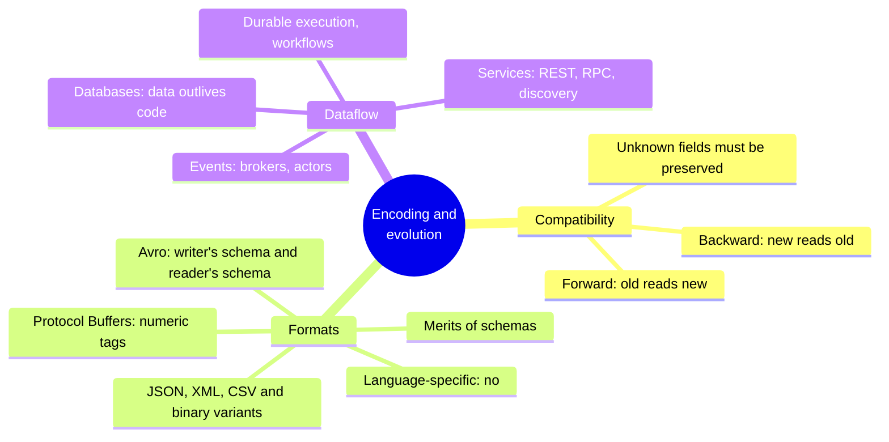
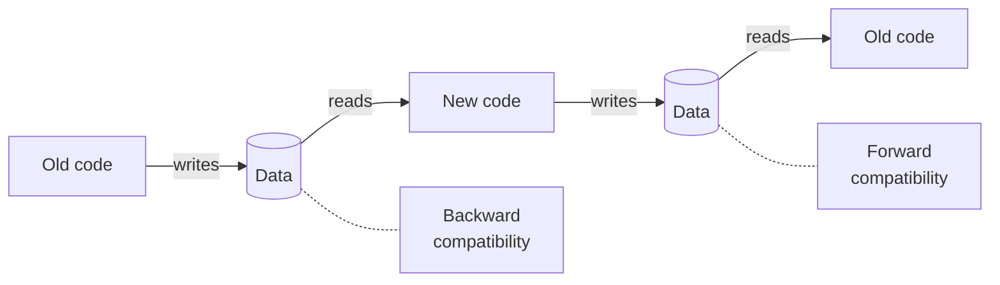
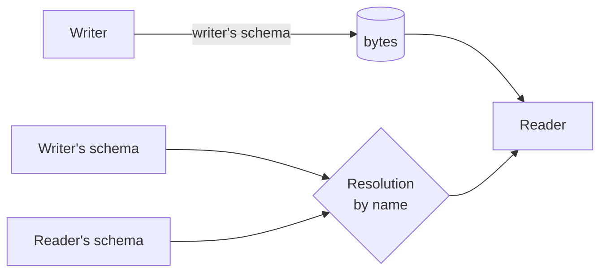

# Chapter 5 · Encoding and Evolution

> *Everything changes and nothing stands still.* — Heraclitus of Ephesus, as quoted by Plato in Cratylus (360 BCE)

**In one sentence:** old and new code, old and new data always coexist
(rolling upgrades, clients that don't update, data that outlives the code). The
format you encode your data with decides whether that coexistence is painless. The
chapter compares the formats and then follows the data along the three paths it
travels: databases, calls between services, messages.

**PDF pages:** 185-220 · **Density:** medium. The part on formats is precise and
technical, the part on dataflow is more of an overview.

---

## Chapter map



---

## 1. Two directions of compatibility
<!-- pdf: 186 -->



- **Backward**: new code reads data written by old code. Easy: you know the old
  format and you handle it.
- **Forward**: old code reads data written by new code. Harder: the old code must
  **ignore** what it doesn't know without breaking.

For APIs: an old client talking to a new server requires backward compatibility on
the request and forward compatibility on the response, and vice versa.

The forward-compatibility trap: new code writes a record with a new field, old code
reads it, modifies it and **writes it back**. If the in-memory model doesn't keep
the unknown fields, the new field **disappears**. Unknown fields must be preserved,
not discarded.

---

## 2. The formats
<!-- pdf: 187 -->

Two representations: in memory (objects, pointers) and as a sequence of bytes for
files and the network. The translation is **encoding** (serialization, marshalling)
and **decoding**. The book avoids "serialization" because in ch. 8 it means
something else.

### Language-specific formats: never
<!-- pdf: 188 -->

`pickle`, `java.io.Serializable`, `Marshal`: convenient and wrong. They tie you to
one language, instantiate arbitrary classes on decoding (**remote code execution**
if an attacker controls the bytes), ignore versioning, and are slow and bloated.
Only for transient purposes.

### JSON, XML, CSV
<!-- pdf: 189 -->

Universal, human-readable, good for exchange **between organizations**, where
reaching agreement matters more than elegance. The flaws worth knowing:

- **Numbers**: XML and CSV don't distinguish a number from a string of digits. JSON
  doesn't distinguish integers from floats and doesn't specify a precision. Above
  2^53 an integer gets corrupted in JavaScript: X sends post IDs twice, as a number
  and as a string.
- **Binary**: no byte strings. Base64, which weighs a third more.
- **Schemas**: JSON Schema and XML Schema are powerful and complicated. JSON Schema
  by default is **open** (`additionalProperties: true`), so it describes what is not
  allowed more than what is. Remote references and conditional logic make it hard
  to evolve.
- **CSV**: no schema, escaping of commas and newlines gets misinterpreted by many
  parsers.

The **binary variants of JSON** (MessagePack, CBOR, BSON) still have to include the
field names: the example record goes from 81 to 66 bytes. Not much, and you lose
readability.

### Protocol Buffers: numeric tags
<!-- pdf: 193 -->

Mandatory schema in an IDL, generated code for every language:

```protobuf
message Person {
    string user_name = 1;
    int64 favorite_number = 2;
    repeated string interests = 3;
}
```

The same record drops to **33 bytes**. There are no field names: there are the
**tags** (1, 2, 3), type and tag packed into a single byte, variable-length
integers, lists as repetitions of the same tag.

Evolution rules, all derived from the fact that tags are the identity of a field:

| Operation | Outcome |
|---|---|
| Renaming a field | Free: the bytes don't contain names |
| Changing a tag | **Never**: it invalidates all existing data |
| Adding a field with a new tag | Forward: old code skips it (the type says how many bytes) and preserves it. Backward: new code reads old data and fills in the default |
| Removing a field | Symmetric. The tag is **never reused**: it is declared `reserved` |
| Changing the type (int32 → int64) | Possible but with a risk of **truncation** when old code reads a 64-bit value |

### Avro: two schemas
<!-- pdf: 196 -->

Born in Hadoop in 2009 because Protobuf wasn't a good fit. A schema without tags:

```
record Person {
    string               userName;
    union { null, long } favoriteNumber = null;
    array<string>        interests;
}
```

**32 bytes**, the most compact: the bytes are just values concatenated, with no
field or type markers. You decode by walking the fields in the order of the schema.
So you need **exactly** the schema the data was written with.



The trick is the **resolution between the writer's schema and the reader's
schema**: Avro compares them and translates. Different field order: no problem,
they are matched by **name**. Field in the writer but not in the reader: ignored.
Field in the reader but not in the writer: the reader's default.

Rules: you can only add or remove fields **with a default value**. Null is not an
implicit default: you need a `union { null, long }` with null in first position,
more verbose but explicit. Renaming is possible with aliases in the reader
(backward but not forward compatible); adding a branch to a union likewise.

**Where is the writer's schema?** It isn't attached to every record, it would be
bigger than the data. It depends on the context:

| Context | Solution |
|---|---|
| Large file with millions of records | Schema once at the start: *object container file* |
| Database with records written at different times | Version number at the start of every record, registry of versions (Confluent's Schema Registry, Espresso) |
| Bidirectional network connection | Negotiated on connection setup, valid for the lifetime of the connection (Avro RPC) |

**Why having no tags is an advantage:** **dynamically generated schemas**. You
want to dump a relational database to binary: you generate the Avro schema from the
tables, one column one field, and every time the DB schema changes you just
regenerate. With Protobuf someone would have to assign the tags by hand and never
reuse the old ones.

### The merits of schemas
<!-- pdf: 201 -->

Protobuf and Avro have simple schemas, with no validation rules (unlike JSON
Schema). The ideas come from ASN.1 (1984), still in X.509 certificates but too
complex for new things. Every DB has its own proprietary binary format behind the
driver.

A binary format with a schema gives you: compactness (no names), **documentation
that is always up to date** because without the schema you can't decode, a registry
that checks compatibility **before** deployment, generated code and type checking
at compile time. The same flexibility as schema-on-read with better guarantees.
Still, keep few concurrent versions.

---

## 3. Three modes of dataflow
<!-- pdf: 202 -->

### Through a database
<!-- pdf: 202 -->

Whoever writes encodes, whoever reads decodes. Even with a single process, writing
to the DB is **sending a message to your future self**: you need backward
compatibility. With several instances in a rolling upgrade, old code will read data
written by new code: you also need forward compatibility.

**Data outlives code.** A deployment replaces the code in minutes; data from five
years ago stays in its original encoding. Rewriting it is expensive, so DBs put it
off: the LSM rewrites in the new format during compaction, the relational DB adds a
column with a null default and fills it in on read. The DB **looks** as if it has a
single schema while on disk historical versions coexist. Complex changes (from
single-valued to multi-valued, moving data to another table) require a rewrite at
the application level.

Snapshots and dumps for the warehouse: you write them in one go with the latest
schema, in an Avro object container file or better in column-oriented Parquet.

### Through services: REST and RPC
<!-- pdf: 204 -->

A service is like a database but exposes only the inputs and outputs decided by the
business logic: **encapsulation**. The goal of microservices is for every team to
release without coordinating, so servers and clients of different versions coexist
and the encoding must be compatible.

**Web services**: HTTP underneath, even outside the web (app to backend, service to
service within the same network, between organizations). **REST** uses the tools of
HTTP: URLs for resources, caching, authentication, content negotiation. Endpoints
are described in an IDL: **OpenAPI** for JSON, **Protobuf** for gRPC. FastAPI
writes the code and generates the IDL; gRPC writes the IDL and generates the
skeleton. From both come clients, SDKs, documentation, compatibility tests.

**The flaw of RPC.** EJB, RMI, DCOM, CORBA, SOAP: all wanted to make a remote call
look like a local call (*location transparency*). It is a fundamental mistake:

| Local call | Network request |
|---|---|
| Predictable, depends on you | Can get lost, the server can be slow or down |
| Returns, throws, or never returns | Has a fourth outcome: **timeout** without knowing what happened |
| Retrying is harmless | Retrying can execute twice: you need **idempotence** |
| Constant time | Latency from under a millisecond to seconds |
| You pass pointers | You encode everything into bytes |
| One language | Types to translate between languages (2^53 again) |

Part of the appeal of REST is that it treats state transfer as something different
from a function.

**Finding the service.** The client has to know the address (*service discovery*)
and requests have to be distributed (*load balancing*):

- Hardware load balancers, or software ones (NGINX, HAProxy): one host and port,
  traffic moved away from failed servers.
- **DNS**: multiple IPs for one name, but it propagates slowly and caches: instances
  that start and stop often lead to stale IPs.
- **Service discovery** (etcd, ZooKeeper): instances register with host, port and
  metadata (shard, datacenter), send heartbeats; the client queries and connects
  directly. Suited to dynamic environments.
- **Service mesh** (Istio, Linkerd): load balancer as a sidecar on client and
  server, everything goes through local connections. TLS handled by the mesh,
  observability of who calls whom. Complex, makes sense with Kubernetes.

**API evolution.** Simplifying assumption: all servers are updated first, then the
clients. So backward compatibility on requests, forward compatibility on responses.
gRPC and Avro inherit the rules of the format; in REST/JSON adding optional
parameters and response fields is considered compatible. Between organizations you
can't force updates: compatibility forever, or several API versions side by side
(number in the URL, in the `Accept` header, or stored per API key).

### Durable execution and workflows
<!-- pdf: 211 -->

A payment calls fraud detection, the credit card, the bank: a sequence of **tasks**
is a **workflow**, run by an **engine** (an orchestrator that schedules, an executor
that runs). Airflow, Dagster, Prefect for ETL; Camunda, Orkes with the BPMN
graphical notation; **Temporal, Restate** for durable execution.

The problem: a crash between the debit and the deposit. You can't wrap two services
in one transaction, and the payment gateway belongs to a third party. **Durable
execution** logs every RPC and state change as in a WAL; on retry it re-executes the
task but **skips the calls that already succeeded**, returning the logged result.
Exactly-once for the workflow.

The costs: external services still have to be idempotent (unique IDs per call); the
replay demands the **same calls in the same order**, so reordering two lines of code
breaks in-flight executions: you deploy a new version alongside and the old ones
finish on the old code; the code must be **deterministic**, no random numbers nor
system clock other than those provided by the framework.

### Event-driven architectures
<!-- pdf: 213 -->

The request is called an event or message, the sender **doesn't wait**, and in
between there is a **message broker** that stores the message. Compared to direct
RPC: a buffer if the recipient is down or overloaded, redelivery after a crash, no
service discovery, the same message to multiple recipients, logical decoupling (the
sender doesn't know who consumes). Asynchronous by nature, but you can build a
request-response model on a separate channel.

Two delivery patterns:

| Queue | Topic |
|---|---|
| A message on a named queue, **one** of the consumers receives it | A message on a topic, **all** the subscribers receive it |

Brokers: RabbitMQ, ActiveMQ, NATS, Redpanda, Kafka; in the cloud Kinesis, Service
Bus, Pub/Sub (compared in ch. 12). A message is bytes with metadata, so Protobuf,
Avro or JSON plus a **schema registry** next to the broker; AsyncAPI is the OpenAPI
of messages. Many brokers delete after consumption; some keep forever, which is what
you need for event sourcing. Whoever republishes to another topic must preserve
unknown fields, the same trap as before.

**Distributed actors** (Akka, Orleans, Erlang/OTP): every actor has private state
and processes one message at a time, no threads nor locks. Delivery isn't guaranteed
even locally, so here location transparency **works better** than in RPC: there is
no conceptual jump between local and remote. An actor framework is a broker plus a
programming model. Rolling upgrades remain an encoding-compatibility problem.

---

## Self-check questions

1. Define backward and forward compatibility and say which of the two is harder and why.
2. Describe the scenario in which old code deletes a field written by new code.
   How do you avoid it?
3. Why is `pickle` a security risk?
4. Why does X send post IDs twice in its JSON?
5. In Protobuf what can you rename freely and what can you never change?
6. Avro decodes without tags or types in the bytes: how can it read data written with a
   different schema?
7. Why is Avro suited to schemas generated from a database and Protobuf not?
8. "Data outlives code": what does it imply for data migration?
9. List three ways a network call differs from a local one.
10. DNS versus service discovery: when is the former not enough?
11. In durable execution, why is reordering two calls in the code dangerous?
12. Queue versus topic: what is the difference in delivery?

Flashcards in [`flashcards/ch05.yaml`](../data/flashcards/ch05.yaml).

## Cross-references

- Compaction that rewrites in the new format: ch. 4
- Serializability of transactions (other meaning): ch. 8
- Timeouts and what really happened: ch. 9
- Deterministic code: ch. 9
- Idempotence and comparison of brokers: ch. 12
- Coordination services (etcd, ZooKeeper): ch. 10
- Archival storage and batch: ch. 11
