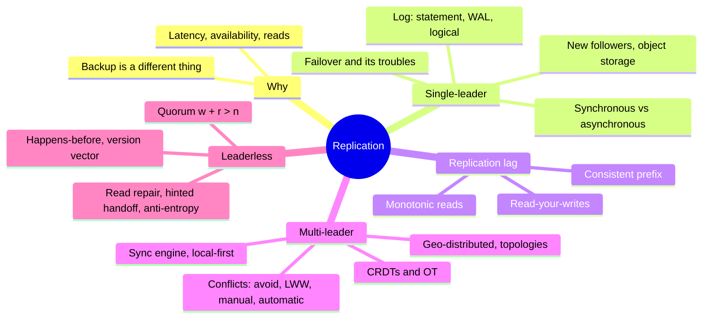
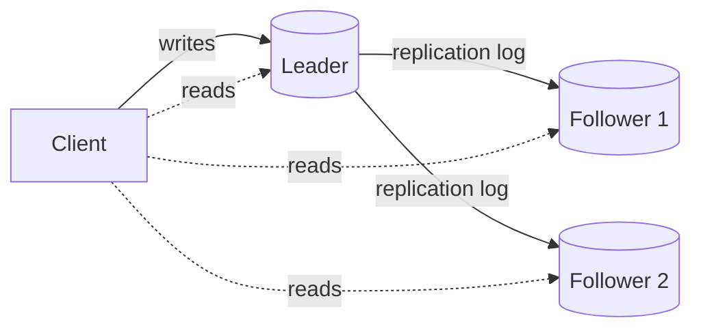
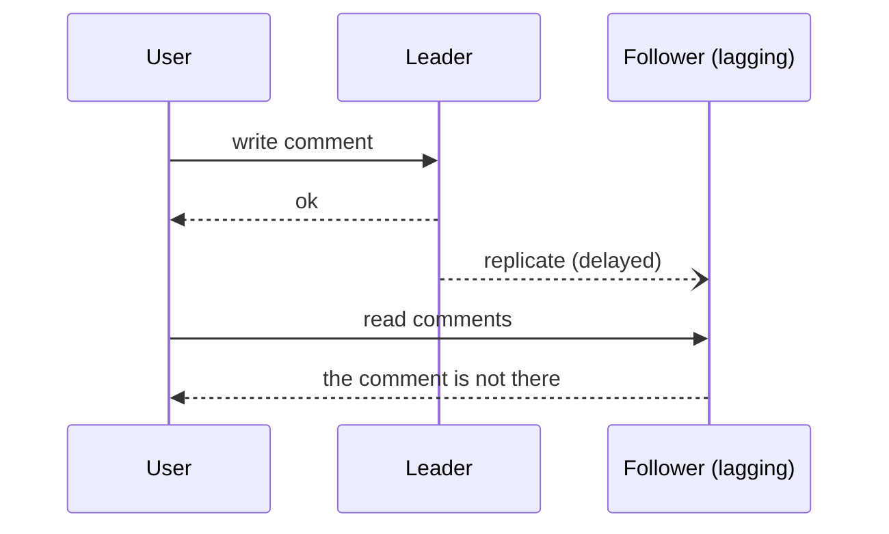
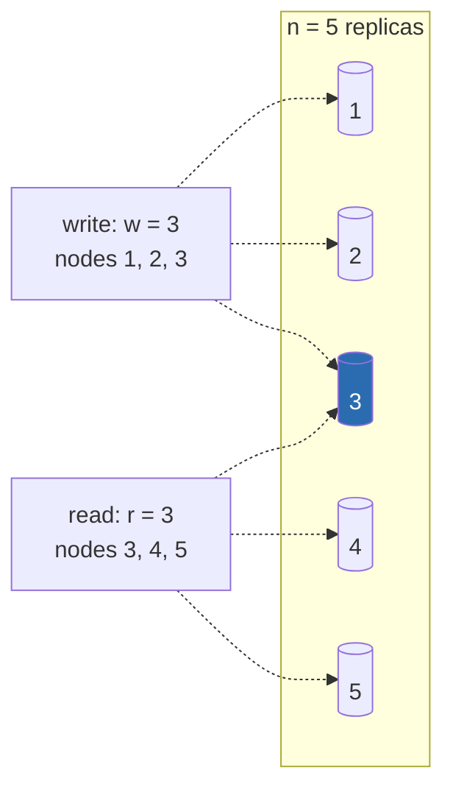

# Chapter 6 · Replication

> *The major difference between a thing that might go wrong and a thing that cannot possibly
> go wrong is that when a thing that cannot possibly go wrong goes wrong, it usually turns out
> to be impossible to get at or repair.* — Douglas Adams, Mostly Harmless (1992)

**In one sentence:** copying data that never changes is trivial; all the difficulty in
replication lies in propagating **changes**. Three families (one leader, several
leaders, no leader), one cross-cutting trade-off (synchronous or asynchronous) and a set
of anomalies that an application must be able to recognize.

**PDF pages:** 221-274 · **Density:** high. This is the chapter that comes up most often
in system design interviews. The three replication lag guarantees and the section on
conflicts must be understood properly, not just read.

---

## Chapter map

---

## 0. Why replicate, and why it is not enough
<!-- pdf: 221 -->

Three reasons: data close to the users (latency), keep working if something goes
down (availability and durability), more machines to serve reads (throughput).
The chapter assumes that each machine holds the **entire** dataset; ch. 7 drops
that assumption.

**Replication is not backup.** Replication propagates writes quickly, including an
accidental deletion. A backup keeps old snapshots so that you can go back in time.
They are complementary: backups are used to create replicas, and archiving the
replication log is part of a backup.

---

## 1. Single-leader
<!-- pdf: 222 -->

One replica is the **leader** (primary, source): it receives all writes and sends them to
the **followers** (read replicas, secondaries, hot standbys) as a log of changes, which
they apply in the same order. Reads can go anywhere. With sharding each shard
has its own leader. It is everywhere: PostgreSQL, MySQL, Oracle, SQL Server, MongoDB,
DynamoDB, Kafka, DRBD, and consensus algorithms such as Raft (etcd, CockroachDB,
TiDB) are single-leader with automatic election.

### Synchronous or asynchronous
<!-- pdf: 224 -->

- **Synchronous**: the leader waits for the follower's confirmation before replying to
  the client. The follower is guaranteed to be up to date, but if it does not respond
  **all writes block**.
- **Asynchronous**: the leader sends and does not wait. Fast, but if the leader dies the
  writes not yet replicated **are lost** even though they were confirmed to the client.

All synchronous is impractical: one node down halts everything. The practice is
**semi-synchronous**: one synchronous follower, the others asynchronous, and if the
synchronous one slows down another is promoted. Guarantee: up-to-date data on at least
two nodes. Variant: a synchronous **majority** (3 out of 5), which is a quorum and comes
back in ch. 10. Fully asynchronous is nonetheless widespread, especially with many
followers or geographic distribution.

### Adding a follower without stopping
<!-- pdf: 225 -->

Copying the files while the DB is writing makes no sense, locking the DB defeats
availability. Procedure: consistent snapshot of the leader **without locking** (also
needed for backups), copy to the new node, the follower asks the leader for everything
that has changed since a **precise position in the log** (log sequence number in
PostgreSQL, binlog coordinates or GTID in MySQL), applies the backlog and has *caught
up* with the leader. Snapshots and logs archived on object storage (WAL-G, Litestream)
serve both for backups and for this step.

### Databases backed by object storage
<!-- pdf: 226 -->

More and more DBs serve queries directly from S3 and the like: cheap, multi-zone and
multi-region replication with very high durability, **conditional write**
(compare-and-set) for transactions and leader election, integration between DBs via
open formats (Parquet, Iceberg). The costs: much higher latency, per-call fees that
force batching, immutable objects (random writes are extremely expensive), non-POSIX
interfaces. Answers: **tiered storage** (hot data on SSD, cold data on the object
store), WAL on separate low-latency storage (EBS, Neon's Safekeeper), or a
**zero-disk architecture**: everything on object storage, disks and RAM only as caches,
nodes with no persistent state (WarpStream, Bufstream, Redpanda Serverless, SlateDB,
nearly every cloud warehouse).

### When a node goes down
<!-- pdf: 228 -->

**Follower**: easy. From its log it knows the last transaction it applied, asks the
leader for the rest, catches up. The leader however has to decide how much log to keep
for absent followers: risk of a full disk, or a follower that has to be rebuilt from a
backup.

**Leader: failover.** Promote a follower, redirect the clients, make the other
followers follow the new leader. Automatically, in three steps:

1. **Determining that the leader has failed.** There is no foolproof way: a **timeout**
   (30 seconds without a response). Planned maintenance does not count, the leader hands
   over beforehand.
2. **Choosing a new leader.** Majority election or appointment by a controller node.
   The best candidate is the most up-to-date one. It is a **consensus** problem (ch. 10).
3. **Reconfiguring.** Clients write to the new leader; the old one, if it comes back,
   must realize it has been deposed.

What goes wrong:

| Problem | Consequence |
|---|---|
| Asynchronous replication, new leader behind | The old leader's unreplicated writes are **discarded**: acknowledged, not durable |
| Discarding coordinated with external systems | GitHub: an out-of-date follower was promoted and reused autoincrementing primary keys already used and present in Redis, private data shown to the wrong users |
| **Split brain**: two nodes believe they are the leader | Both accept writes, data lost or corrupted. Shutting one of them down (*fencing*) may shut down both, or arrive too late |
| Timeout too long | Slow recovery |
| Timeout too short | Unnecessary failovers for a load spike or a network glitch, which make the situation worse |

For this reason many teams perform failover **manually** even if the software
automates it. Golden rule: promote the **most up-to-date** follower (the synchronous
one, or the highest log sequence number).

### What the replication log looks like
<!-- pdf: 230 -->

| Method | How | Pros | Cons |
|---|---|---|---|
| **Statement-based** | The leader forwards every INSERT/UPDATE/DELETE | Compact | `NOW()`, `RAND()`, autoincrement, triggers: nondeterministic. MySQL used it until 5.1; VoltDB makes it safe by requiring deterministic transactions |
| **WAL shipping** | The leader sends the same WAL as the B-tree | Reuses what is already there (PostgreSQL, Oracle) | Bytes in disk blocks: **coupled to the storage engine**, leader and followers must run the same version, upgrades with downtime |
| **Logical (row-based)** | Record per row: new values for an insert, key for a delete, key and changed columns for an update, plus a commit marker | Decoupled: different versions, **upgrade without downtime** by promoting an upgraded follower; readable by external systems (**change data capture**, ch. 12) | One more log (MySQL's binlog; PostgreSQL decodes the physical WAL) |

Deterministic statements in a fixed order is the idea behind event sourcing and
**state machine replication** (ch. 10).

---

## 2. Replication lag and its anomalies
<!-- pdf: 233 -->

Many asynchronous followers to scale reads (*read-scaling*) only work asynchronously:
making them all synchronous would bring the system down whenever any node is down. But
an asynchronous follower can be behind: the same query on leader and follower gives
different results. If you stop writing, they converge sooner or later: **eventual
consistency**. "Eventually" is deliberately vague: usually a fraction of a second, under
load or with network problems even minutes. It applies to relational databases exactly
as it does to NoSQL.

Three anomalies, three guarantees an application can ask for:

### Read-your-writes
<!-- pdf: 234 -->

The user writes (to the leader), reloads the page (from a lagging follower) and **does
not see** what they just wrote. It looks lost.

The **read-after-write** guarantee promises that the user always sees their **own**
writes, not those of others. How:

- Read from the leader whatever the user may have modified (their own profile), from a
  follower everything else. You need to know what is modifiable without querying.
- If almost everything is modifiable: for one minute after the last write read from the
  leader, or exclude followers whose lag is above a threshold.
- The client remembers the **timestamp** of its last write (logical, like a log
  sequence number, or system time with the problems of ch. 9) and the system serves
  the read only from a replica that is at least at that point, or waits.

Complications: multiple regions (requests to the leader must be routed to its
region) and **multiple devices** of the same user (the timestamp must be centralized,
and desktop and phone may end up in different regions).

*Region* = several datacenters in one location; each datacenter is an *availability
zone*. Multi-zone survives a zone outage, not a region outage; multi-region costs
latency, throughput and network bill.

### Monotonic reads
<!-- pdf: 236 -->

The user reads twice from different replicas: first from an up-to-date one (sees a
comment), then from a lagging one (the comment has vanished). **Time goes backward.**
The guarantee: a sequence of reads by the same user never sees data older than what
it has already seen. Weaker than strong consistency, stronger than eventual.
Typical implementation: each user always reads from the **same replica**, chosen by a
hash of the user ID.

### Consistent prefix reads
<!-- pdf: 237 -->

Mr. Poons asks, Mrs. Cake answers. An observer sees the answer **before** the
question because the two shards replicate with different lags: **causality** is
violated. The guarantee: if writes happen in a certain order, anyone reading them sees
them in that order. Easy with a single leader; in sharded DBs the shards are
independent and there is no global ordering. Solutions: causally related writes on the
same shard, or algorithms that track dependencies (happens-before, below).

### What to do
<!-- pdf: 238 -->

Ask yourself how the app behaves if the lag reaches minutes or hours. If it is a
problem, design for the stronger guarantee: pretending replication is synchronous when
it is asynchronous is a recipe for trouble. Handling it in application code is complex
and fragile. The simplest model for developers is a **linearizable** DB with ACID
transactions (ch. 8 and 10): NoSQL said it does not scale, **NewSQL** has proven
otherwise. There remain good reasons for weaker consistency: resilience to network
interruptions and lower overhead. The rest of the chapter is about that.

---

## 3. Multi-leader
<!-- pdf: 239 -->

The flaw of single-leader: if you cannot reach the leader you cannot write. Several
nodes accept writes and forward them to the others (*active/active*, bidirectional).
In the synchronous version it is equivalent to single-leader; interesting only
**asynchronous**.

### Geographically distributed
<!-- pdf: 240 -->

One leader per region, leader-follower replication within the region, replication
between leaders across regions.

| | Multi-region single-leader | Multi-leader |
|---|---|---|
| Write latency | Every write crosses the internet to the leader's region | Local write, asynchronous replication hidden |
| Region outage | Failover to another region | Each region keeps going on its own |
| Unstable inter-region network | Very sensitive | Tolerates it: each leader carries on |
| Consistency | Strong, even serializable transactions | **Much weaker**: you cannot guarantee a never-negative balance or a unique username, two leaders accept writes that are individually valid but together violate the constraint |

It is a fundamental limitation of distributed systems. Supported by MySQL, Oracle, SQL
Server, YugabyteDB, add-ons for Postgres, but often **retrofitted**: autoincrement,
triggers and integrity constraints give surprises. "Dangerous territory that should be
avoided if possible."

**Topologies**: circular, star, all-to-all. In the first two each write may pass
through several nodes: it is tagged with the IDs of the nodes it passed through to avoid
loops, and one node down interrupts the flow. All-to-all is more tolerant but messages
may **overtake** each other on different links: an update arrives before the insert of
the same row. This is causality again; timestamps are not enough (unsynchronized clocks,
ch. 9), you need **version vectors**. Many multi-leader systems do not do this well:
read the documentation and test.

### Sync engines and local-first
<!-- pdf: 244 -->

The calendar on your phone and on your laptop: each device is a local leader, the
synchronization is asynchronous multi-leader replication with a lag of hours or days.
Google Docs, Figma, Linear: each browser tab is a replica, changes show up immediately
and propagate afterwards. Both cases need the same infrastructure: capture local
changes, send or queue them, receive the others', merge them, update the UI. The
library that does this is a **sync engine**.

- **Offline-first**: you keep working without a network.
- **Local-first**: it works even if the developer shuts down the servers, thanks to an
  open sync protocol with several providers. Git is local-first (GitHub or GitLab, it
  makes no difference).

Advantages: UI that responds within one frame (16 ms), no separate offline mode
(offline is just a very large network delay), declarative programming on local data
that almost never fails, real-time updates with a reactive model. Limitation: it works
if all the user's data can be downloaded in advance; not for an e-commerce catalog.
Lotus Notes in the 1980s; today Firestore, Realm, Ditto (proprietary backend),
PouchDB/CouchDB, Automerge, Yjs (open). In video games it is called netcode.

### Conflicting writes
<!-- pdf: 246 -->

Two users change the title of a wiki page, one in B and one in C, each on their own
leader. The writes are **concurrent**: neither knew about the other. Physical time does
not matter, what matters is whether one happened in a state where the other had already
taken effect. Four strategies:

**1. Avoid them.** All writes to a record on the same leader: the user has a "home"
region and from their point of view it is single-leader. It breaks if you change the
designated leader (region down, user who moves). Another example: one leader generates
odd IDs, the other even ones.

**2. Last write wins.** Timestamp on every write, the highest wins, the other **is
silently discarded** even though it had been acknowledged. The name is misleading: among
concurrent writes "the last" is not defined, the choice is arbitrary. Convergence at the
price of **data loss**. It is fine if you only insert unique keys and never update. With
system clocks it is fragile: a node with a clock running ahead always wins; you need a
logical clock (ch. 10).

**3. Manual.** Like a merge conflict in Git, but you cannot halt replication until a
human intervenes: the DB keeps all the concurrent values (**siblings**) and returns them
on read, the app or the user merges them and writes back (CouchDB). Problems: the API
changes (a title becomes a set of titles), the merge UI is work, naive automatic merging
surprises: the **Amazon shopping cart** took the union of the sets and removed items
**reappeared**; and two nodes resolving the same conflict in different orders create a
new conflict (B/C versus C/B).

**4. Automatic.** An algorithm that merges concurrent writes so that all replicas that
have seen the same writes have the same state, **regardless of order**: *strong
eventual consistency*. For text, insertions and deletions of characters are tracked;
for lists and sets likewise, so the cart gives {Soap} and does not bring back Book and
DVD; for counters the increments and decrements of each sibling are summed; for maps
everything is applied per key. Limits: "at most five items" with several users adding
at the same time can only be resolved by discarding. If you start from an offline-first
app, conflicts are unavoidable and automating them is the way.

**CRDTs and OT.** Two replicas start from `ice`; one puts `n` in front, the other `!`
at the end; expected result `nice!`.

| Operational Transformation | CRDT |
|---|---|
| Operations by **index**: `n` at 0, `!` at 3. Applying `!` at 3 to `nice` would give `nic!e`: the index must be **transformed** to 4 for the concurrent operations already applied | Each character has a **unique immutable ID**; an insertion says "after character 3A". Concurrent insertions at the same spot ordered by ID. No transformation |
| Google Docs, ShareDB | Redis Enterprise, Riak, Cosmos DB, Automerge, Yjs |

**Subtle** conflicts: two bookings of the same room at the same time are two inserts,
not an update of the same field, yet they violate a constraint. No ready-made answer,
it is discussed in ch. 8 and 13.

---

## 4. Leaderless
<!-- pdf: 253 -->

No leader: every replica accepts writes directly from the client (or from a
coordinator that **does not enforce an ordering**). An old idea, forgotten, brought
back into fashion by Amazon's Dynamo (2007): Riak, Cassandra, ScyllaDB are
*Dynamo-style*. Careful: **DynamoDB is a different thing**, single-leader with
Multi-Paxos.

### Writing when a node is down
<!-- pdf: 253 -->

Three replicas, one rebooting. No failover: the client writes to all three in
parallel, two acknowledge, the write succeeded. When the third comes back it is
**behind**: whoever reads from it gets stale values. So reads also go to several nodes
in parallel, every value carries a **version number**, and the client keeps the
highest. Three mechanisms for catching up:

| Mechanism | How | Covers |
|---|---|---|
| **Read repair** | The client sees a stale response and writes the newer value back to that replica | Frequently read values |
| **Hinted handoff** | A replica keeps the writes meant for the node that is down as *hints* and delivers them when it comes back | Values that are never read |
| **Anti-entropy** | Background process that compares replicas and copies what is missing, in no particular order and with delay | Everything, slowly |

### Quorums
<!-- pdf: 255 -->

With n replicas, a write must be confirmed by **w** nodes and a read queries **r**
nodes. If **w + r > n** the sets overlap: at least one of the nodes read has the most
recent value.

Node 3 is in both. Typical: odd n (3 or 5), w = r = majority. Variants: w = n, r = 1
for very fast reads but one node down blocks writes. Requests always go to all n
nodes, w and r only say **how many to wait for**. With w < n you can write with a node
down, with r < n you can read; n = 5, w = r = 3 tolerates two nodes down. A cluster may
have more than n nodes: each value lives on n of them (sharding, ch. 7).

With w + r ≤ n you read stale values more often but you get lower latency and higher
availability.

### The limitations of quorums
<!-- pdf: 257 -->

Even with w + r > n, "always read the latest value" **is not guaranteed**:

- A node with the new value dies and is restored from one with the old value: the
  number of new copies drops below w.
- During rebalancing the nodes have different ideas about who holds the n copies: the
  quorums no longer overlap.
- A read concurrent with a write: it may see it or not, and a later read may see the
  **old** value after an earlier one saw the new one (ch. 10).
- A write that succeeded on fewer than w nodes: **it is not rolled back** where it
  succeeded. A "failed" write may show up in reads.
- System timestamps to decide which is newer (Cassandra, ScyllaDB): a clock running
  ahead silently discards writes.
- Two concurrent writes arrive in different orders on different replicas: conflict.

The parameters tune the **probability** of stale reads, they do not eliminate it.
Dynamo-style systems are for those who can tolerate eventual consistency. **Monitoring
staleness** is hard: with a leader you just subtract the positions in the log; without
an ordering there is no clean metric, the number of pending hints is a vague clue.
Eventual is vague by definition, but to operate the system you need to quantify it.

### Performance compared
<!-- pdf: 259 -->

Reading from the leader is up to date but: throughput limited by the leader, failover
visible to users, a slow leader slows everyone down. Leaderless is resilient because
**it does not distinguish the normal case from the failure case**: requests go to
several replicas anyway, a slow one is ignored (**request hedging**, cuts tail
latency). Great with **gray failures**, nodes that are not dead but degraded, where a
leader-based system must decide whether a failover is worth it.

But: detecting absent nodes and handling hints loads the system when it is already in
trouble; large quorums wait for more responses and are more likely to hit a slow
replica (rarely beyond 4 out of 7 or 5 out of 9); a network partition may prevent the
quorum, and some DBs let **any** reachable replica accept the write (*sloppy quorum* in
Riak and Dynamo, consistency level ANY in Cassandra) with no guarantee of reading it
back.

Multi-leader is even more resilient to the network (you talk to a single, nearby
leader) but reads can be arbitrarily old. The quorum is the compromise.

**Multi-region**: in Cassandra and ScyllaDB the client picks a local coordinator that
forwards to the local replicas and to **one** replica in every other region, which
propagates; you choose a global quorum, per region, or local only (fast, more stale).
Riak keeps everything local and replicates between clusters multi-leader style.

### Detecting concurrent writes
<!-- pdf: 261 -->

Three nodes, two clients write X; node 1 sees only A, node 2 sees A then B, node 3 sees
B then A. If each one blindly overwrites, they stay **inconsistent forever**. They must
converge: LWW (Cassandra, ScyllaDB), manual, CRDT (Riak). But a timestamp does not tell
you whether two values are in conflict or in sequence. You need the causality relation.

**Happens-before.** A happens-before B if B **knows** about A, depends on A, builds
upon A. Two operations are **concurrent** if neither happens-before the other. Physical
time is irrelevant: two writes can be hours apart and still be concurrent if the
network prevented one from knowing about the other. Three cases: A before B, B before
A, concurrent. In the first two the later one overwrites; in the third there is a
conflict.

**The algorithm with a single replica.** The server keeps a version number per key;
a read returns **all the siblings** and the version; a write must carry the version
from the preceding read and must have **merged** the siblings it received; the server
overwrites the values with version ≤ the one carried and **keeps** those with a higher
version, because they are concurrent. A write without a version is concurrent with
everything and overwrites nothing. Shopping cart example: two clients add milk, eggs,
flour, ham, bacon without ever seeing each other up to date, the siblings pile up and
get merged, and **no write is lost**.

**Version vectors.** With several replicas and no leader you need a version **per
replica and per key**: each replica increments its own and keeps track of those seen
from the others. The whole set is the version vector (Riak 2.0's *dotted version
vector*, which it calls *causal context*). It travels from the DB to the client on read
and comes back on write. It makes it safe to read from one replica and write to another:
at most siblings arise, never losses. It is sometimes called a vector clock, but it is
not the same thing: for comparing the state of replicas the version vector is the right
structure.

---

## The three guarantees in one table

| Guarantee | Anomaly it avoids | Typical implementation |
|---|---|---|
| **Read-after-write** | I do not see what I just wrote | Own data from the leader; timestamp of the last write |
| **Monotonic reads** | I see a value, then it vanishes | Same replica per user, hash of the ID |
| **Consistent prefix** | The answer before the question | Related writes on the same shard; track causality |

## The three models in one table

| | Single-leader | Multi-leader | Leaderless |
|---|---|---|---|
| Who accepts writes | One node | Several nodes, one per region or device | Any replica, w of n |
| Ordering of writes | Total, from the leader | None between leaders | None |
| Consistency | Strong possible | Weak, conflicts | Eventual, tunable with w and r |
| Node failure | Follower: catch-up. Leader: failover | Each leader carries on | No failover, just ignore it |
| Weak point | The leader: throughput, failover, split brain | Conflicts, retrofitted features | Quorums not absolute, staleness hard to measure |
| Examples | PostgreSQL, MySQL, Kafka, Raft | Regions, sync engines, local-first | Cassandra, Riak, ScyllaDB |

---

## Self-check questions

1. Why is "all followers synchronous" impractical and what does the semi-synchronous configuration do?
2. How do you add a follower without downtime? What is needed besides the snapshot?
3. List three things that can go wrong in an automatic failover.
4. WAL shipping versus logical log: why does the second allow upgrades without downtime?
5. A user posts a comment and does not see it: which guarantee is missing, and two ways to provide it.
6. Why does "always read from the same replica" give monotonic reads and not read-your-writes?
7. Why can multi-leader not guarantee unique usernames?
8. In what sense does LWW "lose data" and why is the name misleading?
9. What went wrong in the Amazon shopping cart and how does a CRDT solve it?
10. OT and CRDTs both get to the same `nice!`: by which mechanism each?
11. n = 5, w = 3, r = 3: why do I always read at least one up-to-date value? List two
    cases in which I still do not read it.
12. Read repair, hinted handoff, anti-entropy: what does each one cover?
13. Define happens-before and concurrency without using the word "time".
14. Why is one version per key not enough with several replicas, and what does the version vector add?

Flashcards in [`flashcards/ch06.yaml`](../data/flashcards/ch06.yaml).

## Cross-references

- Sharding, request routing, rebalancing: ch. 7
- Serializable transactions, constraints, conflicts: ch. 8
- Timeouts, unreliable clocks, gray failures: ch. 9
- Consensus, leader election, linearizability, logical clocks, fencing: ch. 10
- Change data capture: ch. 12
- Scalable conflicts in replicated systems: ch. 13
