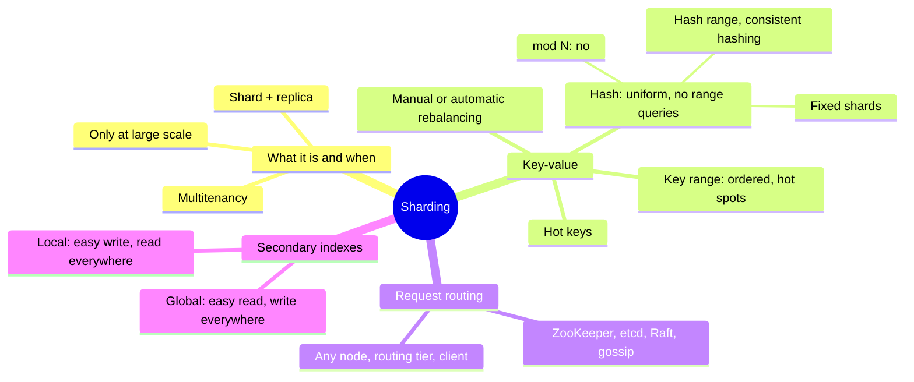
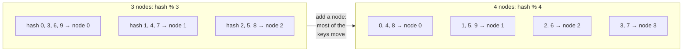
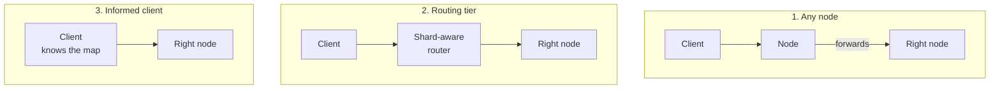
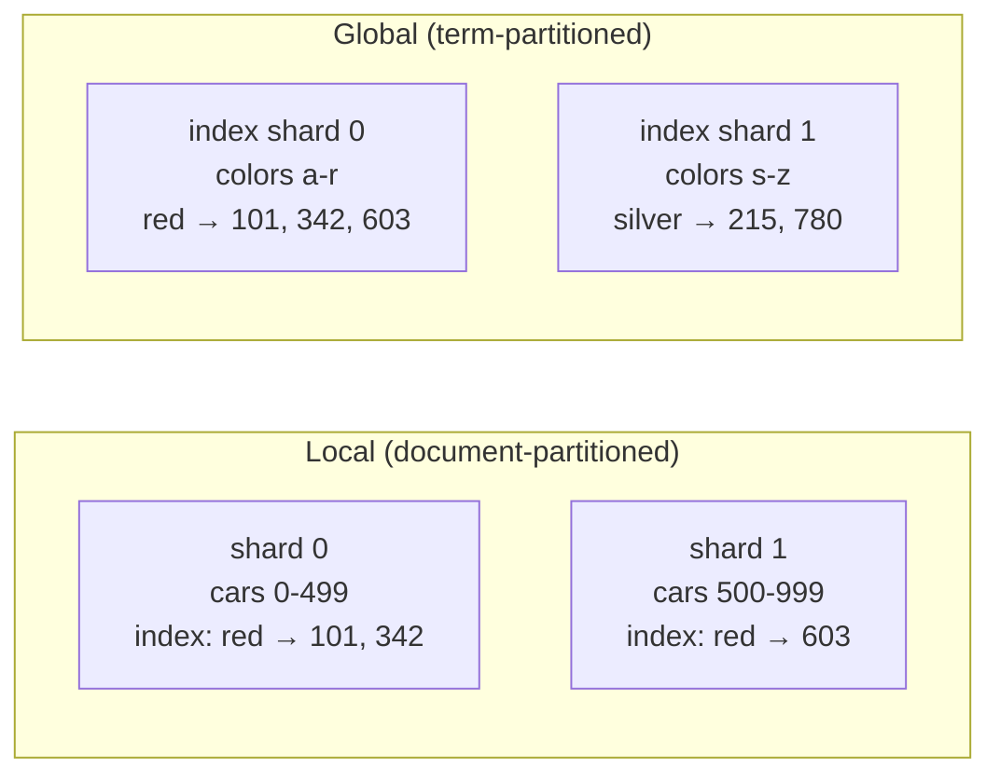

# Chapter 7 · Sharding

> *We must state relationships, not procedures.* — Grace Murray Hopper, *Management and the Computer of the Future* (1962)

**In one sentence:** when the data or the writes no longer fit on one machine, you
split the dataset into **shards** and each shard goes to a different node. There are
three questions: by which rule do I assign a record to a shard, how do I rebalance when
I add nodes, and how does a client find the right node. Plus one complication:
secondary indexes.

**PDF pages:** 275-300 · **Density:** medium-low. A short, linear chapter, but the
choice of partition key is one of the hardest decisions to change afterwards.

---

## Chapter map

---

## 1. What it is, and why to think twice
<!-- pdf: 275 -->

A distributed DB does two things with data: it **copies** it onto several nodes
(replication, ch. 6) and it **splits** it into shards on different nodes. Each record
lives in exactly one shard; each shard is a small database of its own. The two combine:
a node is the leader for some shards and a follower for others, but each shard has only
one leader.

Different names for the same thing: partition in Kafka, range in CockroachDB, region in
HBase and TiDB, vBucket in Couchbase, vnode in Riak, token range in Cassandra, tablet in
Bigtable and ScyllaDB. In PostgreSQL *partitioning* means splitting a table into
several files **on the same machine**; *sharding* is across several machines. Nothing
to do with network partitions (ch. 9).

**When.** The reason is scalability of **data and writes**. If the problem is reads,
read scaling with followers is enough. Sharding is heavy and only makes sense at large
scale, because:

- You must choose a **partition key**, and all records with the same key live
  together. If you search without knowing it, you query every shard. The scheme is
  hard to change.
- Easy for key-value, hard for relational: secondary indexes and joins across
  different shards.
- A write that touches several shards requires a **distributed transaction**, which is
  much slower (ch. 8).

Useful aside: some systems also shard **within a single machine**, one single-threaded
process per core (Redis, VoltDB, FoundationDB), to exploit the cores and NUMA memory.

### Sharding for multitenancy
<!-- pdf: 278 -->

In SaaS each customer is a tenant with separate data: one shard per tenant, or several
small tenants in one shard. Advantages: **resource** isolation (a heavy tenant does not
slow down the others), **permission** isolation (an access control bug does less damage
if the data is physically separated), **cell-based architecture** (the services and
storage of a group of tenants in an independent cell, a failure stays in the cell),
backup and restore per tenant, GDPR (export and deletion are operations on a single
shard), data residency per region, schema rollout one tenant at a time.

Challenges: a tenant too big for one node must be sharded in turn; many small tenants
cost overhead and must be grouped, with the problem of moving them when they grow;
features that cut across tenants become cross-shard joins.

---

## 2. Sharding of key-value data
<!-- pdf: 279 -->

Goal: data and load **uniform** across nodes, so that 10 nodes handle 10 times as
much. If it is not uniform it is **skewed**; an overloaded shard is a **hot spot**; an
overloaded key (the celebrity) is a **hot key**. The algorithm takes the partition key
(the key or its first part; in relational a column, not necessarily the primary key)
and says which shard. It must lend itself to rebalancing.

### By key range
<!-- pdf: 280 -->

Like the volumes of an encyclopedia: each shard gets a contiguous range of keys, from
minimum to maximum. The boundaries are **not evenly spaced** (A-B in one volume, T-Z in
another) and adapt to the data, chosen by hand (Vitess) or automatically (Bigtable,
HBase, MongoDB range, CockroachDB, FoundationDB).

Within the shard the keys are sorted (B-tree or SSTable): **easy range scans**, and the
key works as a concatenated index. Sensors with key = timestamp: "all readings from
March" is a scan.

The flip side: writes to nearby keys all go to the same shard. With the timestamp,
**all of today's writes** end up in this month's shard while the others sit idle.
Remedy: prefix the sensor ID to the timestamp, so the load spreads out; but now "all
sensors in a time range" is one range query per sensor.

**Rebalancing.** At the start there are no ranges: you can **pre-split** (HBase,
MongoDB) if you know the distribution. Then a shard that exceeds a threshold (10 GB by
default in HBase) or a sustained write throughput is **split** into two subranges,
like the top level of a B-tree; shrunken shards are merged. The number of shards
follows the data volume. But splitting is expensive, it rewrites everything like a
compaction, and the shard to split is often the one already under load.

### By hash of key
<!-- pdf: 282 -->

If you don't care about nearby keys living together (tenant ID), you hash first. A good
hash makes a skewed distribution uniform; it need not be cryptographic (MD5 in MongoDB,
Murmur3 in Cassandra). Beware of language built-in hashes: Java's `hashCode()` and
Ruby's `#hash` may change between processes.

**Hash mod N: no.** `hash % number_of_nodes` is obvious and wrong: add a node and
**almost all keys move**.

**Fixed number of shards.** Many more shards than nodes: 1,000 shards on 10 nodes, 100
per node, key in shard `hash % 1000`, and a separate map shard → node. An extra node
receives **whole shards** from the others until it has its share; on removal, the
reverse. The key → shard map never changes, only shard → node. During the transfer the
old map is used. A number with many divisors makes any number of nodes fair; more
powerful nodes get more shards. Citus, Riak, Elasticsearch, Couchbase.

The limit: you have to **guess the number** at the beginning. More nodes than shards is
impossible, and changing the number is an expensive resharding, sometimes not
concurrent with writes. Shards that are too large make rebalancing and recovery
expensive, too small ones cost overhead, and if the dataset grows a lot there is no
"right" size.

**Hash range.** The combination: each shard gets a **range of hash values** (0-16,383
to shard 0, and so on). Similar keys, scattered hashes: no hot spots from proximity.
The shard splits when it grows, so the number adapts. The price: range queries on the
partition key are inefficient. But if the key has several columns and only the first
is the partition key, range queries on the subsequent columns remain efficient within
the shard. YugabyteDB, DynamoDB, MongoDB optionally. Data warehouses do the same under
other names: partition key plus cluster columns (BigQuery), micro-partitions with
cluster key (Snowflake), Delta Lake.

Cassandra and ScyllaDB: the hash space is split into many ranges per node (16 and 256)
with **random boundaries**; the imbalances average out statistically, and a new node
receives pieces of ranges from several nodes without moving more than necessary.

**Consistent hashing.** A hash that maps keys onto a given number of shards with two
properties: roughly equal load, and **when the number changes, the minimum number of
keys move**. "Consistent" has nothing to do with replica consistency or ACID: it is
the tendency of a key to stay where it is. Cassandra is close to the original
definition; alternatives: rendezvous hashing, jump consistent hashing, where the new
node receives individual scattered keys from everyone instead of subranges.

### Skewed load and hot keys
<!-- pdf: 287 -->

Uniform hash ≠ uniform load. The celebrity's post concentrates reads and writes on one
key. Remedies:

- With ranges (of keys or of hashes) you can isolate the hot key in a shard of its
  own, perhaps on a dedicated machine.
- At the application level: **two random digits appended to the key** spread the
  writes over 100 keys in different shards. But reads must read all 100 and combine,
  and bookkeeping is needed: which keys are split, how to convert a regular key into a
  hot one and back, given that a viral post calms down after a couple of days. Keys
  that are hot for reads and hot for writes need different strategies.
- Large-scale clouds automate it: *heat management*, *adaptive capacity* at Amazon.

### Rebalancing: automatic or manual
<!-- pdf: 288 -->

Automatic is convenient and can autoscale in minutes (DynamoDB). But rebalancing is
expensive: it reroutes requests and moves a lot of data, it can saturate the network
and the nodes, and if the system is close to its write maximum the split cannot keep
up. Dangerous together with **automatic failure detection**: a slow node is believed
dead, the cluster rebalances by moving load onto the others, which become slow and are
believed dead: **cascading failure**. Middle ground: the system proposes, the
administrator confirms (Couchbase, Riak). A human in the loop is slower but avoids
surprises, and allows rebalancing **before** a known event (Cyber Monday, the World Cup
final).

---

## 3. Request routing
<!-- pdf: 289 -->

Given a key, which IP and port? It is service discovery, with one difference: a
stateless service accepts any instance, a shard only the nodes that replicate it. The
routing must know key → shard and shard → node.

Three common questions: who decides which shard lives on which node, and how to make
it fault-tolerant without split brain; how the party doing the routing **learns** about
changes; what happens to requests in flight towards the old node during a move.

Common answer: a **coordination service** (ZooKeeper, etcd) with consensus (ch. 10).
Nodes register, the service keeps the authoritative map, routing tier and clients
subscribe and get notified. HBase and SolrCloud use ZooKeeper, Kubernetes uses etcd;
MongoDB has its own config servers and `mongos` routers; Kafka, YugabyteDB, TiDB,
ScyllaDB have Raft built in. Riak uses **gossip** between nodes: much weaker
consistency, split brain possible, tolerable because leaderless promises little anyway.
The IPs of the routing tier change rarely: DNS is enough.

Analytic DBs shard too, but the queries aggregate and join **across many shards in
parallel**: ch. 11.

---

## 4. Secondary indexes
<!-- pdf: 292 -->

So far the client knew the partition key. A secondary index searches for occurrences
of a value ("all red cars") and **does not map neatly onto shards**. Two approaches:

| | Local | Global |
|---|---|---|
| Where it lives | Each shard indexes only its own records | One index over all records, sharded by **indexed value** (the term) |
| Write | Touches **a single shard** | Touches several index shards: a record has several terms, each elsewhere. Needs a distributed transaction, or accepting asynchrony |
| Read with one condition | If you don't know the partition key, **all shards** (scatter/gather): tail latency amplification, and adding shards does not increase query throughput | **A single shard** for the postings list; then the records from their shards anyway |
| Read with several conditions | Each shard does the AND locally | Terms on different shards: the postings lists travel over the network for the intersection, slow if long |
| Who uses it | MongoDB, Riak, Cassandra, Elasticsearch, SolrCloud, VoltDB | CockroachDB, TiDB, YugabyteDB; DynamoDB both, with **asynchronous** global indexes and therefore stale reads |

Global pays off with many more reads than writes and short postings lists. Warning:
building a secondary index by hand in application code on top of a key-value store is
easy to let diverge (race conditions, partial writes): ch. 8.

---

## The two strategies in one table

| | Key range | Hash |
|---|---|---|
| Key order | Preserved: efficient range queries | Destroyed: inefficient range queries on the partition key |
| Distribution | Follows the data: risk of hot spots on nearby keys | Uniform |
| Rebalancing | Split of the range when it grows | Fixed shards moved whole, or hash range with splits |
| Common pattern | | First part of the key as partition key, rest sorted within the shard |

---

## Self-check questions

1. When is sharding needed and when is read scaling enough?
2. Key = sensor timestamp: why is it a hot spot and how do you fix it? What do you lose?
3. Why is `hash % N` wrong for rebalancing?
4. Fixed number of shards: what moves and what never changes when you add a
   node? What is the limit?
5. Hash range versus key range: what do you gain and what do you lose?
6. Define consistent hashing with its two properties. What does "consistent" not mean?
7. Two random digits appended to a hot key: what does it solve and what does it make worse?
8. Why are automatic rebalancing and automatic failure detection dangerous together?
9. Three ways to route a request to the right shard, and where the map lives.
10. Local versus global index: who pays for the write and who pays for the read?

Flashcards in [`flashcards/ch07.yaml`](../data/flashcards/ch07.yaml).

## Cross-references

- Replication of shards: ch. 6
- Distributed transactions across several shards, consistent indexes: ch. 8
- Network partitions: ch. 9
- Consensus, ZooKeeper, etcd, split brain: ch. 10
- Parallel queries across many shards: ch. 11
