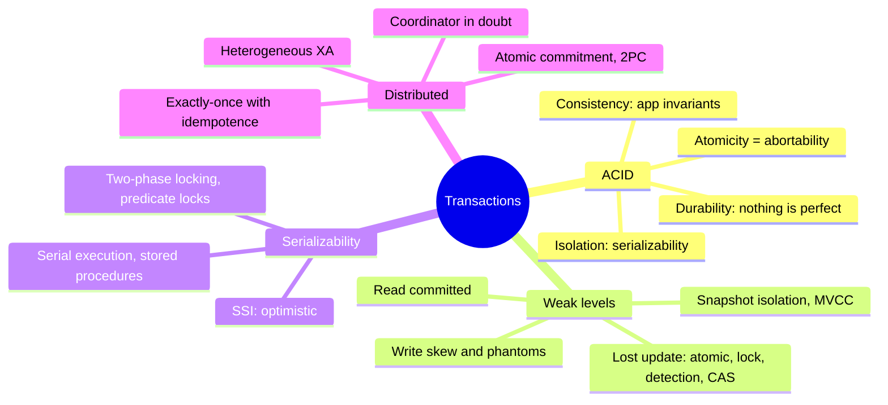
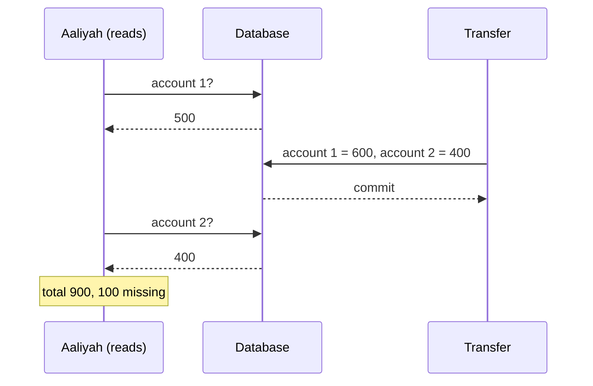
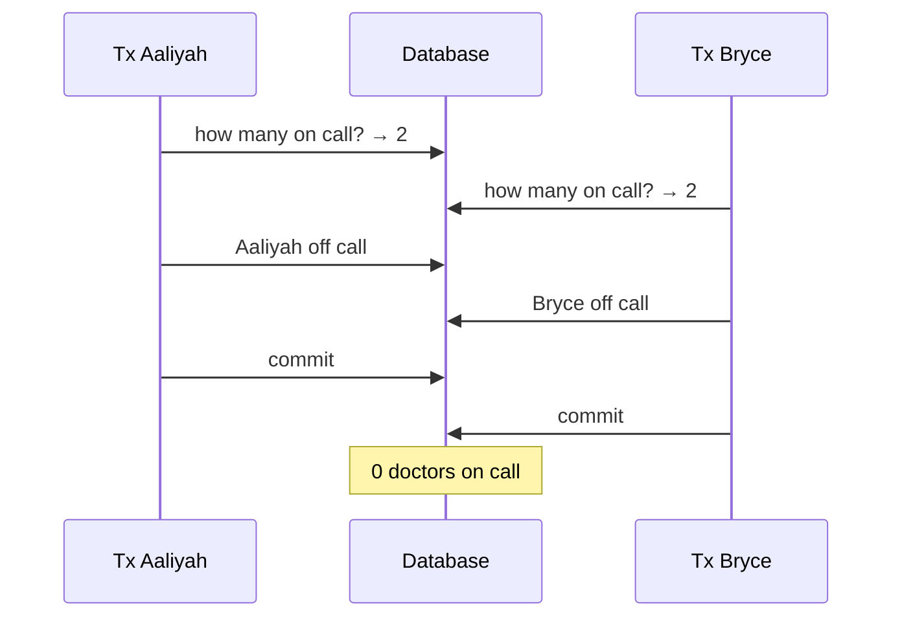
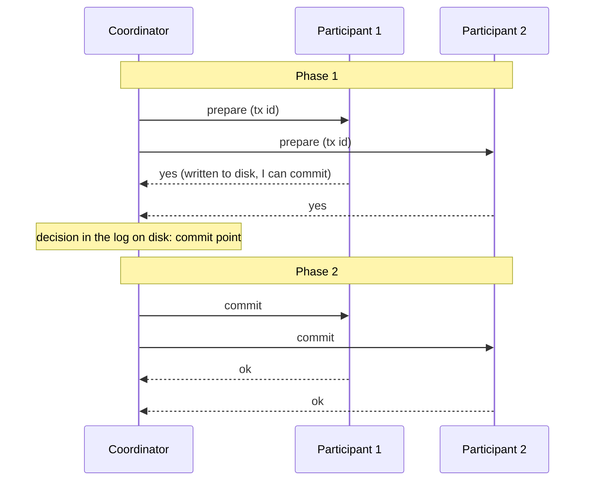

# Chapter 8 · Transactions

> *Some authors have claimed that general two-phase commit is too expensive to support,
> because of the performance or availability problems that it brings. We believe it is better
> to have application programmers deal with performance problems due to overuse of transactions
> as bottlenecks arise, rather than always coding around the lack of transactions.*
> — James Corbett et al., "Spanner: Google's Globally-Distributed Database" (2012)

**In one sentence:** a transaction groups reads and writes into a unit that either
succeeds as a whole or fails as a whole, so the application can ignore crashes, the network
and concurrency and simply retry. The chapter takes ACID apart word by word,
catalogs the race conditions that each isolation level lets through, explains how
serializability is achieved and what happens when a transaction touches several nodes.

**PDF pages:** 301-368 · **Density:** very high. The longest in the book. The
anomalies (dirty read, read skew, lost update, write skew, phantom) must be
recognizable on sight.

---

## Chapter map

---

## 1. What ACID really promises
<!-- pdf: 303 -->

Transactions are not a law of nature: they exist to **simplify the programming
model**. NoSQL abandoned them believing they could not scale; the NewSQL databases
(CockroachDB, TiDB, Spanner, FoundationDB, YugabyteDB) proved the
opposite by combining sharding and consensus. "ACID compliant" today is almost a
marketing term, and BASE just means "not ACID".

| Letter | What it really means | What it does not mean |
|---|---|---|
| **Atomicity** | If something goes wrong halfway through, the transaction is **aborted** and everything it wrote is undone. The right name would be *abortability* | Nothing to do with concurrency (that is isolation) |
| **Consistency** | The **application's invariants** remain true: credits and debits balanced. The DB can enforce constraints (foreign key, unique, check), but the more complex ones are the app's responsibility | It is not a property of the DB. The word has at least five meanings in the book |
| **Isolation** | Concurrent transactions do not step on each other's toes. The ideal is **serializability**: as if they had run one at a time | Many DBs do not implement it: Oracle calls snapshot isolation "serializable" |
| **Durability** | After commit the data is not lost: fsync, WAL, checksums on one node; copies on n nodes in a replicated system | Perfect durability does not exist: SSDs that violate fsync, buggy firmware, silent corruption, worn SSDs that lose data while powered off |

On durability: disk, replication and backups are not alternatives but **risk
reductions to be used together**.

### One object or many
<!-- pdf: 308 -->

Even for a single object you need atomicity (a 20 kB JSON written halfway?) and
isolation (does a reader see a partial value?): almost all engines provide them for
a single key with a log and per-object locks. **Atomic** operations (increment,
compare-and-set) avoid the read-modify-write cycle, but they are not transactions: Cassandra's
"lightweight transactions" are linearizable on **one** object only.

**Multi-object** transactions are needed when: foreign keys and edges between vertices
must remain valid; denormalized data must be updated together (the unread
mail counter); **secondary indexes** must be updated along with the record, otherwise
a record appears in one index and not in the other. In a relational DB the transaction is
everything that goes over the same TCP connection between `BEGIN` and `COMMIT`. A
"multi-put" in a key-value store is **not** a transaction: it can succeed for some
keys and fail for others.

### Abort and retry
<!-- pdf: 311 -->

The point of transactions is being able to retry safely. Too bad Rails ActiveRecord and
Django do not retry: the exception propagates up and the user sees an error. But retrying has
its limits:

- Commit succeeded but the ack was lost: the retry **executes twice** without deduplication.
- Error due to overload: retrying makes it worse. Limit the attempts, exponential backoff.
- Retry only **transient** errors (deadlock, isolation violation, network, failover), never a
  constraint violation.
- Side effects outside the DB (email) happen even if the transaction aborts.
- The client crashes during the retry: the data is lost.

Leaderless systems work on a "best effort" basis: they do not undo what they have already
done, it is up to the application to recover.

---

## 2. Weak isolation levels
<!-- pdf: 312 -->

Concurrency bugs are rare, not reproducible, hard to reason about. The DB
should hide them, but serializability has a cost and DBs use weaker levels,
which "protect against some of these problems but not all". This is not theory: they have caused
a Bitcoin exchange to go bankrupt. And an attacker can **induce** concurrency with
a burst of requests. Even "ACID" relational databases use weak isolation by default.

### Read committed
<!-- pdf: 314 -->

Two guarantees: no **dirty reads** (you only see committed data) and no **dirty
writes** (you only overwrite committed data). Default in Oracle, PostgreSQL, SQL Server.

- Dirty read: you would see a half-done transaction (the new email but the old
  counter), or data that is later rolled back (**cascading aborts**).
- Dirty write: Aaliyah and Bryce buy the same car; without protection the sale goes
  to Bryce and the invoice to Aaliyah, because each wins a different update.

Implementation: **row-level locks** for writes, held until commit or abort.
For reads, locks would be disastrous (a long transaction would block
all reads), so the DB keeps **two versions** of the row, the committed one and
the one in progress, and gives readers the old one. *Read uncommitted* is even weaker:
no dirty writes but dirty reads allowed.

### Snapshot isolation
<!-- pdf: 317 -->

Read committed is not enough. **Read skew**: Aaliyah has 500 across two accounts, a
transfer of 100 is in progress, she reads the first account before (500) and the second
after (400): 900, a hundred gone. Every value was committed when she read it.
Tolerable for a web page, **intolerable for backups and analytic queries**: the
backup of a DB taking hours would have pieces from different instants and the inconsistencies become
permanent.

**Snapshot isolation**: each transaction reads from a **consistent snapshot** of the
DB at the instant it started, even if everything changes in the meantime. PostgreSQL,
InnoDB, Oracle, SQL Server, BigQuery. For Oracle, TiDB and Aurora DSQL it is the
highest level.

**MVCC.** The principle: *readers never block writers, and writers never
block readers*. The DB keeps **several committed versions** of each row. In
PostgreSQL each transaction has an increasing `txid`; each row has `inserted_by` and
`deleted_by`; an update is a delete plus an insert; the versions form a list; a
garbage collector removes the ones nobody can see anymore.

Visibility rules at the start of the transaction: ignore the writes of transactions
**in progress** at that moment (even if they later commit), ignore those with a
**later** txid, ignore those that **aborted**; everything else is visible. A row is
visible if the transaction that inserted it had already committed at the start of my transaction,
and the one that deleted it had not yet.

Indexes point to one version and you walk the chain; CouchDB, Datomic and LMDB
instead use **immutable copy-on-write B-trees**: every write creates a new
root, and a root is a snapshot.

**The naming mess.** The SQL standard does not know snapshot isolation (it dates from
1975) and defines *repeatable read*. PostgreSQL calls snapshot isolation
"repeatable read" to claim conformance; Oracle calls it "serializable"; in MySQL
"repeatable read" is weaker; in Db2 it is serializability. Nobody knows what
repeatable read means.

### Lost update
<!-- pdf: 323 -->

Two clients do a read-modify-write on the same value: the second overwrites without
incorporating the first. Counters, balances, an element added to a JSON document, two users
saving the same wiki page. Four remedies:

| Remedy | How | Note |
|---|---|---|
| **Atomic write operations** | `UPDATE counters SET value = value + 1` | The best when it is enough. ORMs push you towards read-modify-write in code |
| **Explicit locking** | `SELECT ... FOR UPDATE` then the logic, then the update | Needed when there is application logic (rules of a game). Easy to forget; risk of deadlock |
| **Automatic detection** | The DB aborts the transaction that loses the update | PostgreSQL repeatable read, Oracle serializable, SQL Server snapshot. **Not InnoDB**: for some it isn't even snapshot isolation |
| **Compare-and-set** | `UPDATE ... WHERE id = 1234 AND content = 'old'`, or a version number (*optimistic locking*) | For DBs without transactions. Many MVCC DBs let the `WHERE` of an UPDATE see other transactions' writes |

With **multi-leader or leaderless** replication none of these apply: there is no single up-to-date
copy. What remains are siblings and merging; it works if the operations are
**commutative** (increments, additions to a set: CRDTs). LWW loses updates by
definition.

### Write skew and phantoms
<!-- pdf: 327 -->

Two doctors on call, Aaliyah and Bryce, both ill, click "go home" at the
same moment. Each transaction checks "are there at least two on call?" (yes, 2),
then removes **itself**. Both commit. Nobody on call.

This is **write skew**: neither a dirty write nor a lost update, because the two transactions write
**different objects**. It is the generalization of the lost update: they read the same
objects and then update some of them. The options narrow: atomic operations
are no use (multiple objects), lost update detection **does not catch it** in
any DB, multi-object constraints almost never exist. What remains is
serializability or, as a second choice, `SELECT ... FOR UPDATE` on the rows the
decision depends on.

Other examples with the same pattern: booking a meeting room (check for overlaps,
insert), moving two pieces onto the same square, claiming a username
(here a unique constraint is enough), double-spending (two entries inserted together push the
balance negative).

The pattern: a **SELECT** that checks a precondition, a **decision** in the app, a
**write** that changes the precondition. In the doctors' case the modified row is
among the ones read, and the lock works. In the other four cases the query checks for the
**absence** of rows and the write adds one: `FOR UPDATE` has nothing to
lock. This is a **phantom**: a write changes the result of someone else's search.
Snapshot isolation avoids phantoms in read-only queries, not in read/write ones.

**Materializing conflicts**: creating in advance a table of "locks" (one row per
room and 15-minute slot for six months) to lock with `FOR UPDATE`. It works but it is ugly:
the concurrency control leaks into the data model. Last resort.

---

## 3. Serializability
<!-- pdf: 332 -->

The picture is bleak: levels that are hard to understand and implemented differently, impossible
to tell from the code whether a level is enough, no tools to find the races. Since 1970
researchers have been saying the same thing: **use serializability**. If the transactions
are correct on their own, they stay correct together. Why doesn't everyone do it? Three ways
of implementing it, each with a price.

### Actual serial execution
<!-- pdf: 333 -->

Remove concurrency: one transaction at a time, one thread. It seemed crazy until
the 2000s; two things made it possible: RAM cheap enough to keep
the active dataset in memory, and the realization that OLTP transactions are **short**
(long analytic ones run separately on a snapshot). VoltDB, Redis, Datomic.

Constraint: no **interactive** transactions (query, response, another query), because
the thread would spend its time waiting for the network. You need a **stored procedure**
that sends all the code to the DB in advance. Stored procedures have a bad reputation
(archaic PL/SQL, hard to version and test, a bug hurts more than in an
application server, untrusted code in the kernel); modern implementations use
Java, Clojure, Lua, JavaScript. VoltDB also uses them for replication: the same
**deterministic** procedure on every replica, that is state machine replication (ch. 10).

To scale beyond one core: **sharding**, one thread per shard, if every transaction
touches a single shard. Cross-shard transactions go in lockstep: VoltDB reports about 1,000 per
second, orders of magnitude lower, and they do not grow by adding machines. Summary:
small and fast transactions, dataset in RAM, throughput of a single core or shardable.

### Two-phase locking
<!-- pdf: 337 -->

For thirty years the only option (InnoDB and SQL Server serializable, Db2 repeatable read).
Do not confuse it with 2PC: 2PL is isolation, 2PC is distributed atomic commit.

**Shared/exclusive** locks on every object: several readers together, but a writer
excludes everyone, and a reader excludes writers. **Writers block readers and
vice versa**: the exact opposite of snapshot isolation. Two phases: locks are acquired
while executing (growing), all released at the end (shrinking), never
overlapping. Frequent **deadlocks**: the DB aborts one, the app retries.

Why nobody wants it: much worse throughput and latencies, not so much because of the
overhead of the locks as because of **reduced concurrency**. A query that reads a whole
table takes a shared lock on the table and **blocks all writes**
for its duration. Unstable latencies, terrible high percentiles, one slow transaction
stops everything.

**Predicate locks**: to stop phantoms the lock belongs not to a row but to
**all objects that match a condition**, even those that do not exist yet.
Too expensive to check; in practice **index-range locks**
(next-key locks) are used: the predicate is approximated with a larger range on an
index (room 123 at any time, or all rooms between 12 and 13), and whoever wants to
insert touches the same piece of index and runs into the lock. Less precise, much
cheaper. Without a suitable index: lock on the whole table.

### Serializable snapshot isolation
<!-- pdf: 341 -->

Since 2008: full serializability with a small penalty compared to snapshot
isolation. PostgreSQL serializable, SQL Server Hekaton, CockroachDB, FoundationDB.

2PL is **pessimistic**: if something could go wrong, wait. Serial execution
is extreme pessimism. SSI is **optimistic**: go ahead, and at commit the DB
checks whether isolation was violated; if so, abort and retry. It does badly with high
**contention** (many aborts, and the retries load a system already at its limit), well with
spare capacity. Commutative operations reduce contention.

The mechanism: snapshot isolation plus detection of **outdated premises**. A
transaction reads ("two doctors on call"), decides, writes. At commit the premise
may be false. Two cases:

| Case | What the DB tracks | When it aborts |
|---|---|---|
| **Read of a stale MVCC version**: tx 43 ignores the uncommitted write of 42 | Which writes were ignored because of the visibility rules | At the commit of 43, if 42 has committed in the meantime |
| **Write that affects prior reads**: 43 writes where 42 has read | Who read what, on an index entry (like an index-range lock that **does not block**) | The write is a **tripwire** that notifies those who had read; whoever commits second aborts |

Why wait for the commit? If 43 were read-only there is no write skew, and 42
could still abort. This way SSI preserves long reads on a snapshot.

Compared to 2PL: no blocking, predictable latencies, reads without locks. Compared to
serial execution: not limited to one core, FoundationDB distributes the
detection across several machines. Compared to snapshot isolation: an overhead whose
relevance is debated. The abort rate decides everything: **short**
read/write transactions, long read-only ones are fine.

---

## 4. Distributed transactions
<!-- pdf: 347 -->

On a single node the commit is decided by **a single event**: the disk finishes writing the
commit record to the log. Before that you can still abort, after that it is committed. With several nodes
(several shards, a global index) sending "commit" to everyone is not enough: some may
detect a violated constraint, lose the message, crash before the commit record.
And a commit once done **cannot be retracted**: others have already read that data. You need **atomic
commitment**: all or none.

### Two-phase commit
<!-- pdf: 348 -->

A **coordinator** (transaction manager, often a library in the application
process: Narayana, MSDTC) asks all the **participants** "can you commit?".
All yes: commit to everyone. One no: abort to everyone. Like a wedding: the minister
asks each "do you?", and only after the two "I do"s pronounces them married.

It works through a **system of promises** with two points of no return:

1. The participant that answers **yes** has written everything to disk and checked the
   constraints: **it surrenders the right to abort**. A crash or a full disk are not
   valid excuses afterwards.
2. The coordinator writes the decision to its own log (**commit point**) and from there
   it must retry **forever** until every participant has applied it.

If you faint after the "I do" and do not hear the minister, you are married all the same: you find out
by asking for the outcome of your transaction ID.

### The coordinator dies
<!-- pdf: 351 -->

Before the prepare a participant can abort on its own. After voting yes, **it
can do nothing**: not abort (another may have committed), not commit (another
may have aborted). It is **in doubt** and waits for the coordinator. A timeout does not
help. The coordinator on restart reads its log: transactions without a commit record
are aborted. If the log is lost, only an administrator can decide by hand.

**3PC** makes the commit nonblocking but assumes bounded network delays: in the real
world (ch. 9) it does not guarantee atomicity. The real solution: replace the
single coordinator with a **consensus protocol** (ch. 10).

### Heterogeneous transactions: XA
<!-- pdf: 352 -->

Two kinds of distributed transaction not to be confused: **database-internal** (all
nodes run the same software: YugabyteDB, TiDB, Spanner, Kafka) and **heterogeneous**
(DBs from different vendors, or a DB plus a message broker).

The classic use case for heterogeneous ones: acknowledging a message to the broker **if and
only if** the transaction on the DB has committed: **exactly-once**. It only works if
all the systems involved speak the same protocol; the mail server doesn't, and the
email goes out twice.

**XA** (1991) is the standard: not a network protocol but a **C API** for the
coordinator, implemented by the drivers (JTA, JDBC, JMS). The coordinator is a
library in the app process, with its log on the **local disk of the application
server**. Its problems:

- If the app crashes, the coordinator dies with it and the participants stay in doubt
  until that server comes back. The DBs cannot contact the coordinator.
- **In doubt means locks held**: rows locked for 20 minutes, or forever if
  the log is lost. Even restarting the DB does not release the locks, for correctness. Large
  parts of the app become unavailable.
- **Orphaned** transactions really exist; they are resolved by hand, under stress, during
  an emergency. **Heuristic decisions** allow a participant to decide on its
  own: a euphemism for "probably breaking atomicity".
- Lowest common denominator: no deadlock detection across systems, no SSI.
- Even if the coordinator is replicated, the application code remains a single point of failure.

### Database-internal transactions
<!-- pdf: 357 -->

NewSQL databases use 2PC across shards without XA's troubles because they do not have to interface with
anything else: **replicated** coordinator with automatic failover, coordinator and shards that
talk **directly** without going through the app, replicated shards (fewer aborts due to
faults), atomic commitment coupled with distributed concurrency control with
deadlock detection and consistent reads across shards. Consensus (ch. 10) replicates
coordinator and shards. Snapshot isolation and SSI are possible across shards.

### Exactly-once without distributed transactions
<!-- pdf: 358 -->

They are not needed. A transaction **within the database alone** plus **idempotence** is enough:

1. Every message has an ID. Begin a transaction, check whether the ID is in the table
   of processed messages: if so, acknowledge to the broker and drop it.
2. If not, insert the ID, process the message **in the same transaction**, commit.
3. Acknowledge to the broker.
4. Delete the ID in a separate transaction.

Crash before the commit: the broker redelivers, the transaction was aborted. Crash
after the commit but before the ack: redelivery, the ID is there, drop. Crash after the ack:
an orphaned ID is left behind, harmless. Concurrent retries: a unique constraint on the ID. Kafka
Streams does exactly this (ch. 12). Internal transactions remain useful for scaling the
pattern across several shards.

---

## The anomalies by level

| Level | Dirty read | Read skew | Phantom | Lost update | Write skew |
|---|---|---|---|---|---|
| Read uncommitted | possible | possible | possible | possible | possible |
| Read committed | **no** | possible | possible | possible | possible |
| Snapshot isolation | **no** | **no** | **no** (on reads) | depends on the DB | possible |
| Serializable | **no** | **no** | **no** | **no** | **no** |

Dirty writes are prevented by almost everyone and are not in the table.

| Anomaly | In one line |
|---|---|
| **Dirty read** | I read writes that are not yet committed |
| **Dirty write** | I overwrite writes that are not yet committed |
| **Read skew** | I see parts of the DB at different instants |
| **Phantom** | Someone else's write changes the result of my search |
| **Lost update** | Two read-modify-writes, the second wipes out the first |
| **Write skew** | I decide on a premise that is no longer true at commit |

## The three serializabilities

| | Serial | 2PL | SSI |
|---|---|---|---|
| Philosophy | No concurrency | Pessimistic: wait | Optimistic: go ahead and check at commit |
| Who blocks whom | Everything in line | Writers and readers each other | Nobody |
| Price | One core, stored procedures, dataset in RAM | Unstable latencies, deadlocks, table blocked by a long read | Aborts under contention, short read/write transactions |
| Who | VoltDB, Redis, Datomic | InnoDB, SQL Server, Db2 | PostgreSQL, CockroachDB, FoundationDB |

---

## Self-check questions

1. Why would "abortability" be a better name than atomicity? What does it not cover?
2. Why is the C in ACID not a property of the database?
3. Is a multi-put in a key-value store a transaction? Why not?
4. List three cases in which retrying an aborted transaction is wrong or dangerous.
5. Why are read locks not used against dirty reads, and what is used instead?
6. Read skew: why is it acceptable for a web page and catastrophic for a backup?
7. Explain the MVCC visibility rules. Why is a deleted row not removed immediately?
8. Four remedies for lost updates: when is each the best? Which does not apply with
   multi-leader replication?
9. The doctors on call: why is it not a lost update, and why does automatic
   lost update detection not catch it?
10. Why does `SELECT FOR UPDATE` not protect a meeting room booking?
11. What is a predicate lock and why is it approximated with an index-range lock?
12. SSI: what are the two cases of outdated premise and why does it abort only at commit?
13. 2PC: what are the two points of no return? What can an in-doubt participant do?
14. Why is an in-doubt participant a serious problem and not a detail to clean up later?
15. Describe exactly-once with the database transaction alone and verify every crash point.

Flashcards in [`flashcards/ch08.yaml`](../data/flashcards/ch08.yaml).

## Cross-references

- WAL, durability on disk, copy-on-write: ch. 4
- Durable execution and deterministic code: ch. 5
- Siblings, CRDTs, LWW: ch. 6
- Global indexes across shards: ch. 7
- Unbounded network delays and process pauses: ch. 9
- Consensus in place of the coordinator, state machine replication, linearizability: ch. 10
- Exactly-once in Kafka Streams: ch. 12
- Alternatives to transactions for consistency across systems: ch. 13
