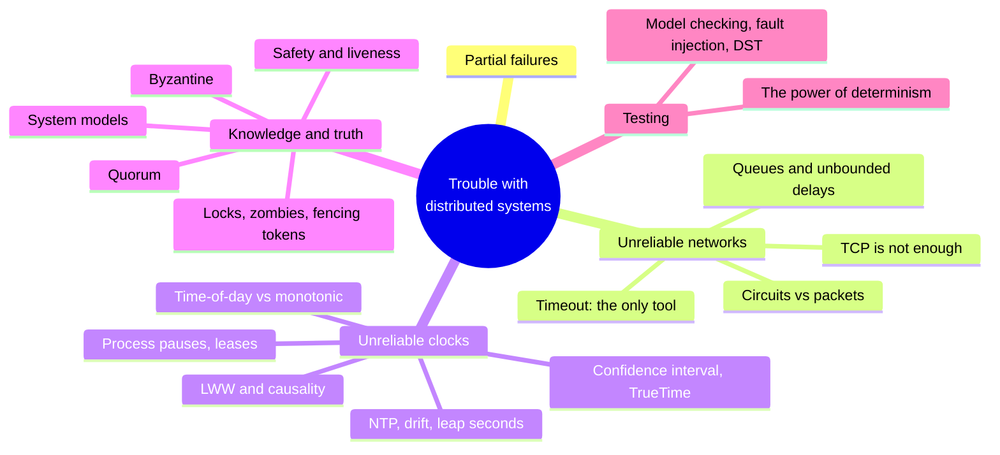
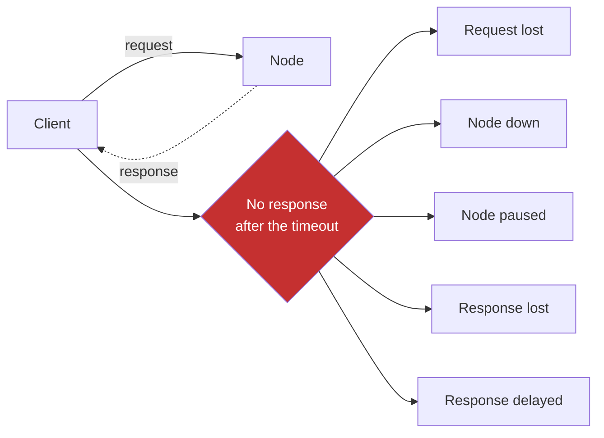
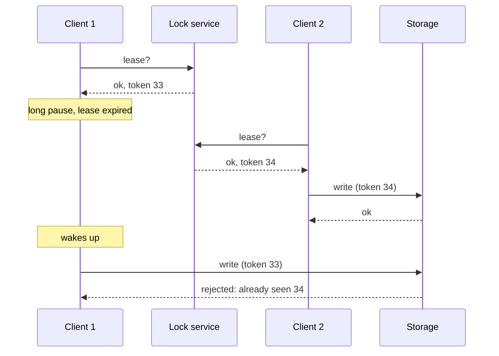

# Chapter 9 · The Trouble with Distributed Systems

> *They're funny things, Accidents. You never have them till you're having them.*
> — A.A. Milne, The House at Pooh Corner (1928)

**In one sentence:** on a single machine it either works or it doesn't; on several machines
connected by a network there are **partial failures**, which are nondeterministic. The
chapter turns the pessimism up to the maximum: networks that lose and delay, clocks that are
wrong, processes that pause without noticing. Then it gives the tools to
reason anyway: quorums, fencing tokens, system models, safety and liveness,
and the ways to test all of this.

**PDF pages:** 369-424 · **Density:** medium-high. Few algorithms, many concepts.
It is the chapter that explains *why* chapter 10 exists.

---

## Chapter map

---

## 1. Partial failures
<!-- pdf: 370 -->

A single computer is deterministic by design choice: if there is a hardware
fault it prefers to crash entirely rather than return a wrong result.
It hides the physical reality behind an idealized model. In a distributed system
faults are too frequent to ignore: some parts are broken in unpredictable ways
while others work, and **the same operation sometimes succeeds and sometimes
doesn't**. You don't even know whether it succeeded.

The flip side: if you tolerate partial failures you can do rolling
upgrades and build **a reliable system from unreliable components**. But first
you need to know the faults, and trigger them artificially in tests. "Suspicion, pessimism,
and paranoia pay off."

---

## 2. Unreliable networks
<!-- pdf: 371 -->

Shared-nothing systems communicate **only** via the network, and the network (internet, Ethernet)
is an **asynchronous packet network**: no guarantee about when a message arrives, nor whether it
arrives. You send a request and get no response: was the request lost? queued? is the
node dead? paused? did it process and the response was lost? delayed? **All
these cases are indistinguishable.** The only information is "I don't have a
response yet". The tool is the **timeout**, which however doesn't tell you whether the node received the
request.

### TCP doesn't solve it
<!-- pdf: 372 -->

TCP retransmits, reorders, verifies checksums and regulates the rate (congestion
control). But if the ack doesn't arrive it doesn't know whether the packet or the ack was lost; if the
cable is unplugged it can't plug it back in; deduplication applies to **one** connection, and
on reconnecting data gets duplicated; a connection closed with an error doesn't say how much
the remote node processed; and the ack means that the **kernel** received it, not
the application. To know that a request succeeded you need a response
**from the application**.

### Network faults in practice
<!-- pdf: 374 -->

About 12 per month in a medium-sized datacenter, half on a single machine and half on a whole
rack. Making the equipment redundant helps less than expected: the main cause is
**human** configuration **errors**. Fibers cut by cows, beavers and sharks.
Round trips of **minutes** between cloud regions at the high percentiles, and even inside a
datacenter during a reconfiguration. Asymmetric faults: A talks to B and B to C
but A not to C; interfaces that receive but don't transmit. The consequences last longer
than the fault. You don't necessarily have to tolerate the network, you can show an error: but you must
know **how** the software **reacts** and that it recovers.

### Detecting faults
<!-- pdf: 375 -->

Sometimes you get explicit feedback: TCP RST/FIN if the process died but the machine
didn't, a script that notifies the crash (HBase), the management interface of the switches,
ICMP unreachable. Don't count on it: in general the answer is **no response**, and
you declare a node dead after a few retries and a timeout. A balance between false positives
(live node believed dead) and false negatives (useless waiting).

### How long the timeout
<!-- pdf: 376 -->

Long: slow recovery. Short: a load spike makes you declare a live node dead,
the action in progress (an email) gets done **twice** by whoever takes over, and the load
shifted makes a system already in trouble worse, up to the **cascading failure** in which
everyone declares everyone dead.

If the network guaranteed delivery within *d* and the node a response within *r*, the
timeout would be 2d + r. But delays are **unbounded**, and the variability comes
almost entirely from **queues**: in the switch when several nodes send to the same
destination (full queue = packet dropped even on a healthy network), in the operating
system if the CPUs are busy, in the hypervisor when the VM is paused for
tens of milliseconds, in the sender because of TCP's rate limiting. A TCP retransmission
shows up as delay. UDP gives up retransmitting: right when a late piece of data
is worth nothing (VoIP: "sorry, could you repeat that?").

In multitenant clouds a **noisy neighbor** saturates shared links and switches. The
timeout is chosen **experimentally** by measuring the distribution of round trips
over many machines and for a long time; better still, it is continually adapted to the
observed distribution (Phi Accrual failure detector in Akka and Cassandra; TCP does it
too).

### Why not make the network reliable
<!-- pdf: 379 -->

The fixed-line telephone network is: a call opens a **circuit** with reserved bandwidth
along the whole path, 16 bits every 250 microseconds without queues: **bounded
delay**, a synchronous network. Ethernet and IP are **packet-switched**,
optimized for **bursty** traffic: a web page or a file don't have a
fixed bandwidth need, they just want to finish soon. On a circuit you would have to
guess the bandwidth; TCP adapts.

It is an economic trade-off, not a law of nature: a wire of 10,000 calls
assigns each one the same bandwidth even if it is the only one in progress (**static**
partitioning, guarantees, low utilization), the internet shares dynamically
(queues, but maximum utilization and cheaper bytes). The same for CPUs shared
among threads and for VMs of different customers on the same machine. Latency
guarantees cost utilization. Hybrids (ATM, InfiniBand) and QoS exist but not in
public clouds: **there is no "right" timeout**.

---

## 3. Unreliable clocks
<!-- pdf: 382 -->

Applications use time for **durations** (timeouts, p99, qps, time on site) and
for **points in time** (publication date, cache expiry, timestamps in logs). In
a distributed system communication is not instantaneous, so the order of
events across machines is uncertain, and each machine has its own quartz, synchronized
"roughly" via NTP.

### Two clocks
<!-- pdf: 383 -->

| | Time-of-day | Monotonic |
|---|---|---|
| What it gives | Calendar date and time, seconds since the epoch | A counter that **only goes forward**, absolute value meaningless |
| API | `CLOCK_REALTIME`, `currentTimeMillis` | `CLOCK_MONOTONIC`, `nanoTime` |
| Synchronized | With NTP: comparable across machines, in theory | No: **don't compare** across machines |
| Can jump | Yes: NTP reset, leap second, DST | No: NTP can only slow it down or speed it up by 0.05% |
| Use it for | Points in time | **Durations**: timeouts, response time |

### How wrong they are
<!-- pdf: 384 -->

Quartz drifts up to 200 ppm according to Google: 6 ms every 30 seconds of resync, 17
seconds per day. NTP: a clock too far off gets **reset** (time going
backwards), a misconfigured firewall lets it drift for weeks, accuracy is
limited by network delay (35 ms at best over the internet, spikes of a second),
some NTP servers are off by hours (you query many and discard the
outliers). **Leap seconds** have crashed large systems; they are "smeared" over a
day and from 2035 they will disappear. In VMs the clock jumps forward after every pause. On
users' devices the clock can be deliberately set wrong to cheat.
True accuracy (MiFID II requires 100 microseconds) is achieved with GPS, atomic
clocks and PTP, but GPS is easily jammed.

The real problem: a wrong clock **goes unnoticed**. Broken CPUs or networks don't
work and are visible; a defective quartz drifts silently and produces **subtle data
loss**, not a crash. If you depend on synchronized clocks, **monitor the
offsets** and evict the nodes that drift too far.

### Timestamps for ordering: LWW
<!-- pdf: 386 -->

Client A writes x = 1 on node 1 (timestamp 42.004); B increments on node 3 (x = 2,
timestamp 42.003): skew of less than 3 ms, better than reality. Node 2 receives
both, applies **last write wins** and keeps x = 1: **the increment is lost** even though
it was causally later. Cassandra and ScyllaDB use the client's clock with LWW
to avoid a round trip, and the price is: writes that **disappear** until the skew
has elapsed, no distinction between sequential and concurrent (version
vectors are needed), equal timestamps that require a random tiebreaker. NTP cannot be enough:
the clock error would have to be much smaller than the network delay, impossible. For
ordering you need **logical clocks** (counters), not physical ones.

### Time as an interval
<!-- pdf: 389 -->

You read nanoseconds, but the accuracy is tens of milliseconds: the fine digits are
noise. A clock reading is a **confidence interval**, not a point, as wide
as the drift since the last sync plus the server's uncertainty plus the round trip. Almost
no API exposes it; Spanner's **TrueTime** and Amazon's ClockBound return
`[earliest, latest]`.

**Spanner** uses it for global snapshot isolation: a monotonic txid across
datacenters would be a bottleneck, timestamps would be perfect if accurate.
If two intervals **don't overlap**, the order is certain. So Spanner
**waits for the width of the interval** before committing a
read/write transaction, so that whoever reads afterwards has a disjoint interval. GPS and atomic clocks in
every datacenter (7 ms) only serve to keep the wait short; the idea is the interval.
YugabyteDB with ClockBound does the same.

### Process pauses
<!-- pdf: 390 -->

A leader needs to know it is still the leader: it obtains a **lease** (a lock with an
expiry) and renews it. Typical code: "if less than 10 seconds remain, renew; if it is
valid, process". Two flaws: it compares an expiry computed **on another
machine** with the local clock; and it assumes that little time passes between the check and `process()`. If the thread stops for **15 seconds** right there, the lease has expired, someone
else is leader, and this one processes anyway.

Stopping for 15 seconds is realistic: lock contention, stop-the-world **garbage collection**
(even minutes, once upon a time), VM suspended or live-migrated, laptop lid closed,
context switches and **steal time** under load, synchronous disk I/O (even
implicit, the Java classloader), **page faults** and thrashing, a `SIGSTOP` sent by
mistake. The thread resumes **without knowing** it stopped, while the world has
moved on and may have declared it dead. The single-node tools (mutexes,
semaphores) don't carry over: no shared memory, only messages.

**Hard real-time** systems (airbags, aircraft) eliminate pauses with an RTOS, libraries
with documented worst case, no dynamic allocation, enormous testing. Hugely expensive,
and real-time doesn't mean fast: lower throughput. For the server side it is not
economical. You limit GC: modern collectors (G1, ZGC, Shenandoah), languages without
GC (Rust, Swift), object pools, or treat GC as **a planned
outage**: warn, stop sending requests to the node, collect, resume.
Variant: GC only for short-lived objects and periodic restart of the process like a
rolling upgrade.

---

## 4. Knowledge, truth and lies
<!-- pdf: 395 -->

A node knows nothing for certain about the others: it can only **make guesses** from the
messages it receives or doesn't receive. It sounds like philosophy, but the way out is practical:
you state the assumptions (a **system model**) and design algorithms that are correct
within that model.

### The majority rules
<!-- pdf: 396 -->

Three nightmares: a node receives everything but its responses are lost, it is declared
dead and dragged to the graveyard screaming "I'm not dead"; a node realizes it can't be
heard but can't do anything about it; a node paused for a minute emerges from the coffin
without knowing how much time has passed. Moral: **a node cannot trust its own
judgment**. Decisions, even "who is dead", are made by a **quorum**: usually the
absolute majority, because there can be **only one majority** at a time. The
node declared dead by the quorum must step down even if it feels alive.

### Locks, leases and zombies
<!-- pdf: 397 -->

A lease is used when "there must be only one": one leader per shard, one
writer per resource, one worker per file. In the third case a duplicate wastes CPU; in the
first two it **corrupts data**. Real HBase bug: client 1 holds the lease on a
file, pauses, the lease expires, client 2 obtains it and writes, client 1
wakes up convinced it holds the lease and writes: **split brain**, corrupted file.
Variant without a pause: client 1 sends a write, crashes, the write stays
**a minute in the network** and arrives after client 2 has taken the lease.

A former leaseholder that doesn't know it has lost the lease is a **zombie**. You can't
rule them out; you can stop them from doing damage: **fencing**. Shutting them down (STONITH:
disconnecting them, powering off the VM) doesn't protect against delayed messages, nodes can
shut each other down, and often it is too late.

**Fencing token**: every grant of the lock carries an **increasing** number; every
write to the storage includes it; the storage rejects tokens lower than one already
seen. Whoever takes the lease writes immediately, and from there the zombies are cut off.
Similar to OCC, but permanent. Names: sequencer in Chubby, epoch number in Kafka,
ballot number in Paxos, term in Raft; in ZooKeeper `zxid` or `cversion`, in etcd
revision plus lease ID. A **conditional write** (S3, Azure, GCS) is enough too: if
you write to a single service that supports it, the lock service is redundant. With several
replicas (leaderless with LWW) put the token in the **most significant bits of the
timestamp**: every timestamp of the new leaseholder exceeds those of the old one; if the
zombie manages to write to a replica that the new one hasn't reached, the quorum read
prefers the higher timestamp and read repair fixes it.

### Byzantine
<!-- pdf: 401 -->

Fencing stops those who err **in good faith**; whoever forges a token bypasses it. The
book assumes nodes that are **unreliable but honest**. A node that lies (contradictory votes
in the same election) is a **Byzantine fault**, and the problem is that of the **Byzantine
Generals**: n generals, some traitors, reaching agreement via messengers. It is really needed
in aerospace (radiation corrupts memory, an error costs lives) and between parties
that don't trust each other (blockchain, peer-to-peer). In datacenters no: the nodes are yours,
multitenancy is isolated with firewalls and VMs, Byzantine protocols are expensive and require
**more than two-thirds** of nodes to be healthy. Against bugs they don't help: same software everywhere,
same bug everywhere; you would need four independent implementations. Against
attackers likewise. What remains is authentication, cryptography, firewalls, and for the web
input validation: the server is the authority.

**Weak forms of lying** are worth defending against: application-level checksums (TCP's sometimes
fail), input sanitization, NTP with several servers and discarding of the outliers.

### System models
<!-- pdf: 404 -->

Three timing models:

| Model | Assumption | Realism |
|---|---|---|
| **Synchronous** | Network delay, pauses and drift **bounded** by a known maximum | No: unbounded delays exist |
| **Partially synchronous** | Synchronous most of the time, but every so often the bounds are exceeded for a finite time | **The most useful** |
| **Asynchronous** | No timing assumptions, not even a clock: no timeouts | Very restrictive |

Four node failure models: **crash-stop** (dies and doesn't come back),
**crash-recovery** (dies and comes back with stable storage intact, memory lost),
**degraded** (the **limping node** or gray failure: responds to health checks but is
too slow to do work, or a background thread has died), **Byzantine**. For
real systems: partially synchronous with crash-recovery.

### Safety and liveness
<!-- pdf: 406 -->

An algorithm is correct if it satisfies its **properties** in every situation of the
model. For fencing tokens: **uniqueness** (never two the same), **monotonic sequence** (if
x finishes before y starts, tx < ty), **availability** (whoever asks and doesn't crash
eventually receives one). The first two are **safety**, the third is **liveness**.

- **Safety**: if it is violated you can point to the exact **moment**, and the damage is
  irreversible. It must hold **always**, even if all nodes crash.
- **Liveness**: it may not hold now, but there is hope for the future. It almost
  always contains "eventually" (yes, eventual consistency is liveness). It admits **conditions**:
  "if the majority doesn't crash and the network recovers".

The model is an abstraction: stable storage can get corrupted, a server may not
see its disks on reboot, and a node with **amnesia** breaks the quorum. The implementation
must handle even the "impossible", if only with an `exit(666)` and a human who
cleans up. It is the difference between computer science and software engineering.

---

## 5. How to verify
<!-- pdf: 408 -->

The possible states are too many for manual tests. You combine:

| Technique | What it does | Limit |
|---|---|---|
| **Formal proof** | Mathematically proves the properties in the model | Doesn't cover the implementation |
| **Model checking** (TLA+, FizzBee) | Systematically explores the states of a simplified **model** | Infinite space: it is bounded; model and code can diverge. It found data loss in Viewstamped Replication |
| **Fault injection** (Jepsen, Chaos Monkey) | Injects real faults into a running system: kill, umount, firewall | Awkward to write, not precisely reproducible |
| **Deterministic simulation testing** | Runs the **real code** with fake network, I/O and clock controlled by the simulator; every run is **reproducible** and faster than real time | You have to control every source of nondeterminism |

DST at three levels: application (FoundationDB with Flow, TigerBeetle as a state machine),
runtime (MadSim for Rust, FrostDB patches Go), machine (Antithesis with a deterministic
hypervisor that explores the rare branches too).

### The power of determinism
<!-- pdf: 411 -->

Nondeterminism is the root of everything: concurrency, delays, pauses, clock
jumps, crashes. Making it deterministic simplifies everything, and it is an idea that comes back
everywhere: event log replay (ch. 3), durable execution (ch. 5), state machine
replication, statement-based replication and stored procedures (ch. 6 and 8), DST. But it is
delicate: even with concurrency, I/O, clocks and randomness removed, there remain the iteration
order of a hash table and resource limits.

---

## Self-check questions

1. List five different things that "no response" can mean. What do they have in common?
2. Why does a TCP ack not prove that the request was processed?
3. Where does almost all the variability in delays come from? Three different queues.
4. Why does the telephone network have bounded delays and the internet not? Is it a law of nature?
5. Time-of-day versus monotonic: which one for a timeout, and why is the other wrong?
6. Why is a wrong clock more dangerous than a broken CPU?
7. Explain how LWW with physical clocks loses an increment with a 3 ms skew.
8. What does Spanner do with the confidence interval and why are atomic clocks
   not strictly necessary?
9. Find the two flaws in the lease loop. List four realistic causes of a pause.
10. Why can't a node trust its own judgment, and what replaces it?
11. Describe the two ways a zombie corrupts a file and how the fencing token
    stops both.
12. Why doesn't Byzantine fault tolerance protect against bugs?
13. Safety versus liveness: give the precise definition and classify eventual consistency.
14. Model checking, fault injection, DST: what does each one test and what is the limit?

Flashcards in [`flashcards/ch09.yaml`](../data/flashcards/ch09.yaml).

## Cross-references

- Metastable failures, retry storms: ch. 2
- Deterministic durable execution: ch. 5
- LWW, version vectors, quorums, failover, split brain: ch. 6
- OCC and fencing: ch. 8
- Consensus, logical clocks, lock services, state machine replication: ch. 10
- Duplicate execution and idempotence: ch. 12
