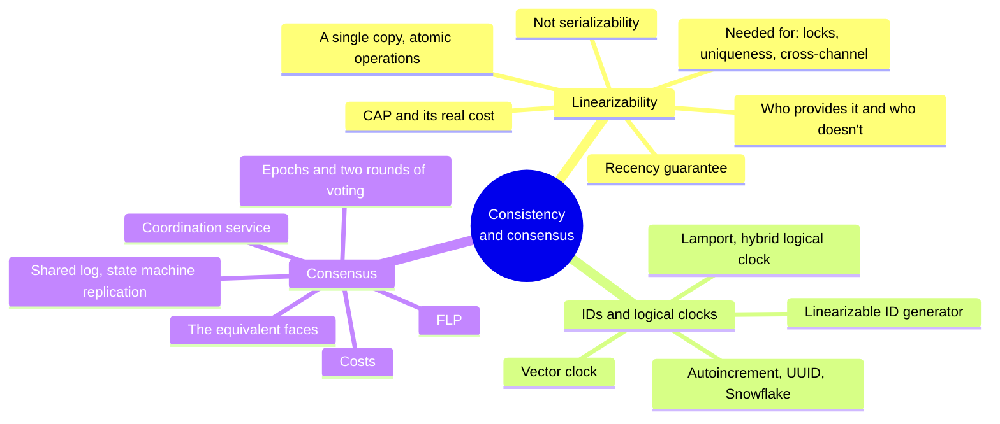
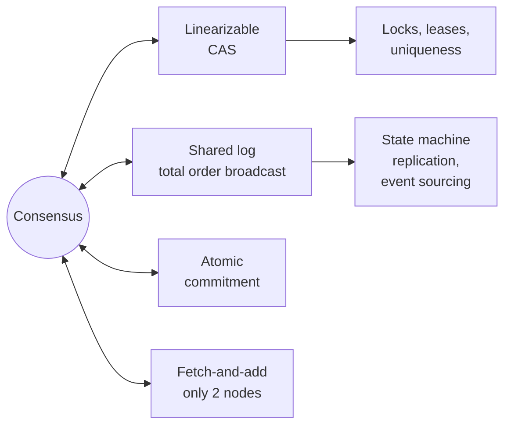
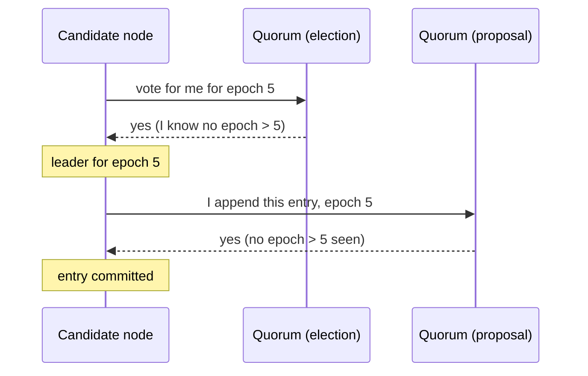

# Chapter 10 · Consistency and Consensus

> *An ancient adage warns, "Never go to sea with two chronometers; take one or three."* — Frederick P. Brooks Jr., The Mythical Man-Month: Essays on Software Engineering (1995)

**In one sentence:** after the troubles of chapter 9, the solutions. First a precise
definition of "strong consistency", **linearizability**; then ID generators and
logical clocks, which approach it without reaching it; finally **consensus**, which
makes it fault-tolerant, and the discovery that CAS, locks, uniqueness constraints,
shared logs and atomic commitment are all the same problem.

**PDF pages:** 425-474 · **Density:** high but conceptual, few algorithmic details.
The book itself warns: to really work on consensus you need much more theory.

---

## Chapter map

---

## 1. Linearizability
<!-- pdf: 426 -->

Two philosophies for replication: **eventual consistency**, where replication is
visible to the application, which handles the inconsistencies (multi-leader,
leaderless), and **strong consistency**, where the system behaves as if it were a
single node. The second is simpler for developers, costs performance, and some faults
that an eventually consistent system tolerates cause outages here. Offline: eventual
is inevitable. Datacenter with a fast network: strong is often sensible.

"Strong consistency" is vague. The precise definition is **linearizability** (atomic,
immediate, external consistency): the system behaves **as if there were only a single
copy of the data and every operation were atomic**. As soon as a write has completed,
all readers see it. It is a **recency guarantee**.

The example: Aaliyah refreshes and sees the result of the match, tells Bryce, Bryce
refreshes and his request goes to a lagging replica: "match in progress". If they had
refreshed at the same time there would be no surprise; but Bryce started his read
**after** Aaliyah's had finished, and he expects a result at least as recent.

### What makes it linearizable
<!-- pdf: 428 -->

A register x, clients reading and writing. Every request is a bar from the moment it
is sent to the moment of the response; you don't know **when** in between the DB
processed it.

```mermaid
gantt
    dateFormat X
    axisFormat %s
    section C
    write x=1          :c1, 2, 6
    section A
    read → 0           :a1, 0, 1
    read → 0 or 1      :a2, 3, 4
    read → 1 (required) :a3, 7, 8
    section B
    read → 0 or 1      :b1, 2, 5
```

- A read that finished **before** the write started must return the old value.
- A read that started **after** the write finished must return the new value.
- A read **concurrent** with the write may return either.

But that's not enough: otherwise the value could flip back and forth during the
write. One more constraint is needed: there is **one instant** between the start and
the end of the write at which the value flips atomically, and **after any read has
seen the new value, all subsequent reads must see it too**, even if the write hasn't
finished yet and even on other clients. Graphically: mark a point inside every bar,
join them in sequence, and the line must **always move forward in time**, forming a
valid history of the register. It can be checked after the fact by recording all the
timings, but it's expensive. Adding CAS, the model does not assume isolation: another
client can change the value at any moment, and CAS is there to detect it.

Linearizability **includes** read-after-write, monotonic reads and consistent prefix:
it is the strongest model in common use.

### It is not serializability
<!-- pdf: 431 -->

| Serializability | Linearizability |
|---|---|
| **Isolation** level of transactions over **multiple objects** | Guarantee on reads and writes of **a single register** |
| Result as if in **some** serial order, even one different from the real one | **Recency**: if A finishes before B starts, B sees a state at least as new as A |
| Allows stale reads | Does not group operations into transactions: does not prevent write skew |

Together they are called **strict serializability** (strong-1SR). Single-node DBs
usually provide it; CockroachDB provides serializability with some recency guarantees
but not strict, Spanner and FoundationDB do. Isolation level and consistency model are
chosen almost independently.

### When it is really needed
<!-- pdf: 432 -->

- **Locking and leader election.** A lease must be linearizable: two nodes cannot
  acquire it at the same time. ZooKeeper and etcd do it with consensus (ZooKeeper has
  linearizable writes but potentially stale reads; etcd 3 reads too). Oracle RAC uses
  per-disk-page locks with a dedicated network.
- **Uniqueness constraints.** Usernames, file paths, a balance that never goes
  negative, stock, a seat: you need **a single up-to-date value that everyone agrees
  on**. It's a lock, it's a CAS. If the constraint is loose (overbooking with
  compensation) it isn't needed; foreign keys and attribute constraints are done
  without it.
- **Cross-channel timing dependencies.** The web server writes a video to the file
  storage and puts a message in a queue for the transcoder. If the queue is **faster
  than the storage's internal replication**, the transcoder reads an old or
  nonexistent file and the two videos stay inconsistent forever. Two channels, one
  race: like Aaliyah's voice. Same problem with push notifications and a fetch from
  a lagging replica. Alternatives exist if you control the second channel, but they
  are more complex.

### Who implements it
<!-- pdf: 435 -->

| Replication | Linearizable? | Why |
|---|---|---|
| Single-leader | Potentially | If everything goes through the leader **and you know who it is**. A deposed leader that keeps serving violates it; asynchronous failover loses committed writes |
| Consensus | Likely | Single-leader with safe election. But a read on a node that doesn't check it's still the leader can be stale |
| Multi-leader | No | Concurrent writes on several nodes, conflicts |
| Leaderless | Probably not | Even with quorums |

**Quorums are not enough.** n = 3, w = 3, r = 2. A write takes x from 0 to 1 and
reaches the replicas at different times. A reads from two replicas and sees 1 (and 0);
B starts **after** A has finished, reads from two other replicas and sees 0 and 0. The
condition w + r > n holds, the execution is not linearizable. Remedy: **synchronous
read repair** before responding, and a read of the maximum timestamp before every
write. Riak doesn't do it for performance; Cassandra waits for read repair but loses
linearizability with physical clocks. And even then you only get reads and writes: a
**linearizable CAS requires consensus**.

### The cost
<!-- pdf: 437 -->

Two regions, network interrupted between them. Multi-leader: each keeps going, writes
are exchanged afterwards. Single-leader: clients in the region without the leader can
neither write nor do linearizable reads, only stale reads. Any linearizable system has
this problem, on any unreliable network.

**CAP.** If you require linearizability, isolated replicas must wait or return an
error: **CP**. If you don't, every replica can keep going: **AP**. Brewer 2000, but
known since the 1970s. It had the merit of opening up the design space and sparking
NoSQL. As a theorem it is extremely narrow: a single model (linearizability), a single
fault (partitions, less than 8% of incidents at Google), nothing about delays and dead
nodes. PACELC adds: without a partition, choose between **latency** and consistency.
"Pick two of three" is misleading: partitions are **not chosen**, they happen; with a
healthy network you have both, with a broken one you choose. The CAP definition of
availability doesn't match the common one; many systems are neither CP nor AP. Today
it's been superseded by more precise results: **don't dwell on it**.

**The real cost is latency.** Not even the RAM of a multi-core CPU is linearizable:
each core has a cache and a store buffer, asynchronous writes towards memory. Not for
fault tolerance, for **performance**. The same holds for DBs that give up
linearizability. Attiya and Welch: the response time of a linearizable system is at
least proportional to the **uncertainty of network delays**. No faster algorithm
exists; for weaker models it does.

---

## 2. ID generators and logical clocks
<!-- pdf: 441 -->

An autoincrement on one node is linearizable (atomic fetch-and-add): if Aaliyah's post
finishes before Bryce's starts, Bryce's ID is greater, and the chat makes sense. But:
single point of failure, slow from another region, bottleneck.

| Alternative | How | Order? |
|---|---|---|
| **Sharded** | Even and odd, or shard bits in the ID | Lost: 16 and 17 from different nodes don't say which came first |
| **Preallocated blocks** | Node A takes 1-1,000, B 1,001-2,000 | Lost: a late message can have a low ID |
| **UUID v4** | A 128-bit random number, no communication | Random |
| **Wall-clock timestamp made unique** | Clock in the high bits, shard and sequence or random in the low bits: UUID v7, X's Snowflake, ULID, MongoDB's ObjectID | **Approximate**: a clock ahead or behind reverses the order, and a non-monotonic clock does so even on a single node |

All unique, none linearizable.

### Lamport clocks
<!-- pdf: 444 -->

A **logical clock** counts events, not seconds. Requirements: compact and unique
timestamps, totally ordered, **consistent with causality** (if A happens-before B,
ts(A) < ts(B)). Lamport, 1978, among the most cited papers in the field.

Every node has an ID and a counter. The timestamp is the pair **(counter, node ID)**.
When it generates a timestamp the node increments its counter; when it **sees**
someone else's timestamp with a greater counter, it raises its own to that value.
Comparison: counter first, then ID. Aaliyah and Caleb post without seeing each other:
(1, Aaliyah) and (1, Caleb). Bryce receives both, goes up to 1, replies with (2,
Bryce). Total order consistent with causality, **but not linearizable**: it doesn't
tell you whether a value is up to date.

Limitations: no link to physical time (you can't search for "yesterday's messages"),
and two nodes that never communicate have disconnected counters.

**Hybrid logical clock**: counts microseconds like a physical clock, but aligns
forward when it sees a greater timestamp from someone else and increments on every
generation, so it is **monotonic even if the physical clock jumps backwards**. It
stays slightly ahead of the physical clock, by a little. Only approximate NTP is
needed. CockroachDB.

Lamport and HLC are excellent as **txids for snapshot isolation**: the snapshot
respects causality. But they order concurrent events arbitrarily: looking at two
timestamps you can't tell whether they were concurrent. To know that you need
**vector clocks**, one counter per node, much larger.

### A linearizable ID generator
<!-- pdf: 447 -->

Why it matters: user A sets the profile to private from the laptop, then uploads a
photo from the phone. Accounts and photos live in two DBs with HLCs. The photo DB has
never read from the account DB, its counter is behind, and the photo gets a timestamp
**lower** than the permission change. An observer with a snapshot between the two
timestamps sees the account still public and the photo. A linearizable ID generator
prevents this.

Implementation: **a single node** that increments, persists and replicates
(single-leader). TiDB calls it the *timestamp oracle*, from Percolator. Optimization:
persist and replicate a **batch** of IDs at a time; on a crash you skip some, never
duplicates nor out of order. It cannot be sharded or distributed across regions: all
requests go to one region, but the work is so simple that one node handles a lot. The
alternative is Spanner: wait out the clock's uncertainty interval, no communication,
even across regions, at the price of the hardware.

### Not enough for constraints
<!-- pdf: 449 -->

With a linearizable clock you can give timestamps to everyone who wants the same
username and let the lowest win: no future request will have a lower one. But **how
does a node know it has the lowest**? It has to hear from **all** the others, and if
one is dead or unreachable everything stops. That is not fault tolerance. You need
consensus.

---

## 3. Consensus
<!-- pdf: 449 -->

Three things that are easy on one node and hard with fault tolerance: failover without
split brain, an atomic counter that survives a crash, a fault-tolerant CAS. They are
all instances of the same problem: **getting several nodes to agree on a value**.
Algorithms: Viewstamped Replication, Paxos, Raft, Zab. All in the non-Byzantine model.

**FLP**: no deterministic algorithm can guarantee reaching consensus if a node may
crash. But it holds in the **purely asynchronous** model, with no clocks or timeouts.
With timeouts to suspect crashes (even wrongly) or with random numbers, consensus is
solvable. FLP says you can't guarantee **termination**, not that you can never decide.

### The many faces
<!-- pdf: 451 -->

**All equivalent**: a solution to one can be converted into a solution to the others.
It is the deep insight of the chapter.

**Single-value consensus.** Several nodes propose, the algorithm decides one: the new
leader, who gets the lease, who buys the last seat. Four properties:

| Property | Says | Type |
|---|---|---|
| **Uniform agreement** | No two nodes decide differently | Safety |
| **Integrity** | Once decided, no changing your mind | Safety |
| **Validity** | The decided value was proposed (rules out "always decide null") | Safety |
| **Termination** | Every node that doesn't crash eventually decides | **Liveness** |

Without fault tolerance the first three are trivial: a dictator. The whole difficulty
is in termination, which requires progress even if a node disappears **forever**
(buried under 30 feet of mud). You need **at least a majority** of working nodes; but
the safety properties hold **always**, even if the majority goes down: an outage stops
the system, it doesn't corrupt it.

**CAS ⇔ consensus.** With a fault-tolerant linearizable CAS: register at null,
everyone does CAS(null, proposal), the final value is decided. With consensus: the CAS
operations with the same expected value propose their new values, the decided one
wins, the others fail. The conditional writes of object stores are distributed CAS.

**Shared log ⇔ consensus.** A log where several nodes ask to append and all read the
same entries in the same order. Properties: eventual append, reliable delivery,
append-only, **agreement** (whoever reads has read the same prefix), validity. It is
implemented with **total order broadcast** (atomic broadcast). From the log to
consensus: the first entry is the decided value. From consensus to the log: one
consensus instance per slot, whoever loses retries on a later slot. Single-leader
without failover does not satisfy liveness.

**Fetch-and-add**: easy from CAS (read, CAS(v, v+1), retry). The other way round: the
counter at 0, whoever reads 0 wins; the others know they lost but **don't know who
won**, and if the winner crashes before telling them they are left hanging. With
**exactly two** proposers it works (whoever reads 1 decides the other's value):
fetch-and-add has **consensus number 2**, CAS and shared logs have ∞.

**Atomic commitment ⇔ consensus.** The difference: in consensus any proposed value is
fine, in atomic commitment **if one votes abort you must abort**. Extra properties:
validity (commit only if everyone voted commit) and nontriviality (if everyone votes
commit and there is no timeout, you commit). From consensus: every node sends its vote
to everyone; whoever receives all commits proposes "commit", whoever receives an abort
or a timeout proposes "abort"; you do what consensus decides. From atomic commitment:
every proposer opens a transaction on a quorum and does a local CAS on the register;
if it succeeds it votes commit.

### In practice: the shared log
<!-- pdf: 457 -->

Raft, Viewstamped Replication and Zab provide a shared log; Paxos provides
single-value, but **Multi-Paxos** is used, which provides the log. The log is the
universal tool:

- **State machine replication**: every entry is a write, every replica applies the
  same writes in the same order with deterministic logic, they all converge. It is
  event sourcing, it is stream processing (ch. 12).
- **Serializable transactions**: every entry is a deterministic stored procedure
  executed in order. Shards often have one log each, which limits cross-shard
  guarantees.
- Single-value and CAS: the first value in the log. Many instances (one seat per
  entry): the first one with that seat number. Fetch-and-add: the sum of the entries.
  **Fencing token**: the sequence number of the entries, ZooKeeper's `zxid`.

### From single-leader to consensus
<!-- pdf: 458 -->

A dictator solves everything until it dies. Manual failover does not satisfy
termination. But to elect a leader you need consensus, and for consensus you need a
leader: how do you break out of the circle?

The algorithms **do not guarantee a single leader at a time**. They guarantee
something weaker: an **epoch** number (ballot in Paxos, view in VR, term in Raft) and
**within each epoch the leader is unique**. Whoever suspects the leader is dead starts
an election with a higher epoch; in case of conflict the higher epoch wins.

Before appending, the leader collects votes from a quorum: a node votes yes only if it
knows of no higher epoch. Two rounds of voting, and the quorums **must overlap**: at
least one of the voters on the proposal took part in the last successful election. If
the proposal passes without revealing higher epochs, the leader knows it is still the
leader. Every entry is replicated **synchronously to a quorum** before the
acknowledgment to the client.

It looks like 2PC, but no: in consensus **anyone** can start an election and a
**quorum** is enough; in 2PC only the coordinator asks for votes and **all** must say
yes.

Subtleties: the new leader must honor the entries already appended by the old one.
Raft elects only a node whose log is at least as up to date as the majority's; Paxos
elects anyone but forces it to catch up first. Kafka offers **unclean leader
election**: more available, but the theory no longer applies and you risk data loss.
**Linearizable reads** must go through a quorum like writes (etcd). The set of nodes
is fixed, with extensions for reconfiguration.

### Costs
<!-- pdf: 461 -->

"Single-leader replication done right": automatic failover, no committed write lost,
no split brain. Any automatic failover without proven consensus is probably unsafe.
But:

- A **strict majority** is needed: 3 nodes for one fault, 5 for two.
- Every operation talks to a quorum: **adding nodes slows things down**, it doesn't
  scale throughput.
- In a partition only the majority side makes progress.
- Timeouts are hard to tune across regions: too long, slow recovery; too short,
  continuous elections.
- Raft with **a single unreliable link** can bounce leadership forever (fixed with the
  pre-vote). EPaxos is leaderless and more robust.

### Coordination services
<!-- pdf: 461 -->

ZooKeeper, etcd, Consul: they look like key-value stores but exist to **coordinate
other systems** (Kubernetes on etcd, Spark and Flink on ZooKeeper). Little data, in
memory, replicated with consensus. Modeled after Google's Chubby. They offer:

| Feature | How | Requires consensus |
|---|---|---|
| Locks and leases | Fault-tolerant atomic CAS | Yes |
| Fencing | Monotonic ID per entry: zxid, cversion, revision | Yes |
| Failure detection | Session with heartbeats; with no heartbeat past the timeout the lease is released (*ephemeral node*) | No |
| Change notifications | Subscription to keys: a node joins, a node fails | No |

Uses: configuration (convenient if it's already there, but a file with polling is
enough), **allocating work** (who is leader, which shard on which node, with automatic
recovery), and above all **outsourcing consensus**: three or five nodes coordinate a
system of thousands, where consensus across all of them would be inefficient. The data
changes over minutes or hours, not thousands of times per second (for that, a DB, or
BookKeeper).

**Service discovery**: convenient with failure detection and notifications, but often
overkill: you don't need linearizability, you need to be **available and fast**.
Better to cache with a TTL and bypass the cache on failure, like DNS. ZooKeeper has
**observers**: replicas that receive the log without voting, stale but available and
scalable reads.

---

## Self-check questions

1. Define linearizability in one sentence and explain why "concurrent reads may
   return old or new" is not enough.
2. Bryce sees the match in progress: which condition does it violate, and why
   wouldn't it be violated if he had refreshed together with Aaliyah?
3. Serializability versus linearizability: one allows stale reads, the other
   doesn't. Which one, and what does the other not prevent?
4. The transcoder reads an old video: where is the race and what eliminates it?
5. Show an execution with w + r > n that is not linearizable. What would be needed to
   fix it, and what do you still not get?
6. Why isn't multi-core RAM linearizable, and what does this say about the real
   cost of linearizability?
7. Restate CAP correctly and say why "pick two" is wrong.
8. Lamport clocks: what do they guarantee and what don't they. Why do Aaliyah and Caleb
   have the same counter?
9. The embarrassing photo: reconstruct how an HLC shows it to someone who shouldn't see it.
10. Why isn't a linearizable clock enough to assign a username in a fault-tolerant
    way?
11. List the four properties of consensus and classify each as safety or liveness.
12. Explain why fetch-and-add has consensus number 2 and CAS infinite.
13. How does consensus break out of the circle "you need a leader to elect a leader"?
14. Two rounds of voting in Raft and two phases in 2PC: three differences.
15. What in a coordination service requires consensus and what doesn't? Why should
    service discovery often not use it?

Flashcards in [`flashcards/ch10.yaml`](../data/flashcards/ch10.yaml).

## Cross-references

- Event sourcing and state machine replication: ch. 3 and 6
- Read-after-write, monotonic reads, consistent prefix, quorums, read repair: ch. 6
- Serializability, write skew, stored procedures, 2PC: ch. 8
- Clocks, confidence interval, Spanner, fencing, safety and liveness: ch. 9
- Shared logs in stream processing: ch. 12
- Avoiding linearizability without losing correctness: ch. 13
