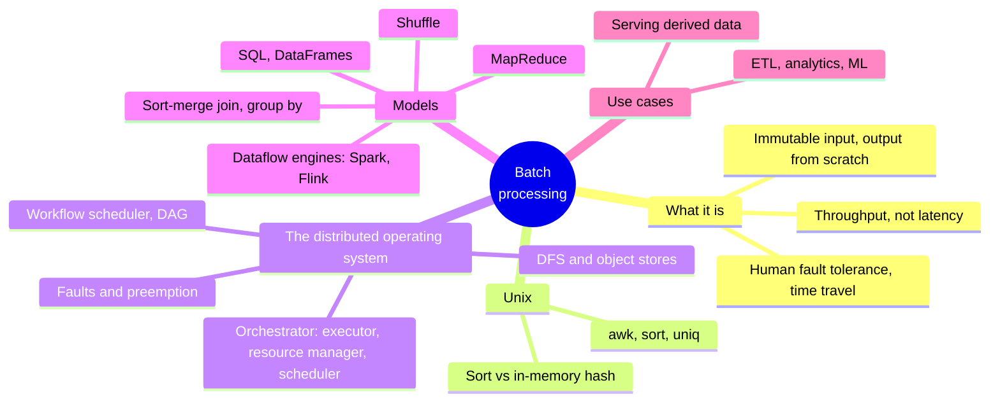
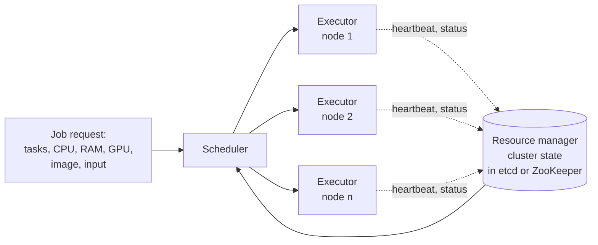
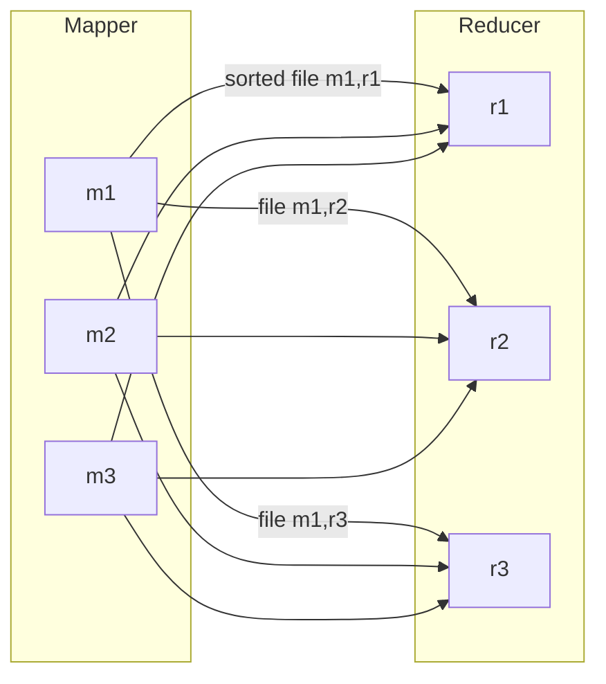

# Chapter 11 · Batch Processing

> *A system cannot be successful if it is too strongly influenced by a single person. Once the initial design is complete and fairly robust, the real test begins as people with many different viewpoints undertake their own experiments.*
> — Donald Knuth, "The Errors of TeX" (1989)

**In one sentence:** a batch job reads immutable input and regenerates the output
from scratch, with no side effects: if you get it wrong, you fix it and rerun. The
chapter starts from a Unix pipeline on one machine, scales it up to a "distributed
operating system" (filesystem, scheduler, programs), explains MapReduce and the
dataflow engines that replaced it, the **shuffle** that underlies joins and
aggregations, and closes with the use cases.

**PDF pages:** 475-510 · **Density:** medium. A descriptive chapter, few pitfalls.
The concept to understand well is the shuffle; the rest is a map of the territory.

---

## Chapter map



---

## 1. What a batch job is
<!-- pdf: 475 -->

**Online** systems respond to requests and are measured by response time. **Batch**
jobs process more data than fits in a single request (training a model,
transforming datasets, analytics) and are measured by **throughput**. The input is
read-only, the output is generated from scratch on every run: it is **derived
data**.

Treating the input as immutable and avoiding side effects gives you:

- **Human fault tolerance**: a bug in the code produces wrong output? You go back
  to the previous code and rerun, or keep the old output in another directory
  (*time travel* in object stores and table formats). A read/write DB doesn't have
  this property: rolling back the code doesn't repair the data.
- **Less irreversibility**, hence faster development.
- The same files feed different jobs, including monitoring jobs that compare the
  output with the previous run.
- Efficient use of resources compared to making an OLTP DB do batch work.

Limits: the output is usable only once the job has finished, and **one changed byte
in the input reprocesses everything**. Jobs of minutes, hours or days, often
scheduled. MapReduce (Google 2004) influenced everything but is **obsolete** and no
longer used at Google: today Spark, Flink, or the query engines of the warehouses.
The Hadoop schedulers (Oozie) have been replaced by Airflow, Dagster, Prefect;
storage has moved from HDFS to S3; BigQuery and Snowflake blur the line between
warehouse and batch.

---

## 2. Batch processing with Unix tools
<!-- pdf: 478 -->

The five most visited pages from an NGINX log:

```bash
cat access.log | awk '{print $7}' | sort | uniq -c | sort -r -n | head -n 5
```

Extract the URL, **sort** so that repetitions are adjacent, `uniq -c` counts
identical adjacent lines, sort again by count, take five. Gigabytes in seconds, and
changing the analysis means changing an argument of `awk`.

The same thing in Python: a dictionary URL → counter. The difference is not
syntactic but one of **execution flow**:

| In-memory hash (Python) | Sort (Unix) |
|---|---|
| The working set is the number of **distinct** URLs | No working set: a sorted list with repetitions |
| Fine if it fits in RAM, even on a laptop | If the data exceeds RAM, `sort` **spills to disk** with mergesort, sequential access, parallel across cores |

It is the principle of the LSM-tree: sorted segments in memory, written out and
merged. The bottleneck becomes reading the file. The limit of Unix tools: a single
machine.

---

## 3. The distributed operating system
<!-- pdf: 481 -->

The machine running the pipeline has storage behind a filesystem, a **scheduler**
that assigns CPU to processes, and programs connected by **pipes**. Distributed
batch frameworks have the same three components.

### Distributed filesystems and object stores
<!-- pdf: 482 -->

A local filesystem has block device drivers, a page cache, a filesystem layer (ext4,
XFS) that splits files into blocks and keeps the metadata, and the VFS as a common
API. A **DFS** replicates that structure: files split into **much bigger** blocks
(128 MB in HDFS, 4 MB in object stores versus 4 KB in ext4: less metadata, fewer
seeks) scattered across many machines; **data nodes** (DataNode in HDFS) that
expose the blocks over the network using their operating system's page cache; a
**metadata service** (NameNode); a pluggable **protocol** like the VFS, today almost
always the S3 API (MinIO, R2, B2) or NFS. Shared-nothing on commodity hardware, so
blocks are **replicated** or use erasure coding (Reed-Solomon): like RAID but over
the network, and the scheduler can run a task on a node that already has the data.

| | DFS | Object store |
|---|---|---|
| Model | Files with `open`, `seek`, links, locks, atomic rename | **Immutable** objects with `get` and `put`, whole rewrite, no handles |
| Directories | Real ones | A convention in the key name; listing by prefix is recursive; empty directories impossible; rename = copy and delete for every object |
| Sizes | MB-GB, rare and large reads | Same, but S3 Express gets close to key-value stores |
| Compute | A task can run **where the data is** | Storage and compute separated: more bandwidth, but they scale independently |

Beware: JuiceFS and Ceph expose both APIs, but performance and consistency differ.

### Job orchestration
<!-- pdf: 485 -->

On a single node the kernel allocates memory, schedules instructions, isolates
processes. In a distributed setting an **orchestrator** (Kubernetes, YARN) does it,
with three components:



- **Task executor** on every node (kubelet, NodeManager): downloads the code,
  launches the task, monitors it, sends heartbeats, isolates with cgroups.
- **Resource manager**: global view of hardware and node state; centralized, hence
  a potential bottleneck; state in etcd or ZooKeeper.
- **Scheduler**: decides which tasks go on which nodes. Application-specific
  sub-schedulers (ApplicationMaster in YARN, operators in Kubernetes) for specific
  needs.

**Allocating resources** is the hard part: 160 cores, two jobs of 100 each. Split
80 and 80? Run one in full and then the other (**gang scheduling**, risk of idle
nodes and deadlock)? Wait for 100 free cores (**starvation**)? **Preempt** tasks of
the first one (lost work)? With millions of requests the problem is **NP-hard**:
heuristics are used (FIFO, dominant resource fairness, priorities, quotas,
bin-packing).

### Job workflows
<!-- pdf: 488 -->

The output of one job is the input of others: a **DAG** of jobs (here "workflow"
is not the durable execution of ch. 5, which makes RPCs over little data). You need
it when several teams read the same output, when you switch tools (Spark on HDFS,
then Trino, then S3), or when two stages shard by different keys. In a Unix pipe the
data goes through an in-memory buffer with **backpressure**; Spark and Flink can do
the same between tasks, but usually a job **writes to the DFS** and the next one
reads, so they are decoupled in time. The orchestrator's scheduler works per job;
dependencies between jobs are handled by a **workflow scheduler** (Airflow,
Dagster, Prefect), indispensable with workflows of 50-100 jobs and teams reading
each other's outputs.

### Faults
<!-- pdf: 489 -->

Long jobs with many tasks: at least one task will fail, because of hardware, the
network, or deliberate **preemption** by the scheduler. **Spot instances** are
cheap VMs that can be killed at any moment: perfect for batch, which is in no hurry,
but preemptions are more frequent than hardware faults. Since the output is
regenerated from scratch, a failed task is discarded and relaunched elsewhere;
MapReduce keeps tasks independent so as to retry **one task at a time**, not the
whole job. The intermediate state is the delicate point: MapReduce always writes it
to the DFS (safe, expensive), Spark keeps it in memory with spill to local disk and
remembers **how it computed it** so as to recompute it, Flink takes periodic
**checkpoints**.

---

## 4. Processing models
<!-- pdf: 490 -->

### MapReduce
<!-- pdf: 490 -->

Exactly the log pipeline:

1. Read the files and break them into records (one line per `\n`; in Hadoop
   Parquet or Avro files on HDFS or S3).
2. The **mapper** extracts a key and a value from every record, with no state
   between records, zero or more pairs per record. It is `awk '{print $7}'`.
3. **Sort** by key. Implicit: you don't write it.
4. The **reducer** iterates over the sorted pairs: equal keys are adjacent, so you
   combine them without keeping state in memory. It is `uniq -c`.

The second `sort` by count is a **second job**. Mapper: prepares the data for
sorting. Reducer: processes the sorted data. It comes from functional programming
(Lisp's map and fold): without mutable state every call depends only on its input,
so the framework parallelizes and **retries** freely. But the raw APIs are laborious
(joins have to be written by hand) and the file I/O prevents **pipelining**.

### Dataflow engines
<!-- pdf: 492 -->

Spark and Flink treat **the entire workflow as one job**, model the flow between
stages explicitly (hence *dataflow*), offer relational operators (join, group by,
filter, aggregate) besides the per-record function, and don't impose the
map/reduce alternation. Advantages:

- You sort only where needed, not between every map and reduce.
- Consecutive operators that don't change the sharding (map, filter) are **fused**
  into one task.
- Declared dependencies: the scheduler puts consumer and producer on the same
  machine and exchanges data via memory.
- Intermediate state in memory or on local disk, not replicated to the DFS.
- An operator starts **as soon as its input is ready**, without waiting for the
  preceding stage.
- Processes are reused, no new JVM per task.

Same computations, much faster.

### Shuffle
<!-- pdf: 493 -->

Sorting petabytes across many machines: input and output both sharded. The
algorithm is called a **shuffle**, and there is nothing random about it: it produces
a sorted order.



- One map task per input shard; the number of reducers is up to you.
- Every mapper writes **one local file per reducer**, choosing the file by the
  **hash of the key** (like hash sharding): equal keys end up in the same reducer
  even from different mappers.
- Inside each file the pairs are **sorted**, with the LSM technique: in memory,
  segments, merge.
- Once the mappers are done, every reducer **copies** its slice from all the
  mappers and merges them mergesort-style: equal keys adjacent. The reducer is
  called once per key with an iterator over the values.
- The reducer's output is one file per reduce task: the shards of the output, on the
  DFS.

BigQuery and the like keep the data in memory and use replicated **external
sorting services**.

### Joins and group by
<!-- pdf: 495 -->

An event log (fact table) and a users table (dimension), both too big for one
machine: "are pages more popular with young or old people?". The shuffle brings all
the pairs with the same key to the same reducer: one mapper emits (user_id, URL)
from the events, another (user_id, date of birth) from the users. With the
**secondary sort** the reducer sees the user record first and then the events in
time order: it keeps **a single record in memory**, no network requests. It is the
**sort-merge join**. The next job shuffles by URL and counts per age bracket:
**group by** and aggregation.

### Languages
<!-- pdf: 497 -->

With the infrastructure solved (petabytes on 10,000 machines) attention has moved
to the programming model. **SQL** is the lingua franca: less code, interactive use
by analysts and product managers, and the query engine (Hive, Trino, Spark, Flink)
**optimizes** with a cost-based optimizer that chooses the join algorithm and
reorders the execution. Niches: Pig (step-by-step pipelines), Morel, jq, Gremlin
for graphs.

Batch and warehouse **converge**: batch frameworks have SQL, Parquet and optimized
engines; cloud warehouses have scheduling, fault tolerance, shuffle, DFS, and even
DataFrames (BigQuery, Snowpark). Not everything is SQL: PageRank, ML, multimodal
data. And warehouses are weak at row-by-row computation and **cost more**: Spark or
Flink are often the better deal. The choice comes down to cost, convenience and
availability.

**Distributed DataFrames** (Spark, Flink, Daft) for data scientists: the same API
as Pandas but, unlike local ones, **neither indexed nor ordered**, and Spark
translates the calls into an optimized plan instead of executing them right away.
Daft runs the small operations on the client and the big ones on the server, with
Arrow as the common model.

---

## 5. Use cases
<!-- pdf: 500 -->

Wherever there is a lot of data and freshness doesn't matter: accounting and
inventory reconciliation, demand forecasting, training recommenders, and almost the
whole American banking system.

- **ETL**: "embarrassingly parallel" transformations, a workflow scheduler with
  retries and ready-made operators for dozens of systems, easy debugging (you
  inspect the failed file, fix it, rerun). Data mesh, data contracts and data fabric
  let every team publish its own data. Pipelines and analytical queries now run on
  the same engine (SparkSQL, Trino, DuckDB).
- **Analytics**: SQL on a query engine that reads from the DFS or object store, with
  a table format and a catalog: the **data lakehouse**. Two styles: scheduled
  **pre-aggregation** into cubes and data marts, even pushed to Druid or Pinot; and
  iterative **ad hoc queries**, where response time matters. Integration with
  Tableau, Power BI, Superset.
- **Machine learning**: feature engineering, training (data in, weights out), batch
  inference. MLlib, FlinkML. Graphs with the **bulk synchronous parallel** model
  (Pregel: Giraph, GraphX, Gelly), one edge at a time until convergence. For LLMs:
  extracting text from HTML, deduplicating, tokenizing and embedding; Ray, Kubeflow,
  Flyte. Notebooks (Jupyter, Hex) use DataFrames and SQL on top of all this.

### Serving derived data
<!-- pdf: 503 -->

Recommendations, reports, features: computed in batch, served from a DB, a
key-value store, a search engine. How do you get them there? **Not** by writing to
the production DB record by record from the job: one network request per record is
orders of magnitude slower, many tasks in parallel **overwhelm** the DB and degrade
its queries, and external side effects break the job's **all-or-nothing** guarantee
(a retried task duplicates the output).

Better to push the output into a **stream** (a Kafka topic), from which
Elasticsearch, Pinot, Druid, Venice, ClickHouse ingest natively: sequential writes,
a buffer that lets consumers set their own pace, one output for many consumers, and
a demilitarized zone between the batch network and the production network. The
all-or-nothing issue remains: the job must **signal completion**, and consumers
keep the data invisible until then, like an uncommitted transaction.

Alternative for bootstrapping: build **a new database inside the job** and bulk
import the files (TiDB's Lightning, Pinot's Hadoop import, SST files in RocksDB).
Very fast and with an atomic switch between versions, but hard to update
incrementally; Venice offers hybrid stores.

---

## Self-check questions

1. What makes a batch job "human fault tolerant" and why isn't a read/write DB?
2. In-memory hash versus sort: when does each win, and what is the link between sort and the LSM-tree?
3. List the three components of an orchestrator and the role of each.
4. Two jobs of 100 cores on 160: describe three scheduling strategies and the flaw of each.
5. Why is batch suited to spot instances, and what changes in fault handling?
6. MapReduce, Spark, Flink: where does each keep the intermediate state and how does it recover it?
7. What is the shuffle, why is the name misleading, and how does it guarantee that equal keys
   end up in the same reducer?
8. Describe a sort-merge join and explain why the reducer makes no network requests.
9. List four advantages of dataflow engines over MapReduce.
10. Why do distributed DataFrames surprise people coming from Pandas?
11. Three reasons not to write to the production DB from inside a batch job. What is
    the alternative and what does it not solve by itself?

Flashcards in [`flashcards/ch11.yaml`](../data/flashcards/ch11.yaml).

## Cross-references

- Derived data, ETL, data warehouse: ch. 1
- LSM-tree, on-disk sort, Parquet, column stores, data cubes: ch. 4
- Avro, durable execution: ch. 5
- Hash sharding: ch. 7
- Read committed: ch. 8
- etcd and ZooKeeper: ch. 10
- Stream processing, Kafka: ch. 12
