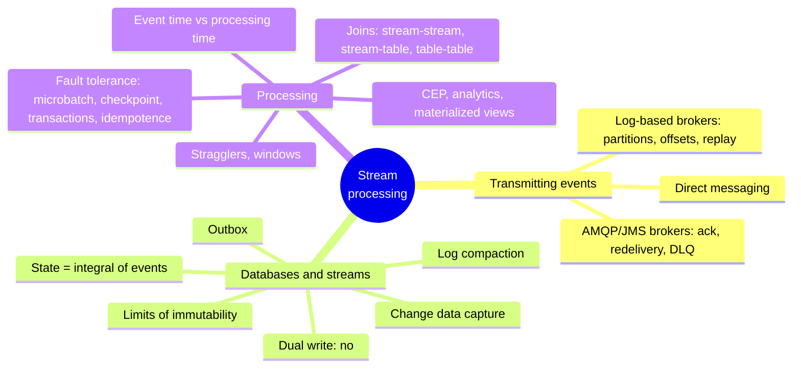
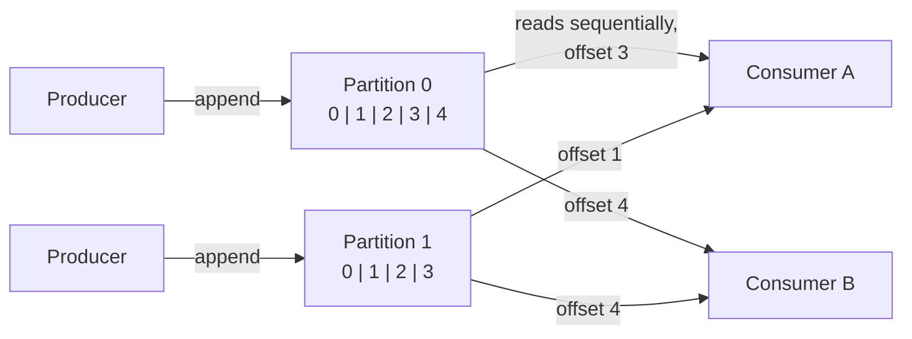
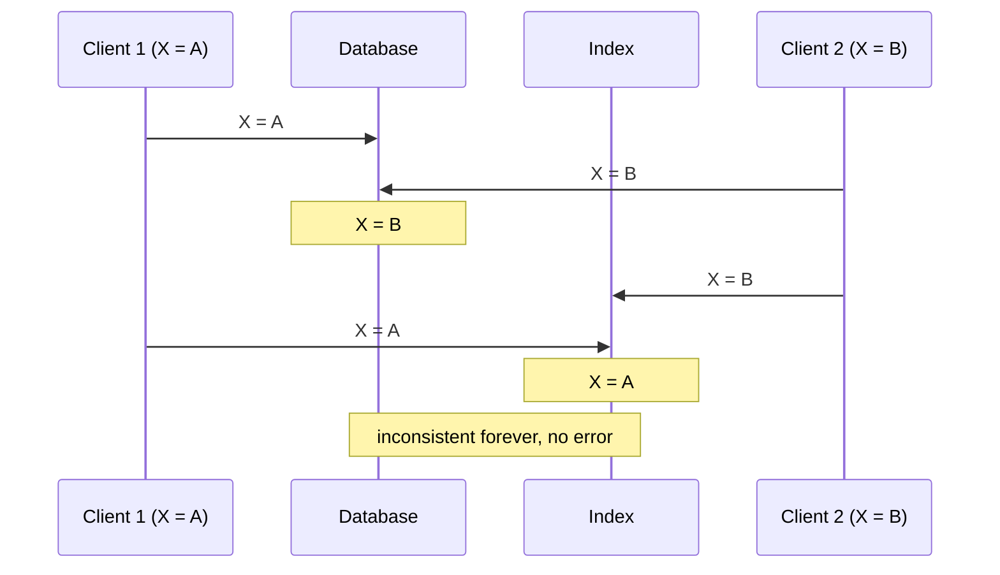

# Chapter 12 · Stream Processing

> *A complex system that works is invariably found to have evolved from a simple system that
> works. The inverse proposition also appears to be true: A complex system designed from
> scratch never works and cannot be made to work.* — John Gall, Systemantics (1975)

**In one sentence:** batch processing assumes a finite input; stream processing works on
**unbounded** data that arrives over time and processes every event as soon as it
happens. The chapter explains how events are transmitted (traditional brokers versus
log-based brokers), discovers that a database is itself a stream (CDC, event sourcing,
"state is the integral of the changelog"), and then tackles what batch does not have:
time, windows, joins over never-ending data, fault tolerance without ever "finishing".

**PDF pages:** 511-562 · **Density:** high. Together with 6 and 8, one of the three
chapters that really need to be understood. The concept of the log-based broker and the
database/stream link are the key to chapter 13.

---

## Chapter map

---

## 1. Transmitting event streams
<!-- pdf: 512 -->

An **event** is a record: small, self-contained, immutable, with a timestamp of when it
happened. A **producer** generates it once, several **consumers** process it; related
events are grouped in a **topic**. In theory a file or a DB with polling would do, but
the more often you poll, the more requests come back empty: better to be **notified**.
DB triggers are limited; hence messaging systems.

Two questions to classify them: **what happens if producers are faster than
consumers** (drop, queue, or **backpressure** like Unix pipes and TCP; and if it
queues, what happens when the queue does not fit in memory?) and **what happens if a
node crashes** (are messages lost? durability has a cost). Losing a few sensor readings
is fine; losing counted events is not, and a massive loss can go unnoticed.

### Direct messaging
<!-- pdf: 514 -->

UDP multicast for stock market feeds, ZeroMQ and nanomsg without a broker, StatsD over
UDP (approximate metrics), **webhooks** (an HTTP request to a callback URL). They work
in their domain but all assume everyone is online: an offline consumer misses messages,
and a producer that crashes loses the retry buffer.

### Traditional brokers (AMQP/JMS)
<!-- pdf: 515 -->

A **message broker** is a database optimized for message flows: clients come and go,
durability is its job, the queue is usually unbounded. Consumers are **asynchronous**:
the producer only waits for the broker's ack.

Differences from a DB: it deletes messages after delivery (not for long-term storage),
assumes **short** queues (long queues degrade throughput), offers subscriptions by
pattern instead of queries, and **notifies** of changes instead of giving snapshots.
RabbitMQ, ActiveMQ, IBM MQ, Azure Service Bus, Pub/Sub.

With several consumers: **load balancing** (each message to one consumer, to
parallelize expensive work) or **fan-out** (each message to all). Kafka's consumer
groups combine them.

**Acks and redelivery.** The consumer tells the broker when it is done; without an ack
the broker redelivers to another one. If the ack was lost after processing, the message
is processed **twice** (you need atomic commit or idempotence). And load balancing plus
redelivery **reorders**: consumer 2 crashes on m3, m3 goes to consumer 1 after m4.
Harmless if the messages are independent, serious if there is causality. A malformed
message that crashes every consumer blocks everything in a loop: the **dead letter
queue** moves it elsewhere, with monitoring, and an operator decides.

### Log-based brokers
<!-- pdf: 519 -->

Traditional brokers have a **transient** mindset: receiving a message is
**destructive**, you cannot rerun a consumer and get the same result, a new consumer
only sees messages after its registration. Databases and filesystems are the opposite:
everything stays until you delete it. The hybrid is the **log-based broker**: the
durable storage of the DB plus the low-latency notification of messaging.

An append-only log: the producer appends, the consumer reads sequentially and at the
end waits for a notification (like `tail -f`). To scale it is **sharded**: a topic is a
group of **partitions**, each an independent log on a different machine, with
increasing **offsets**. Total ordering **within** a partition, none across partitions.
Kafka, Kinesis; Pub/Sub is similar underneath but exposes a JMS API. Millions of
messages per second with sharding, fault tolerance with replication.

Compared to traditional ones:

- **Fan-out** for free: reading does not delete.
- **Load balancing** at coarse grain: whole partitions assigned to the nodes of the
  consumer group, read single-threaded. So at most as many consumers as partitions, and
  a slow message blocks the partition (**head-of-line blocking**). Parallelism = more
  partitions.
- Rule: expensive messages, per-message parallelism, ordering irrelevant → AMQP/JMS.
  High throughput, fast messages, **ordering important** → log. The boundary is
  blurring: Kafka now has JMS-style consumer groups.
- Ordering only within the partition: events that must be ordered (those of one user)
  go in the same partition, with the **user ID as partition key**.

**Offsets**: the broker does not track acks per message, it periodically records the
consumer's offset. Less bookkeeping, batching, pipelining. It is the **log sequence
number** of replication: the broker is the leader, the consumer the follower. If the
consumer crashes, it restarts from the last recorded offset and **sees again** a few
messages.

**Space**: the log is split into segments, old ones are deleted or archived: a
**ring buffer on disk**, but a big one. A 20 TB disk at 250 MB/s fills up in 22 hours
at most; in practice days or weeks. Many brokers now use **object storage** as a tier
(Kafka, Redpanda) or entirely (WarpStream, Bufstream), even as Iceberg tables readable
by batch jobs without copies.

**Slow consumers**: the log is a large but fixed buffer. You monitor how far behind
the head it is and alert: there is time to intervene. A consumer that is too far behind
loses messages but **does not disturb the others**: you can consume a production log
for debugging without risk, and a consumer that is shut down leaves only its offset.
With traditional brokers you must delete orphaned queues to avoid running out of memory.

**Replay**: consuming is read-only, the only effect is the offset, and the offset belongs
to the consumer. Restart from yesterday with new code and write elsewhere. This makes the
log **similar to batch**: derived data separated from the input by a repeatable
transformation.

---

## 2. Databases and streams
<!-- pdf: 524 -->

The link is fundamental. Every write to a DB is an event. The **replication log** is a
stream of write events that the followers apply. State machine replication is "same
events, same order, same state". Event sourcing uses the stream as the system of
record, and a log-based broker configured not to delete is perfect.

### The problem: keeping systems in sync
<!-- pdf: 525 -->

OLTP, cache, full-text index, warehouse: each with its own copy. Periodic dumps (batch)
or **dual writes**: the app writes to the DB, then to the index, then invalidates the
cache. Two serious flaws:

A race condition without detection (you would need version vectors), and **one write
succeeds while the other fails** (atomic commit, expensive). The DB has a leader, the
index has a leader, neither follows the other: it is multi-leader. The index would need
to be a **follower of the DB**.

### Change data capture
<!-- pdf: 527 -->

For decades the replication log was an undocumented internal detail. **CDC** observes
all the writes to a DB and extracts them as a stream that can be replicated elsewhere.
The DB decides the order, writes it to the log, the index applies it in the same
order: the race disappears. Every derived system is just another consumer. CDC makes
one DB the **leader** and all the others **followers**; a log-based broker is the ideal
transport because it preserves ordering. It is implemented on the logical log (ch. 6)
with challenges around schemas and updates: **Debezium** (connectors for MySQL,
PostgreSQL, Oracle, SQL Server, Cassandra), Kafka Connect, Maxwell, GoldenGate.
Asynchronous: a slow consumer does not slow down the DB, but all the replication lag
issues apply.

**Initial snapshot**: the log is not kept forever. A new index needs a full copy, hence
a **consistent snapshot tied to an offset** in the log (Debezium uses Netflix's DBLog
watermarking for incremental snapshots).

**Log compaction**: the alternative to the snapshot. As in the LSM, only the latest
value per key is kept, tombstones delete. Space depends on the **current** contents of
the DB, not on the historical writes. With primary-key CDC where every update replaces
the value, a new consumer starts from **offset 0 of the compacted topic** and gets a
full copy without a snapshot. Kafka supports it: the broker becomes durable storage.

Today DBs expose change streams as a first-class interface (MySQL, PostgreSQL,
Datastream in Google Cloud). Cassandra too, but with no single source of truth it
exposes the **raw per-node log segments** and the consumer merges them like a quorum
reader.

### CDC versus event sourcing
<!-- pdf: 531 -->

| CDC | Event sourcing |
|---|---|
| The app uses the DB in a **mutable** way; the log is extracted at a low level | The app is built on **immutable** events at the application level |
| Ordering guaranteed to match that of the writes | The store is append-only, updates and deletes discouraged |
| Added to an existing DB with minimal changes | A big change for an app that does not already do it |
| An event contains the **full version** of the record: compaction possible | An event expresses an **intention**: later events do not overwrite, the whole history is needed, no compaction. Snapshots of the state only as an optimization |

**CDC and schemas.** In a microservices architecture the DB is an internal detail; CDC
takes the DB schema and turns it into a **public API**: drop a column and you break
consumers, which are now production services, not just the ETL. **Data contracts** to
prevent it. The **outbox pattern**: a table with its own schema exposed to CDC instead
of the internal model. It looks like a dual write and it is a dual write, but **both
writes are in the same transaction** on the same DB. Costs: maintaining the
transformation, more writes to the DB.

### State, streams and immutability
<!-- pdf: 532 -->

The current state is the **result of the events** that mutated it: available seats
from the bookings, the balance from debits and credits. Mutable state and immutable log
are **two sides of the same coin**: the state is the **integral** of the stream over
time, the stream is the **derivative** of the state. Gray and Reuter, 1992: "there is no
fundamental need to keep a database; the log contains all the information. The database
is kept only for the performance of reads." Compaction is the bridge between the two.

Advantages of immutability: accountants have done it for centuries (append-only
**ledger**, mistakes corrected with compensating transactions, never deleted),
diagnosis and recovery from buggy code, audit for customer support, and **more
information than the state**: the item put in the cart and removed vanishes from a DB
but remains in the log for analytics.

**Several views from the same log**: Druid ingests from Kafka, Kafka Connect exports
everywhere. A new feature = a new view alongside the old ones, no migration; then shut
down the old one. The "fallacy" of traditional design: that data must be written in the
form in which it is queried. With a write-optimized log and read-optimized views,
normalizing or denormalizing becomes almost irrelevant: the social timeline is a
denormalized view kept consistent by the fan-out.

**Concurrency**: the drawback of CQRS is that the views are asynchronous
(read-your-writes, ch. 6); updating them synchronously would require distributed
transactions. In return, a user action becomes **a single write**, the append of the
event, easy to make atomic, and if log and state are sharded the same way a
single-threaded consumer per shard needs no concurrency control: the log has
**eliminated the nondeterminism** by defining a serial order.

**Limitations**: with many updates on a small dataset the history explodes, and
compaction and GC become critical. And the GDPR demands **real deletion**, not appending
a "consider it deleted": rewriting history (*excision* in Datomic, *shunning* in
Fossil). Deleting is hard: copies everywhere, storage that writes elsewhere instead of
overwriting, deliberately immutable backups. **Crypto-shredding**: encrypt what you may
have to delete, then forget the key. It shifts the problem to key management and forces
you to decide the granularity in advance. Deleting is "making it hard to retrieve", not
"impossible".

---

## 3. Processing streams
<!-- pdf: 537 -->

Three things to do with a stream: write it to a DB or index, push it to a human
(alerts, dashboards), or **process it into other streams** through **operators** or
jobs, in acyclic pipelines. Sharding and parallelism as in batch. The crucial
difference: **the stream never ends**. No sorting, hence no sort-merge join; and a job
that has been running for years does not restart from scratch.

### Uses
<!-- pdf: 538 -->

- **Complex event processing**: searching for **patterns of events** like a regex
  searches for patterns of characters. Queries are **permanent** and data transient,
  the inverse of a DB. Fraud, trading, manufacturing. Esper, Apama, and SQL on streams
  in Flink.
- **Stream analytics**: aggregates and statistics over windows (rate, rolling average,
  comparison with last week). Probabilistic algorithms (Bloom, HyperLogLog, percentile
  estimates) as a memory **optimization**, not because streams are inherently
  approximate. Storm, Spark Streaming, Flink, Samza, Beam, Kafka Streams.
- **Materialized views**: caches, indexes, warehouses updated from the changelog; the
  state of an event-sourced app is a view. Needs a window **since the beginning of
  time**, which clashes with window-oriented frameworks; Kafka Streams and ksqlDB on top
  of compaction. DBs refresh views in batch (`REFRESH MATERIALIZED VIEW`): everything
  recomputed, stale data. **Incremental view maintenance** (Materialize, RisingWave,
  ClickHouse, Feldera) translates the query into incremental operators and updates only
  what changes.
- **Search on streams**: stored queries, documents evaluated against them (media
  monitoring, real estate alerts; Elasticsearch's percolator). The queries are indexed
  as well as the documents.
- **Actors** are not stream processing: they handle concurrency, ephemeral one-to-one
  communication, even cyclic; streams are durable, multi-subscriber, acyclic. Many
  actor frameworks do not guarantee delivery.

### Reasoning about time
<!-- pdf: 542 -->

"The average over the last five minutes" sounds clear and is not. Batch uses the
**event timestamp**, never the machine's clock (it reads a year in minutes), and is
thereby **deterministic**. Many stream processors use **processing time**, the local
clock: simple, fine if the delay is negligible, breaks with any lag.

**Event time versus processing time.** Lag comes from queues, network faults, restarts,
reprocessing. And messages get out of order: request B leaves after A but reaches the
broker first. Like Star Wars: episode number = event time, date you watched it =
processing time. Confusing them produces false data: you restart the processor, it
works through the backlog, and measuring by processing time you see a **spike of
requests** that never happened.

**Stragglers.** With event-time windows you never know whether you have received all the
events of minute 37 or whether some are buffered elsewhere. You declare the window
closed after a while, and for the latecomers: **ignore them** (counting how many, with
alerts) or **publish a correction** (and retract the previous output). A special message
"from now on no timestamps before t" helps, but with several producers each must be
tracked.

**Whose clock?** A mobile app buffers events offline for hours or days: to the server
they are extreme stragglers. The timestamp should be the **device's**, but that clock is
not reliable (ch. 9). Solution: **three timestamps**, event according to the device,
sending according to the device, receipt according to the server. Receipt minus sending
estimates the offset of the device clock, to apply to the event. Batch has the same
problem, in streaming it is just more visible.

**Types of windows.**

| Window | Definition | Example |
|---|---|---|
| **Tumbling** | Fixed length, every event in exactly one | 10:03:00-10:03:59, then 10:04:00-10:04:59; round the timestamp |
| **Hopping** | Fixed length, **overlapping** for smoothing | 5 minutes with a hop of 1: 10:03-10:07, 10:04-10:08; aggregate adjacent tumbling windows |
| **Sliding** | All the events within some interval of each other | 10:03:39 and 10:08:12 together because they are less than 5 minutes apart; sorted buffer |
| **Session** | No fixed duration: events of the same user close together in time, closed after inactivity | 30 minutes without events; web sessionization |

The state of a window may be fixed (a counter) or grow with the events (sliding and
joins): enough memory or disk is needed.

### Stream joins
<!-- pdf: 547 -->

Three types, all with the same structure: **state derived from one input, queried
while processing the other**.

| Join | Inputs | Example | Window |
|---|---|---|---|
| **Stream-stream** (window join) | Two event streams | Searches and clicks with the same session ID for the click-through rate; the click may never arrive, or days later, or **before** the search | Finite, e.g. one hour: indexes by session ID, emit on match or on expiry |
| **Stream-table** (enrichment) | Events plus the changelog of a DB | User events enriched with the profile | **Infinite** for the changelog (latest version wins), none for the stream |
| **Table-table** (materialized view) | Two changelogs | Social timeline from posts and follows: new post → into the followers' timelines; new follow → recent posts into the timeline; and the inverses | Infinite on both |

The stream-table join does not query the remote DB (slow, overloads it): it keeps a
**local copy** (hash join) updated via **CDC**. Unlike batch, which uses a snapshot,
here the DB changes while the job runs. The table-table join is a materialized view of
the SQL join between posts and follows, and follows the product rule:
(u·v)′ = u′v + uv′, every change to posts joined with the current followers, every
change to follows with the current posts.

Including the search in the click event **is not** a join: you would not see the
searches without clicks.

**Time dependence.** Ordering across different streams is not guaranteed: is an event
joined with the old or the new profile? The tax rate of a sale is the one **at the time
of the sale**, not the current one, if you reprocess history. With indeterminate
ordering the join is **nondeterministic**: rerunning does not give the same result. In
warehouses this is the **slowly changing dimension**: an ID for every version of the
joined record (new ID at every change of tax rate, the invoice carries it).
Deterministic, but no compaction because all versions are needed. Or denormalize the
tax rate into the sale event.

### Fault tolerance
<!-- pdf: 550 -->

Batch retries tasks because the input is immutable, output goes to separate files,
visible only on success: **exactly-once** (better *effectively-once*): records may be
processed several times but the effect is as if once. In streaming you cannot wait for
the end.

- **Microbatching** (Spark Streaming): blocks of about one second treated as
  mini-batches; smaller, more overhead; larger, more delay. It implies a tumbling window
  by processing time; larger windows carry state across microbatches.
- **Checkpoints** (Flink): periodic snapshots of the state to durable storage,
  triggered by **barriers** in the stream; on a crash you restart from the last
  checkpoint and discard the subsequent output. No imposed window size.

Inside the framework both give exactly-once. But as soon as the output **leaves** (DB,
external broker, email) the framework can no longer discard it: the retry duplicates
the effect.

- **Atomic commit revisited**: all outputs and effects (downstream messages, DB
  writes, state, **advancing the offset**) must persist if and only if processing
  succeeds. It is 2PC, but in a restricted environment it is implemented well: Dataflow,
  VoltDB, **Kafka**. Not XA across heterogeneous technologies, but internal transactions
  that manage state and messages within the framework, amortized over several messages.
- **Idempotence**: a repeated operation has the same effect as doing it once (delete
  yes, increment no). It is made idempotent with metadata: write to the external DB
  together with the **offset** of the message that caused the last write, and you know
  whether the update has already been applied. Assumptions: the retry sees the **same
  messages in the same order** (the log does this), deterministic processing, no other
  node updating the same value, **fencing** on failover. With these caveats,
  exactly-once at low cost.

**Rebuilding state**: windowed aggregates, tables for joins. Remote replicated state
(slow per message) or **local, replicated periodically**: Flink with snapshots on the
DFS, Kafka Streams with a **compacted topic** as CDC of the state, VoltDB processing
every message on several nodes. Sometimes it is rebuilt from the inputs: short windows
are redone by replay, a local replica via CDC is redone from the compacted topic. It
depends on the infrastructure: the network may be faster than the disk.

---

## The two brokers in one table

| | AMQP/JMS | Log-based |
|---|---|---|
| Assignment | Individual messages to consumers | Whole partitions to the nodes of the group |
| Ordering | Lost with load balancing + redelivery | Guaranteed within the partition |
| Ack | Per message | Periodic offset |
| After delivery | Deleted | Kept on disk, **re-readable** |
| Suited to | Asynchronous task queue, expensive work, ordering irrelevant | High throughput, fast messages, ordering important, derived data |

---

## Self-check questions

1. The two questions to classify a messaging system, and the three answers to the first.
2. Why does load balancing plus redelivery reorder messages? When does it matter?
3. What makes receiving from a traditional broker "destructive", and why does this
   prevent adding a consumer that reads the past?
4. Why does the log-based broker limit parallelism to the number of partitions, and
   what does a slow message do?
5. Explain the offset / log sequence number analogy and what happens to the consumer after a crash.
6. Two flaws of dual writes. How does CDC solve them?
7. Log compaction: why does it let a new consumer get a full copy without a
   snapshot? Why does it not work with event sourcing?
8. What is the outbox pattern and why "is it a dual write" but does not suffer from it?
9. "State is the integral of the events": explain and quote the sentence by Gray and Reuter.
10. Processing time versus event time: reconstruct the false spike after a redeploy.
11. Three timestamps for the mobile app: which ones and what you estimate from their difference.
12. Tumbling, hopping, sliding, session: two events at 10:03:39 and 10:08:12 are
    together in which 5-minute windows?
13. Stream-table join: why is the remote DB not queried and how does the copy stay up to date?
14. Why can a join between streams be nondeterministic and how does a
    slowly changing dimension solve it? What does it cost?
15. Microbatching and checkpointing give exactly-once: where does the guarantee end? The two
    ways to extend it and the assumptions of idempotence.

Flashcards in [`flashcards/ch12.yaml`](../data/flashcards/ch12.yaml).

## Cross-references

- Social timeline and fan-out: ch. 2
- Event sourcing and CQRS: ch. 3
- LSM, compaction, tombstones, Bloom filters: ch. 4
- Brokers, actors, durable execution: ch. 5
- Replication log, logical log, replication lag, read-your-writes: ch. 6
- Sharding, partition key: ch. 7
- Exactly-once with idempotence, XA: ch. 8
- Clocks, fencing: ch. 9
- Shared log, state machine replication: ch. 10
- Sort-merge join, MapReduce: ch. 11
- Correctness without transactions, multi-shard events: ch. 13
- GDPR and deletion: ch. 14
