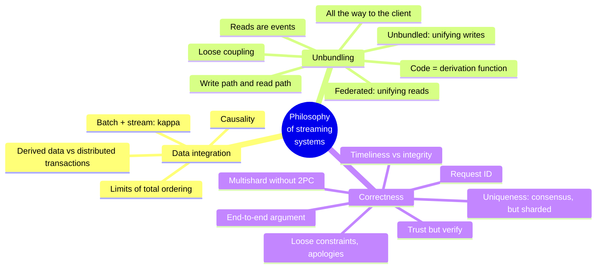
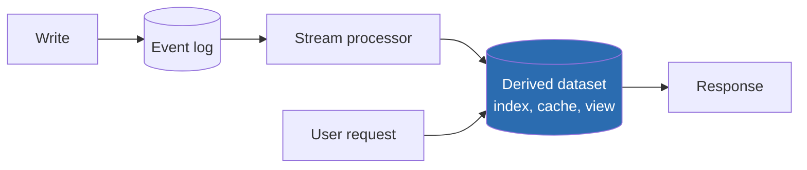
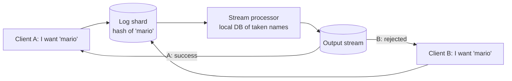

# Chapter 13 · A Philosophy of Streaming Systems

> *If the highest aim of a captain was to preserve his ship, he would keep it in port
> forever.* — St. Thomas Aquinas, *Summa Theologica* (1265–1274)

**In one sentence:** the most opinionated chapter of the book. No single tool serves
all use cases, so every application composes several systems; the robust way to do
that is an **ordered event log with idempotent consumers**, not distributed
transactions. From there: the "unbundled" database, applications designed around
dataflow all the way to the user's device, and a theory of correctness that separates
**integrity** from **timeliness** and uses end-to-end IDs instead of atomic commit.

**PDF pages:** 563-608 · **Density:** medium. Few new techniques, lots of synthesis.
It is the chapter that makes sense of the whole book: read it as an essay.

---

## Chapter map

---

## 1. Data integration
<!-- pdf: 563 -->

The recurring theme of the book: for every problem several solutions, each suited to
different circumstances. Every piece of software, even a "general-purpose" DB, is
designed for one usage pattern, and vendors do not tell you where their product does
badly. Even with a perfect understanding of the tools-to-circumstances map, a complex
application uses its data in different ways: you always end up **combining** several
systems (OLTP plus full-text, plus warehouse, plus cache, plus ML, plus notifications).

### Reasoning about dataflows
<!-- pdf: 565 -->

With several copies you need clarity about **inputs and outputs**: where a write goes
first, what is derived from what. If the index is updated **only** via CDC from the
system of record, it is entirely derived and therefore consistent (barring bugs). If
the app writes to both, nobody dictates the order and the two diverge forever.
Principle: **funnel all input through a single system that decides a total order**,
then derive the rest in that same order. It is state machine replication; CDC versus
event sourcing is secondary. Updating a derived system from a log can be made
**deterministic and idempotent**, easy to recover.

### Derived data versus distributed transactions
<!-- pdf: 565 -->

Same goal, different means: atomic commit versus **deterministic retry plus
idempotence**. The main difference: transactions guarantee that after the write you
immediately read the updated value; derived systems are asynchronous and do not
guarantee it. XA has poor fault tolerance and performance; a better protocol adopted
everywhere will not arrive soon. So the log is the most promising route, **but**
"eventual consistency is inevitable, suck it up" is not an answer without guidance on
how to live with it. The chapter looks for a middle ground.

### The limits of total ordering
<!-- pdf: 566 -->

A totally ordered log is feasible as long as the system is small (every single-leader
DB does it). Then: throughput exceeds one node and the log is sharded (ambiguous order
across shards); several regions, one leader per region (undefined order across
regions); microservices with separate state (no order across services); clients with
local, offline state (client and server see different orders). Deciding a total order
is total order broadcast, i.e. **consensus**, and consensus algorithms assume that a
single node can handle the whole stream.

### Capturing causality
<!-- pdf: 567 -->

Without a causal link an arbitrary order is fine, and updates to the same object are
ordered by routing them to the same shard. But causality is subtle: a user unfriends
their ex, then writes a nasty message to the remaining friends. Friendships and
messages live in different places; the notification service may process the message
**before** the unfriend and notify the ex. Notifications are a join between messages
and the friend list, with the time dependence of joins. No simple answer; starting
points: **logical timestamps** (ordering without coordination, but recipients must
handle out-of-order arrival), **logging the state seen** before a decision with an ID
that later events reference, **conflict resolution algorithms** (good for state,
useless for external side effects such as a notification).

### Batch and stream together
<!-- pdf: 568 -->

Both produce derived data. Batch has a **functional** flavor: pure, deterministic
functions, immutable input, append-only output. Stream adds managed, fault-tolerant
state. Thinking in pipelines makes an organization's dataflows understandable. The
derivations could be synchronous (like the secondary indexes of a relational DB), but
**asynchrony** is what makes the system robust: a failure stays local, whereas a
distributed transaction aborts if one participant fails and **amplifies** failures.
Even cross-shard indexes are more reliable if asynchronous.

**Reprocessing for evolution.** Stream reflects changes with little delay; batch
reprocesses history to derive **new views**. Without reprocessing, schema evolution is
limited to optional fields; with reprocessing you can restructure everything. The
19th-century English railways changed gauge by adding a **third rail**: old and new
trains on the same line for years, then the old one removed. Two views derived from the
same data, users moved gradually, every step **reversible**: less fear of mistakes,
more speed.

**Unifying batch and stream.** The lambda architecture has fallen out of favor; the
**kappa** does both in the same system. Needed: replay of historical events through
the same engine (log-based brokers allow it), exactly-once, and windowing by **event
time** (processing time is meaningless when reprocessing). Apache Beam on Flink or
Dataflow.

---

## 2. Unbundling the database
<!-- pdf: 570 -->

Databases, batch/stream processors and operating systems do the same thing: they store
data and let you query it. Unix and the relational model were born in the same years
with opposite philosophies: Unix a thin abstraction over the hardware (pipes, files as
bytes), the relational model a high abstraction that hides disk, concurrency and
crashes (SQL, transactions). Each "simpler" in its own way. NoSQL is the Unix approach
applied to distributed OLTP. The chapter tries to reconcile them.

### Composing data storage technologies
<!-- pdf: 571 -->

Secondary indexes, materialized views, replication logs, full-text: features **inside**
DBs. In ch. 11 and 12 we built them **outside**, with batch, stream and CDC. What does
`CREATE INDEX` do? It scans a consistent snapshot, extracts and sorts the values,
writes the index, applies the backlog of writes since the snapshot, then keeps it up
to date. It is identical to setting up a new follower (ch. 6) and to bootstrapping CDC
(ch. 12). The DB **reprocesses** the dataset and derives a view.

Seen this way, the dataflow of an entire organization is **one huge database**: batch
and stream processors are elaborate triggers, stored procedures and view maintenance;
the derived systems are different kinds of index, provided by different software on
different machines by different teams. Two ways to compose them:

| | Federated database (unifying reads) | Unbundled database (unifying writes) |
|---|---|---|
| What | A single query interface over different engines: PostgreSQL foreign data wrappers, Trino, polystores | Connecting storage systems reliably via CDC and event logs |
| Tradition | Relational: integrated system, high-level language, complicated implementation | Unix: small tools, uniform low-level API (pipes), composed by a high-level language (the shell) |
| Difficulty | Mapping one model onto another: manageable | Keeping writes in sync: **the hard problem** |

### Making unbundling work
<!-- pdf: 573 -->

Distributed transactions across heterogeneous storage are problematic; within a single
system they are fine (stream processors use them for exactly-once). When data crosses
technologies owned by **different teams**, without a standard protocol, an **ordered log
with idempotent consumers** is a much simpler and more feasible abstraction.

The advantage is **loose coupling**, at two levels:

- **System**: if a consumer is slow or down, the log acts as a buffer and the producer
  and other consumers carry on; the failure is **contained**. Distributed transactions,
  being synchronous, turn local failures into global failures.
- **Human**: components developed and maintained by different teams, each doing one
  thing well, with clear interfaces. The log is powerful enough (durability, ordering)
  and general enough for any kind of data.

**Unbundled versus integrated.** Unbundling does not replace DBs: they are needed for
the state of stream processors and for serving queries. More pieces of infrastructure,
more learning curves and operational quirks: **as few moving parts as possible**. An
integrated product can be faster and more predictable on its workload. Building for a
scale you do not need is premature optimization. The goal of unbundling is **breadth**,
not depth: combining DBs to cover more workloads than a single piece of software can.
If one product does everything you need, use it. The tools are improving: Debezium,
the Kafka protocol as a de facto standard, incremental view maintenance.

### Designing around dataflow
<!-- pdf: 575 -->

The **spreadsheet** has done it since 1979: change a cell, the dependent formulas
recompute. That is what we want at the system level: change a record, and indexes,
caches and aggregates update themselves. On top of that we need fault tolerance,
scale, durability and the integration of different technologies written by different
people.

**Application code is a derivation function.** A secondary index is a standard
derivation (`CREATE INDEX`); full-text requires NLP and tuning; an ML model is derived
from the training data with specific feature engineering; a cache depends on which
fields the UI shows. When the function is not off the shelf you need custom code, and
here DBs struggle: triggers and stored procedures are an afterthought.

**Separating code and state.** DBs are terrible deployment environments (dependencies,
versioning, rolling upgrades, monitoring, network calls); Kubernetes and the like do it
well. Hence stateless services with state in the DB: "separation of Church and state".
In this model the DB is a **shared mutable variable** read and written synchronously
over the network. But you cannot **subscribe** to a variable: you re-read it
periodically. DBs have inherited this passivity: to find out whether something has
changed, you poll. Subscribing to changes is only just emerging.

**Dataflow**: renegotiating the relationship between code and state. Not a passive DB
manipulated by the app, but code that **responds to state changes** in one place by
triggering state changes elsewhere. Already seen in CDC, actors, triggers, IVM.
Unbundling means applying it to derived data **outside** the primary DB. Log-based
brokers provide the two required properties: **stable ordering** (several views from
the same log must remain consistent with each other) and **fault tolerance** (a lost
message leaves things out of sync forever). Demanding requirements, but much cheaper
than distributed transactions. Operators compose like Unix tools in a pipe.

**Stream processors and services.** Microservices scale the organization through loose
coupling, but communicate with **synchronous** requests. Composing stream operators has
the same organizational properties with **asynchronous, one-directional** messages.
Example: a purchase in a different currency.

| Microservices | Dataflow |
|---|---|
| The purchase code **queries** the exchange rate service | The code **subscribes** to the exchange rate stream and keeps the rate in a local DB |
| One synchronous network request, one more service that can go down | A local query, even in the same process. **The fastest and most reliable network request is no network request at all** |
| To avoid the network you need a cache to keep fresh: polling or... subscription | It is a stream join between purchases and exchange rate updates |

The join is **time-dependent**: when reprocessing, you need the historical rate. This
holds in both approaches. Subscribing to changes instead of querying state brings us
closer to the spreadsheet. Open questions remain, but it is a promising direction.

### Observing derived state
<!-- pdf: 579 -->

The **write path**: everything that happens to a written piece of data, through batch
and stream, until every derived dataset incorporates it. Done **eagerly**, whether
anyone asks for it or not. The **read path**: when a user asks, you read from the
derived dataset, process, respond. Only on demand. Eager versus lazy evaluation. The
derived dataset is **where the two paths meet**: a trade-off between work at write
time and at read time.

Full-text: without an index, writes are free and reads are like `grep`; precomputing
every possible query, reads are free and writes are impossible (queries are infinite);
a cache of common queries sits in between and is a materialized view. Caches, indexes
and views **shift the boundary** between the two paths: more work on the write path to
save on the read path. It is exactly the social timeline of chapter 2, with the
boundary drawn differently for celebrities. "After 500 pages, we have come full circle."

**Stateful, offline-capable clients.** Browsers used to be stateless; single-page apps
and mobile apps keep a lot of local state. State on the device is a **cache of the
server's state**; the pixels on screen are a materialized view of the model objects,
which are a local replica of the datacenter. A loaded page knows nothing of changes
until you reload: stale cache, polling (RSS is polling). Server-sent events and
WebSockets let the server **push**: extending the write path all the way to the user.
The client uses the read path only for its initial state, then receives the stream.
Offline? Already solved: it is a consumer with an **offset** that resumes without
missing anything; every device is a small subscriber to a small stream.

**End-to-end event streams.** React and Elm update the UI when state changes: natural
to feed server events into that pipeline. A change flows from the device that
generates it, through logs and derived data, to the UI of another device, in under a
second. Messaging and games already do it. Why not everything? Because the stateless
request/response assumption is **deeply ingrained** in DBs, libraries, frameworks and
protocols: few datastores support "one request, a stream of responses over time". A
lot would need rethinking, towards publish/subscribe.

**Reads are events too.** The derived store is the boundary between write and read
path and allows random access without scanning the log. Some frameworks expose the
internal state of stream processors to queries. One can go further: represent **read
requests as events** on the same stream processor, which responds by emitting the
result on an output stream. It is a **stream-table join** between the queries and the
database, with every read routed to the right shard like a co-partitioned join. A
one-off read passes through the join and is forgotten; a **subscription** is a
persistent join with past and future events. Logging reads helps **provenance** and
causality (what the user had seen before deciding: the displayed shipping date
influences the purchase), at the price of storage and I/O. And it opens the way to
**multishard** processing: a query that combines several shards exploits the routing
and joins already provided by stream processors (Storm's distributed RPC: who has seen
a URL = union of the followers of those who posted it; fraud detection with
reputations sharded by IP, email, address). For these joins a DB that supports them is
simpler, but the path exists for those who hit the limits of standard solutions.

---

## 3. Aiming for correctness
<!-- pdf: 585 -->

A stateless service is fixed and restarted; a stateful system remembers forever,
mistakes included. For forty years transaction properties have been the tool of
correctness, but they are weaker than they seem (the confusion of isolation levels).
Where they have been abandoned, the semantics are messier. "We embrace weak
consistency" without knowing what it means. Jepsen has shown stark gaps between
declared guarantees and actual behavior. Serializability and atomic commit are
established but expensive: a single datacenter, limited scale and fault tolerance.

### The end-to-end argument
<!-- pdf: 586 -->

Using serializable transactions does not save you from an app that writes wrong data
or deletes: an argument for immutability, which however is no panacea.

**Exactly-once execution.** If a processing step fails, you either give up (loss) or
retry (risk of double execution: double charge, inflated counter). Idempotence is the
most effective approach, but for operations that are not naturally idempotent it takes
care: metadata (IDs of the applied operations) and fencing on failover.

**Duplicate suppression.** TCP deduplicates with sequence numbers, but only **within a
connection**. A client sends `COMMIT` for a transfer of $11 and the connection drops
before the response: it does not know whether it committed. It reconnects and retries:
outside the scope of TCP, and the transaction **is not idempotent**: $22. The textbook
example of atomicity **is not correct**, and real banks do not work this way. 2PC
breaks the connection-transaction binding but is not enough: between the **browser
and the server** there is another hop. The POST goes out, the cellular network drops
before the response, the user sees an error and retries ("resubmit the form?" "yes").
To the server it is a new request, to the DB a new transaction.

**Uniquely identifying requests.** A client-generated UUID as a hidden form field (or
a hash of the fields): two submissions have the same ID. You pass it all the way to
the DB and impose a **unique** constraint on the `requests` table: the second `INSERT`
fails and the transaction aborts. Relational DBs maintain uniqueness correctly **even
at weak isolation**, whereas an application-level check-then-insert does not (write
skew). The requests table is also an **event log**: the balance updates could be
derived downstream, as long as the event is processed once, again thanks to the ID.

**The argument** (Saltzer, Reed, Clark, 1984): a function can be completely and
correctly implemented **only with the knowledge of the applications at the
endpoints**; providing it in the communication system is not enough, at best it helps
performance. It applies to duplicates (TCP, transactions, stream processors'
exactly-once: none stops the user who resubmits), to **checksums** (Ethernet, TCP and
TLS do not see software bugs at the endpoints or corruption on disk) and to
**encryption** (the WiFi password, then TLS, then only end-to-end covers everything).
The low-level mechanisms remain useful because they reduce the probability of
high-level problems.

**Applying it to data systems.** A DB with strong guarantees does not exempt the app
from end-to-end measures. That is a pity, because fault tolerance is hard to get
right: transactions compress a thousand failures into two outcomes, commit or abort,
but they are not enough and they cost; rejecting them for their cost, you reimplement
fault tolerance in application code, which is usually wrong. We need **abstractions**
that provide application-specific end-to-end correctness with good performance at
large scale.

### Enforcing constraints
<!-- pdf: 590 -->

**Uniqueness requires consensus.** Several requests with the same value: the system
must decide which one to accept. Usually a leader (Raft for failover). It scales by
**sharding on the value that needs to be unique**: all requests with the same request
ID, or with the same username (by hash), to the same shard. Asynchronous multi-leader
is out: if you want to reject immediately, synchronous coordination is unavoidable.

**Uniqueness with the log.** The shared log is total order broadcast, i.e. consensus.
A stream processor consumes one shard sequentially on one thread, so it decides
**deterministically** who came first:

It is the construction of consensus from a shared log (ch. 10), and it scales with the
shards. It holds for any constraint: **writes that may conflict go to the same shard
and are processed sequentially**, with arbitrary validation logic.

**Multishard without a transaction.** A transfer touches three shards: request ID,
payer, payee. With cross-shard atomic commit the shards are no longer independent and
throughput drops. With sharded logs and stream processors:

1. The client generates a request ID and appends the request to the log sharded by
   **source account**.
2. The source account's processor keeps a local DB (account state and already
   processed IDs) **derived entirely from the log**. New ID: it checks the funds,
   **reserves** the amount, emits events with the same request ID: an outgoing payment
   on its own log, an incoming payment on the destination's log and on the fees log.
3. The outgoing event comes back to the source processor, which recognizes the ID,
   executes the payment, ignores duplicates.
4. The destination and fees processors apply the incoming payment, deduplicating by ID.

The three accounts could live in the same shard: it does not matter. Requirements:
events of each account **in log order with at-least-once**, and **deterministic**
processors. If the source processor crashes halfway, it reprocesses the same request,
takes the same decision, re-emits the same events with the same ID; the duplicates are
ignored. **Atomicity comes from the append of the initial request**, an atomic action:
once in the log, everything else will arrive, perhaps after recovery, perhaps
duplicated, but it will arrive. With exactly-once it is even simpler. The user who
wants to know the outcome subscribes to their own account's log and waits for the
outgoing event or a "payment declined". Same correctness as 2PC (every request applied
once to both accounts) **without atomic commit**.

### Timeliness and integrity
<!-- pdf: 595 -->

Strict serializability makes every commit visible immediately. Unbundled into several
asynchronous stages this does not hold, but a client **can wait** for a message to
appear on the output stream. The correctness of the funds check **does not depend** on
the waiting: the waiting only serves to inform the user. "Consistency" conflates two
requirements:

| | Timeliness | Integrity |
|---|---|---|
| What | The user sees an up-to-date state | No corruption: no lost, contradictory or false data; derived data correct |
| Violation | **Temporary**: wait and try again | **Permanent**: needs explicit checking and repair |
| Example | Yesterday's charge not yet on the statement: normal | The statement does not add up to the sum of the transactions, or money charged and not paid to the merchant: catastrophe |
| Tools | Linearizability, read-after-write | Atomicity, durability, exactly-once |

Slogan: **violations of timeliness are allowed under eventual consistency; violations
of integrity result in perpetual inconsistency**. In most applications integrity
matters much more than timeliness.

ACID gives both together, so the distinction seems irrelevant. Dataflow systems
**decouple** them: no timeliness (unless consumers wait), but integrity is central,
preserved by reliable delivery and deduplication. It is achieved with: the operation
as **a single message** that can be written atomically; all other derived updates with
**deterministic** functions; a **client request ID** passed through all levels;
**immutable** messages that can be reprocessed.

**Loosely interpreted constraints.** Strict uniqueness requires consensus and the
stream does not avoid it. But many applications **must** be able to violate apparently
hard constraints: you sell more than you have in stock and order more goods with a
discount (you would do the same if a forklift crushed the boxes); airlines and hotels
overbook on purpose; the bank charges an overdraft; payments between banks are
reconciled afterwards. The correction is a **compensating transaction**, and the cost
of the **apology** is often low: you cannot recall an email but you can send a
correction; a double charge is refunded. If the apology is acceptable (a business
decision), checking everything **before** writing is needlessly restrictive: write
optimistically and verify afterwards, before actions that are expensive to undo. These
apps require integrity (not losing reservations, not making money disappear), not
timeliness in enforcing the constraint.

**Coordination-avoiding systems.** Two observations: dataflows maintain integrity
without atomic commit, linearizability or cross-shard coordination; many apps accept
loose constraints as long as integrity holds. Together: systems that provide data
management services **without coordination**, with strong integrity, better
performance and fault tolerance. For example multi-leader across datacenters with
asynchronous replication: each datacenter independent, weak timeliness (not
linearizable), strong integrity. Serializable transactions remain useful at **small
scope**; XA is not needed; synchronous coordination is introduced only where needed
(strict constraints before unrecoverable actions), without making everything pay for
it. Coordination and constraints reduce the apologies for inconsistencies but increase
those for unavailability: you do not get to zero apologies, you look for the right
point.

### Trust, but verify
<!-- pdf: 599 -->

The system model is binary (some things happen, others never); reality is
probabilistic. Memory, disk and network get corrupted; at a large enough scale the
improbable happens. Software bugs escape low-level checksums: MySQL got uniqueness
constraints wrong, PostgreSQL showed write skew under serializable, and those are
robust DBs; application code has many more bugs and often does not even use the DB's
constraints. The C in ACID presupposes bug-free transactions.

Hence: **auditing**, verifying the integrity of the data. Not only in finance, where
everyone knows that mistakes happen. HDFS and S3 **do not trust the disks**:
background processes re-read the files, compare them with the replicas, move them. If
you want to know that the data is still there, **read it**. Try restoring backups once
in a while. Few systems self-verify; perhaps more in the future.

**Designing for auditability.** A transaction that mutates several objects does not
say why; the invocation of the logic is transient. Event sourcing represents the input
as an immutable event and derives the state with deterministic, repeatable functions:
same events, same code, same state. Explicit dataflow makes **provenance** clear:
hashes over the event log, re-running the processors (or a redundant derivation in
parallel) to compare the results, **time-travel debugging** to reproduce the exact
circumstances.

**The end-to-end argument, again**: if you do not trust every component, verify
integrity periodically, otherwise you discover corruption once it has already done
damage downstream. The best check is **end-to-end over the whole pipeline**: it
implicitly includes disks, networks, services and algorithms along the way. Like
automated tests, continuous auditing gives confidence and allows faster change.

**Tools.** Few data systems treat auditability as a priority; a separate audit table
does not guarantee consistency with the state; signing the log with an HSM does not
guarantee that the right transactions went into it. **Blockchains** are shared
append-only logs with cryptographic verification: transactions are events, smart
contracts are stream processors, the consensus is **Byzantine** (replicas check each
other). Too much overhead for almost everything, but the cryptographic tools are also
useful in lightweight form: **Merkle trees** to prove that a record is in a dataset;
**certificate transparency** uses verifiable append-only logs and Merkle trees without
consensus, with one leader per log. They could spread into data systems.

---

## Self-check questions

1. Why is "funnel all input through a single system that decides the order" the
   principle, and CDC versus event sourcing a detail?
2. Distributed transactions versus derived data: same goal, what is the main
   difference for the reader?
3. Four situations in which total ordering is not feasible.
4. The ex and the nasty message: where is causality lost and why do CRDTs not help?
5. Why does asynchrony make the system more robust than distributed transactions?
6. The third rail: what does it represent and why is every step reversible?
7. What does `CREATE INDEX` do and which two things in the book does it resemble?
8. Federated versus unbundled: which unifies what, and which is the hard problem?
9. "Breadth, not depth": when is unbundling the wrong choice?
10. Purchase in a foreign currency: microservices versus dataflow. What stays the same in both?
11. Write path and read path: what do caches, indexes and views shift? Link it to the social timeline.
12. Why is an offline client "already solved" by chapter 12?
13. The retried $11 transfer: why are TCP and 2PC not enough, and what is enough?
14. State the end-to-end argument and give three examples.
15. Reconstruct the multishard payment without 2PC. Where does atomicity come from?
    What happens if the source processor crashes halfway?
16. Timeliness versus integrity: definitions, type of violation, banking example.
17. When can a "hard" constraint be loose? What is the cost of the apology?
18. Why do HDFS and S3 re-read files in the background? What does this say about the system model?

Flashcards in [`flashcards/ch13.yaml`](../data/flashcards/ch13.yaml).

## Cross-references

- System of record and derived data: ch. 1
- Social timeline, write path and read path: ch. 2
- Event sourcing: ch. 3
- Setting up a new follower: ch. 6
- Conflicts, sync engines, multi-leader: ch. 6
- Sharded secondary indexes: ch. 7
- 2PC, XA, weak isolation, write skew: ch. 8
- Fencing, system models, Byzantine: ch. 9
- Consensus, shared log, uniqueness, linearizability: ch. 10
- CDC, idempotence, offsets, time-dependent joins: ch. 12
- GDPR and surveillance: ch. 14
