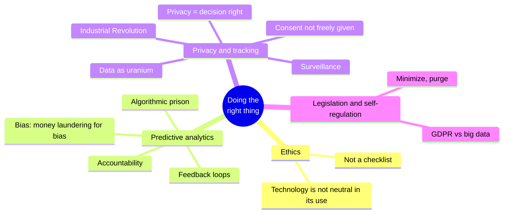

# Chapter 14 · Doing the Right Thing

> *Feeding AI systems on the world's beauty, ugliness, and cruelty, but expecting it
> to reflect only the beauty is a fantasy.* — Vinay Uday Prabhu and Abeba Birhane,
> "Large Datasets: A Pyrrhic Win for Computer Vision?" (2020)

**In one sentence:** every system is built for a purpose and has consequences, both
intended and unintended. Many datasets are about **people**, and the engineers who
build the systems bear the responsibility for those consequences. The chapter covers
two areas: automated decisions about people (bias, accountability, feedback loops)
and data collection itself (surveillance, consent, privacy as a decision right, data
as hazardous material).

**PDF pages:** 609-626 · **Density:** low. A short, discursive chapter, to be read in
full: it is an argument, not a catalog. This sheet keeps its structure and the
sentences worth remembering.

---

## Chapter map

---

## 0. The starting point
<!-- pdf: 609 -->

Ethics in software is important but rarely discussed, and the guidelines (the ACM
Code of Ethics) are rarely applied. A technology is not good or bad in itself: what
matters is how it is used and how it affects people, as true of a search engine as of a
weapon. The responsibility is ours to bear. In contrast to the rest of computing, the
concepts of ethics **require interpretation**: not a checklist to confirm you comply,
but a participatory and iterative process of reflection, in dialog with the people
involved, with accountability for the results.

---

## 1. Predictive analytics
<!-- pdf: 610 -->

Predicting the weather or the spread of a disease is one thing; predicting whether a
convict will reoffend, whether a loan applicant will default, whether an insurance
customer will make expensive claims is another: it directly affects people's lives.
Organizations are cautious for economic reasons (a missed business opportunity costs
little, a bad loan a lot): if in doubt, say no. But someone labeled "risky" by an
algorithm, accurately or falsely, suffers **many** of those "no" decisions: jobs, air
travel, insurance, property rental, financial services. It has been called
**algorithmic prison**: systematic exclusion without any proof of guilt and with
little chance of appeal, whereas the criminal justice system presumes innocence.

### Bias and discrimination
<!-- pdf: 610 -->

Algorithmic decisions are not necessarily any better or worse than human ones:
everyone has biases, and the hope is that data could be more fair. But with
predictive analytics we are not automating a rule: **we leave the rules to be
inferred from the data**, and the learned patterns are opaque. If the input carries a
systematic bias, the system learns it and **amplifies** it. Laws prohibit
discrimination on protected traits, but other features are correlated with them: in
segregated neighborhoods the postal code, or the IP address, predicts race. Believing
that an algorithm can take biased data and produce impartial output is ridiculous:
"machine learning is like **money laundering for bias**". Predictive systems
extrapolate from the past; if the past is discriminatory, they codify it. For a better
future, **moral imagination** is required, and only humans have it. Data and models
are tools, not masters.

### Responsibility and accountability
<!-- pdf: 611 -->

A human who makes a mistake can be held accountable, and the person affected can
appeal. An algorithm that makes a mistake: who is accountable? The self-driving car
that causes an accident, the credit scoring that discriminates by race or religion, the
ML decision under judicial review that you cannot explain to the judge. Nobody should
be able to evade responsibility by blaming an algorithm.

A traditional credit score is based on relevant facts about your borrowing history, and
errors can be corrected (although the agencies do not make it easy). The ML score
uses many more inputs and is opaque. The credit score asks "**how did you behave**";
prediction asks "**who is similar to you, and how did they behave**": a stereotype,
often based on where you live, a proxy for race and class. And whoever ends up in the
wrong bucket, or is judged on erroneous data, has almost no recourse. Data is
statistical: the distribution can be correct and the individual case wrong, just as a
life expectancy of 80 years says nothing about when you will die. Blind belief in data
is delusional and dangerous. The same power can focus aid on those who need it or let
predatory businesses find vulnerable people to sell them high-cost loans and worthless
degrees.

### Feedback loops
<!-- pdf: 612 -->

Even "harmless" systems like recommenders: predicting what you want to see leads to
**echo chambers** of opinions already shared, where stereotypes, misinformation, and
polarization breed, with effects already seen on elections. When predictions affect
lives, the loops become **self-reinforcing**: an employer uses credit scores for
hiring; a misfortune makes you miss payments; the score drops; you cannot find work;
poverty worsens the score. A downward spiral of poisonous assumptions camouflaged as
mathematical rigor. Another example: the algorithmic prices of German gas stations
**learned to collude** and prices went up. Not everything is predictable, but much is
with **systems thinking**: considering the entire system, people included, and asking
whether it amplifies existing differences or combats injustice.

---

## 2. Privacy and tracking
<!-- pdf: 613 -->

Beyond decisions, there is a problem with **collection** itself. If the system stores
only what the user explicitly enters, it performs a service for the user: the user is
the customer. If it tracks activity as a side effect, the service takes on interests of
its own that may conflict with the user's. Some tracking serves useful features
(ranking, recommendations, A/B tests). But if the service is funded through
advertising, **the advertisers are the customers** and the user takes second place:
detailed profiles, retained for a long time, for marketing. The user is given a free
service and is coaxed into engaging with it as much as possible. The right word is
**surveillance**.

### Surveillance
<!-- pdf: 614 -->

Thought experiment: replace "data" with "surveillance". "In our surveillance-driven
organization we collect real-time surveillance streams and store them in our
surveillance warehouse; our surveillance scientists..." The book is called, in this
chapter, *Designing Surveillance-Intensive Applications*. In making software "eat the
world" we have built the greatest mass surveillance infrastructure ever seen: an
internet-connected microphone in every inhabited space (phones, TVs, voice assistants,
baby monitors, toys), often with a terrible security record. Location, relationships,
purchases, health: an organization may know more about you than you know yourself,
identifying illnesses or economic problems before you do. The totalitarian regimes of
the past could only dream of a microphone in every room and a tracking device in
every pocket; we **voluntarily accept** it because the benefits are so great, and the
difference is that corporations collect it to provide us with services, not
governments seeking control.

Why do we accept it? Perhaps "I have nothing to hide": that is, you are in line with
existing power structures, you are not a minority, you need not fear persecution. Not
everyone is so fortunate. Or because the purpose seems benign: merely better
recommendations. But combined with predictive analytics the distinction blurs: driving
data collected by cars without consent that raises insurance premiums, health
insurance coverage tied to a fitness tracker, the sensor in a smartwatch that works
out **what you are typing** (passwords).

### Consent and freedom of choice
<!-- pdf: 615 -->

"Users choose voluntarily, agree to the terms, and receive a service in return." Three
problems. First: **why** is the tracking necessary? Click-through improves ranking,
but do advertising profiles serve the user, or only because the ads pay? Second:
almost nobody knows what data they provide and how it is processed, privacy policies
do more to obscure than to illuminate, and without understanding there is no
**meaningful consent**; one user's data also says things about **other people** who
have not agreed to any terms; the derived datasets that combine everything are
precisely what nobody can understand. Third: extraction is **one-way**, with no
reciprocity or negotiation: the terms are set by the service.

The GDPR requires consent that is "freely given, specific, informed, and unambiguous",
withdrawable "without detriment", in clear and plain language; pre-ticked boxes and
silence do not count. Other lawful bases exist (legal obligations, legitimate interest
such as fraud prevention), but consent is the most used. "If you don't want it, don't
use the service": not a free choice if the service is "regarded by most people as
essential for basic social participation" (smartphones, social networks, Google),
especially with network effects. And the platforms are designed to engage, with
gambling mechanics. Opting out is possible only for the privileged few with time,
knowledge, and no social or professional cost. For everyone else, surveillance is
**inescapable**.

### Privacy and use of data
<!-- pdf: 616 -->

"Privacy is dead, people post everything": false, it misunderstands the word. Privacy
is not keeping everything secret: it is the **freedom to choose** what to reveal to
whom, what to make public and what not. A **decision right**, part of autonomy.
Someone with a rare medical condition would gladly give their data to researchers,
but must be able to choose who accesses it and why, because it could cost them
insurance or employment.

With surveillance the right is not eroded: **it is transferred** to the company.
"Trust us": the right to decide what to reveal passes from the individual to the
company, which then keeps what it knows secret (it would be creepy and harm the
business) and reveals it only indirectly, as tools for targeting groups (those with a
certain illness). Even without reidentification, the user has lost **agency** over
disclosure: the company decides, for profit. Companies manage perceptions rather than
the actual intrusiveness; and a factually correct piece of data may be undesirable or
painful: humility and mechanisms for such failings are needed. Privacy settings
control what other users see, not the service, which grants itself unrestricted rights
of internal analysis. A transfer of privacy rights that is **historically
unprecedented**: surveillance existed but was expensive and manual; trust
relationships (doctor, attorney) were governed by strict ethical and legal
constraints.

### Data as assets and power
<!-- pdf: 618 -->

"Data exhaust" suggests recycled waste. It is the opposite: if advertising pays for
the service, the user's activity is a form of **labor**, and the app is the lure to
feed more and more information into the surveillance infrastructure. Personal data is
an asset: secret data brokers that buy and resell, startups valued in "eyeballs", that
is, in surveillance capabilities. And because it is valuable, everyone wants it:
companies, governments (secret deals, coercion, legal compulsion, theft), the
bankruptcy that sells it, the frequent breaches. Not an asset but a **toxic asset**,
hazardous material: not the new gold or oil but the **new uranium**. When collecting,
balance the benefits with the risk of it falling into the wrong hands: criminals,
hostile intelligence services, insiders, unscrupulous management, a future regime. Not
just today's government, **all future governments**. Schneier: "It is poor civic
hygiene to install technologies that could someday facilitate a police state". To
scrutinize others while avoiding scrutiny oneself is one of the most important forms
of power; companies are not seeking political power, but what they have accumulated,
much of it surreptitiously, gives them a lot of power over our lives.

### Remembering the Industrial Revolution
<!-- pdf: 619 -->

The Industrial Revolution brought growth and prosperity, and also poisoned air and
water, workers in slums, children in mines. The safeguards (environment, safety, child
labor, food inspections) came late and raised the cost of doing business, but society
benefited hugely and nobody would want to go back. The information age has its dark
side, and data collection is one of the problems. Schneier: "Data is the
**pollution** problem of the information age, and protecting privacy is the
environmental challenge. Our grandchildren will judge us on how we addressed the
challenge of data collection and misuse." We should try to make them proud.

---

## 3. Legislation and self-regulation
<!-- pdf: 620 -->

The GDPR requires that data be collected "for specified, explicit and legitimate
purposes" and be "adequate, relevant and limited to what is necessary". **Data
minimization** is the opposite of the big data philosophy: maximize collection,
combine, explore for unforeseen purposes, that is, exactly what the GDPR forbids. Some
effect on advertising, weak enforcement, little change in culture. Companies oppose
regulation as a hindrance to innovation, and they are partly right: sharing medical
data is risky but could save lives; balancing is difficult.

A **culture shift** is needed: users are not metrics to be optimized but humans with
dignity and agency. Self-regulate to deserve trust, educate users instead of keeping
them in the dark, let each individual keep control over their own data without
stealing it through surveillance. The right to one's own data is like the natural
environment of a national park: without explicit protection it will be destroyed, a
tragedy of the commons. Ubiquitous surveillance **is not inevitable**. First step:
**do not retain data forever**, purge it as soon as it is no longer needed, minimize
what you collect. Data you don't have cannot be leaked, stolen, or compelled by
governments to be handed over. "If we don't consider the societal impact of our work,
we're not doing our job."

---

## Self-check questions

1. Why is ethics not a checklist, and what distinguishes it from the rest of computing?
2. What is algorithmic prison, and how does it differ from criminal justice?
3. "Machine learning is money laundering for bias": explain with the postal code example.
4. Credit score versus predictive analytics: what question does each ask?
5. Describe a self-reinforcing feedback loop and what systems thinking is.
6. When is the user the customer and when not? What does the advertising model change?
7. Three reasons why consent to the terms of service is not meaningful.
8. Why is "not using the service" not a free choice?
9. Define privacy as a decision right. Where does that right go with surveillance?
10. Why is data "the new uranium"? What time horizon must be considered?
11. GDPR data minimization versus the big data philosophy: how are they opposed?
12. What is the first practical step the chapter proposes to those who build systems?

Flashcards in [`flashcards/ch14.yaml`](../data/flashcards/ch14.yaml).

## Cross-references

- Law and society, data minimization, costs of retaining data: ch. 1
- Horizon scandal and reliability: ch. 2
- Event sourcing and GDPR: ch. 3
- Deletion in LSM-trees: ch. 4
- Sharding by tenant and GDPR: ch. 7
- Limits of immutability, crypto-shredding: ch. 12
- Auditability: ch. 13
