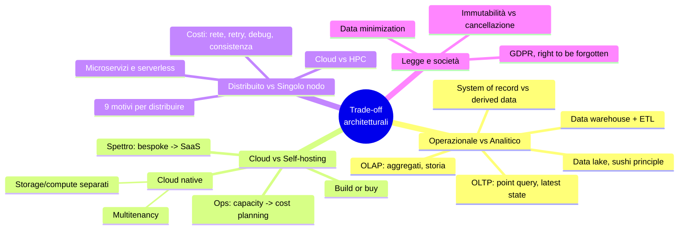
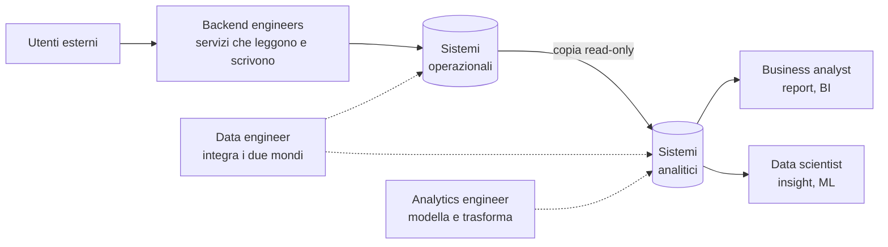
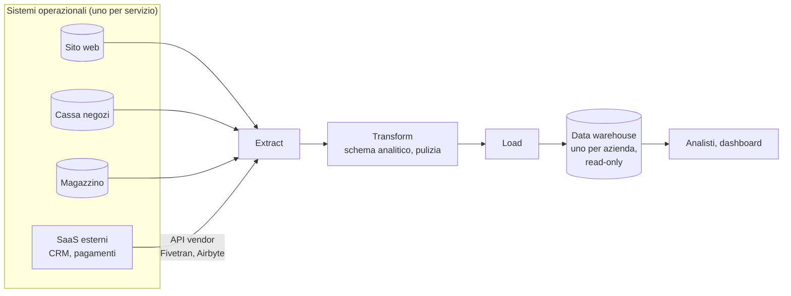
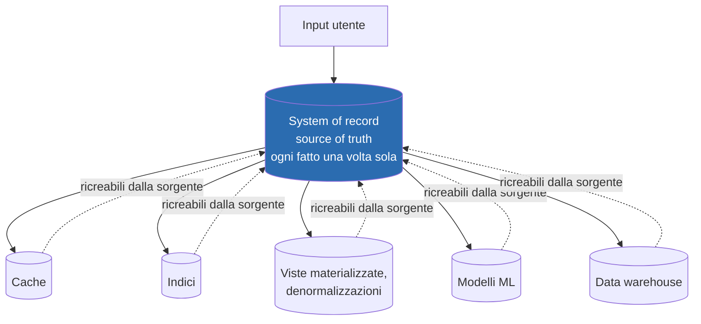
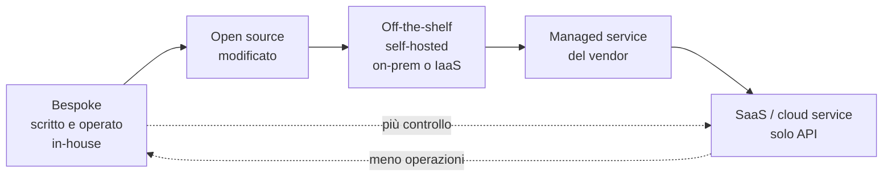
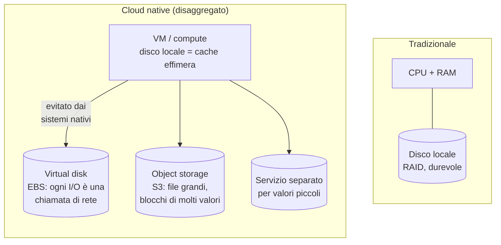
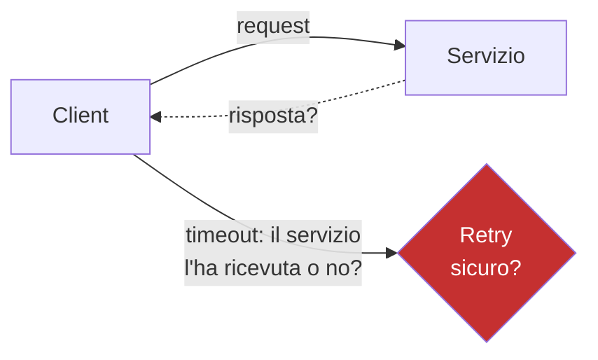

# Capitolo 1 · Trade-off nell'architettura dei sistemi dati

> *There are no solutions; there are only trade-offs.* — Thomas Sowell

**In una frase:** nessuna scelta architetturale è "giusta" in assoluto. Il capitolo
introduce quattro assi di trade-off (operazionale/analitico, cloud/self-hosted,
distribuito/singolo nodo, business/diritti delle persone) e il vocabolario che il
resto del libro dà per scontato.

**Pagine PDF:** 25-56 · **Densità:** introduttivo, ma definisce termini usati ovunque.

---

## Mappa del capitolo

---

## 0. Terminologia di base

- **Data-intensive**: la sfida principale è gestire i dati (volume, cambiamenti,
  consistenza, disponibilità), non parallelizzare un calcolo (*compute-intensive*).
- **Building block ricorrenti**: database, cache, search index, stream processing,
  batch processing. Il libro è una guida a sceglierli e combinarli.
- **Frontend / backend**: il frontend gestisce i dati di *un* utente, il backend quelli
  di *tutti*. Il backend è tipicamente stateless: tutto ciò che deve sopravvivere a una
  request vive nella *data infrastructure* (DB, cache, code).

---

## 1. Sistemi operazionali vs analitici

### Chi usa i dati

### OLTP vs OLAP

| Proprietà | Operazionale (OLTP) | Analitico (OLAP) |
|---|---|---|
| Pattern di lettura | Point query per chiave | Aggregati su molti record |
| Pattern di scrittura | Insert/update/delete singoli | Bulk import (ETL) o stream di eventi |
| Utente umano | Utente finale dell'app | Analista interno |
| Uso macchina | "Questa azione è autorizzata?" | Rilevare pattern di frode |
| Query | Fisse, cablate nel codice | Arbitrarie, esplorative |
| Volume query | Tante e piccole | Poche e pesanti |
| I dati rappresentano | Lo stato attuale | La storia degli eventi |
| Dimensione | GB - TB | TB - PB |

Perché agli utenti OLTP non si dà SQL libero: permessi e costo delle query. Agli
analisti sì, direttamente o via Tableau / Looker / Power BI.

Categoria intermedia: **product analytics / real-time analytics** (Pinot, Druid,
ClickHouse). Workload analitico ma dentro un prodotto utente: ingest in tempo reale,
query a bassa latenza. L'OLAP classico invece ingerisce a batch e ottimizza il throughput.

### Perché separare: il data warehouse

Un'azienda ha decine o centinaia di sistemi OLTP indipendenti. Interrogarli
direttamente per analisi è un problema per quattro motivi:

1. **Data silos**: i dati interessanti sono sparsi su più sistemi.
2. **Schema sbagliato**: il layout buono per OLTP è pessimo per analisi (cap. 3, star schema).
3. **Costo**: una query analitica rallenta gli utenti del sistema operazionale.
4. **Rete e compliance**: spesso gli OLTP non sono nemmeno raggiungibili.

Varianti: **ELT** (trasformazione dopo il caricamento, dentro il warehouse);
**HTAP** (un solo sistema per entrambi i workload, ma internamente è quasi sempre
OLTP + analitico accoppiati). HTAP non sostituisce il warehouse: serve quando *la
stessa app* deve fare scan massivi e letture puntuali a bassa latenza (es. frode).

Tendenza generale: più cresce la scala, più i sistemi si **specializzano**.

### Dal data warehouse al data lake

Il warehouse è relazionale e SQL: perfetto per gli analisti, scomodo per i data
scientist (feature engineering, NLP, computer vision, Pandas, Spark).

| | Data warehouse | Data lake |
|---|---|---|
| Contenuto | Tabelle relazionali con schema | File di qualsiasi formato (Parquet, Avro, immagini, vettori) |
| Schema | Imposto in scrittura | Nessuno imposto |
| Costo | Storage relazionale | Object storage commodity, più economico |
| Utente tipico | Business analyst | Data scientist |

**Sushi principle**: "raw data is better". Il lake tiene i dati grezzi e ogni
consumatore li trasforma come gli serve. Spesso il lake è una tappa intermedia tra
OLTP e warehouse: ETL generalizzato in **data pipeline**.

Oltre il lake: DataOps e governance (GDPR, CCPA), dati come **stream di eventi**
(reazione in secondi invece che giorni), **reverse ETL** (output analitici, es. modelli
ML, riportati nei sistemi operazionali via TFX, Kubeflow, MLflow).

### System of record vs derived data

È il concetto più riutilizzato del capitolo.

- **System of record**: versione canonica. In caso di discrepanza vince lui per definizione.
- **Derived data**: ridondante, ricostruibile. Esiste per le *performance in lettura*
  e per guardare gli stessi dati da punti di vista diversi.
- Non è una proprietà dello strumento ma dell'**uso**: lo stesso PostgreSQL può essere
  l'uno o l'altro. Dichiarare esplicitamente cosa deriva da cosa chiarisce architetture confuse.
- Problema aperto: come **propagare gli aggiornamenti** dal record ai derivati. I DB
  non aiutano, assumono di essere l'unico sistema. Risposta nei cap. 11-12 (data pipeline, stream).

---

## 2. Cloud vs self-hosting

### Build or buy

Regola pratica: in-house ciò che è **core competency o vantaggio competitivo**;
fuori ciò che è routine. Due decisioni distinte: *chi scrive* il software e *chi lo opera*.

### Pro e contro del cloud

| Il cloud conviene quando | Il self-hosting conviene quando |
|---|---|
| Non sai ancora operare quel sistema | Hai già le competenze |
| Il carico è molto **variabile** (es. query analitiche interattive) | Il carico è **prevedibile** |
| Vuoi liberare il team dall'amministrazione di base | Devi tunare per il tuo workload specifico |
| | Latenza estrema (high-frequency trading) |

Il downside principale del cloud è un solo concetto: **nessun controllo**.
Feature mancanti, outage da aspettare, bug non diagnosticabili (niente log di sistema),
vendor lock-in senza API standard, rischio geopolitico (sanzioni), fiducia sulla
sicurezza dei dati per la compliance.

### Cloud native

Non è "software self-hosted spostato su una VM". È software che **costruisce su altri
servizi cloud** (S3 sotto Snowflake, Snowflake sotto altri). Vantaggi misurati: più
performance a parità di hardware, recovery più rapido, scaling veloce, dataset più grandi.

| | Self-hosted | Cloud native |
|---|---|---|
| OLTP | MySQL, PostgreSQL, MongoDB | Aurora, Azure SQL Hyperscale, Spanner |
| OLAP | Teradata, ClickHouse, Spark | Snowflake, BigQuery, Synapse |

Regola sulle astrazioni: più alto il livello, più è specifico per un caso d'uso.
Se il tuo caso combacia, usa il livello alto; altrimenti costruisci dal basso.

### Separazione di storage e compute

- Il disco locale di una VM sparisce se l'istanza muore o viene ridimensionata:
  è una **cache**, non storage.
- I virtual disk emulano un block device via rete: overhead e sensibilità ai
  glitch di rete.
- I sistemi nativi scrivono valori piccoli in un servizio dedicato e blocchi grandi
  in object storage (dettagli nel cap. 4).
- Conseguenza: analizzare dati significa **spostarli sulla rete** verso il compute.
- **Multitenancy**: più clienti sullo stesso hardware. Efficienza per il provider,
  ingegneria delicata per isolare performance e sicurezza.

### Operations nell'era cloud

Da DBA/sysadmin a DevOps/SRE. Il lavoro non sparisce, cambia oggetto:

| Prima (macchine) | Dopo (servizi) |
|---|---|
| Capacity planning: dischi, provisioning | **Financial planning**: metered billing, cosa usi e perché |
| Performance optimization | **Cost optimization** |
| Patch OS, migrazioni fra macchine | Scelta del servizio, integrazione fra servizi, migrazioni fra vendor |
| | Quote e limiti del provider da conoscere in anticipo |

Resta sempre in casa: sicurezza dell'app e delle librerie, interazioni fra i propri
servizi, monitoring, root cause di degradi e outage. L'integrazione fra servizi
cloud non ha standard: è lavoro manuale.

---

## 3. Distribuito vs singolo nodo

**Distributed system**: più macchine che comunicano via rete; ogni processo è un *nodo*.

### Nove motivi per distribuire

1. **Distribuzione intrinseca**: più utenti su più device.
2. **Request fra servizi cloud**: dati in un servizio, elaborazione in un altro.
3. **Fault tolerance / alta disponibilità**: ridondanza.
4. **Scalabilità**: dati o calcolo oltre una macchina.
5. **Latenza**: server vicini agli utenti nel mondo.
6. **Elasticità**: scalare su e giù col carico, pagando solo l'uso.
7. **Hardware specializzato**: molti dischi qui, molte CPU là, GPU altrove.
8. **Compliance legale**: data residency per giurisdizione.
9. **Sostenibilità**: eseguire i job dove e quando c'è energia rinnovabile.

### Il prezzo

- **Fallimento parziale**: ogni chiamata può andare in timeout senza sapere se è stata
  eseguita. Ripetere non è sempre sicuro (cap. 9).
- **Rete lenta** rispetto a una chiamata in-process. Meglio portare il calcolo ai dati
  che i dati al calcolo. Un programma single-thread può battere un cluster da 100 core.
- **Debug difficile**: serve l'*observability* (OpenTelemetry, Zipkin, Jaeger).
- **Consistenza fra servizi** diventa un problema dell'applicazione: un DB per servizio,
  transazioni distribuite raramente usate (cap. 8).

Conclusione dell'autore: **non correre a distribuire**. CPU, RAM e dischi sono
cresciuti; DuckDB, SQLite, KùzuDB reggono molti workload su un nodo solo.

### Microservizi e serverless

- **Microservizi**: un servizio, uno scopo, una API, un team, **un database proprio**
  (condividere il DB rende lo schema parte dell'API e impossibile da cambiare).
- Vantaggi: deploy indipendenti, risorse dedicate, implementazione nascosta.
- Costi: test che richiedono tutte le dipendenze, infrastruttura per ogni servizio
  (deploy, scaling, log, monitoring, on-call), **evoluzione delle API** (campi aggiunti
  o tolti rompono i client; OpenAPI e gRPC aiutano, cap. 5).
- Frase chiave: *i microservizi sono una soluzione tecnica a un problema di persone*.
  Pochi team, niente microservizi.
- **Serverless / FaaS**: metered billing applicato all'esecuzione del codice. Limiti:
  tempo massimo per funzione, runtime vincolati, cold start. Il termine viene usato anche
  da BigQuery e Kafka per dire "autoscaling e fatturazione a consumo".

### Cloud vs supercomputing (HPC)

| HPC | Cloud |
|---|---|
| Calcolo scientifico batch | Servizi online sempre disponibili |
| Checkpoint su disco; se un nodo cade si ferma tutto e si riparte | Non ci si può fermare: servire utenti con interruzioni minime |
| Shared memory, RDMA, fiducia reciproca | Reti IP/Ethernet, tenant che non si fidano: VM, cifratura, autenticazione |
| Topologie mesh/torus | Topologie Clos, bisection bandwidth |
| Nodi vicini | Nodi in più regioni |

---

## 4. Legge e società

- GDPR (2018), CCPA, EU AI Act: diritti sui dati personali, limiti all'uso in AI.
- **Right to be forgotten** contro i **log append-only immutabili**: come cancelli un
  dato in mezzo a un file immutabile? E nei dataset derivati (modelli ML addestrati)?
  Problema ingegneristico aperto e ricorrente nel libro.
- Il costo di tenere un dato non è solo la bolletta S3: leak, reputazione, multe,
  richieste delle autorità, **rischi fisici per gli utenti** (dati di posizione in paesi
  dove certi comportamenti sono criminalizzati).
- **Data minimization** (*Datensparsamkeit*): raccogli solo per uno scopo esplicito,
  non riusare, non conservare oltre il necessario. Opposto alla filosofia "big data".
- Standard di mercato: PCI per i pagamenti, SOC 2 per i vendor.

---

## I trade-off in una tabella

| Asse | Scelta A | Scelta B | Il criterio di decisione |
|---|---|---|---|
| Workload | OLTP | OLAP | Pattern di accesso e pubblico; la scala spinge a specializzare |
| Hosting | Self-hosted | Cloud | Competenze in casa, variabilità del carico, bisogno di controllo |
| Topologia | Singolo nodo | Distribuito | Uno dei nove motivi, altrimenti resta su un nodo |
| Organizzazione | Monolite | Microservizi | Numero di team, non la tecnologia |
| Dati | Tenere tutto | Minimizzare | Valore vs rischio legale, reputazionale, di sicurezza |

---

## Domande di autoverifica

1. Perché un data warehouse è un *derived data system* e non un *system of record*?
2. Cosa rende "cloud native" un database, oltre al fatto di girare nel cloud?
3. Perché i sistemi cloud native evitano i virtual disk tipo EBS?
4. Un timeout su una chiamata remota: quali sono i due stati possibili del server e
   perché il retry non è automaticamente sicuro?
5. In che senso i microservizi risolvono un problema di persone?
6. Cosa cambia nel lavoro delle operations fra on-prem e cloud? Cosa non cambia?
7. Perché la *data minimization* è in tensione con l'architettura a log immutabili?

Flashcard in [`flashcards/ch01.yaml`](../data/flashcards/ch01.yaml).

## Rimandi

- Transazioni in senso stretto: cap. 8
- Star schema e layout analitici: cap. 3 e 4
- Formati Avro/Parquet, evoluzione delle API: cap. 5
- Replica e fault tolerance: cap. 6
- Problemi dei sistemi distribuiti (timeout, retry): cap. 9
- Data pipeline e propagazione ai derivati: cap. 11 e 12
- Etica, bias, compliance: cap. 14
