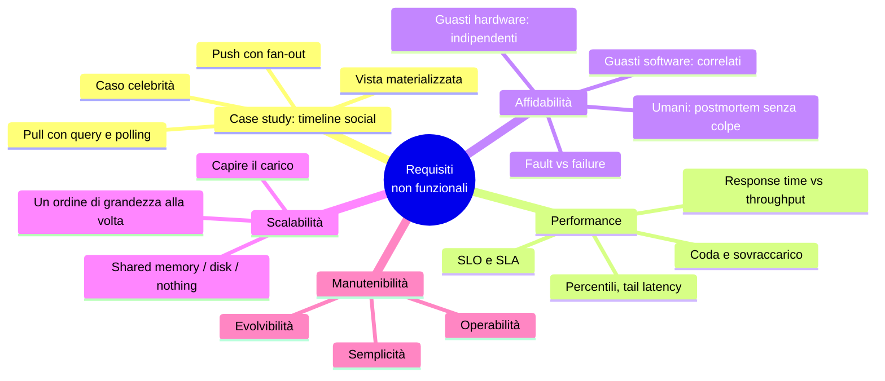
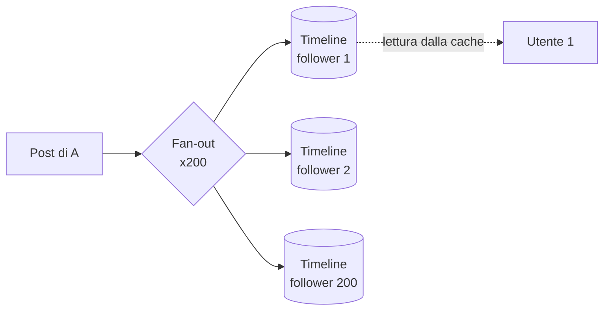
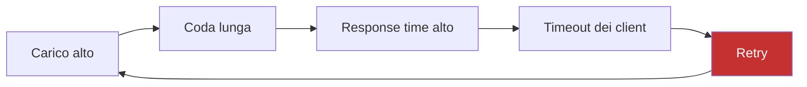
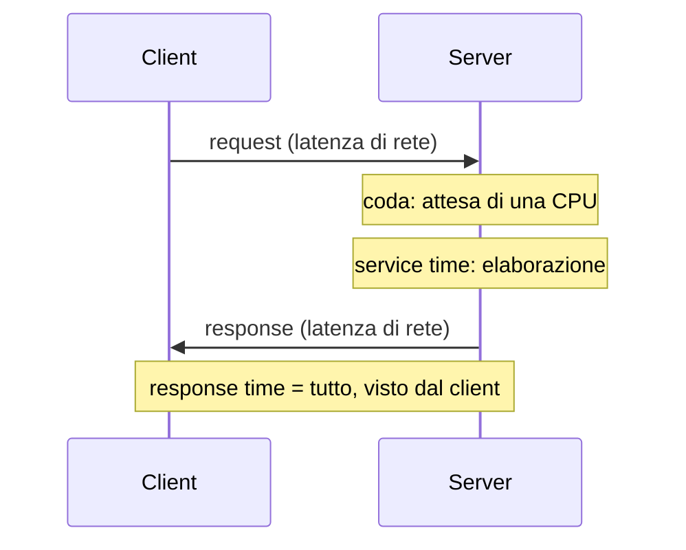
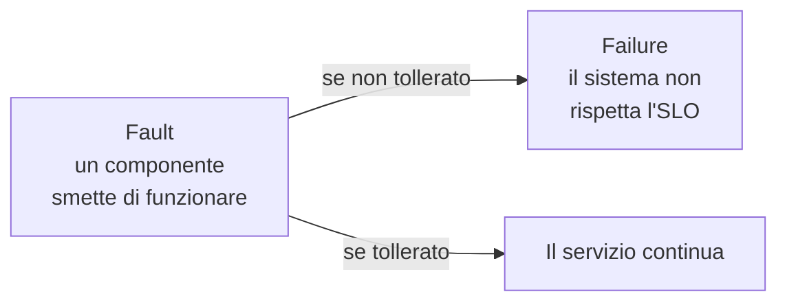
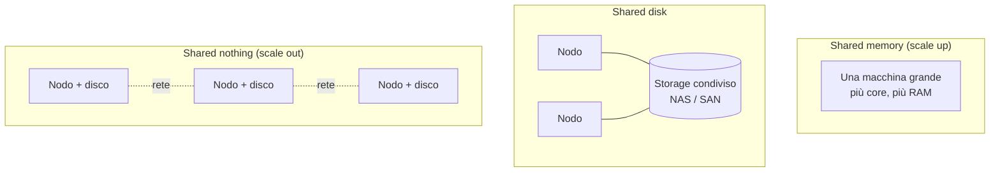

# Capitolo 2 · Requisiti non funzionali

**In una frase:** "veloce, affidabile, scalabile, manutenibile" sono requisiti
quanto le feature, ma restano vaghi finché non li definisci in modo misurabile.
Il capitolo dà il vocabolario per farlo: percentili, fault e failure, carico e
scalabilità, tre proprietà della manutenibilità.

**Pagine PDF:** 57-88 · **Densità:** media. Il case study iniziale vale da solo
metà del capitolo.

---

## Mappa del capitolo

---

## 1. Case study: la home timeline di un social network

Numeri di partenza: 500 milioni di post al giorno (5.800 al secondo, picchi a
150.000), ogni utente segue in media 200 persone e ha 200 follower, 10 milioni di
utenti online insieme.

**Approccio pull.** Tre tabelle (`users`, `posts`, `follows`) e una query con due
join che ricostruisce la timeline. Per vedere i post entro 5 secondi il client deve
ripetere la query ogni 5 secondi (*polling*): 2 milioni di query al secondo, ognuna
con 200 lookup. 400 milioni di lookup al secondo, nel caso medio.

**Approccio push.** Si precalcola la timeline di ogni utente e si tiene in cache.
Quando qualcuno posta, il post viene consegnato nella "casella" di ciascun follower.
Il client si abbona al flusso della propria timeline invece di interrogare.

Costo: circa 1 milione di scritture di timeline al secondo. Tanto, ma 400 volte
meno dei lookup del pull. Nei picchi le consegne si accodano: la timeline arriva con
qualche secondo di ritardo, ma si legge sempre veloce.

Questo è un esempio di **materializzazione**: la timeline in cache è una *materialized
view*. Si paga in scrittura per guadagnare in lettura. È la stessa idea di *derived
data* del capitolo 1.

**I due casi estremi**, che tornano in ogni colloquio di system design:

| Caso | Problema | Soluzione |
|---|---|---|
| Utente che segue decine di migliaia di account | Troppe scritture nella sua timeline | Si scartano alcune consegne: tanto non le legge tutte |
| Celebrità con milioni di follower | Milioni di scritture per un post, non scartabili | I post delle celebrità stanno a parte e si uniscono alla timeline **in lettura** (ibrido push + pull) |

---

## 2. Descrivere la performance

Due metriche, due unità:

- **Response time**: secondi dal click alla risposta. È ciò che l'utente percepisce.
- **Throughput**: richieste (o byte) al secondo. Determina quanti server servono,
  quindi il costo.

Sono legate: a carico basso il response time è stabile, ma avvicinandosi alla
capacità massima dell'hardware sale bruscamente perché le richieste si mettono in
**coda** dietro quelle in corso.

### Quando un sistema sovraccarico non si riprende

Coda lunga, response time alto, i client vanno in timeout e **ritentano**, il carico
aumenta ancora: un *retry storm*. Il sistema può restare in sovraccarico anche quando
il carico esterno torna normale, finché non viene riavviato. Si chiama **metastable
failure**.

Contromisure, lato client e lato server:

| Lato client | Lato server |
|---|---|
| **Exponential backoff**: attese crescenti e casuali fra i retry | **Load shedding**: rifiutare richieste prima del collasso |
| **Circuit breaker**: smettere di chiamare un servizio che fallisce | **Backpressure**: chiedere ai client di rallentare |
| **Token bucket**: limitare il rate | Scelta di code e load balancing |

### Le quattro parole per "tempo"

- **Response time**: il totale, dal punto di vista del client.
- **Service time**: il tempo in cui il server lavora davvero.
- **Queueing delay**: attesa in coda, in più punti del percorso.
- **Latency**: tempo "latente", in cui la richiesta non viene elaborata; *network
  latency* è il viaggio sulla rete.

Il response time varia anche a parità di richiesta: context switch, pacchetti
persi, garbage collection, page fault. La coda è la fonte principale di varianza:
bastano poche richieste lente per bloccare quelle dietro (**head-of-line blocking**).
Per questo si misura **lato client**: il service time da solo nasconde la coda.

### Media, mediana, percentili

Il response time è una **distribuzione**, non un numero. La media serve per stimare
il throughput, ma non dice quanti utenti hanno aspettato quanto. I percentili sì:

- **p50 (mediana)**: metà delle richieste è più veloce di questo valore.
- **p95, p99, p999**: quanto sono brutti gli outlier. Si chiamano *tail latencies*.

Amazon definisce i requisiti interni sul p999 perché i clienti con le richieste più
lente sono quelli con più dati, cioè i più preziosi. Il p9999 è stato giudicato
troppo costoso: oltre un certo punto i guadagni calano e le cause sfuggono al controllo.

**Tail latency amplification**: se una richiesta utente chiama 10 backend in
parallelo, aspetta il più lento dei 10. Anche con l'1% di chiamate lente, la quota
di richieste utente lente cresce. Più fan-out, più conta il p99 dei backend.

**SLO e SLA**: un SLO è un obiettivo misurabile ("p50 sotto 200 ms, p99 sotto 1 s,
99,9% di risposte senza errore"). Un SLA è il contratto che dice cosa succede se
l'SLO non viene rispettato.

**Calcolare i percentili**: finestra mobile e ordinamento, oppure algoritmi
approssimati (HdrHistogram, t-digest, DDSketch). **Non si fa la media dei
percentili** di più macchine o di più minuti: è matematicamente privo di senso. Si
sommano gli istogrammi.

### Quanto conta per l'utente

Le statistiche citate spesso (Google, Bing, Akamai) sono inaffidabili o
contraddittorie. L'unico studio controllato, di Yahoo, misura il 20-30% di click in
più sulle ricerche veloci quando la differenza supera 1,25 secondi. La lezione è di
metodo: diffidare dei numeri non controllati per la qualità del contenuto.

---

## 3. Affidabilità e fault tolerance

**Affidabile** = continua a funzionare correttamente anche quando qualcosa va storto.
Per essere precisi servono due parole:

Sono la stessa cosa a livelli diversi: un disco guasto è una *failure* del disco e un
*fault* del sistema che lo contiene. Un componente il cui fault diventa failure è un
**single point of failure**.

La tolleranza è sempre **limitata** a certi tipi e numeri di guasti ("due dischi su
dieci", "un nodo su tre"). Controintuitivo ma giusto: in un sistema fault-tolerant
conviene **provocare** guasti a caso (*fault injection*, *chaos engineering*), perché
molti bug critici stanno proprio nel codice di gestione degli errori e altrimenti non
viene mai eseguito.

Eccezione: dove non esiste cura (sicurezza, dati trafugati) la prevenzione batte la
tolleranza.

### Guasti hardware: frequenti ma indipendenti

| Componente | Tasso tipico |
|---|---|
| Dischi magnetici | 2-5% all'anno: in un cluster da 10.000 dischi, uno al giorno |
| SSD | 0,5-1% all'anno, ma errori non correggibili circa una volta l'anno per drive |
| CPU | 1 macchina su 1.000 ha un core che a volte calcola male |
| RAM con ECC | Oltre l'1% delle macchine ha un errore non correggibile all'anno |
| Datacenter intero | Raro, ma catastrofico: blackout, incendio, tempesta solare |

Prima risposta: **ridondanza** nel singolo componente (RAID, doppia alimentazione,
generatori). Funziona se i guasti sono indipendenti, ma rack e datacenter cadono
interi più spesso del previsto. Per questo i sistemi cloud tollerano i guasti **a
livello software**, fra macchine in *availability zone* diverse. Vantaggio operativo:
**rolling upgrade**, un nodo alla volta senza fermare il servizio.

### Guasti software: rari ma correlati

Tutti i nodi girano lo stesso codice, quindi hanno gli stessi bug e cadono insieme.
Esempi: il leap second del 2012 che bloccò le JVM, SSD che muoiono tutti a 32.768
ore, un processo che esaurisce una risorsa condivisa, un servizio dipendente che
risponde dati corrotti, **cascading failure** fra componenti.

Il bug dormiente si sveglia quando un'**assunzione sull'ambiente** smette di essere
vera. Non c'è una soluzione rapida: esplicitare le assunzioni, testare, isolare i
processi, lasciarli crashare e ripartire, evitare i feedback loop, misurare in produzione.

### Umani

Nei grandi servizi la prima causa di outage sono i **cambi di configurazione**
fatti dagli operatori; l'hardware pesa solo per il 10-25%. Ma "errore umano" è un
sintomo del sistema sociotecnico, non la causa. Misure tecniche: test anche a input
casuali, rollback rapidi, rollout graduali, monitoring, interfacce che rendono facile
la cosa giusta. Misura culturale: **blameless postmortem**, raccontare tutto senza
paura di punizioni, così l'organizzazione impara. Diffidare delle risposte semplici,
sia "Bob doveva stare più attento" sia "riscriviamo tutto in Haskell".

Perché conta: la perdita permanente di dati è catastrofica anche per app banali (le
foto dei figli). Caso limite: lo scandalo Horizon delle poste britanniche, centinaia
di condanne per furto causate da bug contabili, perché la legge presumeva che i
computer funzionassero.

---

## 4. Scalabilità

Non è un'etichetta ("X scala, Y no") ma una serie di domande: *se il carico cresce
in questo modo, che opzioni abbiamo? quando raggiungiamo i limiti dell'architettura
attuale?*

Per una startup con pochi utenti preoccuparsi della scala è controproducente:
semplicità e flessibilità prima, perché il prodotto cambierà. Si scala quando si
scopre **dove** è il collo di bottiglia.

### Capire il carico

Prima misura il carico attuale: richieste al secondo, GB al giorno, utenti online al
picco. Poi le caratteristiche che cambiano i pattern di accesso: rapporto
letture/scritture, hit rate della cache, elementi per utente. Infine due domande:

1. Carico su, risorse ferme: come cambia la performance?
2. Carico su, performance ferma: quante risorse in più servono?

**Scalabilità lineare**: doppie risorse, doppio carico. Rara. Di solito il costo
cresce più che linearmente.

### Tre architetture

| | Shared memory | Shared disk | Shared nothing |
|---|---|---|---|
| Come | Macchina più grossa | CPU indipendenti, dischi condivisi | Nodi indipendenti, coordinamento via software |
| Pro | Semplice | Tradizionale per data warehouse on-prem | Potenzialmente lineare, hardware a miglior prezzo, elastico, multi-datacenter |
| Contro | Costo più che lineare, colli di bottiglia interni | Contention e lock limitano la scala | Sharding esplicito (cap. 7) e tutta la complessità distribuita (cap. 9) |

I database cloud native con storage e compute separati assomigliano allo shared
disk, ma lo storage espone una API pensata per il database invece di un filesystem,
ed evita i limiti storici.

### Principi

- Non esiste la "magic scaling sauce": 100.000 richieste da 1 kB e 3 richieste da 2 GB
  al minuto hanno lo stesso throughput e architetture completamente diverse.
- Un'architettura regge circa **un ordine di grandezza**; oltre si ripensa. Non vale
  la pena pianificare più in là.
- Spezzare in componenti che operano **indipendentemente**: è il principio sotto
  microservizi, sharding, stream processing, shared nothing.
- Non complicare: un DB su una macchina batte un cluster se basta; scaling manuale
  batte l'autoscaling se il carico è prevedibile; 5 servizi sono meglio di 50.

---

## 5. Manutenibilità

La maggior parte del costo del software è manutenzione, non sviluppo. Ogni sistema
di valore diventerà legacy. Tre proprietà da progettare fin dall'inizio:

| Proprietà | Significa | Come |
|---|---|---|
| **Operabilità** | Facile da tenere in esercizio | Metriche e observability, nessuna dipendenza da una singola macchina, documentazione "se faccio X succede Y", buoni default ma override possibili, self-healing con controllo manuale, comportamento prevedibile |
| **Semplicità** | Facile da capire per chi arriva | Pattern consistenti, niente complessità inutile, **astrazioni** buone (SQL nasconde strutture su disco, concorrenza e crash) |
| **Evolvibilità** | Facile da cambiare | Accoppiamento lasco, semplicità, e soprattutto **minimizzare l'irreversibilità** |

Due note che vale la pena ricordare:

- L'automazione è a doppio taglio: i casi che non può gestire sono i più complessi,
  quindi più automazione richiede operatori più bravi. Più automazione non è sempre
  più operabilità.
- La distinzione fra complessità essenziale e accidentale è utile ma instabile: il
  confine si sposta man mano che gli strumenti evolvono.

---

## Domande di autoverifica

1. Perché la timeline materializzata scambia costo in scrittura per velocità in
   lettura, e perché per le celebrità si torna a un modello ibrido?
2. Spiega un retry storm e indica una contromisura lato client e una lato server.
3. Perché misurare il response time lato server è fuorviante?
4. Un servizio ha p99 di 100 ms. Una pagina chiama 20 di questi servizi in
   parallelo: perché il p99 della pagina sarà molto peggiore?
5. Perché non si può fare la media dei percentili di dieci macchine?
6. Fault e failure: definiscili e spiega perché dipendono dal livello di osservazione.
7. Perché i guasti software sono più pericolosi di quelli hardware pur essendo più rari?
8. Cosa cambia fra shared disk tradizionale e la separazione storage/compute del cloud?
9. Perché "più automazione" non equivale a "più operabilità"?

Flashcard in [`flashcards/ch02.yaml`](../data/flashcards/ch02.yaml).

## Rimandi

- Exactly-once nel fan-out: cap. 12
- Rolling upgrade e compatibilità: cap. 5
- Sharding dello shared nothing: cap. 7
- Timeout e ritardi illimitati: cap. 9
- Fault tolerance fra datacenter: cap. 6 e 10
