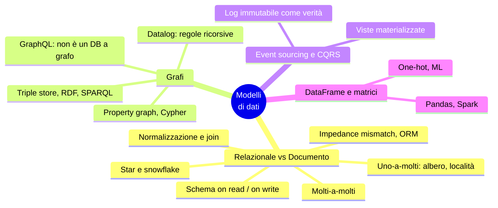
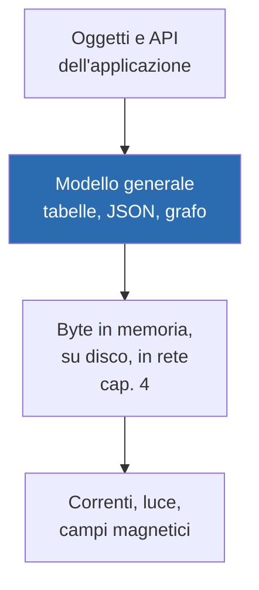
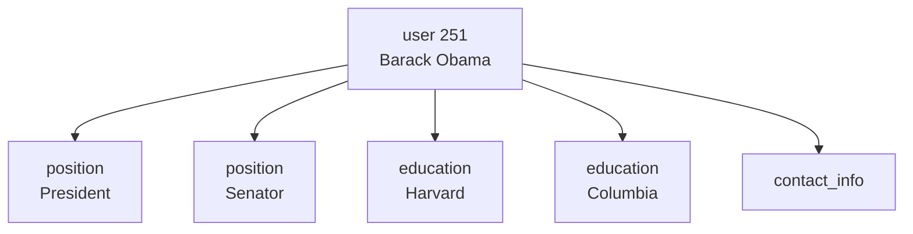
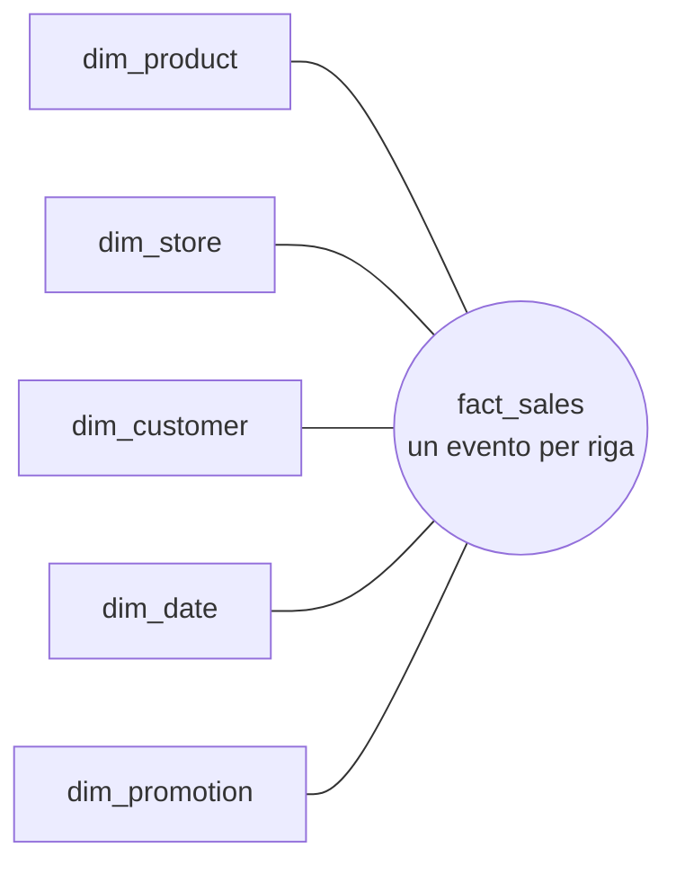
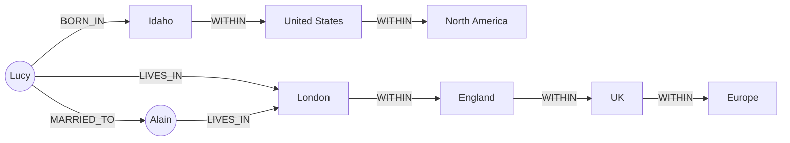
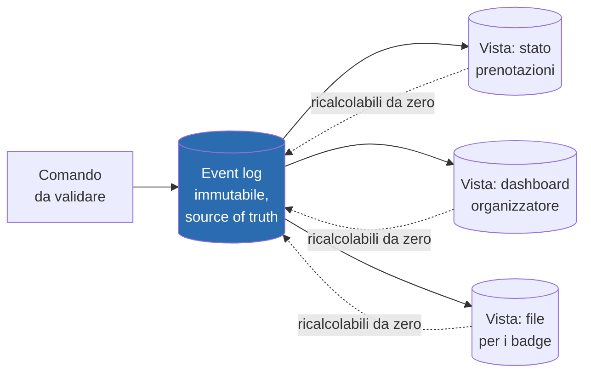
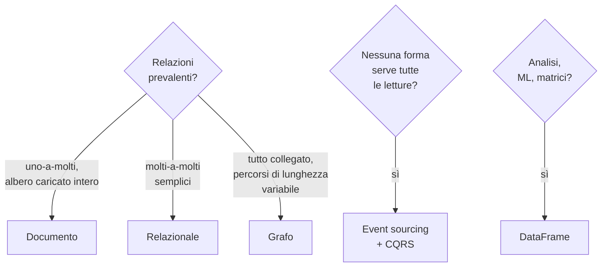

# Capitolo 3 · Modelli di dati e linguaggi di query

> *The limits of my language mean the limits of my world.* — Wittgenstein

**In una frase:** il modello di dati decide non solo come scrivi il codice ma come
pensi il problema. Relazionale, documento, grafo, event sourcing e DataFrame sono
buoni per **tipi di relazione** diversi: la domanda giusta è "che relazioni ci sono
nei miei dati e come le interrogo?".

**Pagine PDF:** 89-138 · **Densità:** alta nella prima metà (relazionale vs
documento), più discorsiva nella parte sui grafi.

---

## Mappa del capitolo



---

## 0. Gli strati

Ogni applicazione impila modelli di dati, e ogni strato nasconde quello sotto:



Questo capitolo è lo strato blu. Quasi tutti i linguaggi che incontri qui (SQL,
Cypher, SPARQL, Datalog) sono **dichiarativi**: dici *cosa* vuoi, non *come*
ottenerlo. Il vantaggio non è solo la concisione: il motore può cambiare algoritmi,
indici e parallelismo senza che tu tocchi una query.

---

## 1. Relazionale vs documento

Breve storia: il modello relazionale (Codd, 1970) ha sconfitto il network model, il
gerarchico, gli object database e gli XML database. NoSQL negli anni 2010 non era una
tecnologia ma un insieme di idee (nuovi modelli, schemi flessibili, scalabilità, open
source). Le idee sono state assorbite e il termine è sbiadito. Il lascito durevole è
il **modello documento** (JSON), nato con MongoDB e Couchbase e ormai supportato da
quasi tutti i relazionali.

### Impedance mismatch e ORM

Il codice è a oggetti, il DB a tabelle: serve uno strato di traduzione. Gli ORM lo
riducono, ma con costi noti:

- Non nascondono del tutto le differenze: pensi comunque a entrambi i modelli.
- Servono solo per OLTP; chi fa analisi lavora sulle tabelle sottostanti, quindi lo
  schema relazionale conta comunque.
- Rendono facile scrivere query inefficienti. Il caso classico è **N+1**: una query
  per N commenti, poi N query per i nomi degli autori invece di un join.

A favore: meno boilerplate nei casi ripetitivi, caching, gestione delle migrazioni.

### Uno-a-molti: dove il documento vince

Un profilo LinkedIn ha un nome (una volta) ma più posizioni, più titoli di studio,
più contatti. In relazionale servono tabelle separate con foreign key (*shredding*).
In JSON è un albero, e l'albero è esplicito:



Vantaggio concreto: **località**. Il documento è una stringa contigua, lo leggi con
un accesso invece di più query o un join a più vie. Vale se ti serve tutto il
documento insieme; se ne usi un pezzo o lo aggiorni spesso, ricaricare e riscrivere
tutto è uno spreco. Da qui la regola: documenti **piccoli**, pochi aggiornamenti.

"Uno-a-molti" spesso è "uno-a-pochi". Se i figli sono migliaia (commenti a un post
virale) l'approccio relazionale torna preferibile.

### Normalizzazione: ID o testo?

Perché `region_id: "us:91"` e non `"Washington, DC"`? Perché un **ID non significa
nulla per gli umani e quindi non cambia mai**. Tutto ciò che ha senso per gli umani
prima o poi cambia, e se è duplicato vanno aggiornate tutte le copie.

| | Normalizzato (ID) | Denormalizzato (testo copiato) |
|---|---|---|
| Scrittura | Veloce: una copia sola | Costosa: tante copie, più spazio, rischio inconsistenza |
| Lettura | Serve un join o un lookup | Veloce: tutto nel record |
| Adatto a | OLTP, scala piccola e media | Analitica, dove i dati storici non cambiano |

Utile pensare alla denormalizzazione come **derived data**: servono un processo che
aggiorni le copie e, se il processo crasha a metà, una transazione atomica o uno
stream che rimetta a posto (cap. 8 e 12).

**L'esempio che smonta un mito.** La timeline materializzata di X non contiene il
testo dei post: solo ID del post e ID dell'autore. In lettura il servizio fa due join
in codice applicativo (*hydrating*) per prendere testo, like e foto profilo, perché
quei dati cambiano troppo spesso per essere denormalizzati. I join in lettura **non
sono** un ostacolo alla scalabilità: l'idratazione parallelizza bene e il suo costo
non dipende da quanti follower hai. La risposta scalabile denormalizza alcune cose e
ne lascia altre normalizzate.

### Molti-a-uno e molti-a-molti

Molte persone nella stessa regione: molti-a-uno. Persone e organizzazioni: molti-a-
molti, in relazionale una **join table**. Questi casi non stanno bene in un documento
autocontenuto. Se li interroghi in entrambe le direzioni, o duplichi i riferimenti
da entrambe le parti (denormalizzato, può divergere) oppure li tieni in un posto solo
e usi **indici secondari**, anche su campi dentro array JSON (cap. 4).

### Star e snowflake: gli schemi per l'analitica



- **Fact table**: un evento per riga (una vendita, un click), più attributi
  numerici (prezzo, costo) e foreign key verso le dimensioni. Diventa enorme, petabyte.
- **Dimension table**: chi, cosa, dove, quando, come, perché. Anche la data è una
  dimensione, così puoi distinguere i festivi.
- Tabelle **larghe**, centinaia di colonne. Quasi tutte relazioni molti-a-uno.
- **Snowflake**: dimensioni spezzate in sottodimensioni, più normalizzato. Lo star è
  preferito perché più semplice per gli analisti.
- **One big table**: via anche le dimensioni, tutto nella fact table. Più spazio,
  query a volte più veloci. Qui la denormalizzazione non fa male: i dati sono storici
  e non cambiano.

### Schema-on-read vs schema-on-write

"Schemaless" è fuorviante: il codice che legge **assume** una struttura. Lo schema
c'è, è solo implicito. Quindi:

| Schema-on-write (relazionale) | Schema-on-read (documento) |
|---|---|
| Esplicito, verificato in scrittura | Implicito, interpretato in lettura |
| Come la tipizzazione statica | Come la tipizzazione dinamica |
| Cambio formato: migrazione `ALTER TABLE` + `UPDATE` | Cambio formato: scrivi i nuovi documenti, il codice gestisce i vecchi in lettura |

Aggiungere una colonna con default è veloce ovunque; l'`UPDATE` su una tabella grande
è lento perché riscrive ogni riga. Trucco pratico: colonna con default `NULL` e
riempimento in lettura, come farebbe un DB a documenti.

Schema-on-read conviene quando i dati sono **eterogenei** (molti tipi di oggetto, o
struttura decisa da sistemi esterni che cambiano). Quando tutti i record hanno la
stessa forma, lo schema documenta e protegge.

### Convergenza

I relazionali hanno aggiunto JSON, operatori e indici dentro i documenti; i documentali
hanno aggiunto join, indici secondari, linguaggi dichiarativi. La combinazione
nello stesso DB è la soluzione più potente. Nota storica: Codd nel 1970 prevedeva già
i *nonsimple domains*, valori annidati dentro una riga. JSON in SQL è arrivato 30 anni dopo.

---

## 2. Modelli a grafo

Se le relazioni molti-a-molti sono la norma e "tutto può essere collegato a tutto",
il grafo è naturale. Vertici ed archi; grafi sociali, web, reti stradali, ma anche
**un solo grafo con tipi diversi** di oggetti (Facebook: persone, luoghi, eventi,
commenti) o i knowledge graph dei motori di ricerca.

Esempio guida del capitolo: Lucy nata in Idaho, Alain nato a Saint-Lô, sposati,
vivono a Londra. Cose difficili in relazionale e facili in un grafo: strutture
regionali diverse per paese, granularità variabile (residenza a livello di città,
nascita a livello di stato).



### Property graph e Cypher

Ogni vertice ha id, label, proprietà, archi in entrata e in uscita. Ogni arco ha id,
vertice di coda e di testa, label, proprietà. In PostgreSQL bastano due tabelle,
`vertices` ed `edges` con `jsonb` per le proprietà e **indici su entrambe le
estremità** per percorrere il grafo in entrambe le direzioni. La tabella `edges` è
la join table generalizzata a più tipi di relazione.

La query "chi è emigrato dagli USA all'Europa" in Cypher:

```cypher
MATCH
  (person) -[:BORN_IN]->  () -[:WITHIN*0..]-> (:Location {name:'United States'}),
  (person) -[:LIVES_IN]-> () -[:WITHIN*0..]-> (:Location {name:'Europe'})
RETURN person.name
```

`WITHIN*0..` significa "segui WITHIN zero o più volte", come `*` in una regex. Il
punto è che **non sai in anticipo quanti archi** separano la residenza dal paese.

In SQL la stessa query richiede `WITH RECURSIVE` e 31 righe contro 4. Si può fare,
ma mostra quanto conti la scelta del modello. Lo standard ISO GQL (2024) è basato su
Cypher.

Limite del grafo: un arco collega esattamente due vertici. Una relazione a tre vie
richiede un vertice intermedio o un ipergrafo.

### Triple store, RDF e SPARQL

Stessa espressività, parole diverse: tutto è una tripla **(soggetto, predicato,
oggetto)**. Se l'oggetto è un valore primitivo, la tripla è una proprietà; se è un
altro vertice, il predicato è un arco. Formato Turtle:

```turtle
_:lucy  a :Person;   :name "Lucy";  :bornIn _:idaho.
_:idaho a :Location; :name "Idaho"; :within _:usa.
```

Nasce dal **Semantic Web**, fallito come progetto ma vivo nei suoi lasciti: JSON-LD,
ontologie biomediche, Open Graph di Facebook, Wikidata, Schema.org. In RDF i predicati
sono URI per evitare conflitti quando unisci dati di altri. SPARQL è il linguaggio;
Cypher ne ha copiato il pattern matching, per cui si somigliano.

### Datalog: regole ricorsive

Anni '80, sottoinsieme di Prolog, modello relazionale non a grafo, ma potentissimo
sulle query ricorsive. I dati sono **fatti** (`born_in(100, 3)`), le query sono
**regole** che derivano tabelle virtuali, come viste SQL componibili e ricorsive:

```prolog
within_recursive(LocID, Name) :- location(LocID, Name, _).
within_recursive(LocID, Name) :- within(LocID, Via), within_recursive(Via, Name).
```

Si costruisce la query un pezzo alla volta, come funzioni che si chiamano. Usato da
Datomic, LogicBlox, CozoDB, LIquid di LinkedIn.

### GraphQL: non è un database a grafo

Nonostante il nome, è un linguaggio **volutamente limitato** per OLTP: il client
(mobile, browser) chiede un JSON con esattamente la forma che gli serve per
renderizzare la UI, e cambia la query senza toccare il server. Niente ricorsione,
niente condizioni arbitrarie, perché le query arrivano da fonti non fidate e
potrebbero fare denial of service. Accetta risposte più grandi e duplicate (nome e
foto dell'autore ripetuti in ogni messaggio) per semplificare il rendering. Si
implementa sopra **qualsiasi** database.

---

## 3. Event sourcing e CQRS

Finora i dati si leggono nella stessa forma in cui si scrivono. In domini complessi
nessuna forma soddisfa tutte le letture. Allora: scrivi in **una** forma ottimizzata
per la scrittura e deriva **più** forme ottimizzate per le letture.

La forma più semplice per scrivere è un **log di eventi immutabili**, append-only.



- **Event sourcing**: gli eventi sono la verità, ogni cambiamento di stato è un evento.
- **CQRS**: rappresentazioni di lettura separate e derivate da quella di scrittura.
- Un **comando** viene validato; se valido diventa un **evento**. Il log contiene solo
  eventi validi, e chi costruisce una vista non può rifiutarne uno.
- Eventi al **passato** ("i posti sono stati prenotati"): un fatto accaduto resta vero
  anche se poi viene cancellato da un altro evento.
- Differenza da una fact table: tipi di evento diversi con proprietà diverse, e
  l'**ordine conta**.

| Pro | Contro |
|---|---|
| Gli eventi dicono il *perché*, non "colonna active a false sulla riga 4001" | Dati esterni (cambi valuta) rendono il replay non deterministico: metti il tasso nell'evento |
| Viste cancellabili e ricalcolabili con codice nuovo: i bug si correggono rifacendo | Immutabilità contro GDPR: crypto-shredding o dati personali fuori dall'evento |
| Più viste, qualsiasi modello, anche solo in memoria | Effetti collaterali esterni (email) non vanno ripetuti al replay |
| Nuove feature = nuovi eventi, vecchi intatti; meno azioni irreversibili | Tutte le viste devono vedere gli eventi **nello stesso ordine**: difficile in distribuito (cap. 10) |
| Audit log gratis; throughput in scrittura alto, burst assorbiti | |

Strumenti: EventStoreDB, MartenDB, Axon, oppure Kafka come log e stream processor
per le viste (cap. 12).

---

## 4. DataFrame, matrici e array

Modelli da analisi e scienza, quasi mai OLTP. Un DataFrame (Pandas, R, Spark, Dask)
sembra una tabella e ha operatori simili (filtro, group by, join chiamato *merge*),
ma si manipola con una **sequenza di comandi** sulla propria copia dei dati, non con
una query dichiarativa. È il flusso di lavoro di chi "spulcia" i dati.

Uso tipico: trasformare una tabella (utente, film, voto) in una **matrice** utenti
per film, sparsa, con migliaia di colonne che un relazionale non reggerebbe. I non
numeri diventano numeri: date scalate, categorie in **one-hot encoding** (una colonna
per genere, 1 o 0). Da lì algebra lineare, cioè la base del ML.

Array database (TileDB) per dati scientifici su griglia: geospaziale, imaging medico,
telescopi. DataFrame anche per serie temporali in finanza.

---

## Quale modello: la decisione



Due regole trasversali:

- **Le relazioni decidono**, non la moda. Pochi legami fra documenti: documento. Tanti
  molti-a-molti: relazionale. Percorsi di lunghezza ignota: grafo.
- Ogni modello **emula** gli altri (grafo in SQL, JSON in Postgres), ma l'emulazione è
  goffa. I DB però convergono, e gli ibridi sono spesso la risposta migliore.

Modelli non trattati: ricerca di sequenze genomiche, registri a partita doppia
(TigerBeetle, blockchain), full-text search (cap. 4).

---

## Domande di autoverifica

1. Cos'è il problema N+1 e perché un ORM lo favorisce?
2. Perché un ID è meglio di una stringa leggibile come riferimento? Qual è il costo?
3. La timeline di X contiene solo ID: perché questa scelta contraddice l'idea che
   "i join non scalano"?
4. Cosa distingue uno star schema da uno snowflake, e perché la denormalizzazione
   non è un problema in analitica?
5. "Schemaless" è un termine sbagliato: perché? Qual è il termine corretto?
6. In quale situazione lo schema-on-read è davvero preferibile?
7. Perché una query con percorsi di lunghezza variabile è goffa in SQL e naturale in Cypher?
8. GraphQL ha "graph" nel nome: cosa non è, e perché è volutamente limitato?
9. In event sourcing, perché un evento con un prezzo in valuta estera è un problema?
10. Qual è l'unico requisito irrinunciabile dello storage degli eventi?

Flashcard in [`flashcards/ch03.yaml`](../data/flashcards/ch03.yaml).

## Rimandi

- Indici secondari, storage engine, full-text search: cap. 4
- Schemi ed evoluzione, encoding JSON: cap. 5
- Atomicità delle transazioni multi-documento: cap. 8
- Ordinamento degli eventi in distribuito: cap. 10
- DataFrame nei framework batch: cap. 11
- Kafka come event log, viste via stream processing: cap. 12
