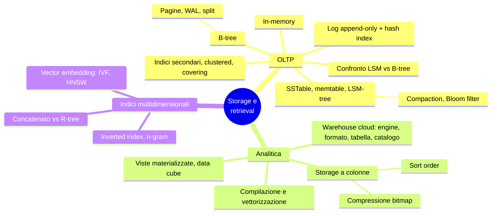
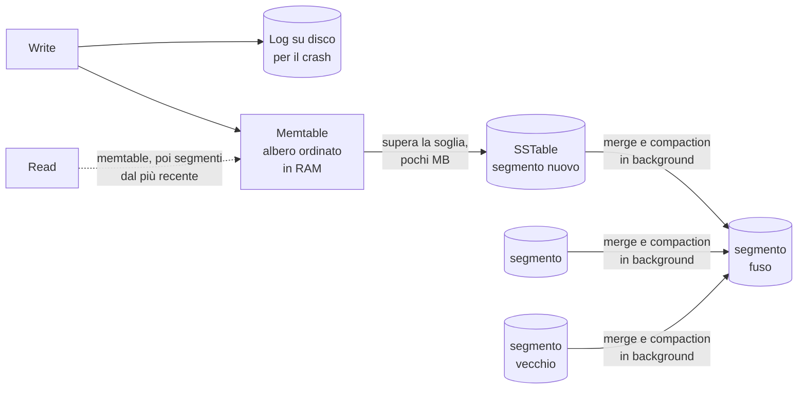
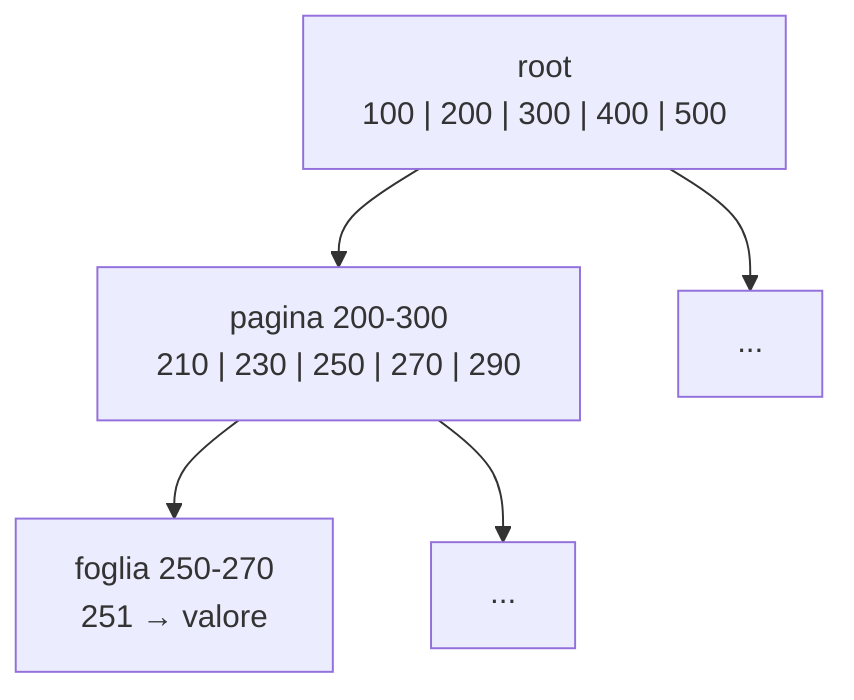
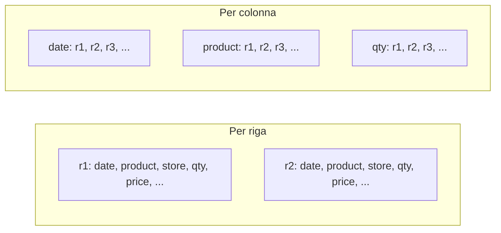

# Capitolo 4 · Storage e retrieval

> *A computer does not primarily compute. They primarily are filing systems.* — Feynman

**In una frase:** un database deve fare due cose, salvare i dati e ritrovarli. Il
capitolo apre il cofano: due famiglie di motori per OLTP (log-structured con file
immutabili, B-tree che sovrascrivono pagine), lo storage a colonne per l'analitica,
e gli indici che rispondono a più condizioni insieme (spaziali, full-text, vettoriali).

**Pagine PDF:** 139-184 · **Densità:** alta. È il capitolo più "meccanico" della
prima metà del libro e il più utile per capire i tuning parameter di qualsiasi DB.

---

## Mappa del capitolo

---

## 1. Il database più semplice del mondo

Due funzioni bash: `db_set` fa `echo "$key,$value" >> database`, `db_get` fa un
`grep` e prende l'ultima riga. Funziona, e la scrittura è ottima perché **appendere a
un file è l'operazione più economica che esista**. La lettura invece è O(n): scansiona
tutto.

Da qui il trade-off che governa l'intero capitolo:

> Un **indice** è una struttura derivata dai dati che accelera le letture. Ogni indice
> costa spazio e **rallenta le scritture**, perché va aggiornato a ogni write. Per
> questo i DB non indicizzano tutto: scegli tu, in base alle query.

Nota sul termine: in questo libro *log* non è il log applicativo, ma una sequenza
append-only di record su disco, anche binaria.

---

## 2. Storage log-structured

### Primo passo: hash index in memoria

Tieni il file append-only e aggiungi una hash map chiave → offset del byte dove sta
l'ultimo valore. Letture veloci, ma quattro problemi: lo spazio non si libera mai,
la hash map va ricostruita a ogni riavvio, deve stare in RAM, e le **range query**
sono impossibili (devi cercare ogni chiave una per una).

### SSTable: ordinare per chiave

Una **Sorted String Table** è un file di coppie chiave-valore **ordinate per chiave,
ogni chiave una volta sola**. Ordinare cambia tutto:

- Basta un **indice sparso**: la prima chiave di ogni blocco di qualche KB. Per
  trovare `handiwork` sai che sta fra `handbag` e `handsome`, salti all'offset di
  `handbag` e scansioni un blocco.
- I blocchi si possono **comprimere**.
- Le range query sono naturali.

Ma non puoi più appendere in coda: romperesti l'ordine. La soluzione è l'ibrido fra
log e file ordinato:

1. Le scritture entrano in una **memtable**, un albero ordinato in memoria (red-black,
   skip list, trie), e in parallelo in un log su disco che serve solo a ricostruire
   la memtable dopo un crash.
2. Quando la memtable supera pochi MB viene scritta su disco come SSTable, il
   **segmento** più recente. Si apre una memtable nuova.
3. Una lettura cerca nella memtable, poi nei segmenti dal più recente al più vecchio.
4. In background, **merge e compaction** fondono segmenti e buttano via i valori
   sovrascritti. È un mergesort: leggi i file affiancati, copia la chiave più bassa,
   se è in più file tieni la più recente. Memoria minima.

Una cancellazione è un record speciale, la **tombstone**: durante il merge dice di
scartare i valori precedenti di quella chiave.

Questo è l'**LSM-tree** (Log-Structured Merge-tree, 1996): RocksDB, Cassandra,
ScyllaDB, HBase, tutti dal paper di Bigtable. I segmenti sono **immutabili**, scritti
in un passaggio: il crash recovery è banale (cancella il file incompleto), i segmenti
possono stare anche su object storage (SlateDB, Delta Lake), e il merge può girare
mentre le letture usano ancora i segmenti di input.

### Bloom filter

Leggere una chiave vecchia o inesistente costa: devi controllare molti segmenti. Un
**Bloom filter** per segmento risponde "sicuramente no" oppure "probabilmente sì"
con pochi bit e operazioni bitwise. Ogni chiave viene hashata in alcune posizioni di
un array di bit, messe a 1. In query: se almeno un bit è 0 la chiave **non c'è**, salti
il segmento. Se sono tutti 1 forse c'è, forse è un **falso positivo** e hai fatto un
po' di lavoro inutile. Regola pratica: 10 bit per chiave danno l'1% di falsi
positivi, ogni 5 bit in più lo riducono di dieci volte.

### Strategie di compaction

| Size-tiered | Leveled |
|---|---|
| SSTable nuove e piccole si fondono in vecchie e grandi | SSTable di dimensione fissa, in livelli L0, L1, L2 di capacità crescente |
| Segmenti vecchi enormi, molto spazio temporaneo durante il merge | L1 in poi partizionati per range di chiavi: compaction incrementale, meno spazio |
| Ottima per **scritture** intense, poche letture | Migliore per **letture**: meno SSTable da controllare |

Quasi tutte le implementazioni offrono entrambe.

### Motori embedded

Non tutti i DB sono servizi di rete: RocksDB, SQLite, LMDB, DuckDB, KùzuDB sono
librerie nello stesso processo dell'app. Standard nelle app mobile; sul backend vanno
bene se i dati stanno su una macchina e la concorrenza è bassa, per esempio un DB
embedded per tenant in un sistema multitenant.

---

## 3. B-tree

Dal 1970, "ubiquo" dieci anni dopo, ancora lo standard in quasi tutti i relazionali.
Come le SSTable tiene le chiavi ordinate, ma la filosofia è opposta: il DB è diviso in
**pagine di dimensione fissa** (4 KiB classiche, 8 in PostgreSQL, 16 in MySQL) che
vengono **sovrascritte sul posto**.

- Ogni pagina ha chiavi di confine e riferimenti (numeri di pagina, come puntatori su
  disco) alle figlie. Il numero di figli è il **branching factor**, tipicamente
  diverse centinaia.
- Cercare una chiave: una pagina per livello. L'albero è bilanciato, profondità
  O(log n): quasi tutti i DB stanno in **3 o 4 livelli** (4 livelli, pagine da 4 KiB,
  fattore 500 reggono 250 TB).
- Aggiornare: trovi la foglia, la sovrascrivi. Inserire in una pagina piena: la
  **spezzi** in due mezze pagine e aggiorni il padre; gli split possono risalire fino
  alla radice.

### Renderlo affidabile

Sovrascrivere più pagine (uno split) è pericoloso: un crash a metà lascia un albero
corrotto, e l'hardware può scrivere mezza pagina (*torn page*). Per questo ogni
modifica va prima nel **write-ahead log** (WAL), append-only, e solo dopo nelle
pagine. Dopo un crash il WAL ripristina lo stato coerente. Le pagine modificate si
tengono in memoria per un po'; i dati sono durevoli quando il WAL è stato scritto e
`fsync` è andato a buon fine.

Varianti: **copy-on-write** (LMDB) che scrive la pagina altrove invece di
sovrascrivere, utile anche per la concorrenza (cap. 8); chiavi abbreviate nelle pagine
interne per alzare il fattore di branching; foglie contigue su disco; puntatori fra
foglie sorelle per scansionare in ordine senza risalire.

---

## 4. LSM-tree contro B-tree

Regola pratica: **LSM per scritture intense, B-tree per letture**. Ma i benchmark
dipendono dal workload, misura col tuo. E non è un aut-aut: esistono motori ibridi.

| Aspetto | B-tree | LSM-tree |
|---|---|---|
| Lettura puntuale | Una pagina per livello, **prevedibile** | Più segmenti, mitigato dal Bloom filter |
| Range query | Semplici e veloci | Scansione di tutti i segmenti in parallelo; il Bloom filter **non aiuta** |
| Pattern di scrittura | **Random**: pagine sparse sul disco | **Sequenziale**: segmenti interi |
| Picchi di latenza | Rari | Se la compaction non regge, la memtable si riempie e il motore applica **backpressure** sospendendo tutto |
| Write amplification | Ogni dato almeno due volte (WAL + pagina), spesso una pagina intera per pochi byte | Log, poi memtable su disco, poi ogni compaction; di solito **più bassa** grazie alla compressione |
| Spazio | Frammentazione, serve il vacuum | Compaction riscrive comunque; file più piccoli per la compressione; size-tiered usa più spazio temporaneo |
| Cancellazione certa (GDPR) | Immediata | La tombstone deve attraversare tutti i livelli: può volerci molto |
| Snapshot e backup | Difficili con pagine sovrascritte | Facili: i segmenti sono immutabili, basta non cancellarli |

**Perché il sequenziale vince anche su SSD.** Sugli HDD è la testina. Sugli SSD la
flash si scrive per pagina (4 KiB) ma si cancella per blocco (512 KiB): prima di
cancellare, il controller sposta le pagine ancora valide altrove (*garbage
collection*). Scritture sequenziali riempiono blocchi interi dello stesso file, che si
cancellano senza GC. Scritture random lasciano blocchi misti, più GC, meno banda
per l'app e più usura.

**Write amplification** = byte scritti su disco / byte che scriveresti con un puro
log append-only. Conta per il throughput nei workload write-heavy e per l'usura degli
SSD. Misurala a lungo: un LSM vuoto non ha compaction e sembra più veloce di quanto sia.

---

## 5. Indici secondari e dove stanno i valori

Un indice secondario è un indice chiave-valore dove la chiave **non è unica**: o il
valore è una lista di ID di riga (come una postings list), o rendi ogni entry unica
appendendo l'ID. Si costruisce su B-tree o LSM indifferentemente.

Cosa sta dentro l'indice:

| Tipo | Il valore è | Esempio |
|---|---|---|
| **Clustered index** | La riga intera | InnoDB: la primary key è sempre clustered |
| Riferimento | La primary key, oppure una posizione nell'**heap file** (righe senza ordine) | InnoDB per i secondari; PostgreSQL usa l'heap |
| **Covering index** | Alcune colonne in più oltre alla chiave | La query si risponde dal solo indice, "la copre" |

Con l'heap file, aggiornare un valore che cresce di dimensione significa spostarlo e
aggiornare tutti gli indici, o lasciare un puntatore di inoltro.

---

## 6. Tutto in memoria

Le strutture viste sono risposte ai limiti del disco, che però è durevole e costa meno
per GB. Con la RAM sempre più economica molti dataset ci stanno interi: Memcached
(solo cache), VoltDB, SingleStore, TimesTen, RAMCloud; Redis e Couchbase con
durabilità debole via scrittura asincrona.

Due cose controintuitive:

- Il vantaggio **non** è evitare le letture da disco: con abbastanza RAM anche un DB
  su disco legge tutto dalla cache del sistema operativo. È evitare l'**overhead di
  codificare** le strutture in una forma scrivibile su disco.
- La durabilità si ottiene comunque con un log append-only, snapshot o repliche: il
  disco serve solo per quello, le letture restano in memoria.

Bonus: in memoria sono facili modelli difficili su disco, come code di priorità e
set in Redis.

---

## 7. Storage per l'analitica

### Il warehouse si è spezzato in componenti

I warehouse cloud (BigQuery, Redshift, Snowflake) separano compute e storage e
mettono i dati su object storage. Nel mondo open source quello che era un sistema
solo (Hive) è diventato quattro strati:

| Strato | Fa | Esempi |
|---|---|---|
| **Query engine** | Parsa, ottimizza, esegue in parallelo | Trino, DataFusion, Presto; esecuzione anche su Spark o Flink |
| **Storage format** | Come le righe diventano byte in un file | Parquet, ORC, Lance, Nimble |
| **Table format** | Quali file formano una tabella, schema, time travel, GC, transazioni | Iceberg, Delta |
| **Data catalog** | Quali tabelle formano un database, via REST | Polaris, Unity Catalog |

Il disaccoppiamento permette a strumenti di governance e discovery di leggere il catalogo.

### Storage a colonne

Una fact table ha centinaia di colonne ma una query ne tocca quattro o cinque. In
**row-oriented** carichi righe intere e butti il 95%. In **column-oriented** ogni
colonna è un file separato e leggi solo quelle che servono.

La riga k si ricompone prendendo il k-esimo valore di ogni colonna: tutte le colonne
tengono le righe **nello stesso ordine**. In pratica la tabella è spezzata in blocchi
di milioni di righe, spesso per intervallo temporale, e dentro ogni blocco le colonne
sono separate. Usato ovunque: Snowflake, DuckDB, Pinot, Druid, Parquet, Arrow, Pandas,
TimescaleDB. Non confondere con il modello **wide-column** di Bigtable e HBase, che
nonostante il nome è row-oriented.

### Compressione a bitmap

Una colonna con pochi valori distinti (100.000 prodotti su miliardi di vendite)
diventa **una bitmap per valore**, un bit per riga. Le bitmap sono sparse, quindi si
comprimono con **run-length encoding**; i roaring bitmap scelgono la rappresentazione
più compatta. Le query diventano operazioni bitwise: `IN (31, 68, 69)` è un OR di tre
bitmap, `product = 30 AND store = 3` è un AND, che funziona perché la k-esima
posizione è la stessa riga in ogni colonna.

### Ordinamento

Non si ordina ogni colonna per conto suo, altrimenti perdi le righe. Si ordina **per
riga intera** scegliendo le colonne chiave in base alle query: `date_key` prima se le
query filtrano per periodo, `product_sk` seconda per raggruppare. Vantaggio doppio:
scansioni solo l'intervallo, e la prima colonna di ordinamento ha lunghe sequenze
di valori uguali che il run-length comprime a pochi KB anche su miliardi di righe.

### Scrivere in uno storage a colonne

Inserire una riga in mezzo a colonne ordinate e compresse sarebbe un disastro. Si usa
l'approccio log-structured: scritture in uno store **row-oriented, ordinato, in
memoria**; quando ce ne sono abbastanza si fondono con i file a colonne scrivendo
file nuovi in blocco. I file vecchi restano immutabili, perfetti per object storage.
L'engine combina disco e memoria in query, l'analista vede i dati subito.

### Esecuzione: compilazione o vettorizzazione

Su milioni di righe conta anche la CPU, non solo l'I/O. Un operatore "interprete"
che per ogni riga controlla la struttura della query è troppo lento. Due vie:

- **Query compilation**: il motore genera codice per quella query, lo compila in
  macchina (LLVM) e lo esegue sui dati in memoria. Come il JIT della JVM.
- **Vectorized processing**: interpretato, ma ogni operatore lavora su un **batch**
  di valori di una colonna e restituisce una bitmap. Uguaglianza su `product_sk`,
  uguaglianza su `store_sk`, AND fra le due bitmap.

Entrambi sfruttano le CPU moderne: accesso sequenziale alla memoria, loop stretti
senza chiamate, SIMD e multithread, lavoro **direttamente sui dati compressi**.

### Viste materializzate e data cube

Una vista virtuale è una scorciatoia per scrivere query; una **materializzata** è una
copia dei risultati su disco, da aggiornare quando cambiano i dati sottostanti (più
lavoro in scrittura, letture ripetute più veloci; Materialize è specializzato in questo).

Un **data cube** è una vista materializzata di aggregati: una griglia con una
dimensione per asse (date × prodotti × negozi × ...) e in ogni cella una somma.
Totali per negozio di ieri: una lettura, zero scansioni. Il limite: non puoi chiedere
nulla su una dimensione che non c'è (la quota di vendite sopra 100 euro, se il prezzo
non è una dimensione). Per questo i warehouse tengono i dati grezzi e usano i cubi
solo come acceleratore.

---

## 8. Indici multidimensionali e full-text

B-tree e LSM fanno range query su **un** attributo. Un **indice concatenato**
(cognome, nome) è come l'elenco telefonico: serve per cognome o cognome+nome, inutile
per il solo nome.

### Spaziali

"Tutti i ristoranti nel rettangolo della mappa" è una range query su due dimensioni
insieme. Un indice concatenato dà o le latitudini o le longitudini, non entrambe.
Soluzioni: una **space-filling curve** che trasforma due dimensioni in un numero per
un B-tree normale, oppure **R-tree** e Bkd-tree che dividono lo spazio tenendo vicini
i punti vicini (PostGIS usa R-tree via GiST). Non solo geografia: (R, G, B) per i
colori, (data, temperatura) per il meteo.

### Full-text: l'inverted index

Pensa ogni parola (*termine*) come una dimensione. L'**inverted index** mappa termine
→ lista di ID dei documenti che lo contengono (**postings list**), rappresentabile
come bitmap sparsa. "red apples" è l'AND di due bitmap, esattamente come la query
vettorizzata del warehouse. Lucene (Elasticsearch, Solr) tiene queste mappe in file
ordinati tipo SSTable fusi in background: lo stesso LSM di prima. Il GIN di PostgreSQL
usa postings list per full-text e JSON.

Estensioni: **n-gram** (i trigrammi di "hello" sono hel, ell, llo) per cercare
sottostringhe arbitrarie e persino regex, al prezzo di indici grandi; ricerca entro
una **edit distance** per i refusi, con un automa di Levenshtein sui termini.

### Vector embedding e ricerca semantica

"Cancellare l'abbonamento" deve trovarsi cercando "chiudere il mio account". Un
**embedding model** (spesso un LLM) trasforma un documento in un vettore di float,
un punto in uno spazio a molte dimensioni (oltre 1.000), dove documenti simili sono
vicini. Distanza: coseno o euclidea. La query viene trasformata nello stesso modo e
si cercano i vettori più vicini in un **vector index**, perché gli R-tree non reggono
tante dimensioni:

| Indice | Come | Trade-off |
|---|---|---|
| **Flat** | Confronta con ogni vettore | Esatto ma lento |
| **IVF** | Clusterizza lo spazio in centroidi, confronta solo in alcune partizioni (*probe*) | Approssimato; più probe, più preciso e lento |
| **HNSW** | Grafo a strati: strato alto rado per avvicinarsi, strati bassi densi per raffinare | Approssimato, molto usato |

Faiss e pgvector implementano IVF e HNSW. Attenzione all'omonimia: "vettorizzazione"
nell'esecuzione delle query è un batch di bit, qui "vettore" è un punto nello spazio.

---

## Domande di autoverifica

1. Perché un hash index in memoria non basta e cosa aggiunge l'ordinamento per chiave?
2. Descrivi il percorso di una scrittura e di una lettura in un LSM-tree. Dove sta la
   tombstone?
3. Un Bloom filter dice "probabilmente sì": perché i falsi positivi non sono un problema?
4. Perché le scritture sequenziali sono più veloci anche su SSD?
5. Cos'è il WAL e perché un B-tree non può farne a meno?
6. Definisci la write amplification e spiega perché un benchmark breve su un LSM
   vuoto è ingannevole.
7. Clustered, heap, covering: dove sta il valore in ciascun caso?
8. Perché un DB in memoria è più veloce, visto che anche uno su disco può leggere
   tutto dalla cache?
9. Perché lo storage a colonne si comprime così bene, e perché la prima colonna
   di ordinamento si comprime meglio delle altre?
10. Come si scrive una singola riga in uno storage a colonne senza riscrivere tutto?
11. Un indice concatenato (lat, lon) perché non risponde a una query su un rettangolo?
12. Che relazione c'è fra inverted index, bitmap del warehouse e LSM-tree?

Flashcard in [`flashcards/ch04.yaml`](../data/flashcards/ch04.yaml).

## Rimandi

- Durabilità, crash recovery, copy-on-write e snapshot isolation: cap. 8
- Formati di encoding (Parquet, Avro): cap. 5
- Manutenzione delle viste materializzate via stream: cap. 12
- Scalare un DB su più macchine: cap. 6 e 7
