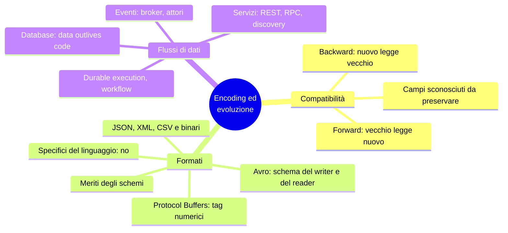
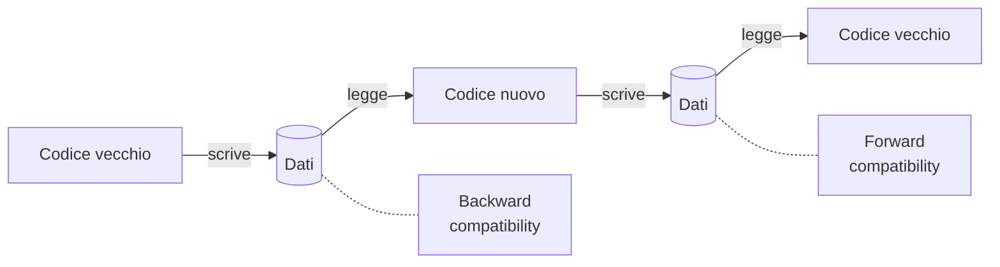
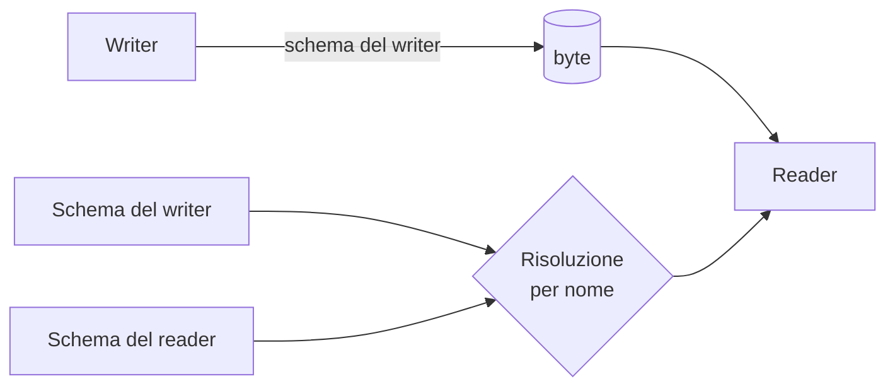

# Capitolo 5 · Encoding ed evoluzione

> *Everything changes and nothing stands still.* — Eraclito

**In una frase:** codice vecchio e nuovo, dati vecchi e nuovi convivono sempre
(rolling upgrade, client che non aggiornano, dati che sopravvivono al codice). Il
formato con cui codifichi i dati decide se questa convivenza è indolore. Il capitolo
confronta i formati e poi segue i dati lungo le tre strade che percorrono: database,
chiamate fra servizi, messaggi.

**Pagine PDF:** 185-220 · **Densità:** media. La parte sui formati è precisa e
tecnica, quella sui flussi è più panoramica.

---

## Mappa del capitolo



---

## 1. Due direzioni di compatibilità



- **Backward**: il codice nuovo legge dati scritti dal vecchio. Facile: conosci il
  formato vecchio e lo gestisci.
- **Forward**: il codice vecchio legge dati scritti dal nuovo. Più difficile: il
  vecchio deve **ignorare** ciò che non conosce senza rompersi.

Per le API: un client vecchio verso un server nuovo richiede backward sulla request e
forward sulla response, e viceversa.

La trappola della forward compatibility: codice nuovo scrive un record con un campo
nuovo, codice vecchio lo legge, lo modifica e lo **riscrive**. Se il modello in
memoria non conserva i campi sconosciuti, il campo nuovo **sparisce**. I campi
ignoti vanno preservati, non scartati.

---

## 2. I formati

Due rappresentazioni: in memoria (oggetti, puntatori) e come sequenza di byte per
file e rete. La traduzione è **encoding** (serializzazione, marshaling) e
**decoding**. Il libro evita "serializzazione" perché nel cap. 8 significa altro.

### Formati del linguaggio: mai

`pickle`, `java.io.Serializable`, `Marshal`: comodi e sbagliati. Ti legano a un
linguaggio, istanziano classi arbitrarie in decodifica (**esecuzione remota di
codice** se un attaccante controlla i byte), ignorano il versioning, sono lenti e
gonfi. Solo per usi transitori.

### JSON, XML, CSV

Universali, leggibili, buoni per lo scambio **fra organizzazioni**, dove mettersi
d'accordo conta più dell'eleganza. I difetti da conoscere:

- **Numeri**: XML e CSV non distinguono numero da stringa di cifre. JSON non
  distingue interi da float e non fissa la precisione. Sopra 2^53 un intero in
  JavaScript si corrompe: X manda gli ID dei post due volte, come numero e come stringa.
- **Binario**: niente stringhe di byte. Base64, che pesa un terzo in più.
- **Schemi**: JSON Schema e XML Schema sono potenti e complicati. JSON Schema di
  default è **aperto** (`additionalProperties: true`), quindi descrive cosa non è
  permesso più che cosa lo è. Riferimenti remoti e logica condizionale lo rendono
  difficile da evolvere.
- **CSV**: nessuno schema, escaping di virgole e newline interpretato male da molti parser.

I **binari di JSON** (MessagePack, CBOR, BSON) devono includere comunque i nomi dei
campi: il record di esempio passa da 81 a 66 byte. Poco, e perdi la leggibilità.

### Protocol Buffers: i tag numerici

Schema obbligatorio in un IDL, codice generato per ogni linguaggio:

```protobuf
message Person {
    string user_name = 1;
    int64 favorite_number = 2;
    repeated string interests = 3;
}
```

Lo stesso record scende a **33 byte**. Non ci sono i nomi dei campi: ci sono i **tag**
(1, 2, 3), tipo e tag impacchettati in un byte, interi a lunghezza variabile, liste
come ripetizione dello stesso tag.

Regole di evoluzione, tutte derivate dal fatto che i tag sono l'identità del campo:

| Operazione | Esito |
|---|---|
| Rinominare un campo | Libero: i byte non contengono nomi |
| Cambiare un tag | **Mai**: invalida tutti i dati esistenti |
| Aggiungere un campo con tag nuovo | Forward: il vecchio lo salta (il tipo dice quanti byte) e lo preserva. Backward: il nuovo legge il vecchio e mette il default |
| Rimuovere un campo | Simmetrico. Il tag **non si riusa mai**: si dichiara `reserved` |
| Cambiare tipo (int32 → int64) | Possibile ma con rischio di **troncamento** quando il vecchio legge un valore a 64 bit |

### Avro: due schemi

Nato in Hadoop nel 2009 perché Protobuf non calzava. Schema senza tag:

```
record Person {
    string               userName;
    union { null, long } favoriteNumber = null;
    array<string>        interests;
}
```

**32 byte**, il più compatto: i byte sono solo valori concatenati, nessun marcatore
di campo né di tipo. Si decodifica scorrendo i campi nell'ordine dello schema. Quindi
serve **esattamente** lo schema con cui è stato scritto.



Il trucco è la **risoluzione fra schema del writer e schema del reader**: Avro li
confronta e traduce. Ordine dei campi diverso: nessun problema, si abbinano per
**nome**. Campo nel writer ma non nel reader: ignorato. Campo nel reader ma non nel
writer: default del reader.

Regole: puoi aggiungere o rimuovere solo campi **con default**. Il null non è
default implicito: serve una `union { null, long }` con null al primo posto, più
verboso ma esplicito. Rinominare è possibile con gli alias nel reader (backward ma
non forward); aggiungere un ramo a una union idem.

**Dov'è lo schema del writer?** Non si allega a ogni record, sarebbe più grande dei
dati. Dipende dal contesto:

| Contesto | Soluzione |
|---|---|
| File grande con milioni di record | Schema una volta in testa: *object container file* |
| Database con record scritti in tempi diversi | Numero di versione in testa a ogni record, registro delle versioni (Schema Registry di Confluent, Espresso) |
| Connessione di rete bidirezionale | Negoziato all'apertura, vale per la connessione (Avro RPC) |

**Perché niente tag è un vantaggio:** gli **schemi generati dinamicamente**. Vuoi
scaricare un database relazionale in binario: generi lo schema Avro dalle tabelle, una
colonna un campo, e ogni volta che lo schema del DB cambia rigeneri e basta. Con
Protobuf qualcuno dovrebbe assegnare i tag a mano e non riusare mai quelli vecchi.

### I meriti degli schemi

Protobuf e Avro hanno schemi semplici, senza regole di validazione (a differenza di
JSON Schema). Le idee vengono da ASN.1 (1984), ancora nei certificati X.509 ma troppo
complesso per cose nuove. Ogni DB ha un suo binario proprietario dietro il driver.

Un binario con schema dà: compattezza (niente nomi), **documentazione sempre
aggiornata** perché senza schema non decodifichi, un registro che verifica la
compatibilità **prima** del deploy, codice generato e type check a compile time. La
stessa flessibilità dello schema-on-read con garanzie migliori. Tieni comunque poche
versioni concorrenti.

---

## 3. Tre flussi di dati

### Attraverso un database

Chi scrive codifica, chi legge decodifica. Anche con un solo processo, scrivere nel
DB è **mandare un messaggio al te stesso futuro**: serve backward. Con più istanze in
rolling upgrade, codice vecchio leggerà dati scritti dal nuovo: serve anche forward.

**Data outlives code.** Il deploy sostituisce il codice in minuti; i dati di cinque
anni fa restano nella codifica originale. Riscriverli è caro, quindi i DB rimandano:
l'LSM riscrive nel formato nuovo durante la compaction, il relazionale aggiunge una
colonna con default null e riempie in lettura. Il DB **sembra** avere uno schema solo
mentre su disco convivono versioni storiche. Cambi complessi (da singolo a
multivalore, spostare dati in un'altra tabella) richiedono riscrittura a livello
applicativo.

Snapshot e dump per il warehouse: li scrivi in un colpo con lo schema più recente, in
Avro object container o meglio in Parquet a colonne.

### Attraverso i servizi: REST e RPC

Un servizio è come un database ma espone solo gli input e output decisi dalla
business logic: **incapsulamento**. L'obiettivo dei microservizi è che ogni team
rilasci senza coordinarsi, quindi server e client di versioni diverse coesistono e
l'encoding deve essere compatibile.

**Web service**: HTTP sotto, anche fuori dal web (app verso backend, servizio verso
servizio nella stessa rete, fra organizzazioni). **REST** usa gli strumenti di HTTP:
URL per le risorse, cache, autenticazione, negoziazione del contenuto. Gli endpoint
si descrivono in un IDL: **OpenAPI** per JSON, **Protobuf** per gRPC. FastAPI scrive
il codice e genera l'IDL; gRPC scrive l'IDL e genera lo scheletro. Da entrambi
nascono client, SDK, documentazione, test di compatibilità.

**Il difetto dell'RPC.** EJB, RMI, DCOM, CORBA, SOAP: tutti volevano far sembrare una
chiamata remota una chiamata locale (*location transparency*). È un errore di fondo:

| Chiamata locale | Richiesta di rete |
|---|---|
| Prevedibile, dipende da te | Può perdersi, il server può essere lento o giù |
| Ritorna, lancia, o non ritorna mai | Ha un quarto esito: **timeout** senza sapere cosa è successo |
| Ripetere è innocuo | Ripetere può eseguire due volte: serve l'**idempotenza** |
| Tempo costante | Latenza da sotto il millisecondo a secondi |
| Passi puntatori | Codifichi tutto in byte |
| Un linguaggio | Tipi da tradurre fra linguaggi (2^53 di nuovo) |

Parte del fascino di REST è che tratta il trasferimento di stato come una cosa
diversa da una funzione.

**Trovare il servizio.** Il client deve sapere l'indirizzo (*service discovery*) e
le richieste vanno distribuite (*load balancing*):

- Load balancer hardware, o software (NGINX, HAProxy): un host e porta, traffico
  spostato via dai server guasti.
- **DNS**: più IP per un nome, ma propaga lento e cachea: istanze che nascono e
  muoiono spesso danno IP stantii.
- **Service discovery** (etcd, ZooKeeper): le istanze si registrano con host, porta e
  metadati (shard, datacenter), mandano heartbeat; il client interroga e si connette
  direttamente. Adatto ad ambienti dinamici.
- **Service mesh** (Istio, Linkerd): load balancer come sidecar su client e server,
  tutto passa per connessioni locali. TLS gestito dal mesh, observability di chi
  chiama chi. Complesso, sensato con Kubernetes.

**Evoluzione delle API.** Assunzione semplificante: prima si aggiornano tutti i server,
poi i client. Quindi backward sulle request, forward sulle response. gRPC e Avro
ereditano le regole del formato; in REST/JSON aggiungere parametri opzionali e campi
in risposta è considerato compatibile. Fra organizzazioni non puoi forzare gli
aggiornamenti: compatibilità per sempre, o più versioni dell'API affiancate (numero
nell'URL, nell'header `Accept`, o salvato per API key).

### Durable execution e workflow

Un pagamento chiama antifrode, carta di credito, banca: una sequenza di **task** è un
**workflow**, eseguito da un **engine** (orchestrator che schedula, executor che
esegue). Airflow, Dagster, Prefect per l'ETL; Camunda, Orkes con notazione grafica
BPMN; **Temporal, Restate** per la durable execution.

Il problema: un crash fra l'addebito e il deposito. Non puoi avvolgere due servizi in
una transazione, e il gateway di pagamento è di terzi. La **durable execution** logga
ogni RPC e cambio di stato come in un WAL; al retry ri-esegue il task ma **salta le
chiamate già riuscite** restituendo il risultato loggato. Exactly-once per il workflow.

I costi: i servizi esterni devono essere comunque idempotenti (ID univoci per
chiamata); il replay pretende le **stesse chiamate nello stesso ordine**, quindi
riordinare due righe di codice rompe le esecuzioni in corso: si deploya una versione
nuova a fianco e le vecchie finiscono col codice vecchio; il codice deve essere
**deterministico**, niente random né clock di sistema se non quelli forniti dal
framework.

### Architetture a eventi

La richiesta si chiama evento o messaggio, il mittente **non aspetta**, e in mezzo c'è
un **message broker** che conserva il messaggio. Rispetto all'RPC diretto: buffer se
il destinatario è giù o sovraccarico, riconsegna dopo un crash, niente service
discovery, stesso messaggio a più destinatari, disaccoppiamento logico (il mittente
non sa chi consuma). Asincrono per natura, ma si può costruire un modello
richiesta-risposta su un canale separato.

Due pattern di consegna:

| Coda | Topic |
|---|---|
| Un messaggio in una coda nominata, **uno** dei consumer lo riceve | Un messaggio su un topic, **tutti** i subscriber lo ricevono |

Broker: RabbitMQ, ActiveMQ, NATS, Redpanda, Kafka; in cloud Kinesis, Service Bus,
Pub/Sub (confronto nel cap. 12). Il messaggio è byte con metadati, quindi Protobuf,
Avro o JSON più uno **schema registry** accanto al broker; AsyncAPI è l'OpenAPI dei
messaggi. Molti broker cancellano dopo il consumo; alcuni conservano per sempre, che è
ciò che serve per l'event sourcing. Chi ripubblica su un altro topic deve preservare i
campi sconosciuti, stessa trappola di prima.

**Attori distribuiti** (Akka, Orleans, Erlang/OTP): ogni attore ha stato privato e
processa un messaggio alla volta, niente thread né lock. La consegna non è garantita
nemmeno in locale, quindi qui la location transparency **funziona meglio** che
nell'RPC: non c'è un salto concettuale fra locale e remoto. Un framework di attori è
un broker più un modello di programmazione. I rolling upgrade restano un problema di
compatibilità dell'encoding.

---

## Domande di autoverifica

1. Definisci backward e forward compatibility e di' quale delle due è più difficile e perché.
2. Descrivi lo scenario in cui codice vecchio cancella un campo scritto dal nuovo.
   Come lo eviti?
3. Perché `pickle` è un rischio di sicurezza?
4. Perché X manda gli ID dei post due volte nel JSON?
5. In Protobuf cosa puoi rinominare liberamente e cosa non puoi mai cambiare?
6. Avro decodifica senza tag né tipi nei byte: come fa a leggere dati scritti con uno
   schema diverso?
7. Perché Avro è adatto agli schemi generati da un database e Protobuf no?
8. "Data outlives code": cosa implica per la migrazione dei dati?
9. Elenca tre modi in cui una chiamata di rete è diversa da una locale.
10. DNS contro service discovery: quando il primo non basta?
11. In durable execution, perché riordinare due chiamate nel codice è pericoloso?
12. Coda contro topic: qual è la differenza nella consegna?

Flashcard in [`flashcards/ch05.yaml`](../data/flashcards/ch05.yaml).

## Rimandi

- Compaction che riscrive nel formato nuovo: cap. 4
- Serializzabilità delle transazioni (altro significato): cap. 8
- Timeout e cosa è successo davvero: cap. 9
- Codice deterministico: cap. 9
- Idempotenza e confronto fra broker: cap. 12
- Coordination service (etcd, ZooKeeper): cap. 10
- Archival storage e batch: cap. 11
