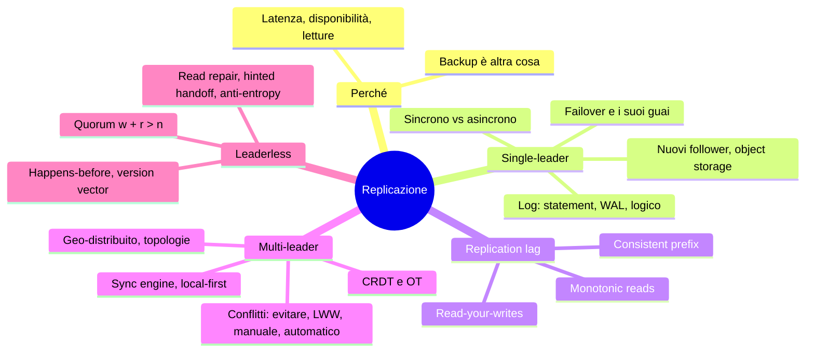
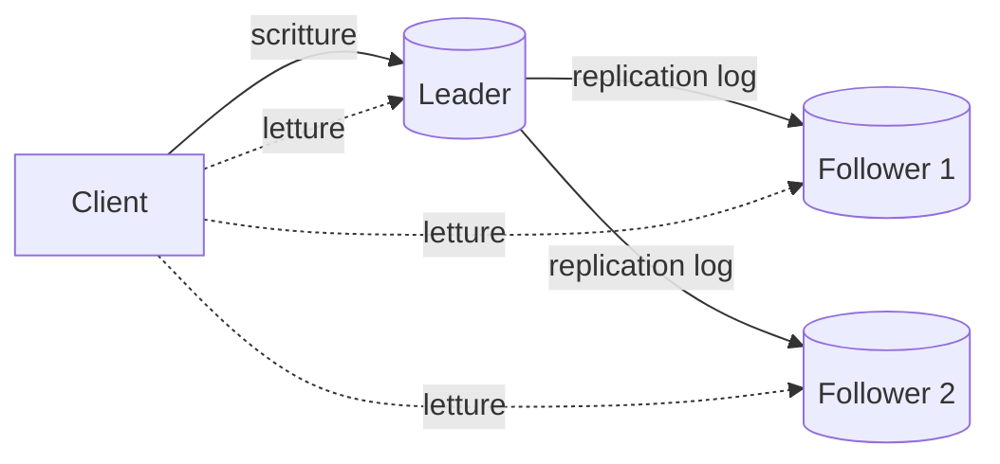
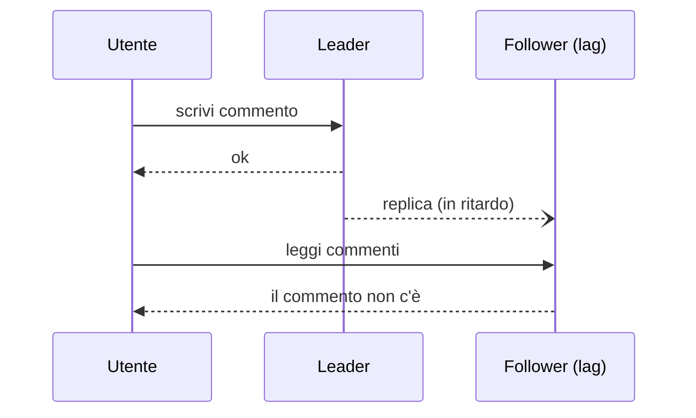
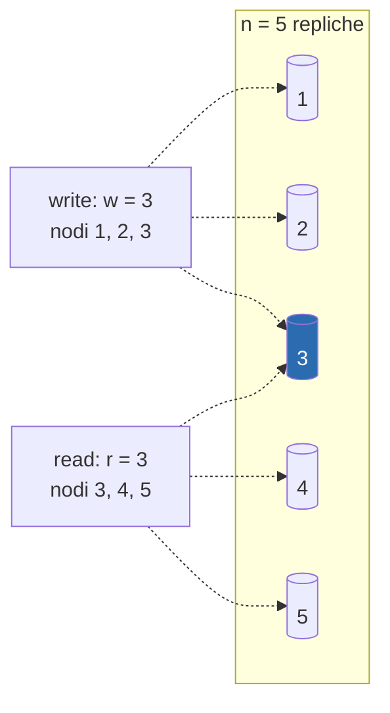

# Capitolo 6 · Replicazione

> *When a thing that cannot possibly go wrong goes wrong, it usually turns out to be
> impossible to get at or repair.* — Douglas Adams

**In una frase:** copiare dati che non cambiano è banale; tutta la difficoltà della
replicazione sta nel propagare i **cambiamenti**. Tre famiglie (un leader, più
leader, nessun leader), un trade-off trasversale (sincrono o asincrono) e una serie
di anomalie che un'applicazione deve sapere riconoscere.

**Pagine PDF:** 221-274 · **Densità:** alta. È il capitolo che più di tutti torna
nei colloqui di system design. Le tre garanzie sul replication lag e la sezione sui
conflitti vanno capite bene, non solo lette.

---

## Mappa del capitolo

---

## 0. Perché replicare, e perché non basta

Tre motivi: dati vicini agli utenti (latenza), continuare a funzionare se qualcosa
cade (disponibilità e durabilità), più macchine per servire le letture (throughput).
Il capitolo assume che ogni macchina tenga **tutto** il dataset; il cap. 7 toglie
l'assunzione.

**Replica non è backup.** La replica propaga le scritture in fretta, anche una
cancellazione per errore. Il backup conserva snapshot vecchi per tornare indietro.
Sono complementari: il backup serve a creare repliche, l'archivio del log di replica
serve al backup.

---

## 1. Single-leader

Un replica è il **leader** (primary, source): riceve tutte le scritture e le manda ai
**follower** (read replica, secondary, hot standby) come log di cambiamenti, che
applicano nello stesso ordine. Le letture vanno ovunque. Con lo sharding ogni shard
ha il suo leader. È ovunque: PostgreSQL, MySQL, Oracle, SQL Server, MongoDB,
DynamoDB, Kafka, DRBD, e gli algoritmi di consenso come Raft (etcd, CockroachDB,
TiDB) sono single-leader con elezione automatica.

### Sincrono o asincrono

- **Sincrono**: il leader aspetta la conferma del follower prima di rispondere al
  client. Il follower è garantito aggiornato, ma se non risponde **tutte le scritture
  si bloccano**.
- **Asincrono**: il leader manda e non aspetta. Veloce, ma se il leader muore le
  scritture non ancora replicate **sono perse** anche se confermate al client.

Tutti sincroni è impraticabile: un nodo giù ferma tutto. La pratica è
**semisincrona**: un follower sincrono, gli altri asincroni, e se il sincrono
rallenta se ne promuove un altro. Garanzia: dati aggiornati su almeno due nodi.
Variante: una **maggioranza** sincrona (3 su 5), che è un quorum e torna nel cap. 10.
Il tutto-asincrono è comunque diffuso, soprattutto con molti follower o geografia.

### Aggiungere un follower senza fermarsi

Copiare i file mentre il DB scrive non ha senso, bloccare il DB nega la
disponibilità. Procedura: snapshot consistente del leader **senza lock** (serve
anche ai backup), copia sul nuovo nodo, il follower chiede al leader tutto ciò che è
cambiato da una **posizione precisa nel log** (log sequence number in PostgreSQL,
binlog coordinates o GTID in MySQL), applica il backlog e ha *raggiunto* il leader.
Snapshot e log archiviati su object storage (WAL-G, Litestream) servono sia al
backup sia a questo passaggio.

### Database su object storage

Sempre più DB servono query direttamente da S3 e simili: costa poco, replica
multi-zona e multi-regione con durabilità altissima, **conditional write**
(compare-and-set) per transazioni ed elezione del leader, integrazione fra DB con
formati aperti (Parquet, Iceberg). I costi: latenza molto più alta, fee per chiamata
che obbliga a fare batch, oggetti immutabili (scritture random costosissime),
interfacce non POSIX. Risposte: **storage a livelli** (dati caldi su SSD, freddi su
object store), WAL su storage a bassa latenza separato (EBS, Safekeeper di Neon), o
**zero-disk architecture**: tutto su object storage, dischi e RAM solo cache, nodi
senza stato persistente (WarpStream, Bufstream, Redpanda Serverless, SlateDB, quasi
tutti i warehouse cloud).

### Quando un nodo cade

**Follower**: facile. Dal suo log sa l'ultima transazione applicata, chiede al leader
il resto, raggiunge. Il leader però deve decidere quanto log tenere per i follower
assenti: rischio disco pieno, oppure follower da ricostruire da backup.

**Leader: il failover.** Promuovere un follower, dirottare i client, far seguire gli
altri follower il nuovo leader. Automatico in tre passi:

1. **Capire che il leader è morto.** Non c'è modo sicuro: un **timeout** (30 secondi
   senza risposta). La manutenzione pianificata non conta, il leader passa la mano prima.
2. **Scegliere il nuovo leader.** Elezione a maggioranza o nomina da un controller.
   Il candidato migliore è il più aggiornato. È un problema di **consenso** (cap. 10).
3. **Riconfigurare.** I client scrivono al nuovo leader; il vecchio, se torna, deve
   capire di essere stato deposto.

Cosa va storto:

| Problema | Conseguenza |
|---|---|
| Replica asincrona, nuovo leader indietro | Le scritture non replicate del vecchio leader vengono **scartate**: confermate, non durevoli |
| Scarto coordinato con sistemi esterni | GitHub: un follower stantio promosso riusò primary key autoincrement già usate e presenti in Redis, dati privati mostrati a utenti sbagliati |
| **Split brain**: due nodi credono di essere leader | Entrambi accettano scritture, dati persi o corrotti. Spegnere uno dei due (*fencing*) può spegnerli entrambi, o arrivare tardi |
| Timeout troppo lungo | Recovery lento |
| Timeout troppo corto | Failover inutili per un picco di carico o un glitch di rete, che peggiorano la situazione |

Per questo molti team fanno il failover **a mano** anche se il software lo
automatizza. Regola d'oro: promuovere il follower **più aggiornato** (quello
sincrono, o il log sequence number più alto).

### Come è fatto il replication log

| Metodo | Come | Pro | Contro |
|---|---|---|---|
| **Statement-based** | Il leader inoltra ogni INSERT/UPDATE/DELETE | Compatto | `NOW()`, `RAND()`, autoincrement, trigger: non deterministici. MySQL lo usava fino alla 5.1; VoltDB lo rende sicuro imponendo transazioni deterministiche |
| **WAL shipping** | Il leader manda lo stesso WAL del B-tree | Riusa ciò che c'è già (PostgreSQL, Oracle) | Byte in blocchi di disco: **accoppiato al motore**, leader e follower devono avere la stessa versione, upgrade con downtime |
| **Logico (row-based)** | Record per riga: nuovi valori per insert, chiave per delete, chiave e colonne cambiate per update, più un marcatore di commit | Disaccoppiato: versioni diverse, **upgrade senza downtime** promuovendo un follower aggiornato; leggibile da sistemi esterni (**change data capture**, cap. 12) | Un log in più (binlog di MySQL; PostgreSQL decodifica il WAL fisico) |

Statement deterministici in ordine fisso è l'idea dell'event sourcing e della **state
machine replication** (cap. 10).

---

## 2. Replication lag e le sue anomalie

Molti follower asincroni per scalare le letture (*read scaling*) funzionano solo
asincroni: sincronizzare tutti renderebbe il sistema giù a ogni nodo giù. Ma un
follower asincrono può essere indietro: la stessa query su leader e follower dà
risultati diversi. Se smetti di scrivere, prima o poi convergono: **eventual
consistency**. "Eventually" è volutamente vago: di solito frazioni di secondo, sotto
carico o con problemi di rete anche minuti. Vale per i relazionali esattamente come
per il NoSQL.

Tre anomalie, tre garanzie che un'applicazione può chiedere:

### Read-your-writes

L'utente scrive (sul leader), ricarica la pagina (da un follower indietro) e **non
vede** quello che ha appena scritto. Sembra perso.

La garanzia **read-after-write** promette che l'utente vede sempre le **proprie**
scritture, non quelle degli altri. Come:

- Leggi dal leader ciò che l'utente può aver modificato (il proprio profilo), dal
  follower il resto. Serve sapere cosa è modificabile senza interrogare.
- Se quasi tutto è modificabile: per un minuto dopo l'ultima scrittura leggi dal
  leader, oppure escludi i follower con lag sopra una soglia.
- Il client ricorda il **timestamp** della sua ultima scrittura (logico, tipo log
  sequence number, o di sistema con i problemi del cap. 9) e il sistema serve la
  lettura solo da una replica che è almeno a quel punto, o aspetta.

Complicazioni: più regioni (le richieste al leader vanno instradate alla sua
regione) e **più dispositivi** dello stesso utente (il timestamp va centralizzato,
e desktop e cellulare possono finire in regioni diverse).

*Regione* = più datacenter in un luogo; ogni datacenter è una *availability zone*.
Multi-zona sopravvive a una zona giù, non a una regione giù; multi-regione costa
latenza, throughput e bolletta di rete.

### Monotonic reads

L'utente legge due volte da repliche diverse: prima da una aggiornata (vede un
commento), poi da una indietro (il commento è sparito). **Il tempo va indietro.**
La garanzia: una sequenza di letture dello stesso utente non vede mai dati più
vecchi di quelli già visti. Più debole della consistenza forte, più forte
dell'eventual. Implementazione tipica: ogni utente legge sempre dalla **stessa
replica**, scelta con un hash dell'ID utente.

### Consistent prefix reads

Mr. Poons chiede, Mrs. Cake risponde. Un osservatore vede la risposta **prima** della
domanda perché i due shard replicano con lag diversi: la **causalità** è violata. La
garanzia: se le scritture avvengono in un certo ordine, chiunque le legga le vede
in quell'ordine. Facile con un leader solo; nei DB shardati gli shard sono
indipendenti e non c'è ordine globale. Soluzioni: scritture causalmente legate sullo
stesso shard, o algoritmi che tracciano le dipendenze (happens-before, sotto).

### Cosa fare

Chiediti come si comporta l'app se il lag arriva a minuti o ore. Se è un problema,
progetta la garanzia più forte: fingere che la replica sia sincrona quando è
asincrona è una ricetta per guai. Gestirlo nel codice applicativo è complesso e
fragile. Il modello più semplice per chi sviluppa è un DB **linearizzabile** con
transazioni ACID (cap. 8 e 10): il NoSQL diceva che non scala, i **NewSQL** hanno
dimostrato il contrario. Restano buoni motivi per consistenza più debole: resilienza
alle interruzioni di rete e overhead minore. Il resto del capitolo è su quello.

---

## 3. Multi-leader

Il difetto del single-leader: se non raggiungi il leader non scrivi. Più nodi
accettano scritture e le inoltrano agli altri (*active/active*, bidirezionale). In
versione sincrona equivale a single-leader; interessante solo **asincrona**.

### Geo-distribuito

Un leader per regione, replica leader-follower dentro la regione, replica fra leader
fra regioni.

| | Single-leader multi-regione | Multi-leader |
|---|---|---|
| Latenza di scrittura | Ogni write attraversa internet fino alla regione del leader | Write locale, replica asincrona nascosta |
| Regione giù | Failover su un'altra regione | Ogni regione continua da sola |
| Rete fra regioni instabile | Molto sensibile | Tollera: ogni leader va avanti |
| Consistenza | Forte, anche transazioni serializzabili | **Molto più debole**: non puoi garantire saldo mai negativo o username unico, due leader accettano scritture singolarmente valide che insieme violano il vincolo |

È un limite fondamentale dei sistemi distribuiti. Supportato da MySQL, Oracle, SQL
Server, YugabyteDB, add-on per Postgres, ma spesso **retrofit**: autoincrement,
trigger e vincoli di integrità danno sorprese. "Territorio pericoloso, da evitare se
possibile."

**Topologie**: circolare, a stella, tutti-con-tutti. Nelle prime due ogni write può
attraversare più nodi: si tagga con gli ID dei nodi attraversati per evitare loop, e
un nodo giù interrompe il flusso. Tutti-con-tutti è più tollerante ma i messaggi
possono **sorpassarsi** su link diversi: un update arriva prima dell'insert della
stessa riga. È ancora causalità; i timestamp non bastano (orologi non sincronizzati,
cap. 9), servono i **version vector**. Molti sistemi multi-leader non lo fanno bene:
leggi la documentazione e testa.

### Sync engine e local-first

Il calendario sul telefono e sul portatile: ogni dispositivo è un leader locale, la
sincronizzazione è replica multi-leader asincrona con lag di ore o giorni. Google
Docs, Figma, Linear: ogni tab del browser è una replica, le modifiche si vedono
subito e si propagano dopo. Entrambi i casi richiedono la stessa infrastruttura:
catturare le modifiche locali, mandarle o accodarle, ricevere quelle altrui,
fonderle, aggiornare la UI. La libreria che lo fa è un **sync engine**.

- **Offline-first**: si continua a lavorare senza rete.
- **Local-first**: funziona anche se lo sviluppatore spegne i server, grazie a un
  protocollo di sync aperto con più provider. Git è local-first (GitHub o GitLab, fa
  lo stesso).

Vantaggi: UI che risponde entro un frame (16 ms), niente modalità offline separata
(offline è solo un ritardo di rete molto grande), programmazione dichiarativa su dati
locali che quasi mai falliscono, aggiornamenti in tempo reale con un modello
reattivo. Limite: funziona se tutti i dati dell'utente si scaricano in anticipo; non
per il catalogo di un ecommerce. Lotus Notes negli anni '80; oggi Firestore, Realm,
Ditto (backend proprietario), PouchDB/CouchDB, Automerge, Yjs (open). Nei videogiochi
si chiama netcode.

### Conflitti di scrittura

Due utenti cambiano il titolo di una pagina wiki, uno in B e uno in C, ciascuno sul
proprio leader. Le scritture sono **concorrenti**: nessuna sapeva dell'altra. Non
conta il tempo fisico, conta se una è avvenuta in uno stato in cui l'altra aveva già
avuto effetto. Quattro strategie:

**1. Evitarli.** Tutte le scritture di un record sullo stesso leader: l'utente ha
una regione "casa" e dal suo punto di vista è single-leader. Si rompe se cambi il
leader designato (regione giù, utente che si sposta). Altro esempio: un leader
genera ID dispari, l'altro pari.

**2. Last write wins.** Timestamp su ogni write, vince il più alto, l'altro **viene
scartato in silenzio** anche se era stato confermato. Il nome inganna: fra scritture
concorrenti "l'ultima" non è definita, la scelta è casuale. Convergenza al prezzo di
**perdita di dati**. Va bene se inserisci solo chiavi uniche e non aggiorni mai. Con
orologi di sistema è fragile: un nodo con l'orologio avanti vince sempre; serve un
orologio logico (cap. 10).

**3. Manuale.** Come un merge conflict in Git, ma non puoi fermare la replica fino
all'intervento umano: il DB conserva tutti i valori concorrenti (**sibling**) e li
restituisce alla lettura, l'app o l'utente li fonde e riscrive (CouchDB). Problemi:
l'API cambia (un titolo diventa un insieme di titoli), la UI di merge è lavoro, il
merge automatico ingenuo sorprende: il **carrello Amazon** faceva l'unione degli
insiemi e gli articoli rimossi **riapparivano**; e due nodi che risolvono lo stesso
conflitto in ordine diverso creano un conflitto nuovo (B/C contro C/B).

**4. Automatico.** Un algoritmo che fonde le scritture concorrenti in modo che tutte
le repliche che hanno visto le stesse scritture abbiano lo stesso stato,
**indipendentemente dall'ordine**: *strong eventual consistency*. Per testo si
tracciano inserimenti e cancellazioni di caratteri; per liste e insiemi idem, così il
carrello dà {Soap} e non riporta Book e DVD; per contatori si sommano incrementi e
decrementi di ogni sibling; per mappe si applica tutto per chiave. Limiti: "massimo
cinque elementi" con più utenti che aggiungono insieme si risolve solo scartando. Se
parti da un'app offline-first, i conflitti sono inevitabili e automatizzarli è la via.

**CRDT e OT.** Due replice partono da `ice`; una mette `n` davanti, l'altra `!` in
coda; risultato atteso `nice!`.

| Operational Transformation | CRDT |
|---|---|
| Operazioni per **indice**: `n` a 0, `!` a 3. Applicare `!` a 3 su `nice` darebbe `nic!e`: l'indice va **trasformato** a 4 per le operazioni concorrenti già applicate | Ogni carattere ha un **ID unico immutabile**; un inserimento dice "dopo il carattere 3A". Inserimenti concorrenti nello stesso punto ordinati per ID. Nessuna trasformazione |
| Google Docs, ShareDB | Redis Enterprise, Riak, Cosmos DB, Automerge, Yjs |

Conflitti **sottili**: due prenotazioni della stessa sala nello stesso orario sono
due insert, non un update dello stesso campo, eppure violano un vincolo. Nessuna
risposta pronta, se ne parla nei cap. 8 e 13.

---

## 4. Leaderless

Nessun leader: ogni replica accetta scritture direttamente dal client (o da un
coordinatore che **non impone un ordine**). Idea antica, dimenticata, riportata in
auge dal Dynamo di Amazon (2007): Riak, Cassandra, ScyllaDB sono *Dynamo-style*.
Attenzione: **DynamoDB è un'altra cosa**, single-leader con Multi-Paxos.

### Scrivere con un nodo giù

Tre repliche, una in riavvio. Niente failover: il client scrive a tutte e tre in
parallelo, due confermano, la write è riuscita. Quando la terza torna è **indietro**:
chi legge da lei prende valori stantii. Quindi anche le letture vanno a più nodi in
parallelo, ogni valore porta un **numero di versione**, e il client tiene il più
alto. Tre meccanismi per riallineare:

| Meccanismo | Come | Copre |
|---|---|---|
| **Read repair** | Il client vede una risposta stantia e riscrive il valore nuovo su quella replica | Valori letti spesso |
| **Hinted handoff** | Una replica conserva le write destinate a quella giù come *hint* e gliele consegna quando torna | Valori mai letti |
| **Anti-entropy** | Processo in background che confronta le repliche e copia ciò che manca, senza ordine e con ritardo | Tutto, lentamente |

### Quorum

Con n repliche, una write deve essere confermata da **w** nodi e una read interroga
**r** nodi. Se **w + r > n** gli insiemi si sovrappongono: almeno uno dei nodi letti
ha il valore più recente.

Il nodo 3 sta in entrambi. Tipico: n dispari (3 o 5), w = r = maggioranza. Varianti:
w = n, r = 1 per letture velocissime ma un nodo giù blocca le scritture. Richieste
sempre a tutti gli n, w e r dicono solo **quanti aspettare**. Con w < n si scrive
con un nodo giù, con r < n si legge; n = 5, w = r = 3 tollera due nodi giù. Un
cluster può avere più di n nodi: ogni valore vive su n di essi (sharding, cap. 7).

Con w + r ≤ n leggi più spesso valori vecchi ma hai latenza più bassa e disponibilità
più alta.

### I limiti del quorum

Anche con w + r > n, "leggi sempre l'ultimo valore" **non è garantito**:

- Un nodo con il valore nuovo muore e viene ripristinato da uno col valore vecchio:
  le copie nuove scendono sotto w.
- Durante un rebalancing i nodi hanno idee diverse su chi tiene le n copie: i quorum
  non si sovrappongono più.
- Read concorrente con una write: può vederla o no, e una lettura successiva può
  vedere il valore **vecchio** dopo che una precedente ha visto il nuovo (cap. 10).
- Write riuscita su meno di w nodi: **non viene annullata** dove è riuscita. Una write
  "fallita" può comparire nelle letture.
- Timestamp di sistema per decidere il più nuovo (Cassandra, ScyllaDB): un orologio
  avanti fa scartare scritture in silenzio.
- Due write concorrenti arrivano in ordine diverso su repliche diverse: conflitto.

I parametri regolano la **probabilità** di letture stantie, non la eliminano. I
Dynamo-style sono per chi tollera l'eventual consistency. **Monitorare la
staleness** è difficile: con un leader basta sottrarre le posizioni nel log; senza
ordine non c'è una metrica pulita, il numero di hint in attesa è un indizio vago.
Eventual è vago per definizione, ma per operare serve quantificarlo.

### Performance a confronto

Leggere dal leader è aggiornato ma: throughput limitato dal leader, failover
visibile agli utenti, un leader lento rallenta tutti. Il leaderless è resiliente
perché **non distingue il caso normale dal guasto**: le richieste vanno comunque a
più repliche, una lenta viene ignorata (**request hedging**, taglia la tail
latency). Ottimo con i **gray failure**, nodi non morti ma degradati, dove un
sistema a leader deve decidere se vale un failover.

Ma: rilevare i nodi assenti e gestire gli hint carica il sistema quando è già in
difficoltà; quorum grandi aspettano più risposte e pescano più facilmente una replica
lenta (raramente oltre 4 su 7 o 5 su 9); una partizione di rete può impedire il
quorum, e alcuni DB permettono a **qualsiasi** replica raggiungibile di accettare la
write (*sloppy quorum* in Riak e Dynamo, consistency level ANY in Cassandra) senza
garanzie di rilettura.

Multi-leader è ancora più resiliente alla rete (parli con un leader solo, vicino) ma
le letture possono essere arbitrariamente vecchie. Il quorum è il compromesso.

**Multi-regione**: in Cassandra e ScyllaDB il client sceglie un coordinatore locale
che inoltra alle repliche locali e a **una** replica per ogni altra regione, che
propaga; si sceglie quorum globale, per regione, o solo locale (veloce, più stantio).
Riak tiene tutto locale e replica fra cluster in stile multi-leader.

### Rilevare le scritture concorrenti

Tre nodi, due client scrivono X; il nodo 1 vede solo A, il 2 vede A poi B, il 3 vede
B poi A. Se ognuno sovrascrive ciecamente, restano **inconsistenti per sempre**. Serve
convergere: LWW (Cassandra, ScyllaDB), manuale, CRDT (Riak). Ma un timestamp non dice
se due valori sono in conflitto o in sequenza. Serve la relazione di causalità.

**Happens-before.** A happens-before B se B **sa** di A, dipende da A, costruisce su
A. Due operazioni sono **concorrenti** se nessuna happens-before l'altra. Non
c'entra il tempo fisico: due write possono essere lontane ore ed essere concorrenti
se la rete ha impedito a una di sapere dell'altra. Tre casi: A prima di B, B prima di
A, concorrenti. Nei primi due la seconda sovrascrive; nel terzo c'è un conflitto.

**L'algoritmo con una replica sola.** Il server tiene un numero di versione per
chiave; una read restituisce **tutti i sibling** e la versione; una write deve
portare la versione della read precedente e aver **fuso** i sibling ricevuti; il
server sovrascrive i valori con versione ≤ a quella portata e **conserva** quelli con
versione superiore, perché concorrenti. Una write senza versione è concorrente con
tutto e non sovrascrive nulla. Esempio del carrello: due client aggiungono latte,
uova, farina, prosciutto, pancetta senza mai vedersi aggiornati, i sibling si
accumulano e si fondono, e **nessuna write si perde**.

**Version vector.** Con più repliche senza leader serve una versione **per replica e
per chiave**: ogni replica incrementa la sua e tiene traccia di quelle viste dalle
altre. L'insieme è il version vector (il *dotted version vector* di Riak 2.0, che lo
chiama *causal context*). Viaggia dal DB al client in lettura e torna in scrittura.
Rende sicuro leggere da una replica e scrivere su un'altra: al massimo nascono
sibling, mai perdite. Si chiama a volte vector clock, ma non è la stessa cosa: per
confrontare stati di repliche il version vector è la struttura giusta.

---

## Le tre garanzie in una tabella

| Garanzia | Anomalia che evita | Implementazione tipica |
|---|---|---|
| **Read-after-write** | Non vedo quello che ho appena scritto | Le proprie cose dal leader; timestamp dell'ultima write |
| **Monotonic reads** | Vedo un dato, poi sparisce | Stessa replica per utente, hash dell'ID |
| **Consistent prefix** | La risposta prima della domanda | Scritture correlate sullo stesso shard; tracciare la causalità |

## I tre modelli in una tabella

| | Single-leader | Multi-leader | Leaderless |
|---|---|---|---|
| Chi accetta scritture | Un nodo | Più nodi, uno per regione o dispositivo | Qualsiasi replica, w di n |
| Ordine delle scritture | Totale, dal leader | Nessuno fra leader | Nessuno |
| Consistenza | Forte possibile | Debole, conflitti | Eventual, regolabile con w e r |
| Guasto di un nodo | Follower: catch-up. Leader: failover | Ogni leader continua | Nessun failover, si ignora |
| Punto debole | Il leader: throughput, failover, split brain | Conflitti, feature retrofit | Quorum non assoluti, staleness difficile da misurare |
| Esempi | PostgreSQL, MySQL, Kafka, Raft | Regioni, sync engine, local-first | Cassandra, Riak, ScyllaDB |

---

## Domande di autoverifica

1. Perché "tutti i follower sincroni" è impraticabile e cosa fa la configurazione semisincrona?
2. Come si aggiunge un follower senza downtime? Cosa serve oltre allo snapshot?
3. Elenca tre cose che possono andare storte in un failover automatico.
4. WAL shipping contro log logico: perché il secondo permette upgrade senza downtime?
5. Un utente commenta e non vede il commento: quale garanzia manca, e due modi per darla.
6. Perché "leggi sempre dalla stessa replica" dà monotonic reads e non read-your-writes?
7. Perché multi-leader non può garantire username unici?
8. In che senso LWW "perde dati" e perché il nome è ingannevole?
9. Cosa andò storto nel carrello Amazon e come lo risolve un CRDT?
10. OT e CRDT ottengono lo stesso `nice!`: con quale meccanismo ciascuno?
11. n = 5, w = 3, r = 3: perché leggo sempre almeno un valore aggiornato? Elenca due
    casi in cui comunque non lo leggo.
12. Read repair, hinted handoff, anti-entropy: cosa copre ciascuno?
13. Definisci happens-before e concorrenza senza usare la parola "tempo".
14. Perché una versione per chiave non basta con più repliche, e cosa aggiunge il version vector?

Flashcard in [`flashcards/ch06.yaml`](../data/flashcards/ch06.yaml).

## Rimandi

- Sharding, request routing, rebalancing: cap. 7
- Transazioni serializzabili, vincoli, conflitti: cap. 8
- Timeout, orologi inaffidabili, gray failure: cap. 9
- Consenso, elezione del leader, linearizzabilità, orologi logici, fencing: cap. 10
- Change data capture: cap. 12
- Conflitti scalabili in sistemi replicati: cap. 13
