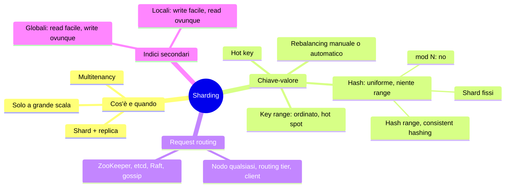
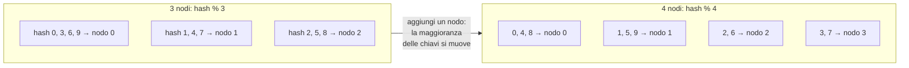
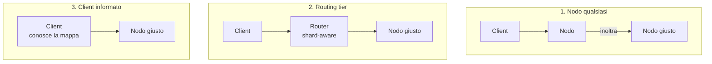
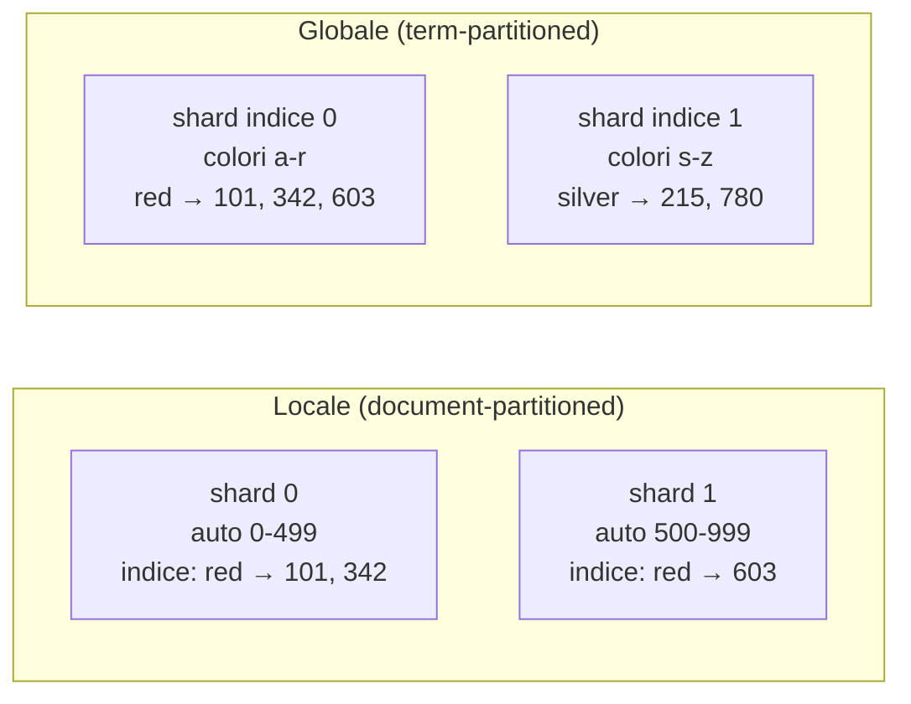

# Capitolo 7 · Sharding

> *We must state relationships, not procedures.* — Grace Hopper

**In una frase:** quando i dati o le scritture non stanno più su una macchina, si
spezza il dataset in **shard** e ogni shard va su un nodo diverso. Le domande sono
tre: con quale regola assegno un record a uno shard, come ribilancio quando aggiungo
nodi, e come un client trova il nodo giusto. Più una complicazione: gli indici
secondari.

**Pagine PDF:** 275-300 · **Densità:** media-bassa. Capitolo corto e lineare, ma la
scelta della partition key è una delle decisioni più difficili da cambiare dopo.

---

## Mappa del capitolo

---

## 1. Cos'è, e perché pensarci due volte

Un DB distribuito fa due cose con i dati: li **copia** su più nodi (replica, cap. 6)
e li **spezza** in shard su nodi diversi. Ogni record sta in esattamente uno shard;
ogni shard è un piccolo database a sé. Le due cose si combinano: un nodo è leader di
alcuni shard e follower di altri, ma ogni shard ha un leader solo.

Nomi diversi per la stessa cosa: partition in Kafka, range in CockroachDB, region in
HBase e TiDB, vBucket in Couchbase, vnode in Riak, token-range in Cassandra, tablet in
Bigtable e ScyllaDB. In PostgreSQL *partitioning* è spezzare una tabella in più file
**sulla stessa macchina**; *sharding* è su più macchine. Niente a che vedere con le
partizioni di rete (cap. 9).

**Quando.** Il motivo è la scalabilità di **dati e scritture**. Se il problema sono
le letture basta il read scaling con i follower. Lo sharding è pesante e sensato solo
a grande scala, perché:

- Devi scegliere una **partition key** e tutti i record con la stessa chiave stanno
  insieme. Se cerchi senza conoscerla, interroghi tutti gli shard. Lo schema è
  difficile da cambiare.
- Facile per chiave-valore, duro per il relazionale: indici secondari e join su
  shard diversi.
- Una write che tocca più shard richiede una **transazione distribuita**, molto più
  lenta (cap. 8).

Curiosità utile: alcuni sistemi shardano anche **dentro una macchina**, un processo
single-thread per core (Redis, VoltDB, FoundationDB), per sfruttare i core e la
memoria NUMA.

### Sharding per multitenancy

Nel SaaS ogni cliente è un tenant con dati separati: uno shard per tenant, o più
tenant piccoli in uno shard. Vantaggi: isolamento di **risorse** (un tenant pesante
non rallenta gli altri), di **permessi** (un bug di access control fa meno danni se i
dati sono fisicamente separati), **cell-based architecture** (servizi e storage di un
gruppo di tenant in una cella indipendente, un guasto resta nella cella), backup e
restore per tenant, GDPR (export e cancellazione sono operazioni su uno shard), data
residency per regione, rollout dello schema un tenant alla volta.

Sfide: un tenant troppo grande per un nodo va shardato a sua volta; tanti tenant
piccoli costano overhead e vanno raggruppati, con il problema di spostarli quando
crescono; le feature che incrociano tenant diventano join fra shard.

---

## 2. Shardare dati chiave-valore

Obiettivo: dati e carico **uniformi** sui nodi, così 10 nodi reggono 10 volte tanto.
Se non è uniforme è **skewed**; uno shard sovraccarico è un **hot spot**; una chiave
sovraccarica (la celebrità) è una **hot key**. L'algoritmo prende la partition key
(la chiave o la sua prima parte; in relazionale una colonna, non per forza la primary
key) e dice lo shard. Deve prestarsi al rebalancing.

### Per intervallo di chiave

Come i volumi di un'enciclopedia: a ogni shard un intervallo contiguo di chiavi,
dal minimo al massimo. I confini **non sono equidistanti** (A-B in un volume, T-Z in
un altro) e si adattano ai dati, scelti a mano (Vitess) o in automatico (Bigtable,
HBase, MongoDB range, CockroachDB, FoundationDB).

Dentro lo shard le chiavi sono ordinate (B-tree o SSTable): **range scan facili**, e
la chiave funziona da indice concatenato. Sensori con chiave = timestamp: "tutte le
letture di marzo" è una scansione.

Il rovescio: scritture su chiavi vicine vanno tutte nello stesso shard. Con il
timestamp, **tutte le scritture di oggi** finiscono nello shard di questo mese mentre
gli altri dormono. Rimedio: anteporre l'ID del sensore al timestamp, così il carico
si spalma; ma ora "tutti i sensori in un intervallo" è una range query per sensore.

**Rebalancing.** All'inizio non ci sono intervalli: si può **pre-splittare** (HBase,
MongoDB) se si conosce la distribuzione. Poi uno shard che supera una soglia (10 GB
di default in HBase) o un throughput di scrittura persistente viene **spezzato** in
due sottointervalli, come al livello alto di un B-tree; shard rimpiccioliti si
fondono. Il numero di shard segue il volume dei dati. Ma spezzare è costoso, riscrive
tutto come una compaction, e lo shard da spezzare è spesso quello già sotto carico.

### Per hash della chiave

Se non ti importa che chiavi vicine stiano insieme (tenant ID), prima hashi. Un buon
hash rende uniforme una distribuzione sbilanciata; non serve crittografico (MD5 in
MongoDB, Murmur3 in Cassandra). Attenzione agli hash dei linguaggi: `hashCode()` di
Java e `#hash` di Ruby possono cambiare fra processi.

**Hash mod N: no.** `hash % numero_nodi` è ovvio e sbagliato: aggiungi un nodo e
**quasi tutte le chiavi si spostano**.

**Numero fisso di shard.** Molti più shard dei nodi: 1.000 shard su 10 nodi, 100 per
nodo, chiave nello shard `hash % 1000`, e una mappa separata shard → nodo. Un nodo in
più riceve **shard interi** dagli altri fino a parità; in uscita il contrario. La
mappa chiave → shard non cambia mai, solo shard → nodo. Durante il trasferimento si
usa la mappa vecchia. Un numero con molti divisori rende equo qualsiasi numero di
nodi; ai nodi più potenti si danno più shard. Citus, Riak, Elasticsearch, Couchbase.

Il limite: devi **indovinare il numero** all'inizio. Più nodi che shard è
impossibile, e cambiare il numero è un resharding costoso, a volte non concorrente
con le scritture. Shard troppo grandi rendono caro il rebalancing e il recovery,
troppo piccoli costano overhead, e se il dataset cresce di molto non c'è una misura
"giusta".

**Hash range.** La combinazione: a ogni shard un **intervallo di valori di hash**
(0-16.383 allo shard 0, e così via). Chiavi simili, hash sparsi: niente hot spot da
vicinanza. Lo shard si spezza quando cresce, quindi il numero si adatta. Il prezzo:
le range query sulla partition key sono inefficienti. Ma se la chiave ha più colonne
e solo la prima è la partition key, le range query sulle colonne successive restano
efficienti dentro lo shard. YugabyteDB, DynamoDB, MongoDB opzionale. I warehouse
fanno lo stesso con altri nomi: partition key più cluster columns (BigQuery),
micro-partizioni con cluster key (Snowflake), Delta Lake.

Cassandra e ScyllaDB: lo spazio degli hash spezzato in molti intervalli per nodo (16
e 256) con **confini casuali**; gli sbilanciamenti si compensano statisticamente, e un
nodo nuovo riceve pezzi di intervalli da più nodi senza spostare più del necessario.

**Consistent hashing.** Un hash che mappa chiavi su un numero dato di shard con due
proprietà: carico circa uguale, e **quando il numero cambia si muovono il minimo di
chiavi**. "Consistent" non c'entra con la consistenza delle repliche o ACID: è la
tendenza di una chiave a restare dove sta. Cassandra è vicina alla definizione
originale; alternative: rendezvous hashing, jump consistent hashing, dove il nodo
nuovo riceve chiavi singole sparse da tutti invece di sottointervalli.

### Carico sbilanciato e hot key

Hash uniforme ≠ carico uniforme. Il post della celebrità concentra letture e
scritture su una chiave. Rimedi:

- Con range (di chiavi o di hash) puoi isolare la chiave calda in uno shard suo,
  magari su una macchina dedicata.
- A livello applicativo: **due cifre casuali in coda alla chiave** spalmano le
  scritture su 100 chiavi in shard diversi. Ma le letture devono leggere tutte e 100
  e combinare, e serve contabilità: quali chiavi sono spezzate, come convertirne una
  normale in calda e viceversa, visto che un post virale si calma dopo due giorni.
  Chiavi calde in lettura e in scrittura chiedono strategie diverse.
- I cloud a grande scala automatizzano: *heat management*, *adaptive capacity* in Amazon.

### Rebalancing: automatico o manuale

Automatico è comodo e può autoscalare in minuti (DynamoDB). Ma il rebalancing è
caro: reindirizza richieste e sposta molti dati, può saturare rete e nodi, e se il
sistema è vicino al massimo di scrittura lo split non sta dietro. Pericoloso insieme
al **rilevamento automatico dei guasti**: un nodo lento viene creduto morto, il
cluster si ribilancia spostando carico sugli altri, che diventano lenti e creduti
morti: **cascading failure**. Via di mezzo: il sistema propone, l'amministratore
conferma (Couchbase, Riak). Un umano nel loop è più lento ma evita sorprese, e
permette di ribilanciare **prima** di un evento noto (Cyber Monday, finale dei mondiali).

---

## 3. Request routing

Dato una chiave, quale IP e porta? È service discovery, con una differenza: un
servizio stateless accetta qualsiasi istanza, uno shard solo i nodi che lo replicano.
Il routing deve conoscere chiave → shard e shard → nodo.

Tre domande comuni: chi decide quale shard sta su quale nodo, e come si rende
tollerante ai guasti senza split brain; come chi instrada **viene a sapere** dei
cambi; cosa succede alle richieste in volo verso il vecchio nodo durante uno spostamento.

Risposta comune: un **coordination service** (ZooKeeper, etcd) con consenso (cap. 10).
I nodi si registrano, il servizio tiene la mappa autorevole, routing tier e client si
abbonano e vengono notificati. HBase e SolrCloud usano ZooKeeper, Kubernetes usa etcd;
MongoDB ha i suoi config server e i router `mongos`; Kafka, YugabyteDB, TiDB,
ScyllaDB hanno Raft integrato. Riak usa **gossip** fra nodi: consistenza molto più
debole, split brain possibile, tollerabile perché il leaderless promette poco comunque.
Gli IP del routing tier cambiano poco: basta il DNS.

I DB analitici shardano ma le query aggregano e joinano **su molti shard in
parallelo**: cap. 11.

---

## 4. Indici secondari

Finora il client conosceva la partition key. Un indice secondario cerca occorrenze di
un valore ("tutte le auto rosse") e **non mappa pulito sugli shard**. Due approcci:

| | Locale | Globale |
|---|---|---|
| Dove sta | Ogni shard indicizza solo i propri record | Un indice su tutti i record, shardato per **valore indicizzato** (il termine) |
| Write | Tocca **un solo shard** | Tocca più shard dell'indice: un record ha più termini, ognuno altrove. Serve una transazione distribuita, o accettare asincronia |
| Read con una condizione | Se non conosci la partition key, **tutti gli shard** (scatter/gather): tail latency amplification, e aggiungere shard non aumenta il throughput delle query | **Un solo shard** per la postings list; poi comunque i record dai loro shard |
| Read con più condizioni | Ogni shard fa l'AND in locale | Termini su shard diversi: le postings list viaggiano in rete per l'intersezione, lento se lunghe |
| Chi lo usa | MongoDB, Riak, Cassandra, Elasticsearch, SolrCloud, VoltDB | CockroachDB, TiDB, YugabyteDB; DynamoDB entrambi, con indici globali **asincroni** e quindi letture stantie |

Il globale conviene con molte più letture che scritture e postings list corte.
Avvertenza: costruire un indice secondario a mano in codice applicativo sopra un
key-value store è facile da far divergere (race condition, write parziali): cap. 8.

---

## Le due strategie in una tabella

| | Key range | Hash |
|---|---|---|
| Ordine delle chiavi | Conservato: range query efficienti | Distrutto: range query inefficienti sulla partition key |
| Distribuzione | Segue i dati: rischio hot spot su chiavi vicine | Uniforme |
| Rebalancing | Split dell'intervallo quando cresce | Shard fissi spostati interi, oppure hash range con split |
| Pattern comune | | Prima parte della chiave come partition key, resto ordinato dentro lo shard |

---

## Domande di autoverifica

1. Quando serve lo sharding e quando basta il read scaling?
2. Chiave = timestamp dei sensori: perché è un hot spot e come lo risolvi? Cosa perdi?
3. Perché `hash % N` è sbagliato per il rebalancing?
4. Numero fisso di shard: cosa si muove e cosa non cambia mai quando aggiungi un
   nodo? Qual è il limite?
5. Hash range contro key range: cosa guadagni e cosa perdi?
6. Definisci consistent hashing con le sue due proprietà. Cosa non significa "consistent"?
7. Due cifre casuali in coda a una hot key: cosa risolve e cosa peggiora?
8. Perché rebalancing automatico e failure detection automatica insieme sono pericolosi?
9. Tre modi di instradare una richiesta allo shard giusto, e dove sta la mappa.
10. Indice locale contro globale: chi paga la write e chi paga la read?

Flashcard in [`flashcards/ch07.yaml`](../data/flashcards/ch07.yaml).

## Rimandi

- Replica degli shard: cap. 6
- Transazioni distribuite su più shard, indici consistenti: cap. 8
- Partizioni di rete: cap. 9
- Consenso, ZooKeeper, etcd, split brain: cap. 10
- Query parallele su molti shard: cap. 11
