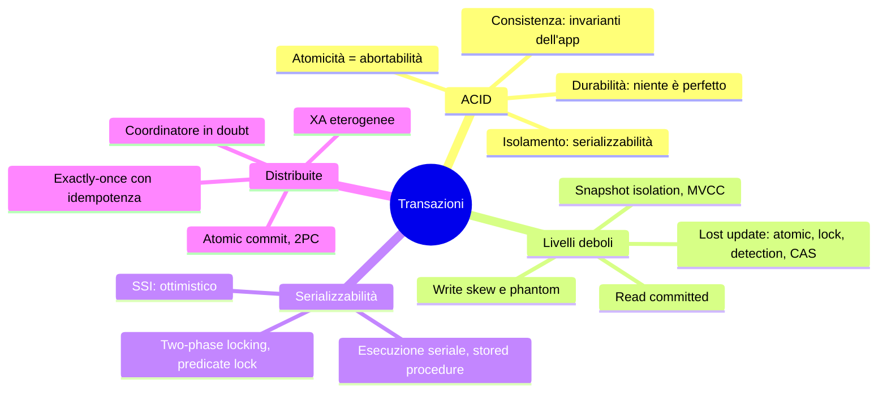
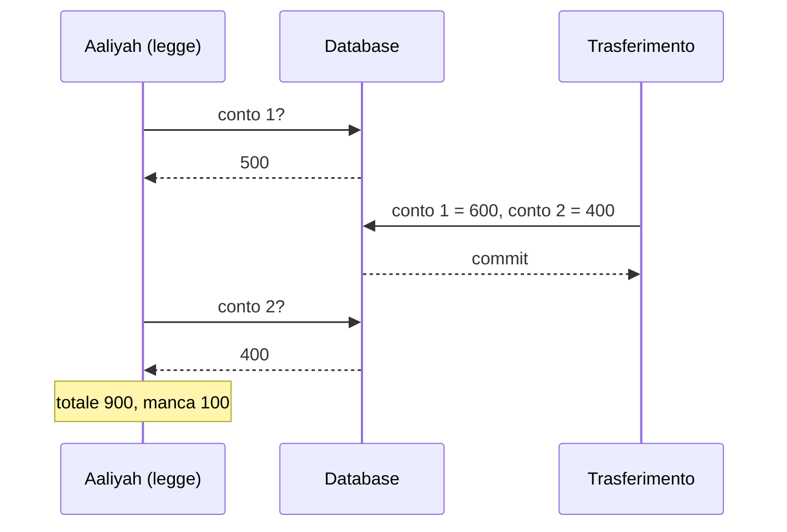
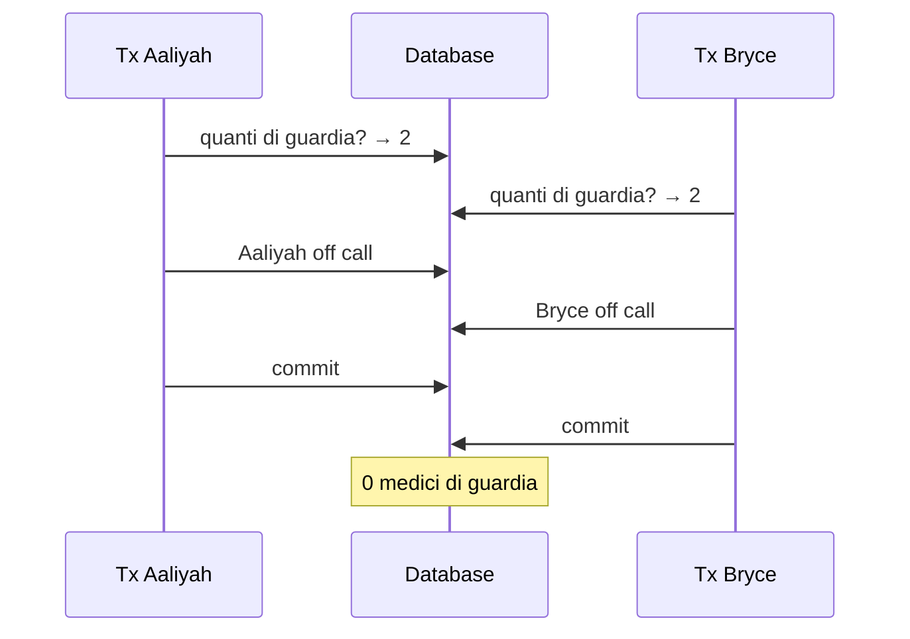
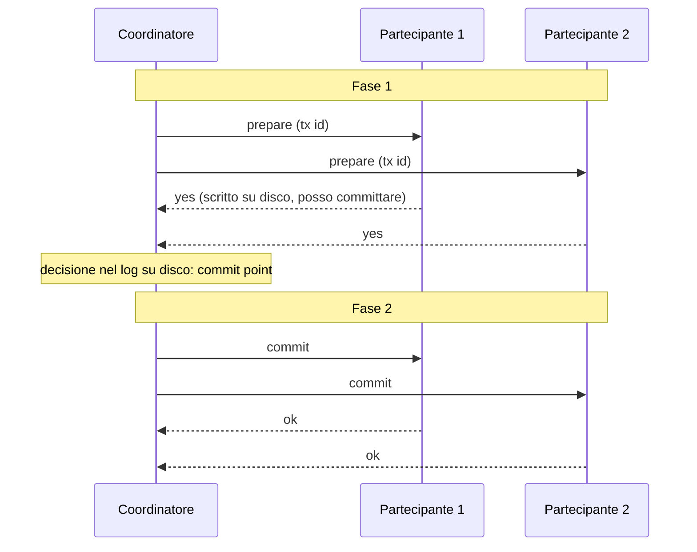

# Capitolo 8 · Transazioni

> *It is better to have application programmers deal with performance problems due to
> overuse of transactions as bottlenecks arise, rather than always coding around the
> lack of transactions.* — Spanner paper, 2012

**In una frase:** una transazione raggruppa letture e scritture in un'unità che o
riesce tutta o fallisce tutta, così l'applicazione può ignorare crash, rete e
concorrenza e limitarsi a ritentare. Il capitolo smonta ACID parola per parola,
cataloga le race condition che ogni livello di isolamento lascia passare, spiega come
si ottiene la serializzabilità e cosa succede quando una transazione tocca più nodi.

**Pagine PDF:** 301-368 · **Densità:** molto alta. Il più lungo del libro. Le
anomalie (dirty read, read skew, lost update, write skew, phantom) vanno sapute
riconoscere a vista.

---

## Mappa del capitolo

---

## 1. Cosa promette ACID davvero

Le transazioni non sono una legge di natura: esistono per **semplificare il modello
di programmazione**. Il NoSQL le abbandonò credendole non scalabili; i NewSQL
(CockroachDB, TiDB, Spanner, FoundationDB, YugabyteDB) hanno dimostrato il
contrario combinando sharding e consenso. "ACID compliant" oggi è quasi un termine
di marketing, e BASE significa solo "non ACID".

| Lettera | Cosa significa davvero | Cosa non significa |
|---|---|---|
| **Atomicità** | Se qualcosa va storto a metà, la transazione viene **abortita** e tutto ciò che ha scritto viene annullato. Il nome giusto sarebbe *abortabilità* | Non c'entra con la concorrenza (quello è l'isolamento) |
| **Consistenza** | Gli **invarianti dell'applicazione** restano veri: dare e avere bilanciati. Il DB può imporre vincoli (foreign key, unique, check), ma i più complessi sono responsabilità dell'app | Non è una proprietà del DB. La parola ha almeno cinque significati nel libro |
| **Isolamento** | Transazioni concorrenti non si pestano i piedi. L'ideale è la **serializzabilità**: come se fossero girate una alla volta | Molti DB non la implementano: Oracle chiama "serializable" la snapshot isolation |
| **Durabilità** | Dopo il commit i dati non si perdono: fsync, WAL, checksum su un nodo; copia su n nodi in un sistema replicato | Non esiste durabilità perfetta: SSD che violano fsync, firmware bacati, corruzione silente, SSD usurati che perdono dati da spenti |

Sulla durabilità: disco, replica e backup non sono alternative ma **riduzioni di
rischio da usare insieme**.

### Un oggetto o molti

Anche per un singolo oggetto servono atomicità (un JSON da 20 kB scritto a metà?) e
isolamento (un lettore vede un valore parziale?): quasi tutti i motori le danno per
singola chiave con log e lock per oggetto. Le operazioni **atomiche** (increment,
compare-and-set) evitano il read-modify-write, ma non sono transazioni: le
"lightweight transactions" di Cassandra sono linearizzabili su **un** oggetto solo.

Le transazioni **multi-oggetto** servono quando: foreign key e archi fra vertici
devono restare validi; dati denormalizzati vanno aggiornati insieme (il contatore di
mail non lette); gli **indici secondari** vanno aggiornati con il record, altrimenti
un record compare in un indice e non nell'altro. In relazionale la transazione è
tutto ciò che passa sulla stessa connessione TCP fra `BEGIN` e `COMMIT`. Un
"multi-put" di un key-value store **non** è una transazione: può riuscire per alcune
chiavi e fallire per altre.

### Abort e retry

Il punto delle transazioni è ritentare in sicurezza. Peccato che Rails ActiveRecord e
Django non ritentino: l'eccezione risale e l'utente vede un errore. Ma il retry ha
i suoi limiti:

- Commit riuscito ma ack perso: il retry **esegue due volte** senza deduplicazione.
- Errore da sovraccarico: il retry peggiora. Limita i tentativi, backoff esponenziale.
- Ritenta solo errori **transitori** (deadlock, isolamento, rete, failover), mai una
  violazione di vincolo.
- Effetti collaterali fuori dal DB (email) partono anche se la transazione abortisce.
- Il client crasha durante il retry: i dati sono persi.

I sistemi leaderless lavorano in "best effort": non annullano ciò che hanno già
fatto, tocca all'applicazione recuperare.

---

## 2. Livelli di isolamento deboli

I bug di concorrenza sono rari, non riproducibili, difficili da ragionare. Il DB
dovrebbe nasconderli, ma la serializzabilità costa e i DB usano livelli più deboli,
che "proteggono da alcuni problemi ma non da tutti". Non è teoria: hanno fatto
fallire un exchange di Bitcoin. E un attaccante può **provocare** la concorrenza con
una raffica di richieste. Anche i relazionali "ACID" usano isolamento debole di default.

### Read committed

Due garanzie: niente **dirty read** (vedi solo dati committati) e niente **dirty
write** (sovrascrivi solo dati committati). Default in Oracle, PostgreSQL, SQL Server.

- Dirty read: vedresti una transazione a metà (la mail nuova ma il contatore
  vecchio), o dati poi annullati (**cascading abort**).
- Dirty write: Aaliyah e Bryce comprano la stessa auto; senza protezione la vendita va
  a Bryce e la fattura ad Aaliyah, perché ciascuno vince un update diverso.

Implementazione: **lock di riga** per le scritture, tenuto fino a commit o abort.
Per le letture i lock sarebbero disastrosi (una transazione lunga bloccherebbe
tutte le letture), quindi il DB tiene **due versioni** della riga, la committata e
quella in corso, e dà ai lettori la vecchia. *Read uncommitted* è ancora più debole:
niente dirty write ma dirty read ammessi.

### Snapshot isolation

Read committed non basta. **Read skew**: Aaliyah ha 500 su due conti, un
trasferimento di 100 è in corso, lei legge il primo conto prima (500) e il secondo
dopo (400): 900, cento euro spariti. Ogni valore era committato quando lo ha letto.
Tollerabile per una pagina web, **intollerabile per backup e query analitiche**: il
backup di un DB da ore avrebbe pezzi a istanti diversi e le incoerenze diventano
permanenti.

**Snapshot isolation**: ogni transazione legge da uno **snapshot consistente** del
DB all'istante in cui è iniziata, anche se nel frattempo tutto cambia. PostgreSQL,
InnoDB, Oracle, SQL Server, BigQuery. Per Oracle, TiDB e Aurora DSQL è il livello
massimo.

**MVCC.** Il principio: *i lettori non bloccano gli scrittori, gli scrittori non
bloccano i lettori*. Il DB tiene **più versioni committate** di ogni riga. In
PostgreSQL ogni transazione ha un `txid` crescente; ogni riga ha `inserted_by` e
`deleted_by`; un update è delete più insert; le versioni formano una lista; un
garbage collector rimuove quelle che nessuno può più vedere.

Regole di visibilità all'inizio della transazione: ignora le scritture delle
transazioni **in corso** in quel momento (anche se poi committano), ignora quelle con
txid **successivo**, ignora quelle **abortite**; tutto il resto è visibile. Una riga è
visibile se chi l'ha inserita aveva già committato all'inizio della mia transazione,
e chi l'ha cancellata non ancora.

Gli indici puntano a una versione e si scorre la catena; CouchDB, Datomic e LMDB
usano invece **B-tree immutabili copy-on-write**: ogni scrittura crea una nuova
radice, e una radice è uno snapshot.

**Il pasticcio dei nomi.** Lo standard SQL non conosce la snapshot isolation (è del
1975) e definisce *repeatable read*. PostgreSQL chiama la snapshot isolation
"repeatable read" per dirsi conforme; Oracle la chiama "serializable"; in MySQL
"repeatable read" è più debole; in Db2 è la serializzabilità. Nessuno sa cosa
significhi repeatable read.

### Lost update

Due client fanno read-modify-write sullo stesso valore: il secondo sovrascrive senza
incorporare il primo. Contatori, saldi, un elemento aggiunto a un JSON, due utenti
che salvano la stessa pagina wiki. Quattro rimedi:

| Rimedio | Come | Nota |
|---|---|---|
| **Operazioni atomiche** | `UPDATE counters SET value = value + 1` | La migliore quando basta. Gli ORM spingono verso il read-modify-write in codice |
| **Lock esplicito** | `SELECT ... FOR UPDATE` poi la logica, poi l'update | Serve quando c'è logica applicativa (regole di un gioco). Facile dimenticarlo; rischio deadlock |
| **Rilevamento automatico** | Il DB abortisce la transazione che perde l'update | PostgreSQL repeatable read, Oracle serializable, SQL Server snapshot. **InnoDB no**: per alcuni non è nemmeno snapshot isolation |
| **Compare-and-set** | `UPDATE ... WHERE id = 1234 AND content = 'old'`, o un numero di versione (*optimistic locking*) | Per DB senza transazioni. Molti MVCC fanno vedere al `WHERE` di UPDATE le scritture altrui |

Con **multi-leader o leaderless** nessuno di questi vale: non esiste una copia unica
aggiornata. Restano i sibling e il merge; funziona se le operazioni sono
**commutative** (incrementi, aggiunte a un insieme: i CRDT). LWW perde update per
definizione.

### Write skew e phantom

Due medici di guardia, Aaliyah e Bryce, entrambi malati, cliccano "vado a casa" nello
stesso momento. Ogni transazione controlla "ci sono almeno due di guardia?" (sì, 2),
poi toglie **se stessa**. Entrambe committano. Nessuno di guardia.

È **write skew**: né dirty write né lost update, perché le due transazioni scrivono
**oggetti diversi**. È la generalizzazione del lost update: leggono gli stessi
oggetti e poi ne aggiornano alcuni. Le opzioni si restringono: le operazioni atomiche
non servono (più oggetti), il rilevamento dei lost update **non lo coglie** in
nessun DB, i vincoli multi-oggetto non esistono quasi mai. Restano la
serializzabilità o, in seconda battuta, `SELECT ... FOR UPDATE` sulle righe da cui
la decisione dipende.

Altri esempi con lo stesso schema: prenotare una sala (controlla sovrapposizioni,
inserisci), muovere due pedine sulla stessa casella, rivendicare uno username
(qui basta un vincolo unique), doppia spesa (due voci inserite insieme mandano il
saldo in negativo).

Il pattern: **SELECT** che verifica una precondizione, **decisione** nell'app,
**scrittura** che cambia la precondizione. Nel caso dei medici la riga modificata è
tra quelle lette, e il lock funziona. Negli altri quattro la query controlla
l'**assenza** di righe e la scrittura ne aggiunge una: `FOR UPDATE` non ha nulla da
bloccare. Questo è un **phantom**: una scrittura cambia il risultato di una ricerca
altrui. La snapshot isolation evita i phantom nelle letture pure, non nel read/write.

**Materializzare i conflitti**: creare in anticipo una tabella di "lock" (una riga per
sala e quarto d'ora per sei mesi) da bloccare con `FOR UPDATE`. Funziona ma è brutto:
il controllo della concorrenza cola nel modello dati. Ultima spiaggia.

---

## 3. Serializzabilità

Il quadro è triste: livelli incomprensibili e implementati diversamente, impossibile
capire dal codice se un livello basta, nessuno strumento per trovare le race. Dal 1970
i ricercatori dicono la stessa cosa: **usa la serializzabilità**. Se le transazioni
sono corrette da sole, lo restano insieme. Perché non lo fanno tutti? Tre modi di
implementarla, ciascuno con un prezzo.

### Esecuzione seriale

Elimina la concorrenza: una transazione alla volta, un thread. Sembrava folle fino
agli anni 2000; due cose l'hanno resa possibile: RAM abbastanza economica da tenere
il dataset attivo in memoria, e la constatazione che le transazioni OLTP sono **corte**
(le analitiche lunghe girano a parte su uno snapshot). VoltDB, Redis, Datomic.

Vincolo: niente transazioni **interattive** (query, risposta, altra query), perché
il thread passerebbe il tempo ad aspettare la rete. Serve una **stored procedure**
che manda tutto il codice al DB in anticipo. Le stored procedure hanno cattiva fama
(PL/SQL arcaico, difficili da versionare e testare, un bug pesa più che in un
application server, codice non fidato nel kernel); le implementazioni moderne usano
Java, Clojure, Lua, JavaScript. VoltDB le usa anche per replicare: la stessa procedura
**deterministica** su ogni replica, cioè state machine replication (cap. 10).

Per scalare oltre un core: **sharding**, un thread per shard, se ogni transazione
tocca uno shard solo. Le cross-shard vanno in lockstep: VoltDB riporta circa 1.000 al
secondo, ordini di grandezza sotto, e non crescono aggiungendo macchine. Riassunto:
transazioni piccole e veloci, dataset in RAM, throughput da un core o shardabile.

### Two-phase locking

Per trent'anni l'unica opzione (InnoDB e SQL Server serializable, Db2 repeatable read).
Non confondere con 2PC: 2PL è isolamento, 2PC è commit atomico distribuito.

Lock **shared/exclusive** su ogni oggetto: più lettori insieme, ma chi scrive
esclude tutti, e chi legge esclude gli scrittori. **Gli scrittori bloccano i lettori e
viceversa**: l'opposto esatto della snapshot isolation. Due fasi: si acquisiscono
lock mentre si esegue (growing), si rilasciano tutti alla fine (shrinking), mai
sovrapposte. **Deadlock** frequenti: il DB ne abortisce uno, l'app ritenta.

Perché nessuno lo vuole: throughput e latenze molto peggiori, non tanto per
l'overhead dei lock quanto per la **concorrenza ridotta**. Una query che legge una
tabella intera prende uno shared lock sulla tabella e **blocca tutte le scritture**
per la sua durata. Latenze instabili, percentili alti pessimi, una transazione lenta
ferma tutto.

**Predicate lock**: per fermare i phantom il lock non appartiene a una riga ma a
**tutti gli oggetti che soddisfano una condizione**, anche quelli che ancora non
esistono. Troppo costoso da verificare; in pratica si usano **index-range lock**
(next-key lock): si approssima il predicato con un intervallo più grande su un
indice (sala 123 a qualsiasi ora, o tutte le sale fra le 12 e le 13), e chi vuole
inserire tocca lo stesso pezzo di indice e incontra il lock. Meno preciso, molto più
economico. Senza indice adatto: lock sull'intera tabella.

### Serializable snapshot isolation

Dal 2008: serializzabilità piena con una piccola penalità rispetto alla snapshot
isolation. PostgreSQL serializable, SQL Server Hekaton, CockroachDB, FoundationDB.

2PL è **pessimistico**: se qualcosa potrebbe andare storto, aspetta. L'esecuzione
seriale è pessimismo estremo. SSI è **ottimistico**: vai avanti, e al commit il DB
verifica se l'isolamento è stato violato; se sì, abort e retry. Va male con alta
**contention** (molti abort, e i retry caricano un sistema già al limite), bene con
capacità di riserva. Le operazioni commutative riducono la contention.

Il meccanismo: snapshot isolation più rilevamento delle **premesse obsolete**. Una
transazione legge ("due medici di guardia"), decide, scrive. Al commit la premessa
potrebbe essere falsa. Due casi:

| Caso | Cosa traccia il DB | Quando abortisce |
|---|---|---|
| **Lettura di una versione MVCC stantia**: la tx 43 ignora la scrittura non committata della 42 | Quali scritture sono state ignorate per le regole di visibilità | Al commit della 43, se la 42 nel frattempo ha committato |
| **Scrittura che tocca letture precedenti**: la 43 scrive dove la 42 ha letto | Chi ha letto cosa, su una voce di indice (come un index-range lock che **non blocca**) | La scrittura è un **tripwire** che avvisa chi aveva letto; chi committa per secondo abortisce |

Perché aspettare il commit? Se la 43 fosse read-only non c'è write skew, e la 42
potrebbe ancora abortire. Così SSI conserva le letture lunghe su snapshot.

Contro 2PL: nessun blocco, latenze prevedibili, letture senza lock. Contro
l'esecuzione seriale: non limitato a un core, FoundationDB distribuisce il
rilevamento su più macchine. Contro la snapshot isolation: un overhead la cui
rilevanza è dibattuta. Il tasso di abort decide tutto: transazioni read/write
**corte**, read-only lunghe va bene.

---

## 4. Transazioni distribuite

Su un nodo il commit è deciso da **un singolo evento**: il disco finisce di scrivere il
commit record nel log. Prima si può ancora abortire, dopo è committato. Con più nodi
(più shard, un indice globale) non basta mandare "commit" a tutti: alcuni possono
rilevare un vincolo violato, perdere il messaggio, crashare prima del commit record.
E un commit fatto **non si ritira**: altri hanno già letto quei dati. Serve l'**atomic
commitment**: o tutti o nessuno.

### Two-phase commit

Un **coordinatore** (transaction manager, spesso una libreria nel processo
applicativo: Narayana, MSDTC) chiede a tutti i **partecipanti** "puoi committare?".
Tutti sì: commit a tutti. Uno no: abort a tutti. Come il matrimonio: il celebrante
chiede a ciascuno "lo vuoi?", e solo dopo i due sì pronuncia.

Funziona per un **sistema di promesse** con due punti di non ritorno:

1. Il partecipante che risponde **yes** ha scritto tutto su disco e verificato i
   vincoli: **rinuncia al diritto di abortire**. Un crash o un disco pieno non sono
   scuse valide dopo.
2. Il coordinatore scrive la decisione nel proprio log (**commit point**) e da lì
   deve ritentare **per sempre** finché ogni partecipante non l'ha applicata.

Se svieni dopo il "sì" e non senti il celebrante, sei sposato lo stesso: lo scopri
chiedendo l'esito al tuo ID di transazione.

### Il coordinatore muore

Prima del prepare un partecipante può abortire da solo. Dopo aver votato yes, **non
può fare nulla**: non abortire (un altro può aver committato), non committare (un
altro può aver abortito). È **in doubt** e aspetta il coordinatore. Un timeout non
aiuta. Il coordinatore al riavvio legge il log: le transazioni senza commit record
vengono abortite. Se il log è perso, solo un amministratore può decidere a mano.

**3PC** rende il commit non bloccante ma assume ritardi di rete limitati: nel mondo
reale (cap. 9) non garantisce atomicità. La soluzione vera: sostituire il
coordinatore singolo con un **protocollo di consenso** (cap. 10).

### Transazioni eterogenee: XA

Due tipi di transazione distribuita da non confondere: **interne** a un DB (tutti i
nodi girano lo stesso software: YugabyteDB, TiDB, Spanner, Kafka) ed **eterogenee**
(DB di vendor diversi, o un DB più un message broker).

Il caso d'uso classico delle eterogenee: confermare un messaggio al broker **se e
solo se** la transazione sul DB ha committato: **exactly-once**. Funziona solo se
tutti i sistemi coinvolti parlano lo stesso protocollo; il server di posta no, e la
mail parte due volte.

**XA** (1991) è lo standard: non un protocollo di rete ma una **API C** per il
coordinatore, implementata dai driver (JTA, JDBC, JMS). Il coordinatore è una
libreria nel processo dell'app, con il log sul **disco locale dell'application
server**. I suoi problemi:

- Se l'app crasha, il coordinatore muore con lei e i partecipanti restano in doubt
  finché quel server non riparte. I DB non possono contattare il coordinatore.
- **In doubt significa lock tenuti**: righe bloccate per 20 minuti, o per sempre se
  il log è perso. Anche riavviare il DB non libera i lock, per correttezza. Grandi
  parti dell'app diventano indisponibili.
- Transazioni **orfane** esistono davvero; si risolvono a mano, sotto stress, durante
  un'emergenza. Le **heuristic decisions** permettono a un partecipante di decidere da
  solo: eufemismo per "probabilmente rompo l'atomicità".
- Minimo comun denominatore: niente deadlock detection fra sistemi, niente SSI.
- Anche replicando il coordinatore, il codice applicativo resta un single point of failure.

### Transazioni interne

I NewSQL usano 2PC fra shard senza i guai di XA perché non devono interfacciarsi con
altro: coordinatore **replicato** con failover automatico, coordinatore e shard che
parlano **direttamente** senza passare dall'app, shard replicati (meno abort per
guasto), commit atomico accoppiato a un controllo di concorrenza distribuito con
deadlock detection e letture consistenti fra shard. Il consenso (cap. 10) replica
coordinatore e shard. Snapshot isolation e SSI sono possibili fra shard.

### Exactly-once senza transazioni distribuite

Non servono. Basta una transazione **nel solo database** più l'**idempotenza**:

1. Ogni messaggio ha un ID. Inizia una transazione, controlla se l'ID è nella tabella
   dei processati: se sì, conferma al broker e scarta.
2. Se no, inserisci l'ID, processa il messaggio **nella stessa transazione**, commit.
3. Conferma al broker.
4. Cancella l'ID in una transazione separata.

Crash prima del commit: il broker riconsegna, la transazione era abortita. Crash
dopo il commit ma prima dell'ack: riconsegna, l'ID c'è, scarto. Crash dopo l'ack:
resta un ID orfano, innocuo. Retry concorrenti: un vincolo unique sull'ID. Kafka
Streams fa così (cap. 12). Le transazioni interne restano utili per scalare il
pattern su più shard.

---

## Le anomalie per livello

| Livello | Dirty read | Read skew | Phantom | Lost update | Write skew |
|---|---|---|---|---|---|
| Read uncommitted | possibile | possibile | possibile | possibile | possibile |
| Read committed | **no** | possibile | possibile | possibile | possibile |
| Snapshot isolation | **no** | **no** | **no** (in lettura) | dipende dal DB | possibile |
| Serializable | **no** | **no** | **no** | **no** | **no** |

Il dirty write è evitato da quasi tutti e non è in tabella.

| Anomalia | In una riga |
|---|---|
| **Dirty read** | Leggo scritture non ancora committate |
| **Dirty write** | Sovrascrivo scritture non ancora committate |
| **Read skew** | Vedo parti del DB a istanti diversi |
| **Phantom** | Una scrittura altrui cambia il risultato della mia ricerca |
| **Lost update** | Due read-modify-write, il secondo cancella il primo |
| **Write skew** | Decido su una premessa che al commit non è più vera |

## Le tre serializzabilità

| | Seriale | 2PL | SSI |
|---|---|---|---|
| Filosofia | Niente concorrenza | Pessimistica: aspetta | Ottimistica: vai e verifica al commit |
| Chi blocca chi | Tutto in fila | Scrittori e lettori a vicenda | Nessuno |
| Prezzo | Un core, stored procedure, dataset in RAM | Latenze instabili, deadlock, tabella bloccata da una lettura lunga | Abort sotto contention, transazioni read/write corte |
| Chi | VoltDB, Redis, Datomic | InnoDB, SQL Server, Db2 | PostgreSQL, CockroachDB, FoundationDB |

---

## Domande di autoverifica

1. Perché "abortabilità" sarebbe un nome migliore di atomicità? Cosa non copre?
2. Perché la C di ACID non è una proprietà del database?
3. Un multi-put di un key-value store è una transazione? Perché no?
4. Elenca tre casi in cui ritentare una transazione abortita è sbagliato o pericoloso.
5. Perché per i dirty read non si usano i lock in lettura e cosa si usa invece?
6. Read skew: perché è accettabile per una pagina web e catastrofico per un backup?
7. Spiega le regole di visibilità MVCC. Perché una riga cancellata non si rimuove subito?
8. Quattro rimedi al lost update: quando ciascuno è il migliore? Quale non vale con
   replica multi-leader?
9. I medici di guardia: perché non è un lost update, e perché il rilevamento
   automatico dei lost update non lo coglie?
10. Perché `SELECT FOR UPDATE` non protegge la prenotazione di una sala?
11. Cos'è un predicate lock e perché si approssima con un index-range lock?
12. SSI: quali sono i due casi di premessa obsoleta e perché si abortisce solo al commit?
13. 2PC: quali sono i due punti di non ritorno? Cosa può fare un partecipante in doubt?
14. Perché un partecipante in doubt è un problema serio e non un dettaglio da pulire dopo?
15. Descrivi l'exactly-once con la sola transazione sul DB e verifica ogni punto di crash.

Flashcard in [`flashcards/ch08.yaml`](../data/flashcards/ch08.yaml).

## Rimandi

- WAL, durabilità su disco, copy-on-write: cap. 4
- Durable execution e codice deterministico: cap. 5
- Sibling, CRDT, LWW: cap. 6
- Indici globali fra shard: cap. 7
- Ritardi di rete illimitati e pause dei processi: cap. 9
- Consenso al posto del coordinatore, state machine replication, linearizzabilità: cap. 10
- Exactly-once in Kafka Streams: cap. 12
- Alternative alle transazioni per la consistenza fra sistemi: cap. 13
