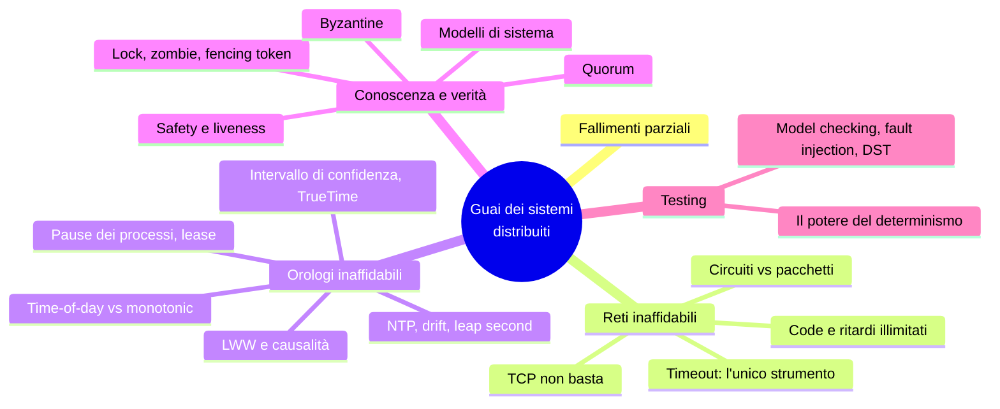
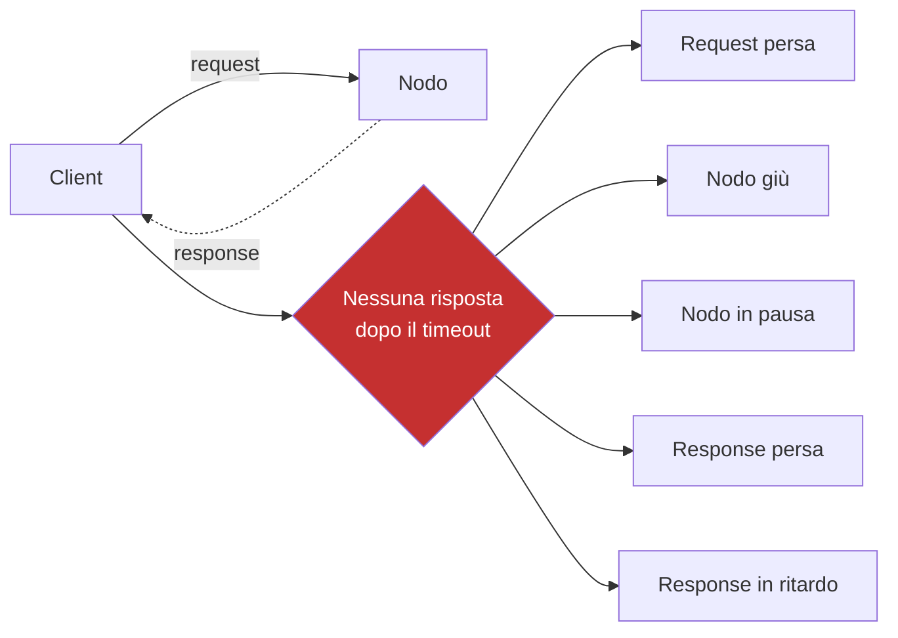
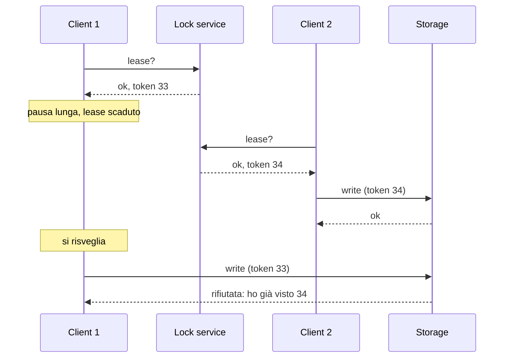

# Capitolo 9 · I guai dei sistemi distribuiti

> *They're funny things, Accidents. You never have them till you're having them.*
> — A.A. Milne

**In una frase:** su una macchina sola o funziona o non funziona; su più macchine
collegate da una rete ci sono i **fallimenti parziali**, non deterministici. Il
capitolo porta il pessimismo al massimo: reti che perdono e ritardano, orologi
sbagliati, processi che si fermano senza accorgersene. Poi dà gli strumenti per
ragionare lo stesso: quorum, fencing token, modelli di sistema, safety e liveness,
e i modi per testare tutto questo.

**Pagine PDF:** 369-424 · **Densità:** media-alta. Pochi algoritmi, molti concetti.
È il capitolo che spiega *perché* il 10 esiste.

---

## Mappa del capitolo

---

## 1. Fallimenti parziali

Un computer singolo è deterministico per scelta di progetto: se c'è un guasto
hardware preferisce crashare del tutto piuttosto che dare un risultato sbagliato.
Nasconde la realtà fisica dietro un modello ideale. In un sistema distribuito i
guasti sono troppo frequenti per ignorarli: alcune parti sono rotte in modo
imprevedibile mentre altre funzionano, e **la stessa operazione a volte riesce e a
volte no**. Non sai nemmeno se è riuscita.

Il rovescio della medaglia: se tolleri i fallimenti parziali puoi fare rolling
upgrade e costruire **un sistema affidabile da componenti inaffidabili**. Ma prima
devi conoscere i guasti, e provocarli artificialmente in test. "Sospetto, pessimismo
e paranoia pagano."

---

## 2. Reti inaffidabili

I sistemi shared-nothing comunicano **solo** via rete, e la rete (internet, Ethernet)
è a **pacchetti asincroni**: nessuna garanzia su quando un messaggio arriva, né se
arriva. Mandi una richiesta e non ricevi risposta: la richiesta è persa? in coda? il
nodo è morto? in pausa? ha processato e la risposta è persa? ritardata? **Tutti
questi casi sono indistinguibili.** L'unica informazione è "non ho ancora una
risposta". Lo strumento è il **timeout**, che però non dice se il nodo ha ricevuto la
richiesta.

### TCP non risolve

TCP ritrasmette, riordina, verifica checksum e regola la velocità (congestion
control). Ma se l'ack non arriva non sa se è andato perso il pacchetto o l'ack; se il
cavo è staccato non lo riattacca; la deduplicazione vale per **una** connessione, e
riconnettendo i dati si duplicano; una connessione chiusa con errore non dice quanto
il nodo remoto ha processato; e l'ack significa che il **kernel** ha ricevuto, non
l'applicazione. Per sapere che una richiesta è riuscita serve una risposta
**dall'applicazione**.

### I guasti di rete nel mondo reale

Circa 12 al mese in un datacenter medio, metà su una macchina e metà su un rack
intero. Ridondare gli apparati aiuta meno del previsto: la causa principale sono gli
**errori umani** di configurazione. Fibre interrotte da mucche, castori e squali.
Round-trip di **minuti** fra regioni cloud agli alti percentili, e anche dentro un
datacenter durante una riconfigurazione. Guasti asimmetrici: A parla con B e B con C
ma A non con C; interfacce che ricevono ma non trasmettono. Le conseguenze durano più
del guasto. Non devi per forza tollerare la rete, puoi mostrare un errore: ma devi
sapere **come reagisce** il software e che si riprende.

### Rilevare i guasti

A volte hai feedback esplicito: TCP RST/FIN se il processo è morto ma la macchina
no, uno script che notifica il crash (HBase), l'interfaccia di gestione degli switch,
ICMP unreachable. Non contarci: in generale la risposta è **nessuna risposta**, e
dichiari morto un nodo dopo qualche retry e un timeout. Bilancio fra falsi positivi
(nodo vivo creduto morto) e falsi negativi (attese inutili).

### Quanto lungo il timeout

Lungo: recovery lenta. Corto: un picco di carico fa dichiarare morto un nodo vivo,
l'azione in corso (una mail) viene fatta **due volte** da chi subentra, e il carico
spostato peggiora un sistema già in difficoltà fino alla **cascading failure** in cui
tutti dichiarano morti tutti.

Se la rete garantisse una consegna entro *d* e il nodo una risposta entro *r*, il
timeout sarebbe 2d + r. Ma i ritardi sono **illimitati**, e la variabilità viene
quasi tutta dalle **code**: nello switch quando più nodi mandano alla stessa
destinazione (coda piena = pacchetto scartato anche a rete sana), nel sistema
operativo se le CPU sono occupate, nell'hypervisor quando la VM è in pausa per
decine di millisecondi, nel mittente per il rate limiting di TCP. Una ritrasmissione
TCP si vede come ritardo. UDP rinuncia a ritrasmettere: giusto quando un dato in
ritardo non vale nulla (VoIP: "scusa, puoi ripetere?").

Nei cloud multitenant un **vicino rumoroso** satura link e switch condivisi. Il
timeout si sceglie **sperimentalmente** misurando la distribuzione dei round-trip
su molte macchine e a lungo; meglio ancora, lo si adatta in continuo alla
distribuzione osservata (Phi Accrual failure detector in Akka e Cassandra; lo fa
anche TCP).

### Perché non rendere la rete affidabile

La rete telefonica fissa lo è: una chiamata apre un **circuito** con banda riservata
lungo tutto il percorso, 16 bit ogni 250 microsecondi senza code: **ritardo
limitato**, rete sincrona. Ethernet e IP sono a **commutazione di pacchetto**,
ottimizzata per traffico **a raffiche**: una pagina web o un file non hanno un
bisogno di banda fisso, vogliono solo finire presto. Su un circuito dovresti
indovinare la banda; TCP si adatta.

È un trade-off economico, non una legge di natura: un filo da 10.000 chiamate
assegna a ciascuna la stessa banda anche se è l'unica in corso (partizione
**statica**, garanzie, bassa utilizzazione), internet spartisce dinamicamente
(code, ma utilizzazione massima e byte più economici). Lo stesso per le CPU condivise
fra thread e per le VM di clienti diversi sulla stessa macchina. Le garanzie di
latenza costano in utilizzazione. Ibridi (ATM, InfiniBand) e QoS esistono ma non nei
cloud pubblici: **non esiste un timeout "giusto"**.

---

## 3. Orologi inaffidabili

Le applicazioni usano il tempo per **durate** (timeout, p99, qps, tempo sul sito) e
per **istanti** (data di pubblicazione, scadenza della cache, timestamp nei log). In
un sistema distribuito la comunicazione non è istantanea, quindi l'ordine degli
eventi fra macchine è incerto, e ogni macchina ha il suo quarzo, sincronizzato
"circa" via NTP.

### Due orologi

| | Time-of-day | Monotonic |
|---|---|---|
| Cosa dà | Data e ora di calendario, secondi dall'epoch | Un contatore che **va solo avanti**, valore assoluto senza significato |
| API | `CLOCK_REALTIME`, `currentTimeMillis` | `CLOCK_MONOTONIC`, `nanoTime` |
| Sincronizzato | Con NTP: comparabile fra macchine, in teoria | No: **non confrontare** fra macchine |
| Può saltare | Sì: reset NTP, leap second, DST | No: NTP può solo rallentarlo o accelerarlo dello 0,05% |
| Usalo per | Istanti | **Durate**: timeout, response time |

### Quanto sono sbagliati

Il quarzo deriva fino a 200 ppm secondo Google: 6 ms ogni 30 secondi di risync, 17
secondi al giorno. NTP: un clock troppo distante viene **resettato** (tempo che va
indietro), un firewall sbagliato lascia derivare per settimane, la precisione è
limitata dal ritardo di rete (35 ms al meglio su internet, picchi di un secondo),
alcuni server NTP sbagliano di ore (si interrogano in molti e si scartano gli
outlier). I **leap second** hanno fatto crashare grandi sistemi; si "spalmano" su un
giorno e dal 2035 spariranno. Nelle VM il clock salta avanti dopo ogni pausa. Sui
dispositivi degli utenti l'orologio può essere impostato apposta male per barare.
Precisione vera (MiFID II chiede 100 microsecondi) si ottiene con GPS, orologi
atomici e PTP, ma il GPS si disturba facilmente.

Il problema vero: un orologio sbagliato **non si nota**. CPU o rete rotte non
funzionano e si vedono; un quarzo difettoso deriva in silenzio e produce **perdita
di dati subdola**, non un crash. Se dipendi da orologi sincronizzati, **monitora gli
offset** ed espelli i nodi che derivano troppo.

### Timestamp per ordinare: LWW

Client A scrive x = 1 sul nodo 1 (timestamp 42.004); B incrementa sul nodo 3 (x = 2,
timestamp 42.003): skew di meno di 3 ms, migliore del reale. Il nodo 2 riceve
entrambe, applica **last write wins** e tiene x = 1: **l'incremento è perso** anche se
era causalmente successivo. Cassandra e ScyllaDB usano il clock del client con LWW
per evitare un round trip, e il prezzo è: scritture che **spariscono** finché lo skew
non è trascorso, nessuna distinzione fra sequenziale e concorrente (servono i version
vector), timestamp uguali che richiedono un tiebreaker casuale. NTP non può bastare:
l'errore di clock dovrebbe essere molto minore del ritardo di rete, impossibile. Per
ordinare servono **orologi logici** (contatori), non fisici.

### Il tempo come intervallo

Leggi i nanosecondi, ma la precisione è di decine di millisecondi: le cifre fini sono
rumore. Una lettura di clock è un **intervallo di confidenza**, non un punto, largo
quanto la deriva dall'ultimo sync più l'incertezza del server più il round trip. Quasi
nessuna API lo espone; **TrueTime** di Spanner e ClockBound di Amazon restituiscono
`[earliest, latest]`.

**Spanner** lo usa per la snapshot isolation globale: un txid monotono fra
datacenter sarebbe un collo di bottiglia, i timestamp sarebbero perfetti se precisi.
Se due intervalli **non si sovrappongono**, l'ordine è certo. Quindi Spanner
**aspetta la larghezza dell'intervallo** prima di committare una transazione
read/write, così chi legge dopo ha un intervallo disgiunto. GPS e orologi atomici in
ogni datacenter (7 ms) servono solo a tenere l'attesa corta; l'idea è l'intervallo.
YugabyteDB con ClockBound fa lo stesso.

### Pause dei processi

Un leader deve sapere di essere ancora leader: ottiene un **lease** (lock con
scadenza) e lo rinnova. Codice tipico: "se mancano meno di 10 secondi rinnova; se è
valido processa". Due difetti: confronta una scadenza calcolata **su un'altra
macchina** con il clock locale; e assume che fra il controllo e `process()` passi
poco tempo. Se il thread si ferma **15 secondi** proprio lì, il lease è scaduto, un
altro è leader, e questo processa lo stesso.

Fermarsi 15 secondi è realistico: contention sui lock, **garbage collection**
stop-the-world (anche minuti, un tempo), VM sospesa o migrata live, portatile chiuso,
context switch e **steal time** sotto carico, I/O sincrono su disco (anche
implicito, il classloader Java), **page fault** e thrashing, un `SIGSTOP` mandato per
sbaglio. Il thread riparte **senza sapere** di essersi fermato, mentre il mondo è
andato avanti e magari l'ha dichiarato morto. Gli strumenti del single-node (mutex,
semafori) non si trasferiscono: niente memoria condivisa, solo messaggi.

I sistemi **hard real-time** (airbag, aerei) eliminano le pause con RTOS, librerie
con worst-case documentato, niente allocazione dinamica, test enormi. Costosissimo,
e real-time non significa veloce: throughput più basso. Per il server-side non è
economico. Si limita la GC: collector moderni (G1, ZGC, Shenandoah), linguaggi senza
GC (Rust, Swift), pool di oggetti, oppure trattare la GC come **un'interruzione
pianificata**: avvisa, smetti di mandare richieste al nodo, raccogli, riprendi.
Variante: GC solo per oggetti a vita breve e riavvio periodico del processo come un
rolling upgrade.

---

## 4. Conoscenza, verità e bugie

Un nodo non sa nulla per certo degli altri: può solo **tirare a indovinare** dai
messaggi che riceve o non riceve. Sembra filosofia, ma la via d'uscita è pratica:
dichiari le assunzioni (un **modello di sistema**) e progetti algoritmi corretti
entro quel modello.

### La maggioranza decide

Tre incubi: un nodo riceve tutto ma le sue risposte si perdono, viene dichiarato
morto e trascinato al cimitero urlando "non sono morto"; un nodo capisce che non lo
sentono ma non può farci nulla; un nodo in pausa per un minuto riemerge dalla bara
senza sapere che tempo è passato. Morale: **un nodo non può fidarsi del proprio
giudizio**. Le decisioni, anche "chi è morto", le prende un **quorum**: di solito la
maggioranza assoluta, perché può esistere **una sola maggioranza** alla volta. Il
nodo dichiarato morto dal quorum deve farsi da parte anche se si sente vivo.

### Lock, lease e zombie

Un lease serve quando "ce ne deve essere uno solo": un leader per shard, uno
scrittore per risorsa, un worker per file. Nel terzo caso un doppione spreca CPU; nei
primi due **corrompe i dati**. Bug reale di HBase: il client 1 ha il lease su un
file, va in pausa, il lease scade, il client 2 lo ottiene e scrive, il client 1 si
risveglia convinto di avere il lease e scrive: **split brain**, file corrotto.
Variante senza pausa: il client 1 manda una scrittura, crasha, la scrittura resta
**un minuto in rete** e arriva dopo che il client 2 ha preso il lease.

Un ex titolare che non sa di aver perso il lease è uno **zombie**. Non puoi
eliminarli; puoi impedirgli di far danni: **fencing**. Spegnerli (STONITH:
disconnetterli, spegnere la VM) non protegge dai messaggi ritardati, i nodi possono
spegnersi a vicenda, e spesso è tardi.

**Fencing token**: ogni concessione del lock porta un numero **crescente**; ogni
scrittura allo storage lo include; lo storage rifiuta i token più bassi di uno già
visto. Chi prende il lease scrive subito, e da lì gli zombie sono tagliati fuori.
Simile all'OCC, ma permanente. Nomi: sequencer in Chubby, epoch number in Kafka,
ballot number in Paxos, term in Raft; in ZooKeeper `zxid` o `cversion`, in etcd
revision più lease ID. Basta anche una **conditional write** (S3, Azure, GCS): se
scrivi su un solo servizio che la supporta, il lock service è ridondante. Con più
repliche (leaderless con LWW) metti il token nei **bit più significativi del
timestamp**: ogni timestamp del nuovo titolare supera quelli del vecchio; se lo
zombie riesce a scrivere su una replica che il nuovo non ha raggiunto, il quorum read
preferisce il timestamp maggiore e read repair sistema.

### Byzantine

Fencing ferma chi sbaglia **in buona fede**; chi falsifica un token lo aggira. Il
libro assume nodi **inaffidabili ma onesti**. Un nodo che mente (voti contraddittori
nella stessa elezione) è un **fault bizantino**, e il problema è quello dei **generali
bizantini**: n generali, alcuni traditori, accordarsi via messaggeri. Serve davvero
in aerospazio (radiazioni corrompono la memoria, un errore costa vite) e fra parti
che non si fidano (blockchain, peer-to-peer). Nei datacenter no: i nodi sono tuoi, la
multitenancy si isola con firewall e VM, i protocolli bizantini costano e richiedono
**più di due terzi** di nodi sani. Contro i bug non aiutano: stesso software ovunque,
stesso bug ovunque; servirebbero quattro implementazioni indipendenti. Contro gli
attaccanti idem. Restano autenticazione, crittografia, firewall, e per il web la
validazione dell'input: il server è l'autorità.

**Bugie deboli** valgono la difesa: checksum applicativi (quelli di TCP a volte
falliscono), sanitizzazione dell'input, NTP con più server e scarto degli outlier.

### Modelli di sistema

Tre modelli temporali:

| Modello | Assunzione | Realismo |
|---|---|---|
| **Sincrono** | Ritardo di rete, pause e drift **limitati** da un massimo noto | No: i ritardi illimitati esistono |
| **Parzialmente sincrono** | Sincrono quasi sempre, ma ogni tanto i limiti saltano per un tempo finito | **Il più utile** |
| **Asincrono** | Nessuna assunzione temporale, nemmeno un clock: niente timeout | Molto restrittivo |

Quattro modelli di guasto dei nodi: **crash-stop** (muore e non torna),
**crash-recovery** (muore e torna con lo storage stabile intatto, memoria persa),
**degradato** (il **limping node** o gray failure: risponde agli health check ma è
troppo lento per lavorare, o un thread in background è morto), **bizantino**. Per i
sistemi reali: parzialmente sincrono con crash-recovery.

### Safety e liveness

Un algoritmo è corretto se soddisfa le sue **proprietà** in ogni situazione del
modello. Per i fencing token: **unicità** (mai due uguali), **sequenza monotona** (se
x finisce prima che y inizi, tx < ty), **disponibilità** (chi chiede e non crasha
prima o poi riceve). Le prime due sono **safety**, la terza è **liveness**.

- **Safety**: se viene violata puoi indicare **il momento** esatto, e il danno è
  irreversibile. Deve valere **sempre**, anche se tutti i nodi crashano.
- **Liveness**: può non valere ora, ma c'è speranza per il futuro. Contiene quasi
  sempre "eventually" (sì, l'eventual consistency è liveness). Ammette **condizioni**:
  "se la maggioranza non crasha e la rete si riprende".

Il modello è un'astrazione: lo storage stabile può corrompersi, un server può non
vedere i dischi al riavvio, e un nodo con **amnesia** rompe il quorum. L'implementazione
deve gestire anche l'"impossibile", fosse pure con un `exit(666)` e un umano che
pulisce. È la differenza fra informatica e ingegneria del software.

---

## 5. Come si verifica

Gli stati possibili sono troppi per i test a mano. Si combinano:

| Tecnica | Cosa fa | Limite |
|---|---|---|
| **Prova formale** | Dimostra matematicamente le proprietà nel modello | Non copre l'implementazione |
| **Model checking** (TLA+, FizzBee) | Esplora sistematicamente gli stati di un **modello** semplificato | Spazio infinito: si limita; modello e codice possono divergere. Ha trovato perdita di dati in Viewstamped Replication |
| **Fault injection** (Jepsen, Chaos Monkey) | Inietta guasti reali in un sistema in esecuzione: kill, umount, firewall | Scomodo da scrivere, non riproducibile con precisione |
| **Deterministic simulation testing** | Esegue il **codice vero** con rete, I/O e clock finti controllati dal simulatore; ogni esecuzione è **riproducibile** e più veloce del tempo reale | Serve controllare ogni fonte di non determinismo |

DST a tre livelli: applicazione (FoundationDB con Flow, TigerBeetle a state machine),
runtime (MadSim per Rust, FrostDB patcha Go), macchina (Antithesis con un hypervisor
deterministico che esplora anche i rami rari).

### Il potere del determinismo

Il non determinismo è la radice di tutto: concorrenza, ritardi, pause, salti di
clock, crash. Renderlo deterministico semplifica tutto, ed è un'idea che torna
ovunque: replay dell'event log (cap. 3), durable execution (cap. 5), state machine
replication, statement-based replication e stored procedure (cap. 6 e 8), DST. Ma è
delicato: anche tolti concorrenza, I/O, clock e random, restano l'ordine di
iterazione di una hash table e i limiti di risorse.

---

## Domande di autoverifica

1. Elenca cinque cose diverse che "nessuna risposta" può significare. Cosa le accomuna?
2. Perché un ack TCP non prova che la richiesta è stata processata?
3. Da dove viene quasi tutta la variabilità dei ritardi? Tre code diverse.
4. Perché la rete telefonica ha ritardi limitati e internet no? È una legge di natura?
5. Time-of-day contro monotonic: quale per un timeout, e perché l'altro è sbagliato?
6. Perché un orologio sbagliato è più pericoloso di una CPU rotta?
7. Spiega come LWW con clock fisici perde un incremento con skew di 3 ms.
8. Cosa fa Spanner con l'intervallo di confidenza e perché gli orologi atomici
   non sono strettamente necessari?
9. Trova i due difetti nel loop del lease. Elenca quattro cause realistiche di pausa.
10. Perché un nodo non può fidarsi del proprio giudizio, e cosa lo sostituisce?
11. Descrivi i due modi in cui uno zombie corrompe un file e come il fencing token
    li ferma entrambi.
12. Perché la tolleranza bizantina non protegge dai bug?
13. Safety contro liveness: dai la definizione precisa e classifica l'eventual consistency.
14. Model checking, fault injection, DST: cosa testa ciascuno e qual è il limite?

Flashcard in [`flashcards/ch09.yaml`](../data/flashcards/ch09.yaml).

## Rimandi

- Metastable failure, retry storm: cap. 2
- Durable execution deterministica: cap. 5
- LWW, version vector, quorum, failover, split brain: cap. 6
- OCC e fencing: cap. 8
- Consenso, orologi logici, lock service, state machine replication: cap. 10
- Esecuzione duplicata e idempotenza: cap. 12
