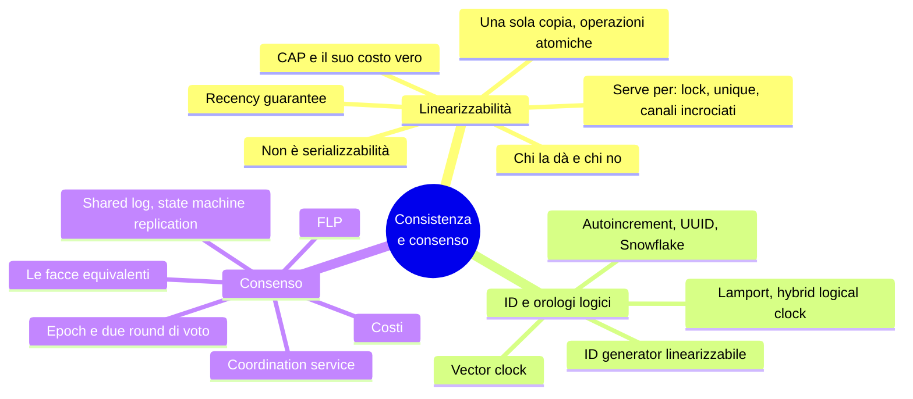
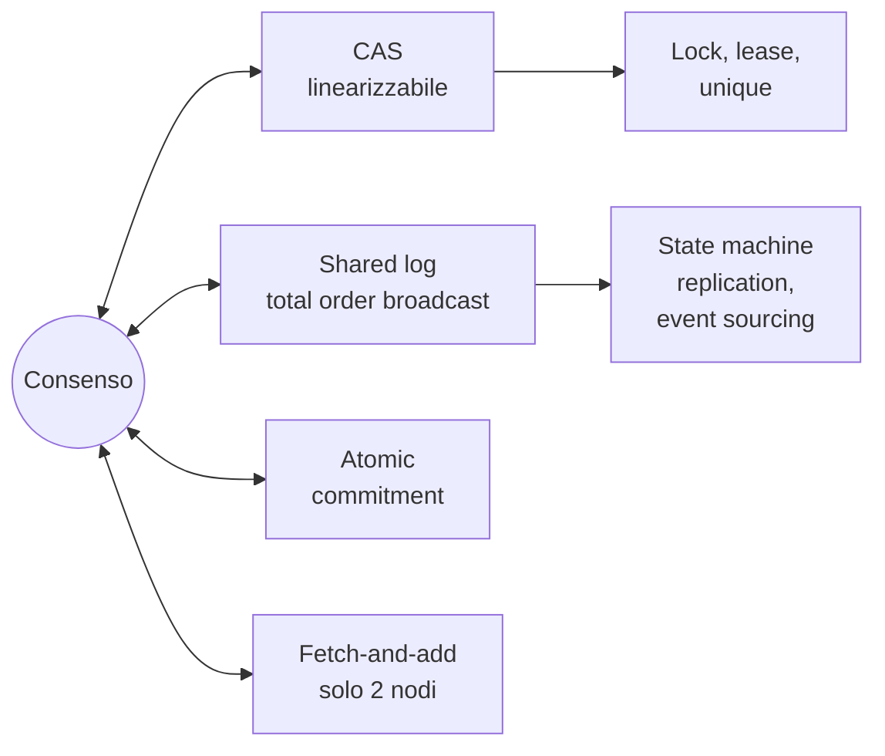
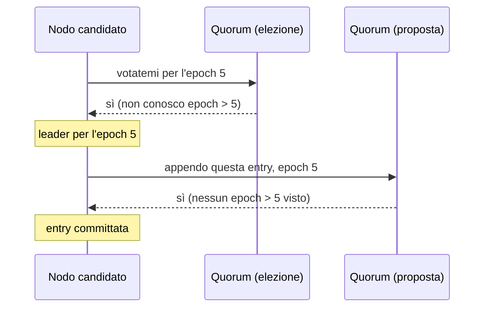

# Capitolo 10 · Consistenza e consenso

> *Never go to sea with two chronometers; take one or three.* — Fred Brooks

**In una frase:** dopo i guai del capitolo 9, le soluzioni. Prima una definizione
precisa di "consistenza forte", la **linearizzabilità**; poi i generatori di ID e gli
orologi logici, che le si avvicinano senza raggiungerla; infine il **consenso**, che
la rende tollerante ai guasti, e la scoperta che CAS, lock, vincoli unique, log
condivisi e commit atomico sono tutti lo stesso problema.

**Pagine PDF:** 425-474 · **Densità:** alta ma concettuale, pochi dettagli
algoritmici. Il libro stesso avverte: per lavorare davvero sul consenso serve molta
più teoria.

---

## Mappa del capitolo

---

## 1. Linearizzabilità

Due filosofie per la replica: **eventual consistency**, dove la replica è visibile
all'applicazione che gestisce le incoerenze (multi-leader, leaderless), e **strong
consistency**, dove il sistema si comporta come un nodo solo. La seconda è più
semplice per chi sviluppa, costa in performance, e alcuni guasti che un sistema
eventual tollera qui causano outage. Offline: eventual inevitabile. Datacenter con
rete veloce: strong spesso sensata.

"Strong consistency" è vago. La definizione precisa è **linearizzabilità** (atomic,
immediate, external consistency): il sistema si comporta **come se esistesse una sola
copia dei dati e ogni operazione fosse atomica**. Appena una scrittura è completata,
tutti i lettori la vedono. È una **garanzia di recenza**.

L'esempio: Aaliyah ricarica e vede il risultato della partita, lo dice a Bryce, Bryce
ricarica e la sua richiesta va a una replica indietro: "partita in corso". Se avessero
ricaricato insieme nessuna sorpresa; ma Bryce ha iniziato la lettura **dopo** la fine
di quella di Aaliyah, e si aspetta un risultato almeno altrettanto recente.

### Cosa la rende tale

Un registro x, client che leggono e scrivono. Ogni richiesta è una barra dal momento
dell'invio al momento della risposta; non sai **quando** nel mezzo il DB l'ha
processata.

```mermaid
gantt
    dateFormat X
    axisFormat %s
    section C
    write x=1          :c1, 2, 6
    section A
    read → 0           :a1, 0, 1
    read → 0 oppure 1  :a2, 3, 4
    read → 1 (obbligo) :a3, 7, 8
    section B
    read → 0 oppure 1  :b1, 2, 5
```

- Una read finita **prima** dell'inizio della write deve dare il vecchio valore.
- Una read iniziata **dopo** la fine della write deve dare il nuovo.
- Una read **concorrente** con la write può dare l'uno o l'altro.

Ma non basta: altrimenti il valore potrebbe oscillare avanti e indietro durante la
scrittura. Serve un vincolo in più: esiste **un istante** fra inizio e fine della write
in cui il valore scatta atomicamente, e **dopo che una read qualsiasi ha visto il nuovo
valore, tutte le read successive devono vederlo**, anche se la write non è ancora
terminata e anche su altri client. Graficamente: segni un punto dentro ogni barra, li
unisci in sequenza, e la linea deve andare **sempre avanti nel tempo**, formando una
storia valida del registro. Si può verificare a posteriori registrando tutti i
timing, ma è costoso. Aggiungendo il CAS il modello non assume isolamento: un altro
client può cambiare il valore in qualsiasi momento, e il CAS serve a rilevarlo.

La linearizzabilità **include** read-after-write, monotonic reads e consistent
prefix: è il modello più forte di uso comune.

### Non è serializzabilità

| Serializzabilità | Linearizzabilità |
|---|---|
| Livello di **isolamento** delle transazioni su **più oggetti** | Garanzia su letture e scritture di **un registro** |
| Risultato come se in **qualche** ordine seriale, anche diverso da quello reale | **Recenza**: se A finisce prima che B inizi, B vede uno stato almeno nuovo quanto A |
| Ammette letture stantie | Non raggruppa in transazioni: non previene il write skew |

Insieme si chiamano **strict serializability** (strong-1SR). I DB single-node di solito
la danno; CockroachDB dà serializzabilità con qualche garanzia di recenza ma non
strict, Spanner e FoundationDB sì. Isolamento e modello di consistenza si scelgono
quasi indipendentemente.

### Quando serve davvero

- **Lock ed elezione del leader.** Un lease deve essere linearizzabile: due nodi non
  possono ottenerlo insieme. ZooKeeper ed etcd lo fanno con il consenso (ZooKeeper
  ha scritture linearizzabili ma letture potenzialmente stantie; etcd 3 anche letture).
  Oracle RAC usa lock per pagina di disco con una rete dedicata.
- **Vincoli di unicità.** Username, path di file, saldo mai negativo, stock, posto a
  sedere: serve **un solo valore aggiornato su cui tutti concordano**. È un lock, è un
  CAS. Se il vincolo è lasco (overbooking con compensazione) non serve; foreign key e
  vincoli su attributi si fanno senza.
- **Canali di comunicazione incrociati.** Il web server scrive un video sul file
  storage e mette un messaggio in coda per il transcoder. Se la coda è **più veloce
  della replica interna dello storage**, il transcoder legge un file vecchio o
  inesistente e i due video restano incoerenti per sempre. Due canali, una race: come
  la voce di Aaliyah. Stesso problema con push notification e fetch da una replica
  indietro. Alternative esistono se controlli il secondo canale, ma sono più complesse.

### Chi la implementa

| Replica | Linearizzabile? | Perché |
|---|---|---|
| Single-leader | Potenzialmente | Se tutto passa dal leader **e sai chi è**. Un leader deposto che continua a servire la viola; failover asincrono perde scritture confermate |
| Consenso | Probabilmente | Single-leader con elezione sicura. Ma una read su un nodo che non verifica di essere ancora leader può essere stantia |
| Multi-leader | No | Scritture concorrenti su più nodi, conflitti |
| Leaderless | Probabilmente no | Anche con quorum |

**Il quorum non basta.** n = 3, w = 3, r = 2. Una write porta x da 0 a 1 e arriva alle
repliche in tempi diversi. A legge da due repliche e vede 1 (e 0); B inizia **dopo** la
fine di A, legge da altre due repliche e vede 0 e 0. Condizione w + r > n rispettata,
esecuzione non linearizzabile. Rimedio: **read repair sincrono** prima di rispondere e
una read del timestamp massimo prima di ogni write. Riak non lo fa per performance;
Cassandra aspetta il read repair ma perde la linearizzabilità con i clock fisici. E
comunque così si ottengono solo read e write: un **CAS linearizzabile richiede il
consenso**.

### Il costo

Due regioni, rete interrotta fra loro. Multi-leader: ciascuna continua, le scritture si
scambiano dopo. Single-leader: i client della regione senza leader non possono né
scrivere né fare letture linearizzabili, solo letture stantie. Qualsiasi sistema
linearizzabile ha questo problema, su qualsiasi rete inaffidabile.

**CAP.** Se richiedi linearizzabilità, le repliche isolate devono aspettare o
rispondere errore: **CP**. Se non la richiedi, ogni replica può continuare: **AP**.
Brewer 2000, ma noto dagli anni '70. Ha avuto il merito di aprire lo spazio di
progetto e innescare il NoSQL. Come teorema è strettissimo: un solo modello (la
linearizzabilità), un solo guasto (le partizioni, meno dell'8% degli incidenti in
Google), niente su ritardi e nodi morti. PACELC aggiunge: senza partizione, scegli fra
**latenza** e consistenza. "Pick two of three" è fuorviante: le partizioni **non si
scelgono**, succedono; a rete sana hai entrambe, a rete rotta scegli. La definizione
CAP di disponibilità non coincide con quella comune; molti sistemi non sono né CP né
AP. Oggi è superato da risultati più precisi: **non soffermarcisi**.

**Il costo vero è la latenza.** Nemmeno la RAM di una CPU multi-core è
linearizzabile: ogni core ha cache e store buffer, scritture asincrone verso la
memoria. Non per tolleranza ai guasti, per **performance**. Lo stesso vale per i DB
che rinunciano alla linearizzabilità. Attiya e Welch: il response time di un sistema
linearizzabile è almeno proporzionale all'**incertezza dei ritardi di rete**. Non esiste
un algoritmo più veloce; i modelli più deboli sì.

---

## 2. Generatori di ID e orologi logici

Un autoincrement su un nodo è linearizzabile (fetch-and-add atomico): se il post di
Aaliyah finisce prima che inizi quello di Bryce, l'ID di Bryce è maggiore, e la chat
ha senso. Ma: single point of failure, lento da un'altra regione, collo di bottiglia.

| Alternativa | Come | Ordine? |
|---|---|---|
| **Shardata** | Pari e dispari, o bit di shard nell'ID | Perso: 16 e 17 da nodi diversi non dicono chi è primo |
| **Blocchi preallocati** | Il nodo A prende 1-1.000, B 1.001-2.000 | Perso: un messaggio tardivo può avere un ID basso |
| **UUID v4** | Numero casuale di 128 bit, nessuna comunicazione | Casuale |
| **Timestamp reso unico** | Clock nei bit alti, shard e sequenza o random nei bassi: UUID v7, Snowflake di X, ULID, ObjectID di MongoDB | **Approssimato**: un clock avanti o indietro inverte l'ordine, e un clock non monotono lo fa anche su un nodo solo |

Tutti unici, nessuno linearizzabile.

### Lamport clock

Un **orologio logico** conta eventi, non secondi. Requisiti: timestamp compatti e
unici, totalmente ordinati, **coerenti con la causalità** (se A happens-before B,
ts(A) < ts(B)). Lamport, 1978, fra i paper più citati del campo.

Ogni nodo ha un ID e un contatore. Il timestamp è la coppia **(contatore, ID nodo)**.
Quando genera un timestamp il nodo incrementa il contatore; quando **vede** un
timestamp altrui con contatore maggiore, alza il proprio a quel valore. Confronto:
prima il contatore, poi l'ID. Aaliyah e Caleb postano senza vedersi: (1, Aaliyah) e
(1, Caleb). Bryce li riceve, sale a 1, risponde con (2, Bryce). Ordine totale coerente
con la causalità, **ma non linearizzabile**: non dice se un valore è aggiornato.

Limiti: nessun legame con il tempo fisico (non puoi cercare "i messaggi di ieri"), e
due nodi che non comunicano mai hanno contatori scollegati.

**Hybrid logical clock**: conta microsecondi come un clock fisico, ma si allinea in
avanti quando vede un timestamp altrui maggiore e si incrementa a ogni generazione,
quindi è **monotono anche se il clock fisico salta indietro**. Resta leggermente avanti
rispetto al clock fisico, di poco. Serve solo NTP approssimativo. CockroachDB.

Lamport e HLC sono ottimi come **txid per la snapshot isolation**: lo snapshot
rispetta la causalità. Ma ordinano i concorrenti arbitrariamente: guardando due
timestamp non sai se erano concorrenti. Per saperlo servono i **vector clock**, un
contatore per nodo, molto più grandi.

### Un ID generator linearizzabile

Perché conta: l'utente A mette il profilo privato dal portatile, poi carica una foto
dal telefono. Account e foto stanno in due DB con HLC. Il DB delle foto non ha mai
letto quello degli account, il suo contatore è indietro, e la foto riceve un timestamp
**minore** del cambio di permessi. Un osservatore con snapshot fra i due timestamp vede
l'account ancora pubblico e la foto. Un ID generator linearizzabile lo impedisce.

Implementazione: **un nodo solo** che incrementa, persiste e replica (single-leader).
TiDB lo chiama *timestamp oracle*, da Percolator. Ottimizzazione: persisti e replica
un **batch** di ID per volta; al crash ne salti alcuni, mai duplicati né fuori ordine.
Non si sharda e non si distribuisce fra regioni: tutte le richieste vanno in una
regione, ma il lavoro è così semplice che un nodo regge molto. L'alternativa è
Spanner: aspettare l'intervallo di incertezza del clock, nessuna comunicazione, anche
fra regioni, al prezzo dell'hardware.

### Non basta per i vincoli

Con un clock linearizzabile puoi dare timestamp a chi vuole lo stesso username e far
vincere il più basso: nessuna richiesta futura ne avrà uno minore. Ma **come fa un
nodo a sapere di avere il più basso**? Deve sentire **tutti** gli altri, e se uno è
morto o irraggiungibile tutto si ferma. Non è tolleranza ai guasti. Serve il consenso.

---

## 3. Consenso

Tre cose facili su un nodo e difficili con tolleranza ai guasti: failover senza split
brain, un contatore atomico che sopravvive al crash, un CAS tollerante ai guasti. Sono
tutte istanze dello stesso problema: **far concordare più nodi su un valore**.
Algoritmi: Viewstamped Replication, Paxos, Raft, Zab. Tutti nel modello non
bizantino.

**FLP**: nessun algoritmo deterministico garantisce di raggiungere il consenso se un
nodo può crashare. Ma vale nel modello **asincrono puro**, senza clock né timeout. Con
timeout per sospettare i crash (anche sbagliando) o con numeri casuali, il consenso è
risolvibile. FLP dice che non puoi garantire la **terminazione**, non che non puoi mai
decidere.

### Le molte facce

**Tutti equivalenti**: una soluzione per uno si converte in una soluzione per gli
altri. È l'intuizione profonda del capitolo.

**Single-value consensus.** Più nodi propongono, l'algoritmo ne decide uno: il nuovo
leader, chi prende il lease, chi compra l'ultimo posto. Quattro proprietà:

| Proprietà | Dice | Tipo |
|---|---|---|
| **Uniform agreement** | Nessuna coppia di nodi decide diversamente | Safety |
| **Integrity** | Deciso una volta, non si cambia idea | Safety |
| **Validity** | Il valore deciso era stato proposto (esclude "decidi sempre null") | Safety |
| **Termination** | Ogni nodo che non crasha prima o poi decide | **Liveness** |

Senza tolleranza ai guasti le prime tre sono banali: un dittatore. La difficoltà è
tutta nella terminazione, che richiede progresso anche se un nodo sparisce **per
sempre** (sepolto sotto nove metri di fango). Serve **almeno una maggioranza** di nodi
funzionanti; ma le proprietà di safety reggono **sempre**, anche se la maggioranza
cade: un outage ferma il sistema, non lo corrompe.

**CAS ⇔ consenso.** Con un CAS linearizzabile tollerante ai guasti: registro a null,
ognuno fa CAS(null, proposta), il valore finale è deciso. Con il consenso: le CAS con
lo stesso valore atteso propongono i loro nuovi valori, vince quello deciso, le altre
falliscono. Le conditional write degli object store sono CAS distribuiti.

**Shared log ⇔ consenso.** Un log dove più nodi chiedono di appendere e tutti leggono
le stesse entry nello stesso ordine. Proprietà: eventual append, consegna affidabile,
append-only, **agreement** (chi legge e ha letto lo stesso prefisso), validity. Si
implementa con **total order broadcast** (atomic broadcast). Dal log al consenso: la
prima entry è il valore deciso. Dal consenso al log: un'istanza di consenso per ogni
slot, chi perde riprova su uno slot successivo. Single-leader senza failover non
soddisfa la liveness.

**Fetch-and-add**: da CAS facile (leggi, CAS(v, v+1), riprova). Al contrario: il
contatore a 0, chi legge 0 vince; gli altri sanno di aver perso ma **non sanno chi ha
vinto**, e se il vincitore crasha prima di dirlo restano appesi. Con **esattamente due**
proponenti funziona (chi legge 1 decide il valore dell'altro): fetch-and-add ha
**consensus number 2**, CAS e shared log hanno ∞.

**Atomic commitment ⇔ consenso.** Differenza: nel consenso va bene qualsiasi valore
proposto, nel commit atomico **se uno vota abort si deve abortire**. Proprietà in più:
validity (commit solo se tutti hanno votato commit) e nontriviality (se tutti votano
commit e nessun timeout, si committa). Dal consenso: ogni nodo manda il voto a tutti;
chi riceve tutti commit propone "commit", chi riceve un abort o un timeout propone
"abort"; si fa ciò che il consenso decide. Dal commit atomico: ogni proponente apre
una transazione su un quorum e fa un CAS locale sul registro; se riesce vota commit.

### In pratica: lo shared log

Raft, Viewstamped Replication e Zab danno uno shared log; Paxos dà single-value, ma
si usa **Multi-Paxos**, che dà il log. Il log è lo strumento universale:

- **State machine replication**: ogni entry è una scrittura, ogni replica applica le
  stesse scritture nello stesso ordine con logica deterministica, tutte convergono. È
  l'event sourcing, è lo stream processing (cap. 12).
- **Transazioni serializzabili**: ogni entry è una stored procedure deterministica
  eseguita in ordine. Gli shard spesso hanno un log ciascuno, che limita le garanzie
  cross-shard.
- Single-value e CAS: il primo valore nel log. Molte istanze (un posto per entry): il
  primo con quel numero di posto. Fetch-and-add: somma delle entry. **Fencing token**:
  il numero di sequenza delle entry, lo `zxid` di ZooKeeper.

### Dal single-leader al consenso

Un dittatore risolve tutto finché non muore. Il failover manuale non soddisfa la
terminazione. Ma per eleggere un leader serve il consenso, e per il consenso serve un
leader: come si esce dal cerchio?

Gli algoritmi **non garantiscono un solo leader alla volta**. Garantiscono una cosa
più debole: un numero di **epoch** (ballot in Paxos, view in VR, term in Raft) e
**dentro ogni epoch il leader è unico**. Chi sospetta il leader morto avvia
un'elezione con un epoch maggiore; in caso di conflitto vince l'epoch più alto.

Prima di appendere, il leader raccoglie voti da un quorum: un nodo vota sì solo se
non conosce un epoch superiore. Due round di voto, e i quorum **devono sovrapporsi**:
almeno uno dei votanti della proposta ha partecipato all'ultima elezione riuscita. Se
la proposta passa senza rivelare epoch maggiori, il leader sa di essere ancora tale.
Ogni entry è replicata **sincronamente a un quorum** prima della conferma al client.

Sembra 2PC, ma no: nel consenso **chiunque** può avviare un'elezione e basta un
**quorum**; in 2PC solo il coordinatore chiede voti e servono **tutti** i sì.

Sottigliezze: il nuovo leader deve onorare le entry già appese dal vecchio. Raft
elegge solo chi ha il log almeno aggiornato quanto la maggioranza; Paxos elegge
chiunque ma lo obbliga ad aggiornarsi prima. Kafka offre **unclean leader election**:
più disponibile, ma la teoria non si applica più e si rischia la perdita di dati. Le
**letture linearizzabili** devono passare da un quorum come le scritture (etcd). Il
set di nodi è fisso, con estensioni per la riconfigurazione.

### Costi

"Single-leader replication fatta bene": failover automatico, nessuna scrittura
committata persa, niente split brain. Qualsiasi failover automatico senza consenso
provato è probabilmente insicuro. Ma:

- Serve una **maggioranza stretta**: 3 nodi per un guasto, 5 per due.
- Ogni operazione parla con un quorum: **aggiungere nodi rallenta**, non scala il throughput.
- In una partizione solo la parte di maggioranza avanza.
- Timeout difficili da tarare fra regioni: troppo lunghi, recovery lenta; troppo
  corti, elezioni continue.
- Raft con **un solo link inaffidabile** può rimbalzare la leadership all'infinito
  (risolto con il pre-vote). EPaxos è leaderless e più robusto.

### Coordination service

ZooKeeper, etcd, Consul: sembrano key-value store ma servono a **coordinare altri
sistemi** (Kubernetes su etcd, Spark e Flink su ZooKeeper). Pochi dati, in memoria,
replicati con consenso. Modellati su Chubby di Google. Offrono:

| Funzione | Come | Richiede consenso |
|---|---|---|
| Lock e lease | CAS atomico tollerante ai guasti | Sì |
| Fencing | ID monotono per entry: zxid, cversion, revision | Sì |
| Failure detection | Sessione con heartbeat; senza heartbeat oltre il timeout il lease cade (*ephemeral node*) | No |
| Notifiche di cambiamento | Sottoscrizione a chiavi: un nodo entra, un nodo cade | No |

Usi: configurazione (comodo se già c'è, ma basta un file con polling), **allocazione
del lavoro** (chi è leader, quale shard su quale nodo, con recovery automatico), e
soprattutto **esternalizzare il consenso**: tre o cinque nodi coordinano un sistema
di migliaia, dove il consenso su tutti sarebbe inefficiente. I dati cambiano in minuti
o ore, non migliaia di volte al secondo (per quello un DB, o BookKeeper).

**Service discovery**: comodo con failure detection e notifiche, ma spesso overkill:
non serve linearizzabilità, serve essere **disponibile e veloce**. Meglio cachare con
TTL e bypassare la cache al fallimento, come il DNS. ZooKeeper ha gli **observer**:
repliche che ricevono il log senza votare, letture stantie ma disponibili e scalabili.

---

## Domande di autoverifica

1. Definisci la linearizzabilità in una frase e spiega perché "read concorrenti
   possono dare vecchio o nuovo" non basta.
2. Bryce vede la partita in corso: quale condizione viola, e perché non la
   violerebbe se avesse ricaricato insieme ad Aaliyah?
3. Serializzabilità contro linearizzabilità: una ammette letture stantie, l'altra
   no. Quale, e cosa non previene l'altra?
4. Il transcoder legge un video vecchio: dov'è la race e cosa la elimina?
5. Mostra un'esecuzione con w + r > n che non è linearizzabile. Cosa servirebbe per
   sistemarla, e cosa comunque non si ottiene?
6. Perché la RAM multi-core non è linearizzabile, e cosa dice questo sul costo
   vero della linearizzabilità?
7. Riformula CAP in modo corretto e di' perché "pick two" è sbagliato.
8. Lamport clock: cosa garantisce e cosa no. Perché Aaliyah e Caleb hanno lo
   stesso contatore?
9. La foto imbarazzante: ricostruisci come un HLC la mostra a chi non dovrebbe.
10. Perché un clock linearizzabile non basta per assegnare uno username in modo
    tollerante ai guasti?
11. Elenca le quattro proprietà del consenso e classifica ciascuna come safety o liveness.
12. Spiega perché fetch-and-add ha consensus number 2 e CAS infinito.
13. Come esce il consenso dal cerchio "serve un leader per eleggere un leader"?
14. Due round di voto in Raft e due fasi in 2PC: tre differenze.
15. Cosa in un coordination service richiede consenso e cosa no? Perché la
    service discovery spesso non dovrebbe usarlo?

Flashcard in [`flashcards/ch10.yaml`](../data/flashcards/ch10.yaml).

## Rimandi

- Event sourcing e state machine replication: cap. 3 e 6
- Read-after-write, monotonic, consistent prefix, quorum, read repair: cap. 6
- Serializzabilità, write skew, stored procedure, 2PC: cap. 8
- Clock, intervallo di confidenza, Spanner, fencing, safety e liveness: cap. 9
- Shared log nello stream processing: cap. 12
- Evitare la linearizzabilità senza perdere correttezza: cap. 13
