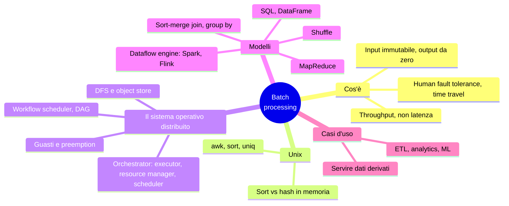
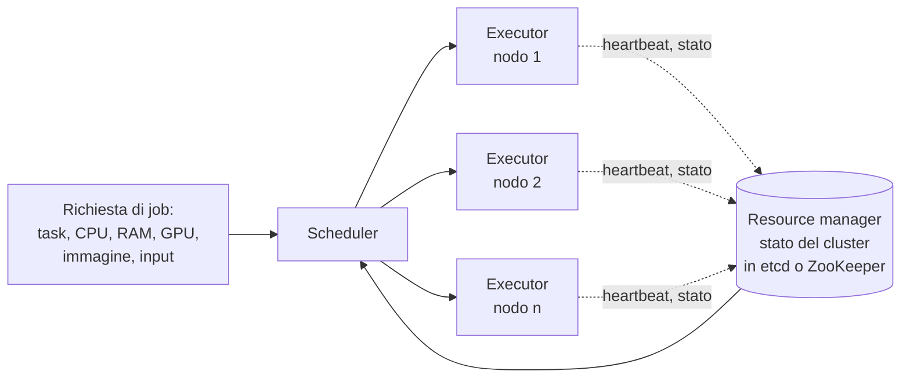
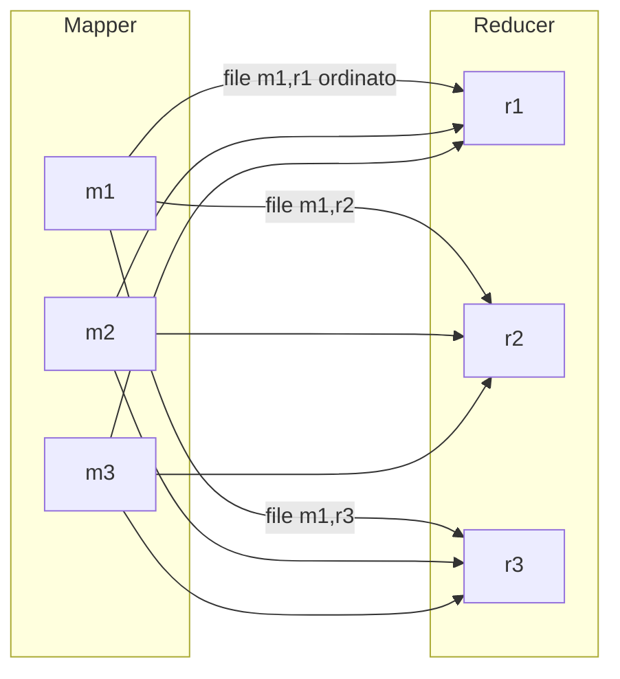

# Capitolo 11 · Batch processing

> *A system cannot be successful if it is too strongly influenced by a single person.*
> — Donald Knuth

**In una frase:** un job batch legge input immutabili e rigenera da zero l'output,
senza effetti collaterali: se sbagli, correggi e rilanci. Il capitolo parte da una
pipeline Unix su una macchina, la scala a un "sistema operativo distribuito"
(filesystem, scheduler, programmi), spiega MapReduce e i dataflow engine che lo hanno
sostituito, lo **shuffle** che sta sotto a join e aggregazioni, e chiude con i casi d'uso.

**Pagine PDF:** 475-510 · **Densità:** media. Capitolo descrittivo, pochi trabocchetti.
Il concetto da capire bene è lo shuffle; il resto è mappa del territorio.

---

## Mappa del capitolo



---

## 1. Cos'è un job batch

I sistemi **online** rispondono a richieste e si misurano in response time. I job
**batch** elaborano più dati di quanto stia in una richiesta (addestrare un modello,
trasformare dataset, analytics) e si misurano in **throughput**. L'input è read-only,
l'output è generato da zero a ogni esecuzione: è **derived data**.

Trattare l'input come immutabile ed evitare effetti collaterali dà:

- **Human fault tolerance**: un bug nel codice produce output sbagliato? Torni al
  codice precedente e rilanci, o tieni l'output vecchio in un'altra directory (*time
  travel* negli object store e nei table format). Un DB read/write non ha questa
  proprietà: il rollback del codice non ripara i dati.
- **Minore irreversibilità**, quindi sviluppo più rapido.
- Gli stessi file alimentano job diversi, inclusi job di monitoraggio che confrontano
  l'output con l'esecuzione precedente.
- Uso efficiente delle risorse rispetto a far fare batch a un DB OLTP.

Limiti: l'output è utilizzabile solo a job finito, e **un byte cambiato nell'input
rielabora tutto**. Job di minuti, ore o giorni, spesso schedulati. MapReduce (Google
2004) ha influenzato tutto ma è **obsoleto** e non più usato in Google: oggi Spark,
Flink, o i query engine dei warehouse. Gli scheduler Hadoop (Oozie) sono stati
rimpiazzati da Airflow, Dagster, Prefect; lo storage da HDFS a S3; BigQuery e
Snowflake sfumano il confine fra warehouse e batch.

---

## 2. Batch con gli strumenti Unix

Le cinque pagine più visitate da un log NGINX:

```bash
cat access.log | awk '{print $7}' | sort | uniq -c | sort -r -n | head -n 5
```

Estrai l'URL, **ordina** così che le ripetizioni siano adiacenti, `uniq -c` conta le
righe adiacenti uguali, riordina per conteggio, prendi cinque. Gigabyte in secondi, e
cambiare l'analisi è cambiare un argomento di `awk`.

Lo stesso in Python: un dizionario URL → contatore. La differenza non è sintattica ma
di **flusso di esecuzione**:

| Hash in memoria (Python) | Sort (Unix) |
|---|---|
| Il working set è il numero di URL **distinti** | Nessun working set: lista ordinata con ripetizioni |
| Bene se sta in RAM, anche su un portatile | Se i dati superano la RAM, `sort` **spilla su disco** con il mergesort, accessi sequenziali, parallelo sui core |

È il principio dell'LSM-tree: segmenti ordinati in memoria, scritti e fusi. Il collo
di bottiglia diventa la lettura del file. Il limite degli strumenti Unix: una macchina.

---

## 3. Il sistema operativo distribuito

La macchina che esegue la pipeline ha storage dietro un filesystem, uno **scheduler**
che assegna CPU ai processi, e programmi collegati da **pipe**. I framework batch
distribuiti hanno gli stessi tre componenti.

### Filesystem distribuiti e object store

Un filesystem locale ha driver di blocco, page cache, uno strato filesystem (ext4,
XFS) che spezza i file in blocchi e tiene i metadati, e il VFS come API comune. Un
**DFS** replica la struttura: file spezzati in blocchi **molto più grandi** (128 MB in
HDFS, 4 MB negli object store contro 4 KB di ext4: meno metadati, meno seek) sparsi su
molte macchine; **data node** (DataNode in HDFS) che espongono i blocchi via rete con
la page cache del loro sistema operativo; un **servizio di metadati** (NameNode); un
**protocollo** pluggable come VFS, oggi quasi sempre l'API di S3 (MinIO, R2, B2) o NFS.
Shared-nothing su hardware commodity, quindi blocchi **replicati** o con erasure
coding (Reed-Solomon): come RAID ma via rete, e lo scheduler può eseguire un task su
un nodo che ha già i dati.

| | DFS | Object store |
|---|---|---|
| Modello | File con `open`, `seek`, link, lock, rename atomico | Oggetti **immutabili** con `get` e `put`, riscrittura intera, niente handle |
| Directory | Vere | Convenzione nel nome della chiave; il list per prefisso è ricorsivo; directory vuote impossibili; rename = copia e cancella per ogni oggetto |
| Dimensioni | MB-GB, letture rare e grandi | Idem, ma S3 Express si avvicina ai key-value store |
| Compute | Task eseguibile **dove stanno i dati** | Storage e compute separati: più banda, ma scalano indipendentemente |

Attenzione: JuiceFS e Ceph espongono entrambe le API, ma performance e consistenza
sono diverse.

### Orchestrazione dei job

Sul singolo nodo il kernel alloca memoria, schedula istruzioni, isola i processi. In
distribuito lo fa un **orchestrator** (Kubernetes, YARN) con tre componenti:



- **Task executor** su ogni nodo (kubelet, NodeManager): scarica il codice, lancia il
  task, lo monitora, manda heartbeat, isola con cgroups.
- **Resource manager**: vista globale di hardware e stato dei nodi; centralizzato,
  quindi potenziale collo di bottiglia; stato in etcd o ZooKeeper.
- **Scheduler**: decide quali task su quali nodi. Sotto-scheduler applicativi
  (ApplicationMaster in YARN, operator in Kubernetes) per esigenze specifiche.

**Allocare le risorse** è il lavoro difficile: 160 core, due job da 100 ciascuno.
Dividere 80 e 80? Eseguirne uno intero e poi l'altro (**gang scheduling**, rischio
di nodi inattivi e deadlock)? Aspettare 100 core liberi (**starvation**)? **Preemptare**
task del primo (lavoro perso)? Con milioni di richieste il problema è **NP-hard**: si
usano euristiche (FIFO, dominant resource fairness, priorità, quote, bin-packing).

### Workflow di job

L'output di un job è l'input di altri: un **DAG** di job (qui "workflow" non è la
durable execution del cap. 5, che fa RPC su poco dato). Serve quando più team leggono
lo stesso output, quando si cambia strumento (Spark su HDFS, poi Trino, poi S3), o
quando due stadi shardano per chiavi diverse. Nella pipe Unix i dati passano in un
buffer in memoria con **backpressure**; Spark e Flink possono fare lo stesso fra task,
ma di solito un job **scrive sul DFS** e il successivo legge, così sono disaccoppiati
nel tempo. Lo scheduler dell'orchestrator lavora per job; le dipendenze fra job le
gestisce un **workflow scheduler** (Airflow, Dagster, Prefect), indispensabile con
workflow da 50-100 job e team che leggono gli output altrui.

### Guasti

Job lunghi con molti task: almeno un task fallirà, per hardware, rete, o
**preemption** voluta dallo scheduler. Le **spot instance** sono VM a basso prezzo
uccidibili in qualsiasi momento: perfette per il batch, che non ha fretta, ma le
preemption sono più frequenti dei guasti hardware. Siccome l'output si rigenera da
zero, un task fallito si cancella e si rilancia altrove; MapReduce tiene i task
indipendenti per ritentare **un task alla volta**, non il job. L'intermedio è il
punto delicato: MapReduce lo scrive sempre sul DFS (sicuro, costoso), Spark lo tiene
in memoria con spill su disco locale e ricorda **come l'ha calcolato** per ricomputarlo,
Flink fa **checkpoint** periodici.

---

## 4. Modelli di elaborazione

### MapReduce

Esattamente la pipeline del log:

1. Leggi i file e spezzali in record (una riga per `\n`; in Hadoop file Parquet o
   Avro su HDFS o S3).
2. Il **mapper** estrae chiave e valore da ogni record, senza stato fra record, zero o
   più coppie per record. È `awk '{print $7}'`.
3. **Ordina** per chiave. Implicito: non lo scrivi.
4. Il **reducer** itera sulle coppie ordinate: le chiavi uguali sono adiacenti, quindi
   le combini senza stato in memoria. È `uniq -c`.

Il secondo `sort` per conteggio è un **secondo job**. Mapper: prepara i dati per
l'ordinamento. Reducer: elabora i dati ordinati. Viene dalla programmazione funzionale
(map e fold del Lisp): senza stato mutabile ogni chiamata dipende solo dal suo input,
quindi il framework parallelizza e **ritenta** liberamente. Ma le API grezze sono
laboriose (i join da scrivere a mano) e l'I/O su file impedisce il **pipelining**.

### Dataflow engine

Spark e Flink trattano **l'intero workflow come un job**, modellano esplicitamente il
flusso fra stadi (da qui *dataflow*), offrono operatori relazionali (join, group by,
filter, aggregate) oltre alla funzione per record, e non impongono l'alternanza
map/reduce. Vantaggi:

- Ordini solo dove serve, non fra ogni map e reduce.
- Operatori consecutivi che non cambiano lo sharding (map, filter) si **fondono** in un task.
- Dipendenze dichiarate: lo scheduler mette consumatore e produttore sulla stessa
  macchina e scambia via memoria.
- Stato intermedio in memoria o disco locale, non replicato sul DFS.
- Un operatore parte **appena il suo input è pronto**, senza aspettare lo stadio precedente.
- Processi riusati, niente JVM nuova per task.

Stesse computazioni, molto più veloci.

### Shuffle

Ordinare petabyte su molte macchine: input e output entrambi shardati. L'algoritmo si
chiama **shuffle**, e non ha nulla di casuale: produce un ordine.



- Un map task per shard di input; il numero di reducer lo scegli tu.
- Ogni mapper scrive **un file locale per ogni reducer**, scegliendo il file con
  l'**hash della chiave** (come lo sharding per hash): chiavi uguali finiscono nello
  stesso reducer anche da mapper diversi.
- Dentro ogni file le coppie sono **ordinate**, con la tecnica dell'LSM: in memoria,
  segmenti, merge.
- A mapper finito, ogni reducer **copia** la sua fetta da tutti i mapper e le fonde
  mergesort-style: chiavi uguali adiacenti. Il reducer è chiamato una volta per
  chiave con un iteratore sui valori.
- L'output del reducer è un file per reduce task: gli shard dell'output, sul DFS.

BigQuery e simili tengono i dati in memoria e usano **servizi di sorting esterni**
replicati.

### Join e group by

Un log di eventi (fact table) e una tabella utenti (dimension), entrambi troppo
grandi per una macchina: "le pagine piacciono più ai giovani o agli anziani?". Lo
shuffle porta tutte le coppie con la stessa chiave allo stesso reducer: un mapper
emette (user_id, URL) dagli eventi, un altro (user_id, data di nascita) dagli utenti.
Con il **secondary sort** il reducer vede prima il record utente e poi gli eventi in
ordine di tempo: tiene **un solo record in memoria**, nessuna richiesta di rete.
È il **sort-merge join**. Il job successivo shuffla per URL e conta per fascia d'età:
**group by** e aggregazione.

### Linguaggi

Con l'infrastruttura risolta (petabyte su 10.000 macchine) l'attenzione è passata al
modello di programmazione. **SQL** è la lingua franca: meno codice, uso interattivo da
analisti e product manager, e il query engine (Hive, Trino, Spark, Flink) **ottimizza**
con un cost-based optimizer che sceglie l'algoritmo di join e ne riordina l'esecuzione.
Nicchie: Pig (pipeline passo-passo), Morel, jq, Gremlin per i grafi.

Batch e warehouse **convergono**: i framework batch hanno SQL, Parquet e motori
ottimizzati; i warehouse cloud hanno scheduling, fault tolerance, shuffle, DFS, e
anche DataFrame (BigQuery, Snowpark). Non tutto è SQL: PageRank, ML, dati
multimodali. E i warehouse sono deboli nel calcolo riga per riga e **costano di più**:
spesso conviene Spark o Flink. La scelta è di costo, comodità e disponibilità.

**DataFrame distribuiti** (Spark, Flink, Daft) per i data scientist: stessa API di
Pandas ma, a differenza dei locali, **non indicizzati né ordinati**, e Spark traduce
le chiamate in un piano ottimizzato invece di eseguirle subito. Daft esegue le
operazioni piccole sul client e le grandi sul server, con Arrow come modello comune.

---

## 5. Casi d'uso

Ovunque ci siano molti dati e la freschezza non conti: riconciliazione contabile e
di inventario, previsione della domanda, addestramento dei recommender, e quasi tutto
il sistema bancario americano.

- **ETL**: trasformazioni "imbarazzantemente parallele", workflow scheduler con retry
  e operatori pronti per decine di sistemi, debug facile (ispezioni il file fallito,
  correggi, rilanci). Data mesh, data contract e data fabric permettono a ogni team
  di pubblicare i propri dati. Pipeline e query analitiche girano ormai sullo stesso
  motore (SparkSQL, Trino, DuckDB).
- **Analytics**: SQL su un query engine che legge dal DFS o object store, con table
  format e catalogo: il **data lakehouse**. Due stili: **pre-aggregazione** schedulata
  in cubi e data mart, anche spinta a Druid o Pinot; e **query ad hoc** iterative,
  dove conta il tempo di risposta. Integrazione con Tableau, Power BI, Superset.
- **Machine learning**: feature engineering, training (input i dati, output i pesi),
  inferenza batch. MLlib, FlinkML. I grafi con il modello **bulk synchronous
  parallel** (Pregel: Giraph, GraphX, Gelly), un arco alla volta fino a convergenza.
  Per gli LLM: estrarre testo dall'HTML, deduplicare, tokenizzare ed embeddare; Ray,
  Kubeflow, Flyte. I notebook (Jupyter, Hex) usano DataFrame e SQL sopra tutto questo.

### Servire i dati derivati

Raccomandazioni, report, feature: calcolati in batch, serviti da un DB, un key-value
store, un motore di ricerca. Come li porti lì? **Non** scrivendo nel DB di produzione
record per record dal job: una richiesta di rete per record è ordini di grandezza più
lenta, molti task in parallelo **sommergono** il DB e degradano le query, e gli effetti
collaterali esterni rompono la garanzia **tutto-o-niente** del job (un task ritentato
duplica l'output).

Meglio spingere l'output in uno **stream** (topic Kafka), da cui Elasticsearch,
Pinot, Druid, Venice, ClickHouse ingeriscono nativamente: scritture sequenziali,
buffer che permette ai consumatori di regolare il ritmo, un output per molti
consumatori, e una zona demilitarizzata fra rete batch e rete di produzione. Resta il
tutto-o-niente: il job deve **notificare la fine**, e i consumatori tengono i dati
invisibili fino ad allora, come una transazione non committata.

Alternativa per il bootstrap: costruire **un database nuovo dentro il job** e fare
bulk import dei file (Lightning di TiDB, import Hadoop di Pinot, SST in RocksDB).
Velocissimo e con switch atomico fra versioni, ma difficile da aggiornare
incrementalmente; Venice offre store ibridi.

---

## Domande di autoverifica

1. Cosa rende un job batch "human fault tolerant" e perché un DB read/write non lo è?
2. Hash in memoria contro sort: quando vince ciascuno, e che legame ha il sort con l'LSM-tree?
3. Elenca i tre componenti di un orchestrator e il ruolo di ciascuno.
4. Due job da 100 core su 160: descrivi tre strategie di scheduling e il difetto di ciascuna.
5. Perché il batch è adatto alle spot instance, e cosa cambia nella gestione dei guasti?
6. MapReduce, Spark, Flink: dove tiene ciascuno lo stato intermedio e come lo recupera?
7. Cos'è lo shuffle, perché il nome inganna, e come garantisce che chiavi uguali
   finiscano nello stesso reducer?
8. Descrivi un sort-merge join e spiega perché il reducer non fa richieste di rete.
9. Elenca quattro vantaggi dei dataflow engine su MapReduce.
10. Perché i DataFrame distribuiti sorprendono chi viene da Pandas?
11. Tre motivi per non scrivere nel DB di produzione da dentro un job batch. Qual è
    l'alternativa e cosa non risolve da sola?

Flashcard in [`flashcards/ch11.yaml`](../data/flashcards/ch11.yaml).

## Rimandi

- Derived data, ETL, data warehouse: cap. 1
- LSM-tree, sort su disco, Parquet, column store, data cube: cap. 4
- Avro, durable execution: cap. 5
- Sharding per hash: cap. 7
- Read committed: cap. 8
- etcd e ZooKeeper: cap. 10
- Stream processing, Kafka: cap. 12
