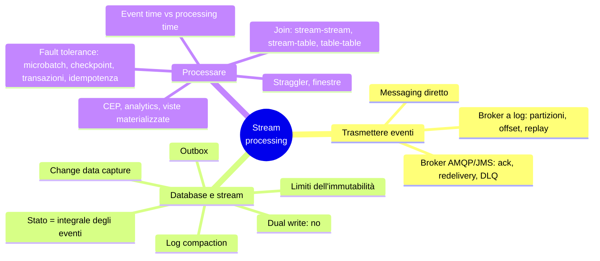
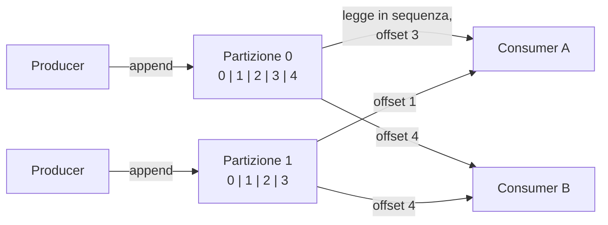
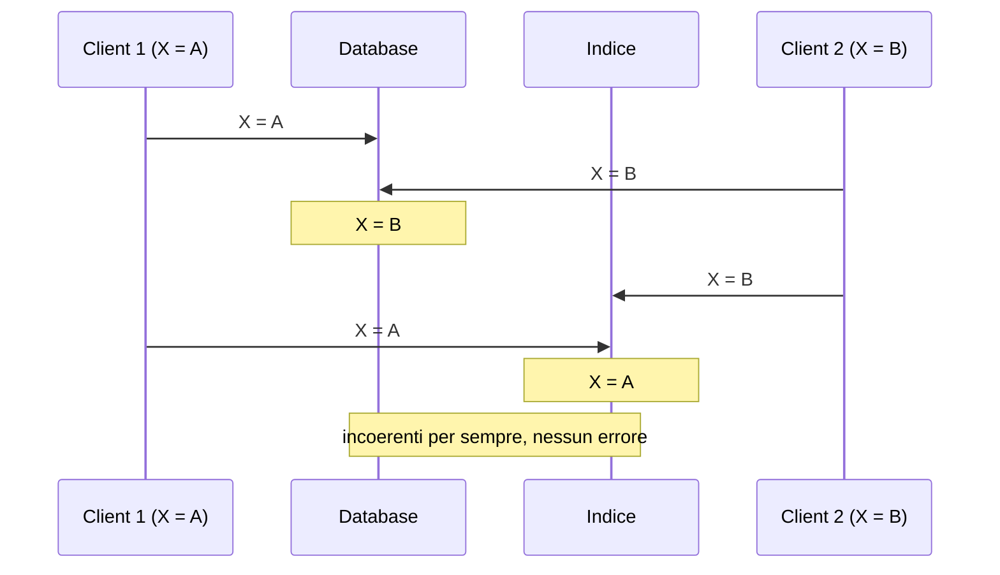

# Capitolo 12 · Stream processing

> *A complex system that works is invariably found to have evolved from a simple
> system that works.* — John Gall

**In una frase:** il batch assume un input finito; lo stream processing lavora su
dati **illimitati** che arrivano nel tempo e processa ogni evento appena accade. Il
capitolo spiega come si trasportano gli eventi (broker classici contro broker a log),
scopre che un database è esso stesso uno stream (CDC, event sourcing, "lo stato è
l'integrale del changelog"), e poi affronta ciò che il batch non ha: il tempo, le
finestre, i join su dati senza fine, la fault tolerance senza mai "finire".

**Pagine PDF:** 511-562 · **Densità:** alta. Insieme al 6 e all'8, uno dei tre
capitoli che vanno capiti davvero. Il concetto di log-based broker e il legame
database/stream sono la chiave per il capitolo 13.

---

## Mappa del capitolo

---

## 1. Trasmettere stream di eventi

Un **evento** è un record: piccolo, autocontenuto, immutabile, con un timestamp di
quando è accaduto. Un **producer** lo genera una volta, più **consumer** lo
processano; gli eventi correlati stanno in un **topic**. In teoria basterebbero un
file o un DB con polling, ma più spesso interroghi, più richieste tornano vuote:
meglio essere **notificati**. I trigger dei DB sono limitati; da qui i sistemi di
messaggistica.

Due domande per classificarli: **cosa succede se i producer sono più veloci dei
consumer** (scartare, accodare, o **backpressure** come le pipe Unix e TCP; e se
accoda, cosa succede quando la coda non sta in memoria?) e **cosa succede se un nodo
crasha** (si perdono messaggi? la durabilità costa). Perdere qualche lettura di un
sensore va bene; perdere eventi contati no, e una perdita massiccia può passare
inosservata.

### Messaging diretto

UDP multicast per i feed di borsa, ZeroMQ e nanomsg senza broker, StatsD su UDP
(metriche approssimate), **webhook** (una richiesta HTTP a un URL di callback).
Funzionano nel loro ambito ma assumono tutti online: un consumer offline perde
messaggi, e un producer che crasha perde il buffer dei retry.

### Broker classici (AMQP/JMS)

Un **message broker** è un database ottimizzato per flussi di messaggi: i client
vanno e vengono, la durabilità è sua, la coda di solito è illimitata. I consumer
sono **asincroni**: il producer aspetta solo l'ack del broker.

Differenze da un DB: cancella i messaggi dopo la consegna (non per storage a lungo
termine), assume code **corte** (code lunghe degradano il throughput), offre
sottoscrizioni per pattern invece di query, e **notifica** i cambiamenti invece di
dare snapshot. RabbitMQ, ActiveMQ, IBM MQ, Azure Service Bus, Pub/Sub.

Con più consumer: **load balancing** (ogni messaggio a un consumer, per
parallelizzare lavoro costoso) o **fan-out** (ogni messaggio a tutti). I consumer
group di Kafka li combinano.

**Ack e redelivery.** Il consumer dice al broker quando ha finito; senza ack il
broker riconsegna a un altro. Se l'ack si è perso dopo l'elaborazione, il messaggio
viene processato **due volte** (serve atomic commit o idempotenza). E load balancing
più redelivery **riordina**: il consumer 2 crasha su m3, m3 va al consumer 1 dopo m4.
Innocuo se i messaggi sono indipendenti, grave se c'è causalità. Un messaggio
malformato che fa crashare ogni consumer blocca tutto in un loop: la **dead letter
queue** lo sposta altrove, con monitoraggio, e un operatore decide.

### Broker a log

I broker classici hanno una mentalità **transitoria**: ricevere un messaggio è
**distruttivo**, non puoi rieseguire un consumer e ottenere lo stesso risultato, un
consumer nuovo vede solo i messaggi dopo la sua registrazione. Database e filesystem
sono l'opposto: tutto resta finché non lo cancelli. L'ibrido è il **log-based
broker**: storage durevole del DB più notifica a bassa latenza del messaging.

Un log append-only: il producer appende, il consumer legge in sequenza e in fondo
aspetta la notifica (come `tail -f`). Per scalare si **sharda**: un topic è un gruppo
di **partizioni**, ognuna un log indipendente su una macchina diversa, con
**offset** crescenti. Ordine totale **dentro** una partizione, nessuno fra
partizioni. Kafka, Kinesis; Pub/Sub è simile sotto ma espone un'API JMS. Milioni di
messaggi al secondo con sharding, tolleranza ai guasti con replica.

Rispetto ai classici:

- **Fan-out** gratis: leggere non cancella.
- **Load balancing** a grana grossa: partizioni intere assegnate ai nodi del consumer
  group, lette single-thread. Quindi al massimo tanti consumer quante partizioni, e un
  messaggio lento blocca la partizione (**head-of-line blocking**). Parallelismo = più
  partizioni.
- Regola: messaggi costosi, parallelismo per messaggio, ordine irrilevante → AMQP/JMS.
  Throughput alto, messaggi veloci, **ordine importante** → log. Il confine sfuma:
  Kafka ora ha consumer group stile JMS.
- Ordine solo nella partizione: eventi che devono essere ordinati (quelli di un
  utente) vanno nella stessa partizione, con l'**user ID come partition key**.

**Offset**: il broker non traccia ack per messaggio, registra periodicamente l'offset
del consumer. Meno contabilità, batching, pipelining. È il **log sequence number**
della replica: il broker è il leader, il consumer il follower. Se il consumer crasha,
riparte dall'ultimo offset registrato e **rivede** qualche messaggio.

**Spazio**: il log si divide in segmenti, i vecchi si cancellano o archiviano: un
**ring buffer su disco**, ma grande. Un disco da 20 TB a 250 MB/s si riempie in 22
ore al massimo; in pratica giorni o settimane. Molti broker ora usano **object
storage** a livelli (Kafka, Redpanda) o del tutto (WarpStream, Bufstream), anche come
tabelle Iceberg leggibili dal batch senza copie.

**Consumer lenti**: il log è un buffer grande ma fisso. Si monitora il ritardo dalla
testa e si allerta: c'è tempo per intervenire. Un consumer troppo indietro perde
messaggi ma **non disturba gli altri**: puoi consumare un log di produzione per
debug senza rischi, e un consumer spento lascia solo il suo offset. Con i broker
classici devi cancellare le code orfane per non esaurire la memoria.

**Replay**: consumare è read-only, l'unico effetto è l'offset, e l'offset è del
consumer. Riparti da ieri con codice nuovo e scrivi altrove. Questo rende il log
**simile al batch**: derived data separato dall'input da una trasformazione
ripetibile.

---

## 2. Database e stream

Il legame è fondamentale. Ogni scrittura in un DB è un evento. Il **replication log**
è uno stream di eventi di scrittura che i follower applicano. La state machine
replication è "stessi eventi, stesso ordine, stesso stato". L'event sourcing usa lo
stream come system of record, e un broker a log configurato per non cancellare è
perfetto.

### Il problema: tenere sincronizzati i sistemi

OLTP, cache, indice full-text, warehouse: ognuno con la sua copia. Dump periodici
(batch) o **dual write**: l'app scrive nel DB, poi nell'indice, poi invalida la cache.
Due difetti gravi:

Race senza rilevamento (servirebbero version vector), e **una write riesce e
l'altra fallisce** (atomic commit, costoso). Il DB ha un leader, l'indice ha un
leader, nessuno segue l'altro: è multi-leader. Servirebbe che l'indice fosse un
**follower del DB**.

### Change data capture

Il replication log è stato per decenni un dettaglio interno non documentato. **CDC**
osserva tutte le scritture di un DB e le estrae come stream replicabile altrove. Il
DB decide l'ordine, lo scrive nel log, l'indice lo applica nello stesso ordine: la
race sparisce. Ogni sistema derivato è un altro consumer. CDC rende un DB il
**leader** e tutti gli altri **follower**; un broker a log è il trasporto ideale perché
conserva l'ordine. Si implementa sul log logico (cap. 6) con sfide su schemi e update:
**Debezium** (connettori per MySQL, PostgreSQL, Oracle, SQL Server, Cassandra), Kafka
Connect, Maxwell, GoldenGate. Asincrono: un consumer lento non rallenta il DB, ma vale
tutto il replication lag.

**Snapshot iniziale**: il log non si tiene per sempre. Un indice nuovo serve una copia
intera, quindi uno **snapshot consistente legato a un offset** del log (Debezium usa
il watermarking DBLog di Netflix per snapshot incrementali).

**Log compaction**: l'alternativa allo snapshot. Come nell'LSM, si tiene solo
l'ultimo valore per chiave, le tombstone cancellano. Lo spazio dipende dal contenuto
**attuale** del DB, non dalle scritture storiche. Con CDC a chiave primaria dove ogni
update sostituisce il valore, un consumer nuovo parte dall'**offset 0 del topic
compattato** e ottiene una copia completa senza snapshot. Kafka lo supporta: il
broker diventa storage durevole.

Oggi i DB espongono change stream come interfaccia di prima classe (MySQL,
PostgreSQL, Datastream in Google Cloud). Anche Cassandra, ma senza una singola fonte
di verità espone i **segmenti di log grezzi per nodo** e chi consuma li fonde come un
quorum reader.

### CDC contro event sourcing

| CDC | Event sourcing |
|---|---|
| L'app usa il DB in modo **mutabile**; il log è estratto a basso livello | L'app è costruita su eventi **immutabili** a livello applicativo |
| Ordine garantito uguale a quello delle scritture | Lo store è append-only, update e delete scoraggiati |
| Si aggiunge a un DB esistente con cambi minimi | Cambiamento grande per un'app che non lo fa già |
| Un evento contiene la **versione intera** del record: compaction possibile | Un evento esprime un'**intenzione**: gli eventi successivi non sovrascrivono, serve tutta la storia, niente compaction. Snapshot dello stato solo come ottimizzazione |

**CDC e gli schemi.** In un'architettura a microservizi il DB è un dettaglio interno;
CDC usa lo schema del DB e lo trasforma in **API pubblica**: togli una colonna e rompi
i consumer, che ora sono servizi di produzione, non solo l'ETL. **Data contract** per
prevenire. Il **pattern outbox**: una tabella con schema proprio esposta al CDC al
posto del modello interno. Sembra un dual write ed è un dual write, ma **entrambe le
scritture stanno nella stessa transazione** sullo stesso DB. Costi: mantenere la
trasformazione, più scritture sul DB.

### Stato, stream e immutabilità

Lo stato corrente è il **risultato degli eventi** che lo hanno mutato: i posti
disponibili dalle prenotazioni, il saldo da dare e avere. Stato mutabile e log
immutabile sono **due facce della stessa medaglia**: lo stato è l'**integrale** dello
stream nel tempo, lo stream è la **derivata** dello stato. Gray e Reuter, 1992: "non
c'è bisogno fondamentale di tenere un database; il log contiene tutta l'informazione.
Il database si tiene solo per la performance delle letture." La compaction è il ponte
fra i due.

Vantaggi dell'immutabile: i contabili lo fanno da secoli (**ledger** append-only,
errori corretti con transazioni compensative, mai cancellati), diagnosi e recovery da
codice bacato, audit per il supporto clienti, e **più informazione dello stato**:
l'articolo messo e tolto dal carrello sparisce da un DB ma resta nel log per
l'analytics.

**Più viste dallo stesso log**: Druid ingerisce da Kafka, Kafka Connect esporta
ovunque. Una feature nuova = una vista nuova accanto alle vecchie, senza migrazione;
poi spegni la vecchia. La "fallacia" del design tradizionale: che i dati debbano
essere scritti nella forma in cui si interrogano. Con un log ottimizzato per la
scrittura e viste ottimizzate per la lettura, normalizzare o denormalizzare diventa
quasi irrilevante: la timeline social è una vista denormalizzata tenuta coerente dal
fan-out.

**Concorrenza**: il difetto del CQRS è che le viste sono asincrone (read-your-writes,
cap. 6); aggiornarle in sincrono richiederebbe transazioni distribuite. In cambio,
un'azione utente diventa **una sola scrittura**, l'append dell'evento, facile da
rendere atomica, e se log e stato sono shardati allo stesso modo un consumer
single-thread per shard non ha bisogno di controllo di concorrenza: il log ha
**eliminato il non determinismo** definendo un ordine seriale.

**Limiti**: con molti update su un dataset piccolo la storia esplode, e compaction e
GC diventano critici. E il GDPR chiede di **cancellare davvero**, non di appendere un
"consideralo cancellato": riscrivere la storia (*excision* in Datomic, *shunning* in
Fossil). Cancellare è difficile: copie ovunque, storage che scrive altrove invece di
sovrascrivere, backup immutabili apposta. **Crypto-shredding**: cifra ciò che potresti
dover cancellare, poi dimentica la chiave. Sposta il problema sulla gestione delle
chiavi e obbliga a decidere in anticipo la granularità. Cancellare è "rendere
difficile recuperare", non "impossibile".

---

## 3. Processare gli stream

Tre cose da fare con uno stream: scriverlo in un DB o indice, spingerlo a un umano
(alert, dashboard), o **processarlo in altri stream** attraverso **operatori** o job,
in pipeline acicliche. Sharding e parallelismo come nel batch. La differenza cruciale:
**lo stream non finisce**. Niente sort, quindi niente sort-merge join; e un job che
gira da anni non si riavvia da capo.

### Usi

- **Complex event processing**: cercare **pattern di eventi** come una regex cerca
  pattern di caratteri. Le query sono **permanenti** e i dati transitori, l'inverso di
  un DB. Frode, trading, manifattura. Esper, Apama, e SQL su stream in Flink.
- **Stream analytics**: aggregati e statistiche su finestre (rate, media mobile,
  confronto con la settimana scorsa). Algoritmi probabilistici (Bloom, HyperLogLog,
  stime di percentili) come **ottimizzazione** della memoria, non perché lo stream sia
  intrinsecamente approssimato. Storm, Spark Streaming, Flink, Samza, Beam, Kafka Streams.
- **Viste materializzate**: cache, indici, warehouse aggiornati dal changelog; lo
  stato di un'app event-sourced è una vista. Serve una finestra **dall'inizio del
  tempo**, che contrasta con i framework orientati alle finestre; Kafka Streams e
  ksqlDB sulla compaction. I DB rinfrescano le viste a batch (`REFRESH MATERIALIZED
  VIEW`): tutto ricalcolato, dati stantii. L'**incremental view maintenance**
  (Materialize, RisingWave, ClickHouse, Feldera) traduce la query in operatori
  incrementali e aggiorna solo ciò che cambia.
- **Ricerca su stream**: query salvate, documenti valutati contro di esse (media
  monitoring, alert immobiliari; il percolator di Elasticsearch). Si indicizzano le
  query oltre ai documenti.
- Gli **attori** non sono stream processing: gestiscono concorrenza, comunicazione
  effimera uno-a-uno, anche ciclica; gli stream sono durevoli, multi-subscriber,
  aciclici. Molti framework di attori non garantiscono la consegna.

### Ragionare sul tempo

"La media degli ultimi cinque minuti" sembra chiara e non lo è. Il batch usa il
**timestamp dell'evento**, mai l'orologio della macchina (legge un anno in minuti),
ed è così **deterministico**. Molti stream processor usano il **processing time**,
l'orologio locale: semplice, va bene se il ritardo è trascurabile, si rompe con
qualsiasi lag.

**Event time contro processing time.** Il lag viene da code, guasti di rete, restart,
riprocessamento. E i messaggi si disordinano: la richiesta B parte dopo A ma arriva
prima al broker. Come Star Wars: numero dell'episodio = event time, data in cui l'hai
visto = processing time. Confonderli produce dati falsi: riavvii il processor, smaltisce
il backlog, e misurando per processing time vedi un **picco di richieste** che non c'è
mai stato.

**Straggler.** Con le finestre per event time non sai mai se hai ricevuto tutti gli
eventi del minuto 37 o se qualcuno è bufferizzato altrove. Dichiari la finestra chiusa
dopo un po', e per i ritardatari: **ignorali** (contando quanti, con alert) o
**pubblica una correzione** (e ritira l'output precedente). Un messaggio speciale
"da ora in poi niente timestamp prima di t" aiuta, ma con più producer va tracciato
ciascuno.

**Quale orologio?** Un'app mobile bufferizza eventi offline per ore o giorni: per il
server sono straggler estremi. Il timestamp dovrebbe essere quello del **dispositivo**,
ma quell'orologio non è affidabile (cap. 9). Soluzione: **tre timestamp**, evento
secondo il device, invio secondo il device, ricezione secondo il server. Ricezione
meno invio stima l'offset del clock del device, da applicare all'evento. Il batch ha lo
stesso problema, nello stream è solo più visibile.

**Tipi di finestra.**

| Finestra | Definizione | Esempio |
|---|---|---|
| **Tumbling** | Lunghezza fissa, ogni evento in una sola | 10:03:00-10:03:59, poi 10:04:00-10:04:59; arrotonda il timestamp |
| **Hopping** | Lunghezza fissa, **sovrapposte** per lisciare | 5 minuti con hop di 1: 10:03-10:07, 10:04-10:08; aggrega tumbling adiacenti |
| **Sliding** | Tutti gli eventi entro un intervallo l'uno dall'altro | 10:03:39 e 10:08:12 insieme perché distano meno di 5 minuti; buffer ordinato |
| **Session** | Nessuna durata fissa: eventi dello stesso utente vicini nel tempo, chiusa dopo inattività | 30 minuti senza eventi; sessionizzazione web |

Lo stato di una finestra può essere fisso (un contatore) o crescere con gli eventi
(sliding e join): servono memoria o disco a sufficienza.

### Join su stream

Tre tipi, tutti con la stessa struttura: **stato derivato da un input, interrogato
processando l'altro**.

| Join | Input | Esempio | Finestra |
|---|---|---|---|
| **Stream-stream** (window join) | Due stream di eventi | Ricerche e click con lo stesso session ID per il click-through rate; il click può non arrivare mai, o giorni dopo, o **prima** della ricerca | Finita, es. un'ora: indici per session ID, emetti al match o alla scadenza |
| **Stream-table** (enrichment) | Eventi più changelog di un DB | Eventi utente arricchiti con il profilo | **Infinita** per il changelog (ultima versione vince), nessuna per lo stream |
| **Table-table** (vista materializzata) | Due changelog | Timeline social da post e follow: nuovo post → nelle timeline dei follower; nuovo follow → post recenti nella timeline; e gli inversi | Infinita su entrambi |

Lo stream-table non interroga il DB remoto (lento, lo sovraccarica): tiene una **copia
locale** (hash join) aggiornata via **CDC**. A differenza del batch, che usa uno
snapshot, qui il DB cambia mentre il job gira. Il table-table è una vista
materializzata del join SQL fra posts e follows, e segue la regola del prodotto:
(u·v)′ = u′v + uv′, ogni cambio dei post joinato con i follower correnti, ogni cambio
dei follow con i post correnti.

Includere la ricerca nell'evento di click **non è** un join: non vedresti le ricerche
senza click.

**Dipendenza dal tempo.** L'ordine fra stream diversi non è garantito: un evento è
joinato con il profilo vecchio o nuovo? L'aliquota fiscale di una vendita è quella
**al momento della vendita**, non quella corrente, se riprocessi la storia. Con ordine
indeterminato il join è **non deterministico**: rilanciare non dà lo stesso risultato.
Nei warehouse è la **slowly changing dimension**: un ID per ogni versione del record
joinato (nuovo ID a ogni cambio di aliquota, la fattura lo porta). Deterministico, ma
niente compaction perché servono tutte le versioni. Oppure denormalizza l'aliquota
nell'evento di vendita.

### Fault tolerance

Il batch ritenta i task perché input immutabile, output su file separati, visibile
solo a successo: **exactly-once** (meglio *effectively-once*): i record possono essere
processati più volte ma l'effetto è come una. Nello stream non puoi aspettare la fine.

- **Microbatching** (Spark Streaming): blocchi di circa un secondo trattati come
  mini-batch; più piccoli, più overhead; più grandi, più ritardo. Implica una tumbling
  window per processing time; finestre più grandi portano stato fra microbatch.
- **Checkpoint** (Flink): snapshot periodici dello stato su storage durevole,
  innescati da **barriere** nello stream; al crash riparti dall'ultimo checkpoint e
  scarti l'output successivo. Niente dimensione di finestra imposta.

Dentro il framework entrambi danno exactly-once. Ma appena l'output **esce** (DB,
broker esterno, email) il framework non può più scartarlo: il retry duplica l'effetto.

- **Atomic commit rivisitato**: tutti gli output ed effetti (messaggi a valle, scritture
  su DB, stato, **avanzamento dell'offset**) devono persistere se e solo se
  l'elaborazione riesce. È il 2PC, ma in ambiente ristretto si implementa bene:
  Dataflow, VoltDB, **Kafka**. Non XA fra tecnologie eterogenee, ma transazioni interne
  che gestiscono stato e messaggi nel framework, ammortizzate su più messaggi.
- **Idempotenza**: un'operazione ripetuta ha lo stesso effetto di una (delete sì,
  increment no). Si rende idempotente con metadati: scrivi nel DB esterno insieme
  all'**offset** del messaggio che ha causato l'ultima scrittura, e sai se l'update è
  già applicato. Assunzioni: il retry rivede gli **stessi messaggi nello stesso
  ordine** (il log lo fa), elaborazione deterministica, nessun altro nodo che
  aggiorna lo stesso valore, **fencing** al failover. Con questi caveat, exactly-once a
  basso costo.

**Ricostruire lo stato**: aggregati finestrati, tabelle per i join. Stato remoto
replicato (lento per messaggio) o **locale replicato periodicamente**: Flink con
snapshot sul DFS, Kafka Streams con un **topic compattato** come CDC dello stato,
VoltDB processando ogni messaggio su più nodi. A volte si ricostruisce dagli input:
finestre corte si rifanno con il replay, una replica locale via CDC si rifà dal topic
compattato. Dipende dall'infrastruttura: la rete può essere più veloce del disco.

---

## I due broker in una tabella

| | AMQP/JMS | A log |
|---|---|---|
| Assegnazione | Messaggi singoli ai consumer | Partizioni intere ai nodi del gruppo |
| Ordine | Perso con load balancing + redelivery | Garantito nella partizione |
| Ack | Per messaggio | Offset periodico |
| Dopo la consegna | Cancellato | Conservato su disco, **rileggibile** |
| Adatto a | Task queue asincrona, lavoro costoso, ordine irrilevante | Alto throughput, messaggi veloci, ordine importante, derived data |

---

## Domande di autoverifica

1. Le due domande per classificare un sistema di messaggistica, e le tre risposte alla prima.
2. Perché load balancing più redelivery riordina i messaggi? Quando importa?
3. Cosa rende "distruttiva" la ricezione in un broker classico, e perché questo
   impedisce di aggiungere un consumer che legga il passato?
4. Perché il log-based broker limita il parallelismo al numero di partizioni, e
   cosa fa un messaggio lento?
5. Spiega l'analogia offset / log sequence number e cosa succede al consumer dopo un crash.
6. Due difetti del dual write. Come li risolve il CDC?
7. Log compaction: perché permette a un consumer nuovo di ottenere una copia
   intera senza snapshot? Perché non funziona con l'event sourcing?
8. Cos'è il pattern outbox e perché "è un dual write" ma non ne soffre?
9. "Lo stato è l'integrale degli eventi": spiega e cita la frase di Gray e Reuter.
10. Processing time contro event time: ricostruisci il falso picco dopo un redeploy.
11. Tre timestamp per l'app mobile: quali e cosa stimi dalla loro differenza.
12. Tumbling, hopping, sliding, session: due eventi a 10:03:39 e 10:08:12 in quali
    finestre da 5 minuti stanno insieme?
13. Stream-table join: perché non si interroga il DB remoto e come resta aggiornata la copia?
14. Perché un join fra stream può essere non deterministico e come lo risolve una
    slowly changing dimension? Cosa costa?
15. Microbatch e checkpoint danno exactly-once: dove finisce la garanzia? Le due
    vie per estenderla e le assunzioni dell'idempotenza.

Flashcard in [`flashcards/ch12.yaml`](../data/flashcards/ch12.yaml).

## Rimandi

- Timeline social e fan-out: cap. 2
- Event sourcing e CQRS: cap. 3
- LSM, compaction, tombstone, Bloom filter: cap. 4
- Broker, attori, durable execution: cap. 5
- Replication log, log logico, replication lag, read-your-writes: cap. 6
- Sharding, partition key: cap. 7
- Exactly-once con idempotenza, XA: cap. 8
- Orologi, fencing: cap. 9
- Shared log, state machine replication: cap. 10
- Sort-merge join, MapReduce: cap. 11
- Correttezza senza transazioni, eventi multi-shard: cap. 13
- GDPR e cancellazione: cap. 14
