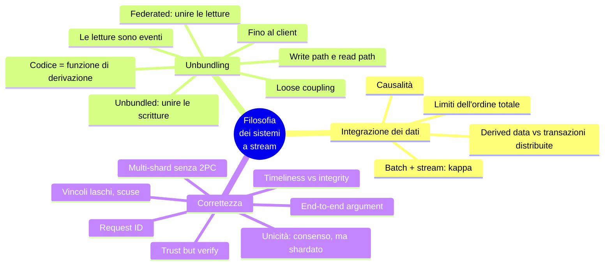
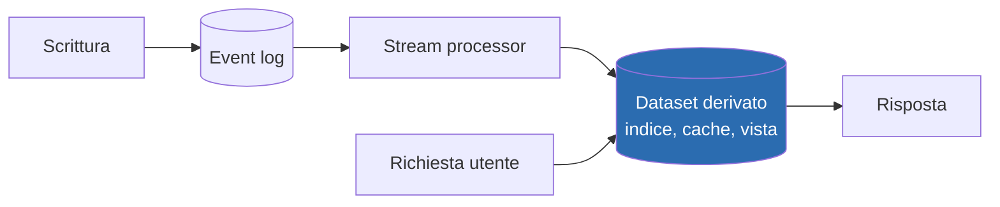
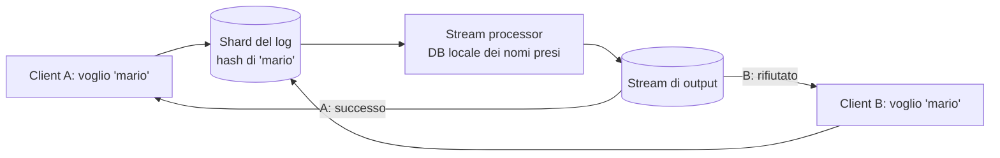

# Capitolo 13 · Una filosofia dei sistemi a stream

> *If the highest aim of a captain was to preserve his ship, he would keep it in port
> forever.* — Tommaso d'Aquino

**In una frase:** il capitolo più opinionato del libro. Nessuno strumento serve
tutti i casi d'uso, quindi ogni applicazione compone più sistemi; il modo robusto per
farlo è un **log di eventi ordinato con consumatori idempotenti**, non le transazioni
distribuite. Da lì: il database "spacchettato" (unbundled), le applicazioni progettate
attorno al flusso di dati fino al dispositivo dell'utente, e una teoria della
correttezza che separa **integrità** da **tempestività** e usa gli ID end-to-end al
posto del commit atomico.

**Pagine PDF:** 563-608 · **Densità:** media. Poche tecniche nuove, molta sintesi.
È il capitolo che dà un senso a tutto il libro: leggilo come un saggio.

---

## Mappa del capitolo

---

## 1. Integrazione dei dati

Il tema ricorrente del libro: per ogni problema più soluzioni, ognuna adatta a
circostanze diverse. Ogni software, anche un DB "general-purpose", è progettato per
un pattern d'uso, e i vendor non ti dicono dove il loro prodotto va male. Anche
capendo perfettamente la mappa strumenti-circostanze, un'applicazione complessa usa
i dati in modi diversi: finisci sempre per **combinare** più sistemi (OLTP più
full-text, più warehouse, più cache, più ML, più notifiche).

### Ragionare sui flussi

Con più copie serve chiarezza su **input e output**: dove si scrive per primo, cosa
deriva da cosa. Se l'indice si aggiorna **solo** via CDC dal system of record, è
interamente derivato e quindi coerente (a meno di bug). Se l'app scrive in entrambi,
nessuno comanda l'ordine e i due divergono per sempre. Principio: **far passare tutto
l'input da un sistema che decide un ordine totale**, poi derivare il resto nello stesso
ordine. È state machine replication; CDC o event sourcing è secondario. Aggiornare un
sistema derivato da un log si rende **deterministico e idempotente**, facile da recuperare.

### Derived data contro transazioni distribuite

Stesso obiettivo, mezzi diversi: il commit atomico contro **retry deterministico più
idempotenza**. La differenza principale: le transazioni garantiscono che dopo la
scrittura leggi subito il valore aggiornato; i sistemi derivati sono asincroni e non
lo garantiscono. XA ha pessima tolleranza ai guasti e performance; un protocollo
migliore adottato ovunque non arriverà presto. Quindi il log è la via più
promettente, **ma** "eventual consistency, fatevene una ragione" non è una risposta
senza indicazioni su come conviverci. Il capitolo cerca una via di mezzo.

### I limiti dell'ordine totale

Un log totalmente ordinato è fattibile finché il sistema è piccolo (ogni DB
single-leader lo fa). Poi: il throughput supera un nodo e il log si sharda (ordine
ambiguo fra shard); più regioni, un leader per regione (ordine indefinito fra
regioni); microservizi con stato separato (nessun ordine fra servizi); client con
stato locale e offline (client e server vedono ordini diversi). Decidere un ordine
totale è total order broadcast, cioè **consenso**, e gli algoritmi di consenso assumono
che un nodo regga tutto il flusso.

### Catturare la causalità

Senza legame causale l'ordine arbitrario va bene, e gli update dello stesso oggetto si
ordinano instradandoli allo stesso shard. Ma la causalità è subdola: un utente toglie
l'amicizia all'ex, poi scrive un messaggio cattivo agli amici rimasti. Amicizie e
messaggi stanno in posti diversi; il servizio di notifiche può processare il
messaggio **prima** del de-friend e avvisare l'ex. Le notifiche sono un join fra
messaggi e lista amici, con la dipendenza temporale dei join. Nessuna risposta
semplice; punti di partenza: **timestamp logici** (ordine senza coordinamento, ma i
destinatari devono gestire l'arrivo fuori ordine), **loggare lo stato visto** prima di
una decisione con un ID che gli eventi successivi referenziano, **algoritmi di
risoluzione dei conflitti** (buoni per lo stato, inutili per effetti esterni come una
notifica).

### Batch e stream insieme

Entrambi producono derived data. Il batch ha un sapore **funzionale**: funzioni pure
e deterministiche, input immutabile, output append-only. Lo stream aggiunge stato
gestito e tollerante ai guasti. Pensare in pipeline rende i flussi di
un'organizzazione comprensibili. Le derivazioni potrebbero essere sincrone (come gli
indici secondari di un relazionale), ma l'**asincronia** è ciò che rende robusto il
sistema: un guasto resta locale, mentre una transazione distribuita abortisce se un
partecipante fallisce e **amplifica** i guasti. Anche gli indici cross-shard sono più
affidabili se asincroni.

**Riprocessare per evolvere.** Lo stream riflette i cambiamenti con poco ritardo; il
batch riprocessa la storia per derivare **viste nuove**. Senza riprocessamento
l'evoluzione dello schema si limita a campi opzionali; con il riprocessamento puoi
ristrutturare tutto. Le ferrovie inglesi dell'800 cambiarono scartamento aggiungendo
un **terzo binario**: treni vecchi e nuovi sulla stessa linea per anni, poi via il
vecchio. Due viste derivate dagli stessi dati, utenti spostati gradualmente, ogni
passo **reversibile**: meno paura di sbagliare, più velocità.

**Unificare batch e stream.** La lambda architecture è caduta in disuso; la **kappa**
fa entrambi nello stesso sistema. Servono: replay degli eventi storici attraverso lo
stesso motore (i broker a log lo permettono), exactly-once, e finestre per **event
time** (il processing time non ha senso nel riprocessamento). Apache Beam su Flink o
Dataflow.

---

## 2. Spacchettare il database

Database, batch/stream processor e sistemi operativi fanno la stessa cosa:
conservano dati e li fanno interrogare. Unix e il relazionale sono nati negli stessi
anni con filosofie opposte: Unix una sottile astrazione dell'hardware (pipe, file
come byte), il relazionale un'astrazione alta che nasconde disco, concorrenza e crash
(SQL, transazioni). Ciascuno "più semplice" a modo suo. Il NoSQL è l'approccio Unix
applicato all'OLTP distribuito. Il capitolo prova a riconciliarli.

### Comporre tecnologie di storage

Indici secondari, viste materializzate, replication log, full-text: feature **dentro**
i DB. Nei cap. 11 e 12 le abbiamo costruite **fuori**, con batch, stream e CDC. Cosa fa
`CREATE INDEX`? Scansiona uno snapshot consistente, estrae e ordina i valori, scrive
l'indice, applica il backlog di scritture dallo snapshot, poi lo tiene aggiornato. È
identico a creare un follower (cap. 6) e a fare il bootstrap del CDC (cap. 12). Il DB
**riprocessa** il dataset e deriva una vista.

Visto così, il flusso di dati di un'intera organizzazione è **un enorme database**:
batch e stream processor sono trigger, stored procedure e manutenzione di viste
elaborati; i sistemi derivati sono tipi di indice diversi, forniti da software diversi
su macchine diverse di team diversi. Due vie per comporli:

| | Federated database (unire le letture) | Unbundled database (unire le scritture) |
|---|---|---|
| Cosa | Un'interfaccia di query unica su motori diversi: foreign data wrapper di PostgreSQL, Trino, polystore | Collegare sistemi di storage in modo affidabile via CDC ed event log |
| Tradizione | Relazionale: sistema integrato, linguaggio alto, implementazione complicata | Unix: strumenti piccoli, API bassa uniforme (le pipe), composti da un linguaggio alto (la shell) |
| Difficoltà | Mappare un modello in un altro: gestibile | Tenere sincronizzate le scritture: **il problema duro** |

### Far funzionare l'unbundling

Le transazioni distribuite fra storage eterogenei sono problematiche; dentro un
singolo sistema vanno bene (gli stream processor le usano per l'exactly-once). Quando
i dati attraversano tecnologie di **team diversi**, senza protocollo standard, un **log
ordinato con consumatori idempotenti** è un'astrazione molto più semplice e fattibile.

Il vantaggio è il **loose coupling**, a due livelli:

- **Sistema**: se un consumer è lento o cade, il log fa da buffer e producer e altri
  consumer continuano; il guasto è **contenuto**. Le transazioni distribuite, sincrone,
  trasformano guasti locali in guasti globali.
- **Umano**: componenti sviluppati e mantenuti da team diversi, ognuno che fa una cosa
  bene, con interfacce chiare. Il log è abbastanza potente (durabilità, ordine) e
  abbastanza generale per qualsiasi dato.

**Unbundled contro integrato.** L'unbundling non sostituisce i DB: servono per lo stato
degli stream processor e per servire le query. Più pezzi di infrastruttura, più curve
di apprendimento e stranezze operative: **meno parti in movimento possibile**. Un
prodotto integrato può essere più veloce e prevedibile sul suo workload. Costruire per
una scala che non serve è ottimizzazione prematura. L'obiettivo dell'unbundling è la
**larghezza**, non la profondità: combinare DB per coprire più workload di quanto
possa un solo software. Se un prodotto fa tutto ciò che ti serve, usalo. Gli strumenti
migliorano: Debezium, il protocollo Kafka come standard de facto, l'incremental view
maintenance.

### Progettare attorno al dataflow

Il **foglio di calcolo** lo fa dal 1979: cambi una cella, le formule dipendenti si
ricalcolano. È ciò che vogliamo a livello di sistema: cambia un record, indici, cache
e aggregati si aggiornano da soli. In più serve tolleranza ai guasti, scala,
durabilità e integrazione di tecnologie diverse scritte da persone diverse.

**Il codice applicativo è una funzione di derivazione.** Un indice secondario è una
derivazione standard (`CREATE INDEX`); il full-text richiede NLP e tuning; un modello
ML è derivato dai dati di training con feature engineering specifico; una cache
dipende da quali campi mostra la UI. Quando la funzione non è da catalogo serve codice
custom, e qui i DB arrancano: trigger e stored procedure sono un ripensamento.

**Separare codice e stato.** I DB sono pessimi ambienti di deployment (dipendenze,
versioning, rolling upgrade, monitoring, chiamate di rete); Kubernetes e simili lo
fanno bene. Da qui i servizi stateless con lo stato nel DB: "separazione fra Church e
stato". In questo modello il DB è una **variabile mutabile condivisa** letta e scritta
in modo sincrono via rete. Ma a una variabile non ti puoi **abbonare**: la rileggi
periodicamente. I DB hanno ereditato questa passività: per sapere se qualcosa è
cambiato, polli. Sottoscrivere i cambiamenti sta appena emergendo.

**Dataflow**: rinegoziare il rapporto fra codice e stato. Non un DB passivo
manipolato dall'app, ma codice che **risponde a cambi di stato** in un posto
provocando cambi di stato altrove. Già visto in CDC, attori, trigger, IVM.
Spacchettare significa applicarlo ai derivati **fuori** dal DB primario. I broker a
log danno le due proprietà necessarie: **ordine stabile** (più viste dallo stesso log
devono restare coerenti fra loro) e **tolleranza ai guasti** (un messaggio perso
disallinea per sempre). Pretese severe, ma molto meno care delle transazioni
distribuite. Gli operatori si compongono come strumenti Unix in pipe.

**Stream processor e servizi.** I microservizi scalano l'organizzazione con il loose
coupling, ma comunicano con richieste **sincrone**. Comporre operatori di stream ha le
stesse proprietà organizzative con messaggi **asincroni e unidirezionali**. Esempio:
un acquisto in valuta diversa.

| Microservizi | Dataflow |
|---|---|
| Il codice dell'acquisto **interroga** il servizio cambi | Il codice si **abbona** allo stream dei cambi e tiene il tasso in un DB locale |
| Una richiesta di rete sincrona, un servizio in più che può cadere | Una query locale, anche nello stesso processo. **La richiesta di rete più veloce e affidabile è quella che non fai** |
| Per evitare la rete serve una cache da tenere fresca: polling o... sottoscrizione | È uno stream join fra acquisti e aggiornamenti dei cambi |

Il join è **dipendente dal tempo**: riprocessando, serve il cambio storico. Vale in
entrambi gli approcci. Abbonarsi ai cambiamenti invece di interrogare lo stato ci
avvicina al foglio di calcolo. Domande aperte restano, ma è una direzione promettente.

### Osservare lo stato derivato

Il **write path**: tutto ciò che accade a un dato scritto, attraverso batch e stream,
finché ogni derivato lo incorpora. Fatto **in anticipo**, che qualcuno lo chieda o no.
Il **read path**: quando un utente chiede, leggi dal derivato, elabori, rispondi. Solo
a richiesta. Eager contro lazy evaluation. Il dataset derivato è **dove i due percorsi
si incontrano**: un trade-off fra lavoro in scrittura e in lettura.

Full-text: senza indice, scrittura gratis e lettura come `grep`; precalcolando ogni
query possibile, lettura gratis e scrittura impossibile (le query sono infinite); una
cache delle query comuni sta in mezzo ed è una vista materializzata. Cache, indici e
viste **spostano il confine** fra i due percorsi: più lavoro in scrittura per
risparmiare in lettura. È esattamente la timeline social del capitolo 2, con il
confine tracciato diversamente per le celebrità. "Dopo 500 pagine abbiamo chiuso il cerchio."

**Client con stato, anche offline.** I browser erano stateless; le single-page app e le
app mobile tengono molto stato locale. Lo stato sul device è una **cache dello stato
del server**; i pixel sullo schermo sono una vista materializzata degli oggetti del
modello, che sono una replica locale del datacenter. Una pagina caricata non sa dei
cambiamenti finché non ricarichi: cache stantia, polling (RSS è polling). Server-sent
events e WebSocket permettono al server di **spingere**: estendere il write path fino
all'utente. Il client usa il read path solo per lo stato iniziale, poi riceve lo
stream. Offline? Già risolto: è un consumer con un **offset** che riprende senza
perdere nulla; ogni device è un piccolo subscriber di un piccolo stream.

**Stream end-to-end.** React ed Elm aggiornano la UI quando cambia lo stato: naturale
far entrare gli eventi del server in quella pipeline. Un cambio fluisce dal device
che lo genera, attraverso log e derivati, fino alla UI di un altro device, sotto il
secondo. Messaggistica e giochi lo fanno già. Perché non tutto? Perché l'assunzione
stateless e request/response è **radicata** in DB, librerie, framework e protocolli:
pochi datastore supportano "una richiesta, uno stream di risposte nel tempo".
Servirebbe ripensare molto, verso publish/subscribe.

**Anche le letture sono eventi.** Lo store derivato è il confine fra write e read
path e permette accessi casuali senza scansionare il log. Alcuni framework espongono
lo stato interno degli stream processor alle query. Si può andare oltre: rappresentare
le **richieste di lettura come eventi** sullo stesso stream processor, che risponde
emettendo il risultato in uno stream di output. È uno **stream-table join** fra le
query e il database, con ogni lettura instradata allo shard giusto come un join
copartizionato. Una lettura one-off passa dal join e viene dimenticata; una
**sottoscrizione** è un join persistente con eventi passati e futuri. Loggare le
letture aiuta la **provenienza** e la causalità (cosa aveva visto l'utente prima di
decidere: la data di spedizione mostrata influenza l'acquisto), al prezzo di storage e
I/O. E apre al **multishard**: una query che combina più shard sfrutta routing e join
già forniti dagli stream processor (distributed RPC di Storm: chi ha visto un URL =
unione dei follower di chi l'ha postato; antifrode con reputazioni shardate per IP,
email, indirizzo). Per questi join è più semplice un DB che li supporta, ma la
strada esiste per chi tocca i limiti delle soluzioni standard.

---

## 3. Puntare alla correttezza

Un servizio stateless si corregge e si riavvia; un sistema stateful ricorda per
sempre, anche gli errori. Per quarant'anni le proprietà delle transazioni sono state
lo strumento della correttezza, ma sono più deboli di quanto sembri (la confusione dei
livelli di isolamento). Dove si sono abbandonate, la semantica è più disordinata.
"Abbracciamo la consistenza debole" senza sapere cosa significhi. Jepsen ha mostrato
divari netti fra garanzie dichiarate e comportamento reale. Serializzabilità e commit
atomico sono consolidati ma costosi: un solo datacenter, scala e tolleranza limitate.

### L'argomento end-to-end

Usare transazioni serializzabili non salva da un'app che scrive dati sbagliati o
cancella: argomento per l'immutabilità, che però non è una panacea.

**Esecuzione esattamente una volta.** Se un'elaborazione fallisce, o rinunci (perdita)
o ritenti (rischio di doppia esecuzione: doppio addebito, contatore gonfiato).
L'idempotenza è l'approccio più efficace, ma per operazioni non naturalmente
idempotenti serve cura: metadati (ID delle operazioni applicate) e fencing al failover.

**Soppressione dei duplicati.** TCP deduplica con i numeri di sequenza, ma solo
**dentro una connessione**. Un client manda `COMMIT` di un trasferimento di 11 euro e
la connessione cade prima della risposta: non sa se è committato. Riconnette e
ritenta: fuori dallo scope di TCP, e la transazione **non è idempotente**: 22 euro.
L'esempio da manuale dell'atomicità **non è corretto**, e le banche vere non lavorano
così. Il 2PC rompe il legame connessione-transazione ma non basta: fra il **browser e
il server** c'è un altro salto. Il POST parte, la rete cellulare cade prima della
risposta, l'utente vede un errore e ritenta ("vuoi reinviare il modulo?" "sì"). Per il
server è una richiesta nuova, per il DB una transazione nuova.

**Identificare univocamente le richieste.** Un UUID generato dal client come campo
nascosto del form (o un hash dei campi): due invii hanno lo stesso ID. Lo passi fino
al DB e imponi un vincolo **unique** sulla tabella `requests`: il secondo `INSERT`
fallisce e la transazione abortisce. I relazionali mantengono l'unicità correttamente
**anche a isolamento debole**, mentre un check-then-insert applicativo no (write skew).
La tabella delle richieste è anche un **event log**: gli update dei saldi potrebbero
essere derivati a valle, purché l'evento sia processato una volta, di nuovo grazie
all'ID.

**L'argomento** (Saltzer, Reed, Clark, 1984): una funzione può essere implementata
completamente e correttamente **solo con la conoscenza delle applicazioni agli
estremi**; fornirla nel sistema di comunicazione non basta, al massimo aiuta le
performance. Vale per i duplicati (TCP, transazioni, exactly-once degli stream
processor: nessuno ferma l'utente che reinvia), per i **checksum** (Ethernet, TCP e
TLS non vedono i bug del software agli estremi né la corruzione su disco) e per la
**cifratura** (la password del WiFi, poi TLS, poi solo la end-to-end copre tutto). I
meccanismi bassi restano utili perché riducono la probabilità dei problemi alti.

**Applicarlo ai sistemi dati.** Un DB con garanzie forti non esonera l'app da misure
end-to-end. È un peccato, perché la tolleranza ai guasti è difficile da fare bene: le
transazioni comprimono mille guasti in due esiti, commit o abort, ma non bastano e
costano; rifiutandole per il costo, si reimplementa la tolleranza in codice
applicativo, che di solito è sbagliato. Servono **astrazioni** che diano correttezza
end-to-end specifica dell'applicazione con buone performance a grande scala.

### Imporre i vincoli

**L'unicità richiede consenso.** Più richieste con lo stesso valore: il sistema deve
decidere quale accettare. Di solito un leader (Raft per il failover). Si scala
**shardando per il valore che deve essere unico**: tutte le richieste con lo stesso
request ID, o con lo stesso username (per hash), allo stesso shard. Multi-leader
asincrono escluso: se vuoi rifiutare subito, il coordinamento sincrono è inevitabile.

**Unicità con il log.** Lo shared log è total order broadcast, cioè consenso. Un
stream processor consuma uno shard in sequenza su un thread, quindi decide in modo
**deterministico** chi è arrivato primo:

È la costruzione del consenso da un shared log (cap. 10), e scala con gli shard. Vale
per qualsiasi vincolo: **le scritture che possono confliggere vanno allo stesso shard
e si processano in sequenza**, con logica di validazione arbitraria.

**Multi-shard senza transazione.** Un trasferimento tocca tre shard: request ID,
pagatore, beneficiario. Con il commit atomico cross-shard gli shard non sono più
indipendenti e il throughput cala. Con log shardati e stream processor:

1. Il client genera un request ID e appende la richiesta al log shardato per **conto
   sorgente**.
2. Il processor del conto sorgente tiene un DB locale (stato del conto e ID già
   processati) **derivato interamente dal log**. ID nuovo: controlla i fondi, **riserva**
   l'importo, emette eventi con lo stesso request ID: pagamento in uscita sul proprio
   log, in entrata sul log del destinatario e su quello delle commissioni.
3. L'evento in uscita torna al processor sorgente, che riconosce l'ID, esegue il
   pagamento, ignora i duplicati.
4. I processor di destinatario e commissioni applicano l'entrata, deduplicando per ID.

I tre conti potrebbero stare nello stesso shard: non importa. Requisiti: eventi di
ogni conto **in ordine di log con at-least-once**, e processor **deterministici**. Se
il processor sorgente crasha a metà, riprocessa la stessa richiesta, prende la stessa
decisione, riemette gli stessi eventi con lo stesso ID; i duplicati vengono ignorati.
L'**atomicità viene dall'append della richiesta iniziale**, un'azione atomica: una
volta nel log, tutto il resto arriverà, forse dopo recovery, forse duplicato, ma
arriverà. Con exactly-once è ancora più semplice. L'utente che vuole sapere l'esito si
abbona al log del proprio conto e aspetta l'evento in uscita o un "pagamento
rifiutato". Stessa correttezza del 2PC (ogni richiesta applicata una volta a entrambi
i conti) **senza commit atomico**.

### Tempestività e integrità

La strict serializability rende visibile subito ogni commit. Spacchettando su più
stadi asincroni questo non vale, ma un client **può aspettare** che un messaggio
compaia sullo stream di output. La correttezza del controllo fondi **non dipende**
dall'attesa: l'attesa serve solo a informare l'utente. "Consistenza" confonde due
requisiti:

| | Timeliness | Integrity |
|---|---|---|
| Cosa | L'utente vede uno stato aggiornato | Nessuna corruzione: niente dati persi, contraddittori o falsi; i derivati corretti |
| Violazione | **Temporanea**: aspetta e riprova | **Permanente**: serve controllo e riparazione esplicita |
| Esempio | Un addebito di ieri non ancora nell'estratto conto: normale | L'estratto non torna con la somma delle transazioni, o soldi addebitati e non pagati al negoziante: catastrofe |
| Strumenti | Linearizzabilità, read-after-write | Atomicità, durabilità, exactly-once |

Slogan: **le violazioni di timeliness sono ammesse dall'eventual consistency; le
violazioni di integrity sono inconsistenza perpetua**. Nella maggior parte delle
applicazioni l'integrità conta molto più della tempestività.

ACID dà entrambe insieme, quindi la distinzione sembra irrilevante. I sistemi a
dataflow le **disaccoppiano**: nessuna tempestività (a meno di consumer che aspettano),
ma l'integrità è centrale, preservata da consegna affidabile e deduplicazione. Si
ottiene con: l'operazione come **un singolo messaggio** scrivibile atomicamente; tutti
gli altri aggiornamenti derivati con funzioni **deterministiche**; un **request ID del
client** passato a tutti i livelli; messaggi **immutabili** riprocessabili.

**Vincoli interpretati in modo lasco.** L'unicità stretta richiede consenso e lo stream
non lo evita. Ma molte applicazioni **devono** poter violare vincoli apparentemente
duri: vendi più di quanto hai in magazzino e ordini altra merce con uno sconto (lo
faresti comunque se un muletto schiacciasse gli scatoloni); le compagnie aeree e gli
hotel fanno overbooking apposta; la banca addebita uno scoperto; i pagamenti fra banche
si riconciliano dopo. La correzione è una **transazione compensativa**, e il costo
della **scusa** è spesso basso: non puoi richiamare un'email ma puoi mandarne una di
correzione; un doppio addebito si rimborsa. Se la scusa è accettabile (decisione di
business), controllare tutto **prima** di scrivere è inutilmente restrittivo: scrivi
in modo ottimistico e verifica dopo, prima delle azioni costose da annullare. Queste
app richiedono integrità (non perdere prenotazioni, non far sparire soldi), non
tempestività nell'applicare il vincolo.

**Sistemi che evitano il coordinamento.** Due osservazioni: i dataflow mantengono
l'integrità senza commit atomico, linearizzabilità o coordinamento cross-shard; molte
app accettano vincoli laschi purché l'integrità regga. Insieme: sistemi che danno
servizi di gestione dati **senza coordinamento**, con forte integrità, migliore
performance e tolleranza. Per esempio multi-leader fra datacenter con replica
asincrona: ogni datacenter indipendente, tempestività debole (non linearizzabile),
integrità forte. Le transazioni serializzabili restano utili a **piccolo scopo**; XA
non serve; il coordinamento sincrono si introduce solo dove serve (vincoli stretti
prima di azioni irrecuperabili), senza farlo pagare a tutto. Coordinamento e vincoli
riducono le scuse per le inconsistenze ma aumentano quelle per le indisponibilità:
non si arriva a zero scuse, si cerca il punto giusto.

### Fidati, ma verifica

Il modello di sistema è binario (alcune cose succedono, altre mai); la realtà è
probabilistica. Memoria, disco e rete si corrompono; a scala abbastanza grande
l'improbabile accade. I bug del software sfuggono ai checksum bassi: MySQL ha sbagliato
vincoli di unicità, PostgreSQL ha mostrato write skew in serializable, e sono DB
robusti; il codice applicativo ha molti più bug e spesso non usa nemmeno i vincoli
del DB. La C di ACID presuppone transazioni senza bug.

Quindi: **auditing**, verificare l'integrità dei dati. Non solo in finanza, dove tutti
sanno che gli errori accadono. HDFS e S3 **non si fidano dei dischi**: processi in
background rileggono i file, li confrontano con le repliche, li spostano. Se vuoi
sapere che i dati ci sono ancora, **leggili**. Prova a ripristinare i backup ogni
tanto. Pochi sistemi si auto-verificano; forse in futuro di più.

**Progettare per l'auditabilità.** Una transazione che muta più oggetti non dice
perché; l'invocazione della logica è transitoria. L'event sourcing rappresenta l'input
come un evento immutabile e deriva lo stato con funzioni deterministiche e
ripetibili: stessi eventi, stesso codice, stesso stato. Il dataflow esplicito rende
chiara la **provenienza**: hash sull'event log, riesecuzione dei processor (o una
derivazione ridondante in parallelo) per confrontare i risultati, **debugging con
viaggio nel tempo** per riprodurre le circostanze esatte.

**L'argomento end-to-end, di nuovo**: se non ti fidi di ogni componente, verifica
l'integrità periodicamente, altrimenti scopri la corruzione quando ha già fatto danni
a valle. Il controllo migliore è **end-to-end sull'intera pipeline**: include
implicitamente dischi, reti, servizi e algoritmi lungo il percorso. Come i test
automatici, l'auditing continuo dà fiducia e permette di cambiare più in fretta.

**Strumenti.** Pochi sistemi dati trattano l'auditabilità come priorità; una tabella
di audit separata non garantisce la coerenza con lo stato; firmare il log con un HSM
non garantisce che ci siano andate le transazioni giuste. Le **blockchain** sono log
append-only condivisi con verifica crittografica: le transazioni sono eventi, gli smart
contract stream processor, il consenso è **bizantino** (le repliche si controllano a
vicenda). Troppo overhead per quasi tutto, ma gli strumenti crittografici servono anche
in leggero: **Merkle tree** per provare che un record è in un dataset; **certificate
transparency** usa log append-only verificabili e Merkle tree senza consenso, con un
leader per log. Potrebbero diffondersi nei sistemi dati.

---

## Domande di autoverifica

1. Perché "far passare tutto l'input da un sistema che decide l'ordine" è il
   principio, e CDC contro event sourcing un dettaglio?
2. Transazioni distribuite contro derived data: stesso obiettivo, quale differenza
   principale per chi legge?
3. Quattro situazioni in cui l'ordine totale non è fattibile.
4. L'ex e il messaggio cattivo: dov'è la causalità persa e perché i CRDT non aiutano?
5. Perché l'asincronia rende il sistema più robusto delle transazioni distribuite?
6. Il terzo binario: cosa rappresenta e perché ogni passo è reversibile?
7. Cosa fa `CREATE INDEX` e a quali due cose del libro assomiglia?
8. Federated contro unbundled: quale unifica cosa, e quale è il problema duro?
9. "Larghezza, non profondità": quando l'unbundling è la scelta sbagliata?
10. Acquisto in valuta: microservizi contro dataflow. Cosa resta uguale in entrambi?
11. Write path e read path: cosa spostano cache, indici e viste? Collega alla timeline social.
12. Perché un client offline è "già risolto" dal capitolo 12?
13. Il trasferimento di 11 euro ritentato: perché TCP e 2PC non bastano, e cosa basta?
14. Enuncia l'argomento end-to-end e dai tre esempi.
15. Ricostruisci il pagamento multi-shard senza 2PC. Da dove viene l'atomicità?
    Cosa succede se il processor sorgente crasha a metà?
16. Timeliness contro integrity: definizioni, tipo di violazione, esempio bancario.
17. Quando un vincolo "duro" può essere lasco? Cos'è il costo della scusa?
18. Perché HDFS e S3 rileggono i file in background? Cosa dice questo sul modello di sistema?

Flashcard in [`flashcards/ch13.yaml`](../data/flashcards/ch13.yaml).

## Rimandi

- System of record e derived data: cap. 1
- Timeline social, write path e read path: cap. 2
- Event sourcing: cap. 3
- Creare un follower: cap. 6
- Conflitti, sync engine, multi-leader: cap. 6
- Indici secondari shardati: cap. 7
- 2PC, XA, isolamento debole, write skew: cap. 8
- Fencing, modelli di sistema, bizantino: cap. 9
- Consenso, shared log, unicità, linearizzabilità: cap. 10
- CDC, idempotenza, offset, join dipendenti dal tempo: cap. 12
- GDPR e sorveglianza: cap. 14
