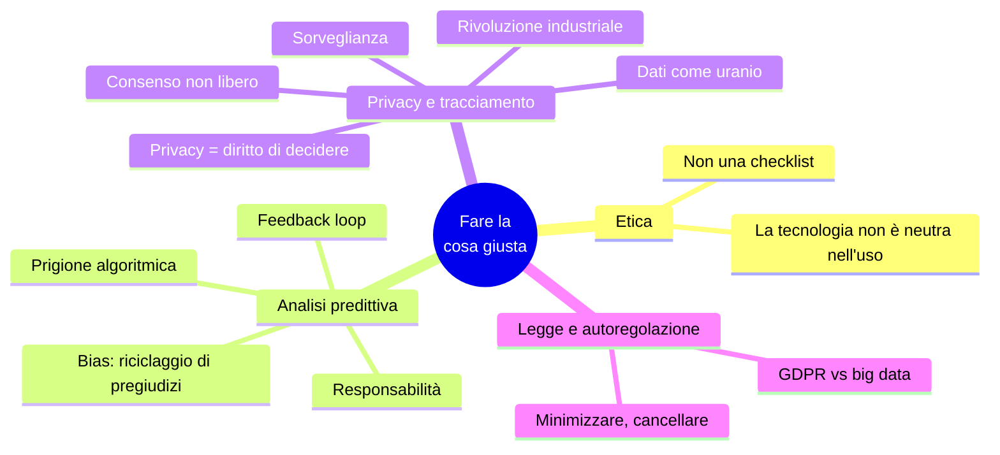

# Capitolo 14 · Fare la cosa giusta

> *Feeding AI systems on the world's beauty, ugliness, and cruelty, but expecting it
> to reflect only the beauty is a fantasy.* — Prabhu e Birhane

**In una frase:** ogni sistema è costruito per uno scopo e ha conseguenze, volute e
no. Molti dataset riguardano **persone**, e chi costruisce i sistemi ha la
responsabilità di quelle conseguenze. Il capitolo tocca due aree: le decisioni
automatiche sulle persone (bias, responsabilità, feedback loop) e la raccolta dei
dati in sé (sorveglianza, consenso, privacy come diritto di scelta, dati come
materiale pericoloso).

**Pagine PDF:** 609-626 · **Densità:** bassa. Capitolo breve e discorsivo, da
leggere per intero: è un argomento, non un catalogo. Questa scheda ne tiene la
struttura e le frasi che valgono la pena di ricordare.

---

## Mappa del capitolo

---

## 0. Il punto di partenza

L'etica nel software è importante ma poco discussa, e le linee guida (il codice ACM)
raramente applicate. Una tecnologia non è buona o cattiva in sé: conta come viene
usata e come tocca le persone, come un motore di ricerca e come un'arma. La
responsabilità è nostra. A differenza del resto dell'informatica, i concetti etici
**richiedono interpretazione**: non una checklist di conformità, ma un processo
partecipativo e iterativo di riflessione, in dialogo con le persone coinvolte, con
responsabilità per i risultati.

---

## 1. Analisi predittiva

Prevedere il tempo o un'epidemia è una cosa; prevedere se un condannato recidiverà,
se un richiedente non ripagherà un prestito, se un assicurato costerà caro è un'altra:
tocca direttamente le vite. Le organizzazioni sono prudenti per ragione economica (un
affare mancato costa poco, un cattivo prestito molto): nel dubbio, no. Ma chi viene
etichettato "rischioso" da un algoritmo, a torto o a ragione, subisce **molti** no:
lavoro, voli, assicurazione, affitto, credito. È stata chiamata **prigione
algoritmica**: esclusione sistematica senza prova di colpa e con poca possibilità di
appello, mentre la giustizia presume l'innocenza.

### Bias e discriminazione

Le decisioni algoritmiche non sono per forza migliori o peggiori di quelle umane:
tutti hanno pregiudizi, e la speranza è che i dati siano più equi. Ma con l'analisi
predittiva non automatizziamo una regola: **lasciamo inferire le regole dai dati**, e
i pattern appresi sono opachi. Se l'input ha un bias sistematico, il sistema lo impara
e lo **amplifica**. Le leggi vietano di discriminare per tratti protetti, ma altre
feature sono correlate: in quartieri segregati il codice postale, o l'IP, predice
l'etnia. Credere che un algoritmo prenda dati distorti e produca output imparziale è
ridicolo: "il machine learning è **riciclaggio di denaro per i pregiudizi**". I
sistemi predittivi estrapolano il passato; se il passato è discriminatorio, lo
codificano. Per un futuro migliore serve **immaginazione morale**, che solo gli umani
hanno. Dati e modelli sono strumenti, non padroni.

### Responsabilità

Un umano che sbaglia risponde, e chi subisce può appellarsi. Un algoritmo che sbaglia:
chi risponde? L'auto a guida autonoma che causa un incidente, il credit scoring che
discrimina per etnia o religione, la decisione ML sotto esame giudiziario che non sai
spiegare al giudice. Nessuno deve poter scaricare la responsabilità su un algoritmo.

Un credit score tradizionale si basa su fatti rilevanti della tua storia creditizia, e
gli errori si possono correggere (anche se non lo rendono facile). Il punteggio ML usa
molti più input ed è opaco. Il credit score chiede "**come ti sei comportato**"; la
predizione chiede "**chi è simile a te e come si è comportato**": uno stereotipo,
spesso basato su dove vivi, un proxy di etnia e classe. E chi finisce nel secchio
sbagliato, o è giudicato su dati errati, non ha quasi ricorso. I dati sono statistici:
la distribuzione può essere giusta e il singolo caso sbagliato, come l'aspettativa di
vita di 80 anni non dice nulla su quando morirai tu. La fede cieca nei dati è
delusoria e pericolosa. Lo stesso potere può concentrare aiuti su chi ne ha bisogno o
far trovare ai predatori le persone vulnerabili a cui vendere prestiti costosi e lauree
inutili.

### Feedback loop

Anche i sistemi "innocui" come i recommender: prevedere cosa vuoi vedere porta a
**camere d'eco** di opinioni già condivise, dove stereotipi, disinformazione e
polarizzazione prosperano, con effetti già visti sulle elezioni. Quando le predizioni
toccano le vite, i loop si **auto-rinforzano**: un datore di lavoro usa il credit score
per assumere; una disgrazia ti fa saltare pagamenti; il punteggio cala; non trovi
lavoro; la povertà peggiora il punteggio. Una spirale di assunzioni velenose
mascherate da rigore matematico. Altro esempio: i prezzi algoritmici dei distributori
tedeschi hanno **imparato a colludere** e i prezzi sono saliti. Non tutto è
prevedibile, ma molto sì con il **pensiero sistemico**: considerare l'intero sistema,
persone comprese, e chiedersi se amplifica le differenze o combatte l'ingiustizia.

---

## 2. Privacy e tracciamento

Oltre alle decisioni, c'è un problema nella **raccolta** in sé. Se il sistema conserva
solo ciò che l'utente inserisce apposta, fa un servizio all'utente: l'utente è il
cliente. Se traccia l'attività come effetto collaterale, il servizio acquisisce
interessi propri che possono confliggere con quelli dell'utente. Un po' di
tracciamento serve a feature utili (ranking, raccomandazioni, A/B test). Ma se il
servizio vive di pubblicità, **i clienti sono gli inserzionisti** e l'utente viene
dopo: profili dettagliati, conservati a lungo, per il marketing. L'utente riceve un
servizio gratis ed è indotto a usarlo il più possibile. La parola giusta è
**sorveglianza**.

### Sorveglianza

Esperimento: sostituisci "dati" con "sorveglianza". "Nella nostra organizzazione
guidata dalla sorveglianza raccogliamo stream di sorveglianza in tempo reale nel
nostro warehouse di sorveglianza; i nostri scienziati della sorveglianza..." Il libro
si chiama, in questo capitolo, *Designing Surveillance-Intensive Applications*. Nel
far "mangiare il mondo" al software abbiamo costruito la più grande infrastruttura di
sorveglianza di massa mai vista: un microfono connesso in ogni spazio abitato
(telefoni, TV, assistenti vocali, baby monitor, giocattoli), spesso con sicurezza
pessima. Posizione, relazioni, acquisti, salute: un'organizzazione può sapere di te
più di quanto tu sappia, individuando malattie o problemi economici prima di te. I
regimi totalitari del passato potevano solo sognare un microfono in ogni stanza e un
dispositivo di tracciamento in ogni tasca; noi lo **accettiamo volontariamente** perché
i benefici sono grandi, e la differenza è che raccolgono le aziende per darci servizi,
non i governi per controllarci.

Perché accettiamo? Forse "non ho nulla da nascondere": cioè sei allineato al potere,
non sei una minoranza, non temi persecuzioni. Non tutti sono così fortunati. O perché
lo scopo sembra benigno: solo raccomandazioni migliori. Ma unito all'analisi
predittiva la distinzione sfuma: dati di guida raccolti dalle auto senza consenso che
alzano i premi, coperture sanitarie legate a un fitness tracker, il sensore di uno
smartwatch che ricostruisce **cosa digiti** (le password).

### Consenso e libertà di scelta

"Gli utenti scelgono volontariamente, accettano i termini, ricevono un servizio in
cambio." Tre problemi. Primo: **perché** il tracciamento è necessario? Il
click-through migliora il ranking, ma i profili pubblicitari servono all'utente o solo
perché la pubblicità paga? Secondo: quasi nessuno sa quali dati fornisce e come
vengono trattati, le privacy policy oscurano più che illuminare, e senza capire non c'è
**consenso significativo**; i dati di un utente parlano anche di **altri** che non hanno
accettato nulla; i dataset derivati che combinano tutto sono esattamente ciò che
nessuno può capire. Terzo: l'estrazione è **unidirezionale**, senza reciprocità né
negoziazione: i termini li fissa il servizio.

Il GDPR chiede consenso "libero, specifico, informato e inequivocabile", revocabile
"senza pregiudizio", in linguaggio chiaro; caselle pre-spuntate e silenzio non
valgono. Esistono altre basi legali (obblighi di legge, interesse legittimo come
l'antifrode), ma il consenso è la più usata. "Chi non vuole, non usi il servizio": non
è una scelta libera se il servizio è "considerato essenziale per la partecipazione
sociale" (smartphone, social, Google), specie con gli effetti di rete. E le
piattaforme sono progettate per catturare, con meccaniche da gioco d'azzardo.
Rinunciare è possibile solo per pochi privilegiati con tempo, conoscenza e nessun
costo sociale o professionale. Per gli altri la sorveglianza è **ineludibile**.

### Privacy e uso dei dati

"La privacy è morta, la gente posta tutto": falso, fraintende la parola. Privacy non è
tenere tutto segreto: è la **libertà di scegliere** cosa rivelare a chi, cosa rendere
pubblico e cosa no. Un **diritto di decisione**, parte dell'autonomia. Chi ha una
malattia rara darebbe volentieri i dati ai ricercatori, ma deve poter scegliere chi vi
accede e perché, perché potrebbero costargli assicurazione o lavoro.

Con la sorveglianza il diritto non si erode: **si trasferisce** all'azienda. "Fidati
di noi": il diritto di decidere cosa rivelare passa dall'individuo alla società, che
poi tiene segreto ciò che sa (sarebbe inquietante e danneggerebbe il business) e lo
rivela solo indirettamente, come strumenti per targettizzare gruppi (chi ha una certa
malattia). Anche senza reidentificazione, l'utente ha perso l'**agency** sulla
divulgazione: decide l'azienda per il profitto. Le aziende gestiscono la percezione
più che l'intrusività reale; e un dato fattualmente corretto può essere indesiderato o
doloroso: serve umiltà e meccanismi per questi fallimenti. Le impostazioni privacy
regolano cosa vedono gli altri utenti, non il servizio, che si concede diritti
illimitati di analisi interna. Un trasferimento di diritti di privacy **senza
precedenti storici**: la sorveglianza esisteva ma era costosa e manuale; i rapporti di
fiducia (medico, avvocato) erano governati da vincoli etici e legali stretti.

### Dati come bene e come potere

"Data exhaust" suggerisce rifiuto riciclato. È il contrario: se la pubblicità paga il
servizio, l'attività dell'utente è una forma di **lavoro**, e l'app è l'esca per far
entrare sempre più informazioni nell'infrastruttura di sorveglianza. I dati personali
sono un asset: data broker segreti che comprano e rivendono, startup valutate in
"eyeballs" cioè in capacità di sorveglianza. E perché valgono, tutti li vogliono:
aziende, governi (accordi segreti, coercizione, obbligo legale, furto), il fallimento
che li vende, le violazioni frequenti. Non un asset ma un **asset tossico**, materiale
pericoloso: non il nuovo oro o petrolio ma il **nuovo uranio**. Raccogliendo, bilancia
i benefici con il rischio che finiscano in mani sbagliate: criminali, intelligence
ostili, insider, un management senza scrupoli, un regime futuro. Non solo il governo
di oggi, **tutti i governi futuri**. Schneier: "è cattiva igiene civica installare
tecnologie che un giorno potrebbero facilitare uno stato di polizia". Scrutare gli
altri evitando di essere scrutati è una delle forme più importanti di potere; le
aziende non cercano potere politico, ma ciò che hanno accumulato, in gran parte di
nascosto, dà loro molto potere sulle nostre vite.

### Ricordare la rivoluzione industriale

La rivoluzione industriale portò crescita e benessere, e anche aria e acqua
avvelenate, operai in tuguri, bambini nelle miniere. Le tutele (ambiente, sicurezza,
lavoro minorile, ispezioni alimentari) arrivarono tardi e alzarono il costo di fare
impresa, ma la società ne beneficiò enormemente e nessuno vorrebbe tornare indietro.
L'era dell'informazione ha il suo lato oscuro, e la raccolta dei dati è uno dei
problemi. Schneier: "I dati sono il problema dell'**inquinamento** dell'era
dell'informazione, e proteggere la privacy è la sfida ambientale. I nostri nipoti ci
giudicheranno su come abbiamo affrontato la raccolta e l'abuso dei dati." Cerchiamo
di renderli orgogliosi.

---

## 3. Legge e autoregolazione

Il GDPR impone che i dati siano raccolti "per scopi specifici, espliciti e legittimi"
e siano "adeguati, pertinenti e limitati al necessario". La **minimizzazione** è
l'opposto della filosofia big data: raccogliere il massimo, combinare, esplorare per
scopi imprevisti, cioè esattamente ciò che il GDPR vieta. Qualche effetto sulla
pubblicità, applicazione debole, poca cultura cambiata. Le aziende si oppongono alla
regolazione come freno all'innovazione, e in parte hanno ragione: condividere dati
medici è rischioso ma potrebbe salvare vite; bilanciare è difficile.

Serve un **cambio culturale**: gli utenti non sono metriche da ottimizzare ma umani con
dignità e agency. Autoregolarsi per meritare fiducia, educare gli utenti invece di
tenerli al buio, lasciare a ciascuno il controllo dei propri dati senza rubarlo con la
sorveglianza. Il diritto ai propri dati è come l'ambiente di un parco nazionale: senza
protezione esplicita viene distrutto, tragedia dei beni comuni. La sorveglianza
ubiqua **non è inevitabile**. Primo passo: **non conservare per sempre**, cancellare
appena non serve, raccogliere il minimo. I dati che non hai non possono essere
rubati, trafugati né richiesti da un governo. "Se non consideriamo l'impatto sociale
del nostro lavoro, non stiamo facendo il nostro lavoro."

---

## Domande di autoverifica

1. Perché l'etica non è una checklist, e cosa la distingue dal resto dell'informatica?
2. Cos'è la prigione algoritmica e in cosa differisce dalla giustizia penale?
3. "Machine learning è riciclaggio per i pregiudizi": spiega con l'esempio del codice postale.
4. Credit score contro analisi predittiva: quale domanda fa ciascuno?
5. Descrivi un feedback loop che si auto-rinforza e cos'è il pensiero sistemico.
6. Quando l'utente è il cliente e quando non lo è? Cosa cambia il modello pubblicitario?
7. Tre ragioni per cui il consenso ai termini di servizio non è significativo.
8. Perché "non usare il servizio" non è una scelta libera?
9. Definisci la privacy come diritto di decisione. Dove va quel diritto con la sorveglianza?
10. Perché i dati sono "il nuovo uranio"? Quale orizzonte temporale va considerato?
11. Minimizzazione del GDPR contro filosofia big data: in cosa sono opposte?
12. Qual è il primo passo pratico che il capitolo propone a chi costruisce sistemi?

Flashcard in [`flashcards/ch14.yaml`](../data/flashcards/ch14.yaml).

## Rimandi

- Legge e società, data minimization, costi di conservare dati: cap. 1
- Scandalo Horizon e affidabilità: cap. 2
- Event sourcing e GDPR: cap. 3
- Cancellazione negli LSM: cap. 4
- Sharding per tenant e GDPR: cap. 7
- Limiti dell'immutabilità, crypto-shredding: cap. 12
- Auditabilità: cap. 13
